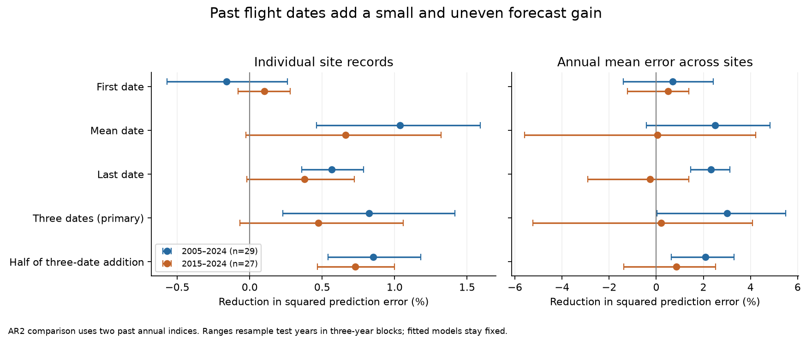
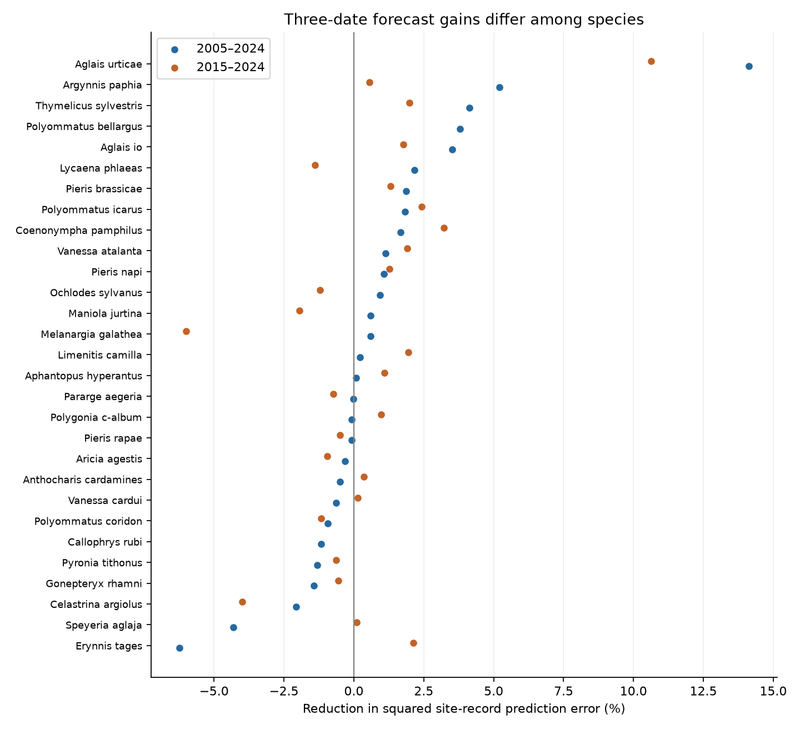
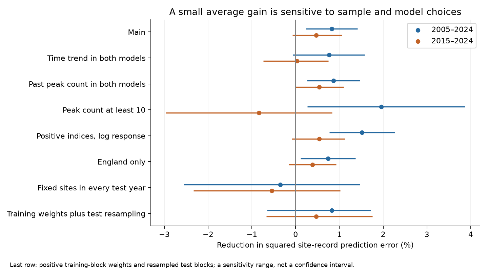

# Past flight dates gave small and uncertain gains in British butterfly index forecasts in 2005-2024

## Main result

Past flight dates gave a small gain in next-year butterfly index forecasts. A model with first, mean and last flight dates reduced mean squared error by **0.83%** in 2005-2024. The comparison model used the same sites and two past annual indices. It had no date term. Each of 29 species had equal weight. The conditional 95% range was **0.23% to 1.42%**. This range resamples test years. It holds all fitted models fixed.

The later test gave a smaller and uncertain gain. Models fitted in 1995-2014 reduced error by **0.47%** in 2015-2024 for 27 species. The range was **-0.07% to 1.06%**. The two test periods overlap. They are not independent replications. When training weights also vary, the full-model sensitivity ranges cross zero in both tests. Restricting the test to complete site series gives slightly negative point gains. Thus the positive fixed-fit result does not establish a robust general forecast gain.

These results add a limit to the timing-versus-abundance finding. Past timing can carry some information about later abundance. The tested gain is small, differs among species, and depends on the model and sample. It does not establish a common benefit from early emergence. It does not show that climate forecasts can predict population trends.



## Question and contribution

Two cited SCI studies found that early temperature models predicted later spring dates better than population growth. Later campaign studies tested forecast mean and slope corrections. We asked a different question: **Does measured timing in one year add information about the next year's population index, beyond two years of population history?** Timing can integrate development, food and local conditions that a monthly weather mean misses. This is a test of that possible information link.

Macgregor et al. (2019, doi:10.1038/s41467-019-12479-w) found links between early first-generation emergence and higher abundance in species with several generations. Wepprich et al. (2025, doi:10.1111/ele.70018) found benefits from larger late generations in US butterflies. SCI 6a2ba4ee reported a positive next-year association after late British flights. SCI 42584527 did not find a clear repeated mean-date link for Meadow Brown. These studies motivate the question. Our public annual date measures do not separate broods. Our test does not reproduce their brood-specific models.

We add a matched forecast test across species, with a strict time order, two abundance lags, several date measures, and checks for fit uncertainty and changing sites. All forecast inputs precede the target year. We do not use observed target-year weather. We searched and read published campaign results before choosing the question. The source records overlap with prior UKBMS studies. This is new analysis of the same monitoring system, not independent field evidence. The saved plan preceded forecast results. It was not registered with an external registry. The plan was written after earlier campaign results were known. The ranges do not adjust for question selection across the wider campaign. It states the checks added after the first results.

## Data and sample

We used the UK Butterfly Monitoring Scheme (UKBMS) phenology 2024 and site indices 2024 releases. Botham and colleagues published these datasets in 2025. Files were already in the shared store. We downloaded no new raw data. Exact input paths, source URLs, source versions, ZIP hashes and CSV member hashes are in `files/results/provenance.json`.

The phenology guide defines the mean date as a count-weighted date across the survey season. First and last dates depend on visits and abundance. The standard survey season is April to September. These are whole-season measures. They can mix generations. The site index is a relative abundance measure. Missing visits can be filled by a fitted seasonal count curve. A negative value, including -2, is invalid. Zero is valid.

We kept England, Wales and Scotland. We joined each target year t to indices at t-1 and t-2, and to first, mean and last dates and peak count at t-1. We kept zero indices and used log(1 + index). A site needed at least eight complete training triples. A species needed at least 200 training rows, 200 test rows, 15 training sites and eight test years. No effect estimate entered these rules. All nested models score the same rows.

| Training target years | Test target years | Species | Training triples | Test triples | Unique training sites | Unique test sites |
| --- | --- | ---: | ---: | ---: | ---: | ---: |
| 1978-2004 | 2005-2024 | 29 | 46,912 | 25,510 | 228 | 193 |
| 1995-2014 | 2015-2024 | 27 | 58,702 | 20,544 | 387 | 317 |

The site counts above count each location once. `sample.csv` also reports sites per species. Their sum is larger. Species-sites can share a location. Training target zeros numbered 1,972 and 1,459; test target zeros numbered 726 and 510. The samples favor persistent populations and sites. They exclude newly opened sites and many rare species. The Wall did not pass the sample rules.

Input checks found 46 exact duplicate index rows and 100 rows with conflicting keys after those duplicates were removed. We removed all conflicting rows. Phenology had 98 exact duplicates and no remaining conflicting keys. The plan records this input-audit change, which preceded forecast results. We did not average conflicting values or choose one value. Joined external records remain in scratch, outside this publication.

## Models and score

We fit each species separately by ordinary least squares with a separate intercept for each site. We removed training site means before fitting slopes. The baseline is:

`log(1 + index[t]) = site intercept + b1 log(1 + index[t-1]) + b2 log(1 + index[t-2]) + error`.

We call this model AR2. The main model adds first, mean and last flight dates at t-1. Each coefficient and site intercept is fitted only in the stated training period. They stay fixed in test years. The lagged annual indices and dates are observed test inputs. A prediction for t does not use any observation from t in its features. These are retrospective forecasts made with a final data release. They were not issued in real time. Index revision and release delays can limit operational use.

Planned comparisons add one date at a time. Other checks use one abundance lag, a shared linear time trend, past peak count, half of the full model's addition to the baseline, a peak count of at least ten, positive indices with a log response, and England only. No test outcome selects a date or coefficient. Date coefficients in the three-date model can be correlated. Their signs are not a causal early-versus-late contrast.

For each species j, site score is `1 - SSE(full,j) / SSE(baseline,j)`. SSE is the sum of squared log-index errors across all held-out site-year rows. We average these scores with equal species weight. Thus the result is a percentage reduction in squared prediction error. It is not a percent change in butterfly abundance. The same forecast errors result if we subtract the observed lagged log index from both predictions and outcomes to express growth. Code verifies this identity.

A second score first averages forecast errors over sites in each year. It then scores those annual means. It tests an aggregate error for the selected changing site sample. It is not an official national population index. The two scales must not be compared as equal measures of field abundance error.

We resample circular three-year test blocks 10,000 times. The same calendar blocks apply to all species. Fixed full-test baseline error scales retain equal species weight at the point estimate. Conditional ranges fix those scales and fitted models. Block lengths one and five are checks. These ranges describe test-year variation under this procedure. Short, dependent records limit coverage. They exclude source error and training fit uncertainty. There is one primary three-date contrast per split. All metric, group and sensitivity results are descriptive. We do not use each positive range as a separate confirmed discovery.

## Results and limits of the gain

| Added past timing | 2005-2024 site error reduction | 2015-2024 site error reduction |
| --- | ---: | ---: |
| First date | -0.16% (-0.57 to 0.26) | 0.10% (-0.08 to 0.28) |
| Mean date | 1.04% (0.46 to 1.59) | 0.66% (-0.03 to 1.32) |
| Last date | 0.57% (0.36 to 0.78) | 0.38% (-0.02 to 0.72) |
| Three dates, primary | 0.83% (0.23 to 1.42) | 0.47% (-0.07 to 1.06) |
| Half of the three-date addition | 0.85% (0.54 to 1.18) | 0.73% (0.47 to 1.00) |

All parentheses in this table are conditional 95% three-year block ranges. Half-strength was a planned check. Its positive recent range does not validate a universal correction rule. Mean date alone gave the largest earlier point gain. We do not select it as a new primary result after the test.

The primary addition improved 16 of 29 species and 16 of 27 species. The earlier score ranged from -6.24% for Dingy Skipper to +14.13% for Small Tortoiseshell. Later scores ranged from -6.00% for Marbled White to +10.64% for Small Tortoiseshell. Removing one species at a time left the earlier mean at 0.35% to 1.08%, and the later mean at 0.08% to 0.72%. These are point-score checks. They do not establish a positive effect for each species.

The earlier gain was 1.15% in 2005-2014 and 0.50% in 2015-2024, using the original fits. With new 1995-2014 fits, the 2015-2024 gain was 0.47%. Thus a more recent fit did not create a large gain. A time trend in both models gave gains of 0.76% (-0.06 to 1.58) and 0.03% (-0.74 to 0.75). Peak count in both models gave 0.87% (0.27 to 1.47) and 0.54% (0.00 to 1.10). Shared abundance information from peak count therefore does not fully remove the point gain, but it does not remove all detection bias.

The annual-mean error score was 3.00% (0.02 to 5.49) in the earlier test and 0.21% (-5.23 to 4.09) in the later test. The later aggregate test gives no clear added value. This distinction matters for the earlier national-scale timing-versus-growth claim.

Nine of the ten fixed non-adult-hibernating multivoltine species passed the main sample rules. Their gains were 0.68% (-0.68 to 2.03) and 0.07% (-0.73 to 1.00). The remaining species are a mixed group, not a univoltine control group. These results do not establish a special forecast advantage in multivoltine species. The high-count sample gave 1.96% in the earlier test and -0.84% in the later test. Its species and sites differ. It cannot be read as an isolated measurement-noise effect.



## Training and site coverage checks

The additional fit check used 2,000 draws. Each draw gave positive exponential weights to calendar blocks of up to three training years. The block origin was random. All species shared those weights. Both models were refitted, and common circular three-year test blocks were then resampled. All sites retained positive training weight. Original species error scales stayed fixed. These distributions are sensitivity ranges, not calibrated confidence intervals. They cover variation in training weights and test years. They do not cover source measurement error or all choices of fitting period.

For the full three-date model, the central 95% ranges were **-0.65% to 1.72%** for the earlier test and **-0.67% to 1.75%** for the later test. Thus a claim of a general positive full-model gain depends on holding the original fit fixed. The half-strength check retained positive ranges: **0.20% to 1.56%** and **0.18% to 1.61%**. This supports a small possible signal after reduction of the added forecast amplitude. It does not select or validate a correction for other systems.

We also kept only species-sites with a complete forecast triple in every test year, and scored the original frozen models. The earlier check retained 26 species and 3,200 rows in 160 species-site series. It kept only 12.5% of primary test rows. The later check retained all 27 species and 6,730 rows in 673 series, or 32.8% of test rows. Site-record gains were **-0.35% (-2.56 to 1.47)** and **-0.54% (-2.33 to 1.02)**. These are conditional test-block ranges. The retained data do not give a clear positive gain.

The complete-site rule uses held-out availability. It favors persistent populations and regular species detections. It does not isolate a causal effect of site turnover or effort. The check also changes site weights and can reduce precision. It shows a limit of the initial gain, not proof that changing sites caused that gain. `balanced_species_match.csv` gives the original full-site score in the species that have at least one balanced series.




An exact loss decomposition helps explain the small gain. Let delta be the full model's addition to the baseline and e be the baseline error. Then the error reduction is `2 mean(e*delta) - mean(delta^2)`. On the earlier site's normalized loss scale, the cross term was 2.59 percentage points and the penalty was 1.76 points. Later they were 2.44 and 1.96 points. A positive cross term can coexist with a small net gain. Test-based optimal amplitudes were 0.73 and 0.62. These are diagnostics fitted to held-out outcomes, not validated forecast rules. The addition also changes the fitted abundance slopes; it is not a pure date effect.

## Interpretation and remaining uncertainty

The study supports a narrow information link between past timing and later indices at some old sites. It weakens a blanket statement that timing contains no information useful for abundance prediction. It does not contradict the earlier finding that the tested monthly climate models gave no abundance gain. We use measured past biology, a different information set, a selected smaller site sample and a different population-history baseline.

Timing may mark development conditions, brood mix, persistent habitat quality or measurement error. This design does not separate those causes. Earlier first-generation emergence differs from whole-season first, mean or last record dates. We therefore do not infer that earlier emergence helps or harms populations. We do not estimate climate effects, pollution effects or a mediation fraction. The small gain could partly reflect shared survey errors across years. Site intercepts do not control changing habitat, observer behavior or visits. A trend check limits part of the result. No detection model is fitted.

The biological result is modest. The useful method is a reproducible test of whether a measured biological response carries information into later demographic forecasts, with identical scored rows and strong history baselines. A useful next test would separate broods and use independent effort and abundance estimates. These data do not establish that this would produce a larger gain.

## Numerical checks and reproduction

Explicit site-dummy regressions reproduced the main predictions for Meadow Brown and Green-veined White at both splits. Maximum differences were below 3e-12. Every nested model reduced training error as required. Key, date-order and error-identity checks passed. Full check details are in `files/results/checks.json`. `files/results/annual_losses.csv` preserves model/year/species error sums and row counts, not site observations. Coefficients, all sample rules and all sensitivity results are bundled. No source records or private keys are bundled.

Use Python 3.12 with numpy, pandas, pyarrow and matplotlib. Exact versions are in `files/results/environment.json`. From an extracted publication, run:

```bash
python files/code/retrieve.py /absolute/path/to/external_datasets
bash files/code/run.sh /absolute/path/to/external_datasets /absolute/path/to/scratch /absolute/path/to/reproduced
```

On the campaign host, replace the external dataset root with `/mnt/dell-data/shared_datasets`. Read the two named inputs in place. Do not alter shared files. The retrieval step is unnecessary there. Scratch must be outside the signed publication. It contains external records. Outputs are authored statistics and figures. Do not write reproduction outputs into the signed original. The default robustness run uses 2,000 refits and can take several minutes. Seeds are fixed. Compare the resulting tables with `files/results/`; small floating-point changes can occur across software versions. Provider ZIP wrappers include request metadata and can change. The retrieval script checks the exact CSV members and refuses a changed snapshot.

The baseline LICENSE covers our authored files. External source rights and required attribution are in `files/EXTERNAL_DATA_NOTICE.txt`. The source tables and joined derivative database remain external. All included annual tables are statistical forecast-error summaries, not an annual butterfly abundance or date extract.

## Provenance and references

Campaign: 11_07_2026. Job: `sci-1107-hp-climate-pollution-biodiversity-de5a5ad69792`. Topic: climate-pollution-biodiversity. Machine: hp. Account: codex-myxtap. Model: gpt-6.1-sol, high reasoning effort, through the Codex harness in T3 Code. Date: 2026-11-10. One finite worker; no child agents. The signing identity is the campaign-machine key. It is not a personal authorship claim.

Full dataset citations and licence URLs are in the external data notice. Signed SCI citation targets are in `sci.json`. The main prior works are SCI 578f803b and 10c822d2 (timing and growth forecasts), SCI 717e1ad9 and d02aab6c (forecast correction), SCI 6a2ba4ee (late flights), and SCI 42584527 (Meadow Brown). Peer-reviewed context is Macgregor et al. (2019), doi:10.1038/s41467-019-12479-w; Wepprich et al. (2025), doi:10.1111/ele.70018; and Dennis et al. (2016), doi:10.1111/biom.12506, for seasonal abundance indices.
