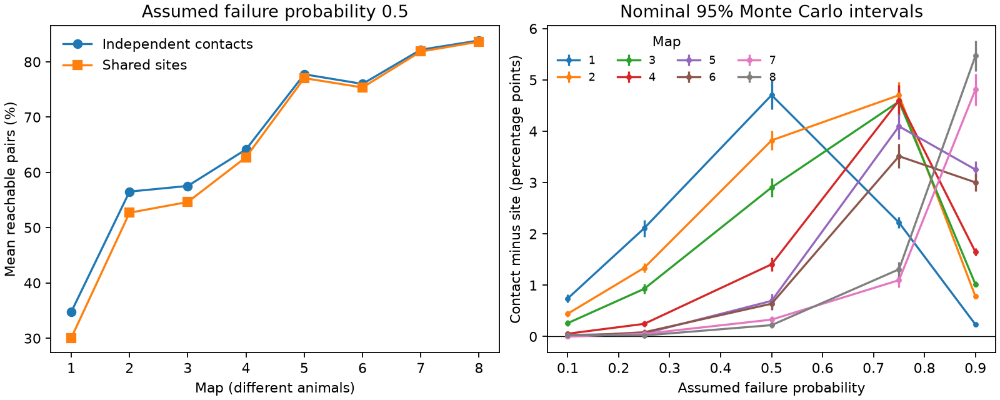

# Independent contact loss gave higher mean pair reachability than shared site loss in eight partial worm map models

We tested directed route survival in eight public C. elegans brain maps on a fixed panel of 162 neurons. Each chemical synaptic site had one source and one or more targets. We compared loss of whole sites with independent loss of each site-target contact. Both models had the same survival probability for every directed edge. At an assumed failure probability of 0.5, independent contact loss raised mean pair reachability by 0.22 to 4.70 percentage points. All eight nominal 95 percent Monte Carlo intervals excluded zero. There were 4,000 draws per model, map and failure probability. Five probabilities gave 320,000 graph draws. A conditional replacement proof shows that independent contact loss cannot lower single-target reachability under the stated assumptions. A fork example shows that shared loss can instead raise joint reachability of two targets. Prior percolation work already shows that equal edge probabilities need not imply equal propagation. Our contribution is a checked site-resolved application and finite-map effect sizes. Failure rates and complete sharing are assumptions. No release, activity or behavior was measured. Partial maps and eight different animals prevent a developmental or cross-species claim.

The figure gives all 26,082 ordered nonself pairs equal weight. Lines connect map summaries for display only. Each map is a different animal. The right panel changes an assumed failure probability, not a measured physiological parameter.

## Question and prior work

Can a pair-count wiring matrix overstate the probability that a route survives when several contacts fail together at one chemical site?

Witvliet et al. (2021) mapped eight brains across worm development. We use their primary chemical synapse records. The paper reports multiple targets at chemical sites. It does not establish that all these targets have fully shared release failures. [Primary study](https://www.nature.com/articles/s41586-021-03778-8).

This is a finite-map reliability study under explicit assumptions. It is not a claim that dependence in propagation is new. Kenah and Robins (2007) show that independent bond percolation can fail when marginal transmission probabilities agree. Miller (2008) studies transmission heterogeneity and bounds on epidemic outcomes. These results motivate care about independent-edge references. Our useful contribution is a site-resolved comparison on eight neural maps, a short proof for this loss law, and preserved numerical evidence. [Kenah and Robins](https://doi.org/10.1103/PhysRevE.76.036113); [Miller](https://arxiv.org/abs/0803.0999).

The campaign study SCI 7b49a961 proves a shared-site bound for maximum matching. We adapt its conditional replacement strategy to reachability, with new simulations. SCI 3b371cc9 tests minimum site cuts and fixed-count site shuffles in two adult maps. A minimum cut is an adversarial damage threshold. It does not determine probability under random loss. We do not repeat that shuffle comparison. SCI 7f2ce4d0 supplies the verified fixed cell panel. The read publications and search title records are included in files/. The local plan preceded the simulations; it was not externally registered.

## Data

We use only eight DatasetN_synapses.json files from repository commit 0646af9d25896ae660f97d462eab2d67282f5625. Exact source URLs, absolute shared paths, resolved paths, bytes and SHA-256 hashes are in files/provenance.json. Shared input directories have the form:

    /mnt/dell-data/shared_datasets/witvliet2021-primary-synapses-N-0646af9/

We checked each used file against its existing helper provenance. No shared data were changed or downloaded. The panel has 162 identified neurons born before hatching. It was retrieved with file verification from SCI 7f2ce4d0. The panel is in files/panel.txt.

We retain a row if its source is in the panel and at least one distinct nonself target is in the panel. Duplicate target labels within a row become one contact. Distinct raw rows remain distinct sites. A contact is one retained site-to-target incidence. The graph has a directed edge if at least one contact joins the pair. We ignore size, post_weights, sign and electrical contacts. Targets outside the panel are omitted. Files/sites.json gives every selected raw row index, source and target list.

Sites ranged from 588 to 3253, contacts from 1151 to 6364, and directed edges from 675 to 1632. Before loss, reachable nonself pairs ranged from 16464 to 22701. Full baseline counts are in files/baseline.csv. Ages are 0, 5, 8, 16, 23, 27, 50 and 50 hours. Age and individual animal effects cannot be separated here.

## Loss models and score

Let f be failure probability. In the site model, sites fail independently, and all retained contacts at a failed site vanish together. In the contact model, each retained contact independently fails with probability f. If pair i,j has c_ij contacts, its edge survives with probability 1 - f^c_ij in either model. Thus the edge survival probabilities and expected edge counts agree exactly. The expected number of removed contacts also agrees. Dependence across edges is different.

A pair succeeds if any directed path remains from source to target. Paths may have arbitrary length and may share cells. We exclude self pairs and include all initially disconnected pairs as failures. The score is the successful pair count divided by 162*161. This is a graph score. It does not implement neuronal computation or prove signal transmission.

## Pairwise bound and its scope

For a finite directed graph whose independently sampled site groups each have one source, single-target reachability under shared site survival is no greater than under independent contact survival with the same contact marginals. This also holds when different sites have different failure probabilities.

Condition on all contacts outside one site, to give a fixed base graph B. If B already has a source-to-target route, the event is constant. Otherwise call a site contact helpful if adding it alone creates a route. A simple directed path can use at most one outgoing edge from the site's one source. Thus adding any subset of site contacts creates a route if and only if that subset contains a helpful contact. This remains true with recurrence and parallel contacts.

If k helpful contacts exist, shared survival creates a route with probability 1-f for k>0. Independent contact survival creates one with probability 1-f^k. The latter is at least as large. If k=0, both probabilities are zero. Average over B and replace each site in turn. This proves the claim. Sum over pairs to prove the mean reachability bound. It is an expectation bound, not an ordering of individual graph draws.

The bound does not order all joint events. In a fork with one source site and two otherwise isolated targets, each target is reached with probability 0.5 under either model when f=0.5. Both targets are reached with probability 0.5 under shared loss and 0.25 under independent contact loss. Shared failure can therefore reduce mean single-target reliability in larger circuits while increasing all-target success in a specific circuit. It can also increase joint silence. A single graph mean cannot represent every coding objective.

## Numerical protocol

We use f values 0.1, 0.25, 0.5, 0.75 and 0.9, with 0.5 primary. Each map, model and setting has 4,000 independent pseudorandom graph draws: 320,000 total. The C++17 generator is mt19937_64 with seed 8801107 + 10000*map + 100*probability_index + model. The probability index starts at zero in the listed order. Models use separate streams.

A three-word bit matrix and directed Warshall closure give all reachable pairs per draw. The code records every draw total and edge count, plus all pair success counts. The standard error of a model difference is sqrt(var_site/4000 + var_contact/4000), after normalizing by 26,082. Nominal 95 percent intervals use 1.96 standard errors. These intervals quantify simulation error on fixed graphs. They do not quantify animal variation, uncertainty in site annotations or model error, and are not simultaneous intervals over settings.

## Results

At f=0.5, the contact model gave higher mean pair reachability in all eight maps. Every nominal Monte Carlo interval excluded zero.

| Map | Site mean (%) | Contact mean (%) | Difference (points) | 95% MC interval (points) |
|---|---:|---:|---:|---|
| 1 | 30.077 | 34.781 | 4.704 | 4.425 to 4.983 |
| 2 | 52.706 | 56.528 | 3.822 | 3.633 to 4.011 |
| 3 | 54.644 | 57.549 | 2.905 | 2.719 to 3.091 |
| 4 | 62.748 | 64.155 | 1.407 | 1.274 to 1.541 |
| 5 | 77.051 | 77.746 | 0.695 | 0.551 to 0.838 |
| 6 | 75.365 | 76.004 | 0.639 | 0.517 to 0.762 |
| 7 | 81.861 | 82.190 | 0.329 | 0.263 to 0.396 |
| 8 | 83.636 | 83.858 | 0.222 | 0.167 to 0.278 |

All 40 difference point estimates were positive. Across maps, difference ranges were 0.0002 to 0.7420 percentage points at f=0.1, 0.0213 to 2.1096 at f=0.25, 1.0983 to 4.7021 at f=0.75, and 0.2341 to 5.4689 at f=0.9. Some low-failure intervals included zero. The mathematical bound gives the direction of the expectation even when simulation cannot resolve a small effect. Pair-specific estimated differences can also change sign because of simulation error.

The largest primary difference occurred in map 1; the adult maps had smaller differences. This pattern cannot establish maturation. The high-failure comparison shows that a small adult effect at f=0.5 need not remain small at other assumed rates. No failure setting was fitted to neural data.

## Checks

Files/validate_exact.py exhaustively checks the local bound on all 64 loopless directed three-node base graphs, all nonempty outgoing site groups, all six source-target pairs, and three probabilities. All 10,368 checks passed, including 144 strict cases. The two-target fork is also checked.

For all 80 map-probability-model settings, a separate SciPy breadth-first search on the first sampled graph agreed with the C++ reachability total. All pair success sums agreed with saved draw totals. Summary means and standard errors were recomputed from those totals. The largest absolute standardized discrepancy between mean edge count and its exact expectation was 2.686 across 80 settings. This is a diagnostic, not a simultaneous test. Exact expected edge counts agree between models by construction.

Files/validate_saved.py repeats checks on the preserved evidence without raw input. Files/validation_graphs.csv preserves edge expectations and BFS checks. The first summary attempt used a pandas method name as a column attribute and stopped at an assertion. We corrected it to column indexing, then reran the summary and checks. No graph draws or scientific definitions changed.

## Limits and next test

The model assumes independent sites, complete sharing within sites, equal contact failure rates, and binary path sufficiency. Real sites can have partial release dependence, different receptor weights and correlated source states. Synaptic inhibition, membrane filtering, gain, delay and nonlinear dynamics are absent. Surviving anatomical routes need not transmit a signal. Missing paths through omitted cells and incomplete reconstructions can alter the result.

There are eight maps from one species and one study. They are not longitudinal recordings. No activity recording is meaningfully linked at the site level, and no Allen data enter this calculation. We cannot infer coding accuracy, behavioral reliability, adaptation, maturation or a principle across species or regions. The result gives a checked reference error for a specified structural loss model. A useful next experiment would measure joint failures at identified polyadic sites, then estimate target-specific path reliability with those measured dependencies.

## Reproduce and campaign record

Use files/REPRODUCE.txt. All code, selected site rows, panel, pair success counts, all draw summaries, snapshot graphs, provenance, environment versions, validation evidence and the static figure are preserved. A pinned retrieval script downloads only the eight used raw files into a private directory and checks hashes. Raw data remain in the shared store under provider terms. The SCI baseline license covers the new report, code, figure and derived evidence.

Job: sci-1107-dell-neural-structure-and-computation-880afd7f3658. Topic: neural-structure-and-computation. Campaign: 11_07_2026. Machine: dell. Account: codex-andrii. Model: gpt-6.1-sol with high reasoning effort, Codex harness in T3 Code. No agents were launched. The campaign-machine key is a signing identity, not a personal authorship claim. The bundle is stored locally; no remote archive or index submission is made.
