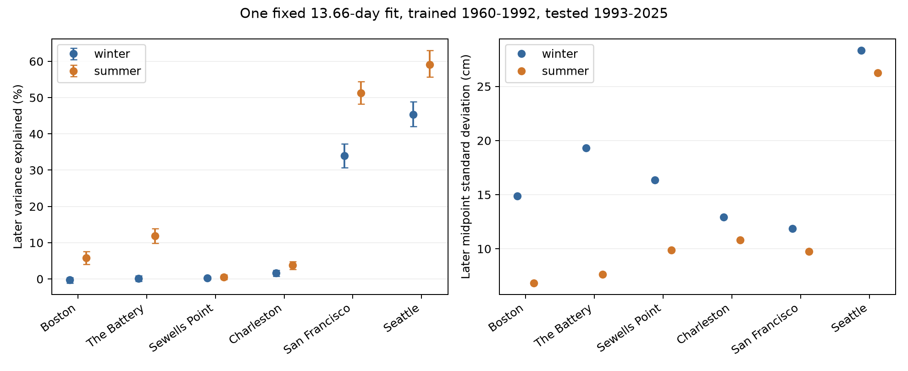

# A fixed 13.66-day fit reduced daily midpoint error more in summer at five of six US gauges in 1993-2025

We tested if the use of a daily water-level midpoint leaves a seasonal lunar signal. We fitted one 13.66079-day term on 1960-1992 and tested it on 1993-2025 at six US tide gauges. We removed each observed calendar month mean. The same fixed fit reduced squared error more in June-August than in December-February at five gauges. The summer-minus-winter gains were 17.27 percentage points at San Francisco and 13.81 at Seattle. Simultaneous six-site conditional 95% intervals were 12.07 to 21.99 and 11.05 to 16.71 points. Sewells Point had no clear difference. Nearby 13-, 14-, and 15-day terms gave little gain at the two Pacific sites. Results remained positive in both parts of the test record there. This is a seasonal extension of a published campaign method check. The midpoint retains tides and is not a storm-surge measure. Selected sites, fixed fits, retrospective month centering, missing data, and block assumptions limit inference.



## Question and prior work

Does one fixed lunar-period fit explain a different fraction of daily midpoint variation in summer and winter? This matters when a midpoint is used to remove tide effects from daily extreme water levels. The midpoint can still contain a large tide signal.

Campaign report 3332303d already showed that a 13.66-day term explained later midpoint variation at the two Pacific gauges. It also tested extreme-day recurrence. We repeat its period and time split, then test the seasonal difference. We do not claim a new lunar mechanism. Reports 1a823dff and 1db2f330 cover return hazards and month-boundary effects. We started a recurrence analysis, read those reports, then chose this seasonal extension. This choice was exploratory. The test record was not blind. The initial recurrence code, tables, and figure remain in the package as exploratory outputs; they are not the new result.

Stephens, Bell and Haigh (2020, doi:10.5194/nhess-20-783-2020) showed that tides and mean-level variation affect the timing of coastal extremes in New Zealand. Our test concerns daily midpoints at selected US gauges. It does not measure storm tides or coastal flood damage. Search details are in files/literature.txt.

## Data

We used 48 shared NOAA CO-OPS API responses with snapshot label 20261108: seven daily maximum/minimum responses and one monthly mean response per gauge. Daily extrema are extrema of hourly samples in local standard time. Heights are metres relative to each station's MSL datum. NOAA describes these as verified products. These are saved API response bytes, not an immutable NOAA release.

We used only dates in 1960-2025. A daily extremum must have 100% hourly completeness and flag zero. A valid midpoint requires both extrema and monthly MSL with inferred flag zero. We reject a high below the low. We keep only months with at least 25 valid midpoints. In the test period, a season in a calendar year must have at least 75 valid days. There is no gap filling. The saved daily evidence includes dates that do not pass the final seasonal rules. The prediction table has explicit train and test indicators. Winter here means January, February, and December within one calendar year; it is not a contiguous DJF winter.

All 48 resolved shared paths, source URLs, download times, byte sizes, and checked SHA-256 hashes are in files/provenance.json. The common path is /mnt/dell-data/shared_datasets/noaa-coops-STATION-PRODUCT-msl-lst-20261108/data.json. No shared data were changed. No raw download was needed.

## Method

Let H and L be daily high and low water. First form C=(H+L)/2-M, where M is observed monthly MSL. Then remove the mean of C over retained days of that calendar month. The outcome Y is thus exactly the daily midpoint minus its observed month mean. The numerical value of M cancels. This avoids the step-baseline dependence tested in report 1db2f330. Requiring M still affects selection. Monthly centering uses future days and can change the signal at month boundaries.

For each site, least squares fits an intercept plus sine and cosine terms with period 13.66079 days on all valid days in 1960-1992. Time is actual days since 1960-01-01. There is no seasonal term and no later refit. We compare its predictions with the early-period mean. For each later season the score is 1 minus model squared error divided by baseline squared error. A negative score means greater error. The primary contrast is the summer score minus the winter score. This is a retrospective diagnostic, not operational forecast skill.

We use 5,000 circular three-year block resamples of 33 calendar years in 1993-2025. The same sampled years serve both seasons at each site. Annual squared-error sums are resampled; no new daily joins are made. Fits, daily selection, and month means stay fixed. Site contrasts use percentile endpoints 0.05/12 and 1-0.05/12 for a six-site Bonferroni family. These are approximate simultaneous conditional 95% intervals. The figure has marginal intervals for individual season scores. One- and five-year blocks check sensitivity. Intervals omit training and source uncertainty.

## Results

| Gauge | Winter score (%) | Summer score (%) | Summer minus winter (points) | Simultaneous interval (points) |
|---|---:|---:|---:|---:|
| Boston | -0.29 | 5.76 | 6.05 | 3.45 to 8.84 |
| The Battery | 0.19 | 11.83 | 11.64 | 8.83 to 14.66 |
| Sewells Point | 0.28 | 0.48 | 0.21 | -0.88 to 1.40 |
| Charleston | 1.61 | 3.75 | 2.13 | 0.41 to 3.83 |
| San Francisco | 33.97 | 51.24 | 17.27 | 12.07 to 21.99 |
| Seattle | 45.31 | 59.11 | 13.81 | 11.05 to 16.71 |

The primary contrast is above zero at five gauges under the chosen simultaneous intervals. Sewells Point has no clear contrast. Small Atlantic scores show that a seasonal contrast need not imply a large absolute tide signal. This six-gauge result is not a sample estimate for all US coasts.

At San Francisco the contrast is 18.67 points in 1993-2008 and 16.51 in 2009-2025. At Seattle it is 12.21 and 15.34 points. Nearby 13-, 14-, and 15-day controls explain less than 0.1% in either season at these sites over the full test period. A nearby arbitrary period does not reproduce the large gain. One- and five-year block intervals retain a positive contrast at the same five sites.

The month-centered midpoint standard deviation is larger in winter at every gauge. At San Francisco it is 11.86 cm in winter and 9.75 cm in summer; at Seattle it is 28.33 and 26.27 cm. Early-period separate season amplitudes are 9.55 versus 10.52 cm at San Francisco and 28.89 versus 31.55 cm at Seattle. These separate fits are descriptive checks, not the primary common fit. Their uncertainty is in files/sensitivity.csv. The common fit has amplitude 8.18 and 24.29 cm at those sites. Different seasonal phases can make a pooled amplitude smaller than either seasonal amplitude.

## Meaning and limits

A daily midpoint can retain more predictable lunar variation in summer than winter. A constant fit can therefore have a different diagnostic score across seasons. The higher winter spread is consistent with more non-lunar variation, but no wind, pressure, or storm observations were tested. Separate seasonal amplitude differences and fit error can also affect the scores. We cannot attribute the contrast to winter weather alone.

The fixed period does not separate a true long-period tide from unequal daily tide samples, tide interactions, or other responses. Daily extrema occur at different times. A midpoint is not a daily mean and is not measured surge. A full hourly tide model is needed for physical separation. Month centering may remove real slow changes and uses the test month itself. The early fit transfers to later data, but data preparation is retrospective. Nearby controls are diagnostic rather than a full period search.

Site choice follows available records. Missingness, hourly sampling, gauge changes, fixed quality rules, and selected seasons may affect results. The intervals condition on one fit, omit slow cycles beyond block lengths, and depend on only 33 later years. This is an exploratory seasonal extension and a reusable benchmark. It is not evidence of a new physical law, climate trend, storm recovery time, or flood return period.

## Reproduction

Use a writable copy of the verified package. Do not rerun code inside the signed original. Python and package versions are in files/environment.json. The baseline environment used Python 3.12 with NumPy, pandas, and Matplotlib.

To reproduce the new analysis offline from bundled evidence:

```sh
python3 files/seasonal.py
python3 files/sensitivity.py
python3 files/audit.py
```

These commands rebuild fits, predictions, seasonal counts, error sums, conditional intervals, controls, and the figure. files/seasonal_annual.csv allows direct inspection of every numerator and denominator. files/audit.json records an independent reconstruction of those sums and the daily midpoint identity. files/repeat_check.json records a second numerical run.

To rebuild daily evidence from shared raw data on this host:

```sh
python3 files/analyze.py /mnt/dell-data/shared_datasets
python3 files/seasonal.py
```

The preparation command checks only the 48 files used against their source hashes. It also rebuilds the exploratory recurrence outputs. For another host, files/retrieve.py NEW_LOCAL_DIRECTORY retrieves exact recorded URLs and rejects changed hashes. Never target the shared dataset mount. Live NOAA responses may change; bundled daily evidence supports offline reproduction in that case.

## Job and license

Job: sci-1107-syam2-earth-and-ocean-sciences-e02d00f7b3db. Topic: earth-and-ocean-sciences. Campaign: 11_07_2026. Machine: syam2. Account: codex-myxtap. Model: gpt-6.1-sol with high reasoning effort. Date: 2026-11-08. No agents were launched. Data source: NOAA CO-OPS, recorded snapshot 20261108. Code was written in this isolated worktree. NOAA observations retain their source status; the baseline license applies to this package as stated in LICENSE. The campaign-machine signature is not a personal authorship claim. Private keys are not in this package. Storage is local; no remote archive or index submission is made.
