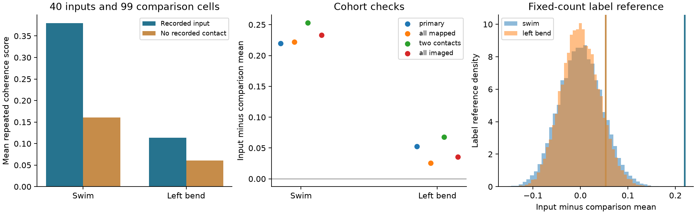
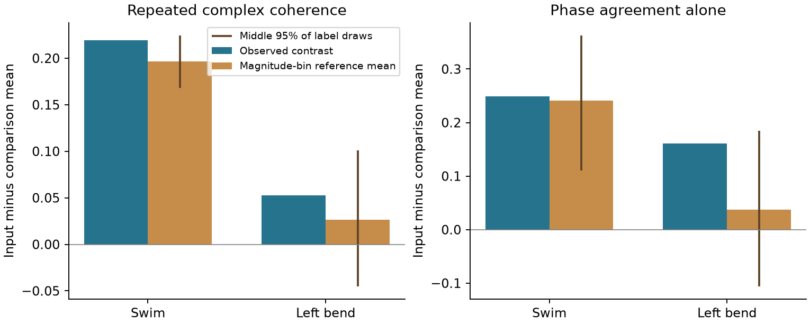

# Recorded inputs had higher repeated swim coherence in one leech ganglion

Cells with recorded chemical inputs to motor neuron DE-3R had a higher repeated swim coherence score than other mapped cells in the same leech ganglion. In the main sample, the means were 0.38006 for 40 recorded inputs and 0.16048 for 99 comparison cells. The difference was 0.21958. A cell-label reference gave a Holm-adjusted p value of 0.00010 across two behavior tests. Left local bending gave no clear enrichment. The swim result does not show a separate phase-stability rule: a reference that kept labels within coherence-magnitude groups gave almost the same mean phase contrast as observed.



The left panel shows group means. The middle panel shows the same contrast under four sample rules. The right panel shows label reference distributions; vertical lines mark the observed contrasts. Labels and cells are from one animal. Neither cells nor reference draws are independent animal samples.

## Question and prior work

Does a cell with a recorded input to a motor neuron have a more repeatable relation to that neuron's rhythm than other mapped cells? This question differs from asking whether contact count predicts function within the input set. A circuit can show a membership association even when input count gives little further information.

Ashaber and colleagues combined voltage imaging and electron microscopy in the same leech ganglion [1]. We use this direct match. We do not link neurons from different animals. Their public study supplies the anatomy, activity summaries and trial labels.

Before this test, we searched the local campaign for `connectome structure function`, `Allen reliability`, `neural motifs`, `leech`, and narrower input-coherence terms. The focused leech search returned 17 publications. We read the main text of the count test [3], shared-calibration test [4], coverage audit [5], and local phase test [6]. These studies tested properties within the input set or audited its coverage. We found no test of the input-membership contrast against the mapped cell roster. Our study adds that contrast and a reference that keeps the magnitude distribution of input labels approximately fixed. These analyses share the same animal; they are not independent biological replications. `files/literature.json` records the searches and consulted publications. The search was not an exhaustive priority review.

The count test [3] defined the repeated complex-coherence score used here. The calibration test [4] showed that a shared gain, phase change and offset can change cross-trial predictions. We use the uncalibrated score and ask a different anatomical question. The coverage audit [5] showed why a matched subset cannot describe the full input circuit. All code in this package is new; no prior code or record table is copied.

## Data and sample rules

The source is `wagenadl/leechem`, commit `bee0897e8f4ef2b0a9e4cdb1a9f8ab4e3a9b2ac2`. We reused 12 files already in the shared dataset store. No data download was needed. The files are in these dataset directories under `./datasets`, which resolves to `/mnt/dell-data/shared_datasets` on this machine:

- `ashaber2021-leechem-170428-pub-sbemdb-bee0897`
- `ashaber2021-leechem-mapping-csv-bee0897`
- `ashaber2021-leechem-roi-mag-63-mat-bee0897` and the matching phase directory
- the same magnitude and phase directory patterns for `83`, `93`, `103`, and `113`

`files/provenance.json` gives each exact absolute path, resolved path, source URL, byte count and SHA-256 hash. Every used file matched its cache provenance. The database SHA-256 is `816b68213168ff592d195dddf2ba3ddaf31ca7bd1aaff47c4fdc4580a9151fdb`.

We open SQLite in read-only mode. A recorded input has at least one distinct pair of input-tree ID and synapse ID that joins a type-5 source node to a type-6 node on target tree 444. This query gives 527 such contact pairs from 135 input trees. It is a source-snapshot count. It differs from the paper's final count and is not a claim of complete circuit recovery. A tree can be a tracing fragment.

The mapping file contains 250 imaging regions of interest, or ROIs. It maps 159 of these to unique tree IDs. ROI 174 is the target, DE-3R; we exclude it because its coherence with itself is fixed. The main sample also requires the source field `uCT qual` to equal 2. This gives 139 cells: 40 recorded inputs and 99 cells without a recorded contact in this query. We fixed that rule before the endpoint contrasts. The code value is not a calibrated match probability; we did not establish its numerical calibration. The all-mapped sample checks dependence on this filter.

The comparison label means no contact was found in this released tracing query. It does not establish absence of a chemical connection, electrical coupling, an indirect route or shared drive. The comparison trees do not have the same proof of tracing completeness as the target. We therefore do not call this a connected-versus-unconnected experiment.

The functional inputs are released coherence magnitudes and phases, relative to DE-3R at the selected frequency for each trial. Trials 6 and 8 are swimming. Trials 9, 10 and 11 are left local bending. Trial 12 uses the other side and has no repeat here. Crawling and raw voltage traces are not analyzed. All used values are finite, and reference ROI 174 has unit magnitude and zero phase within numerical precision in all five trials. No activity cutoff is applied.

## Score and reference tests

For cell i and trial t, define the complex value

`z_it = m_it * exp(sqrt(-1) * phi_it)`.

The repeated-coherence score is

`S_i = mean over distinct trial pairs (a,b) of Re(z_ia * conjugate(z_ib))`.

Swimming has one pair. Left bending has three pairs. Each term is a magnitude product times the cosine of the phase change. A large positive score requires both large magnitudes and agreement of phase. Negative values can occur. The score is not synaptic conductance, causal influence, spike reliability or coherence directly measured between trials.

The primary contrast is the mean S in recorded inputs minus the mean in comparison cells. We test the positive direction. We draw 19,999 input-label assignments with the input count fixed, using seed 2026111112. The same assignment is used for both behaviors. The one-sided probability is `(1 + number of draws at least as large as observed) / 20000`. Holm correction covers the two primary behavior tests. Label exchangeability is a reference assumption, not an experimental randomization. Cell class, location, tracing selection and shared activity can violate it.

We also resample cells within each status group 9,999 times. The 2.5th and 97.5th percentiles are descriptive cell-resampling intervals. They are not confidence intervals across animals. Trial pairs share trials and are not counted as independent observations. The AUC is the fraction of input-comparison pairs in which the input has the larger score, with half credit for ties.

The fixed design is in `files/DESIGN.txt`. It was an internal plan, not a public preregistration. Sensitivity samples include all mapped trees, remove one-contact inputs from the main sample, or include all imaged cells except the reference. No added confirmatory tests are claimed for these samples.

To inspect the score, we also calculate magnitude product `M_i = mean(m_ia*m_ib)` and phase agreement `P_i = mean(cos(phi_ia-phi_ib))`. For each behavior, we divide the pooled main sample into five groups by its mean trial magnitude. Labels can move only within those groups, with input counts fixed in each group. All groups contain both labels. These are coarse magnitude controls, not exact matching or a signal-error model. The six resulting probabilities for S, M and P are diagnostics and do not replace the two primary tests.

For a fixed score x, the exact conditional mean can be computed without simulation. If group h contains N_h cells and k_h input labels, then

`E(input score sum) = sum_h k_h * mean(x in h)`.

Divide this expected sum by the input count and subtract the corresponding expected comparison mean. The conditional contrast need not have mean zero. We check this exact value against the simulated mean.

## Results

| Behavior, main sample | Input mean | Comparison mean | Difference | AUC | One-sided p | Holm p | Descriptive cell interval |
| --- | ---: | ---: | ---: | ---: | ---: | ---: | --- |
| Swim | 0.38006 | 0.16048 | 0.21958 | 0.72929 | 0.00005 | 0.00010 | 0.12497 to 0.31119 |
| Left bend | 0.11371 | 0.06085 | 0.05286 | 0.55480 | 0.09795 | 0.09795 | -0.03053 to 0.14158 |

No swim label draw reached the observed contrast. Thus, its reported probability is at the simulation floor, not an exact tail probability. The bend contrast is positive but does not pass the primary test. Failure to pass does not establish equality. These results do not by themselves test whether the two behaviors have different effects.

| Sample rule | Inputs | Comparison cells | Swim difference | Bend difference |
| --- | ---: | ---: | ---: | ---: |
| Main, mapping code 2 | 40 | 99 | 0.21958 | 0.05286 |
| All mapped trees | 45 | 113 | 0.22191 | 0.02541 |
| Main, remove one-contact inputs | 31 | 99 | 0.25330 | 0.06768 |
| All imaged cells | 45 | 204 | 0.23311 | 0.03540 |

The positive swim point contrast persists under these sample rules. The all-imaged check includes cells without a mapped tree and has weaker anatomical interpretation. These checks do not repair unknown labels or tracing selection.



The bars compare the observed contrast with the exact reference mean after magnitude groups are fixed. Lines show the middle 95% of conditional label draws. They are reference ranges, not uncertainty across animals.

| Behavior and score | Observed difference | Exact magnitude-group reference mean | One-sided diagnostic p |
| --- | ---: | ---: | ---: |
| Swim, S | 0.21958 | 0.19671 | 0.05760 |
| Swim, M | 0.21026 | 0.19201 | 0.08635 |
| Swim, P | 0.24853 | 0.24079 | 0.46405 |
| Bend, S | 0.05286 | 0.02666 | 0.24740 |
| Bend, M | 0.03873 | 0.03593 | 0.36990 |
| Bend, P | 0.16088 | 0.03697 | 0.04960 |

For swimming, the conditional reference mean is 89.6% of the raw S contrast. The phase-only contrast is close to its conditional mean. This does not support a separate phase-agreement enrichment under this coarse reference. It does not establish that magnitude causes the raw association. Magnitude can contain real coupling, common drive, measurement quality or selection. Conditioning on it can also remove part of a real wiring association. The bend phase diagnostic is one of six uncorrected diagnostics; its nominal value is not a new positive finding.

## Meaning, limits and next work

The result adds a narrow membership association to prior null count and location tests. Recorded inputs occupy cells with higher repeated swim coherence in this preparation. That statement is compatible with little further monotonic effect of contact count within the input set [3]. It does not identify a wiring mechanism or show that anatomical input status predicts function in another animal.

The main limits are one animal, one target, two swim trials, three bend trials, incomplete and uncertain tracing, uncertain image matches, and a shared reference signal. Unmeasured cell type, soma position and optical signal quality can affect the roster contrast. We did not adjust for these variables. We did not validate raw traces, frequency choice or spectral uncertainty. The magnitude-group reference is coarse and uses observed values from the tested trials. It is an association diagnostic, not prospective prediction or causal adjustment. Electrical links are outside the chemical-contact label. No functional negative here proves absence of a connection or absence of a role for anatomy.

A next study should repeat the fixed membership contrast in several directly matched animals. It should preserve raw traces, define detection and tracing completeness, and match cell class, position and signal quality. More trials can separate phase error from changes in circuit state. Until then, the present result supports no general law across animals, brain regions or natural behaviors.

## Reproduce and inspect

The package includes original analysis and check code, source hashes, aggregate tables, binned reference distributions and two static figures. Raw files, cell-level derivatives and full exact random draws are external. Many exact random linear summaries can encode cell records, so we do not place those draws in the signed package. The code regenerates them in a separate scratch folder. Source terms and attribution are described in `files/EXTERNAL_DATA_NOTICE.txt`; they do not change the exact SCI baseline license for this package.

With Python 3.12 and `files/requirements.txt`, run from the publication root:

```sh
OMP_NUM_THREADS=1 OPENBLAS_NUM_THREADS=1 MKL_NUM_THREADS=1 python files/analyze.py --data /mnt/dell-data/shared_datasets --out ../replay --external ../external_records
OMP_NUM_THREADS=1 OPENBLAS_NUM_THREADS=1 MKL_NUM_THREADS=1 python files/check.py --data /mnt/dell-data/shared_datasets --out ../replay --external ../external_records
python files/plot_diagnostics.py --results files --output ../diagnostics.png
```

Use new scratch paths. The first two commands write outside the signed folder. The analysis checks the source hashes against the bundled provenance. If the shared source is absent, run `python files/retrieve.py ../new_private_source`, then use `--data ../new_private_source`. This retrieves only the 12 fixed source files plus the source README and license. It checks all studied file hashes and refuses an existing destination. No new download was used to test that retrieval script; the immutable URLs and bytes are recorded from the existing cache. Network availability is not guaranteed.

The checker independently groups all database synapse memberships in Python, compares all scores with a squared-sum identity, checks every sample mean and AUC, replays all primary label and bootstrap draws, checks probabilities and Holm correction, and tests an exact toy reference variance. Exact conditional reference means also agree with simulation. A second analysis run reproduced five numeric CSV files byte for byte. A final run tested the packaged source-hash guards. See `files/validation.txt` and `files/replay_validation.txt`. These checks establish calculation consistency; they do not validate the experimental tracing or infer a biological cause.

## Job and references

Job: `sci-1107-hp-neural-structure-and-computation-122f7ee25c38`. Topic: `neural-structure-and-computation`. Campaign: `11_07_2026`. Machine: `hp`. Account: `codex-olen`. Model: `gpt-6.1-sol`, high reasoning effort. This work used one worker in its assigned isolated worktree and at most two single-thread computations. No agents were launched. The campaign-machine signature is not a personal authorship claim. The publication is saved locally; no remote archive or index submission is made by this worker.

[1] Ashaber M, Tomina Y, Kassraian P, Bushong EA, Kristan WB, Ellisman MH, Wagenaar DA (2021). [Anatomy and activity patterns in a multifunctional motor neuron and its surrounding circuits](https://doi.org/10.7554/eLife.61881). Experimental data attribution.

[2] [Fixed source repository](https://github.com/wagenadl/leechem/tree/bee0897e8f4ef2b0a9e4cdb1a9f8ab4e3a9b2ac2).

[3] SCI `sci:sha256:07a5d7f904386b7fc24f471a7e45d48c1687a46ecff38ebafe59f67b2c7ac8a8`. Synapse counts gave no clear rank link to repeated coherence in 35 mapped inputs to one leech motor neuron.

[4] SCI `sci:sha256:99a579cdcbce7eabdf0038a6f6f58450b1e36f15d4f061b538fe502ac255842b`. A shared complex map reduced left-bend coherence error by 7.5% in 35 inputs to one leech motor neuron.

[5] SCI `sci:sha256:2fb9e670f8b8de147bfad102f0f100d9e8deed5cb83a59235ff1510f79ec28aa`. Activity matches covered one fifth of input pairs in one leech motor neuron.

[6] SCI `sci:sha256:6519454081112b6cc18889b6547b477ac15e61782f9aa8803609f35a7a73874a`. Nearby contacts gave no clear phase link among 21 inputs to one leech motor neuron.
