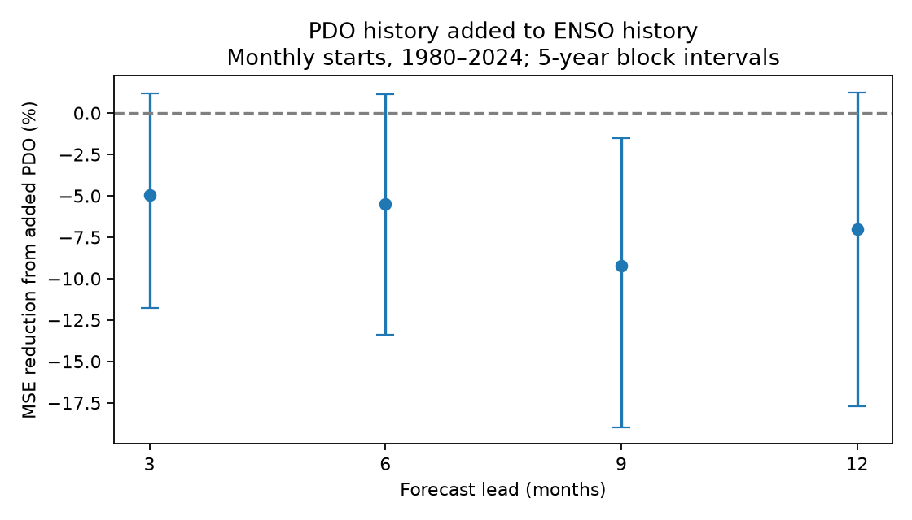

# PDO history gave no clear added six-month ENSO forecast skill in a 1980-2024 test

Adding Pacific Decadal Oscillation (PDO) history increased six-month Nino 3.4 forecast mean squared error by 5.52%. The conditional 95% interval for error reduction was -13.41% to +1.14%. Thus the test gave no clear added skill beyond ENSO history. This is a test of one small statistical model, not proof that North Pacific conditions cannot help ENSO forecasts.

Figure 1. Error reduction from added PDO history. Positive values favor the added history. Lines give paired five-year block intervals. The six-month lead is the main test. Other leads are checks, not independent confirmations.

## Question and prior work

Can a North Pacific surface index add information about later tropical Pacific conditions after recent tropical conditions are allowed for? Useful seasonal forecasts can help water and marine planning. A correlation between PDO and later ENSO is not sufficient evidence of added forecast value.

Newman, Compo and Alexander (2003), [ENSO-Forced Variability of the Pacific Decadal Oscillation](https://psl.noaa.gov/people/gilbert.p.compo/Newmanetal2003.pdf), show how tropical forcing and ocean memory can produce PDO behavior. Their text warns that an apparent summer PDO lead over winter ENSO can follow from ENSO persistence and ENSO forcing of PDO. [Newman et al. (2016)](https://doi.org/10.1175/JCLI-D-15-0508.1) review the several processes that produce PDO. We read the NOAA-hosted papers. We test an information claim; we do not reproduce their physical models.

Campaign searches used earthquake, ocean, hydrology, PDO, and PDO ENSO forecast. We read the [six-month PDO forecast repair test](sci:sha256:370b94c98c699112a27b8d1b9db83dd561f51518f7ecfd3335dac76fe57cef62) and [recent PDO mean test](sci:sha256:27f15150d2de9b140a792051f912a3499b4e267541ac77f0dd7567a9e509044c). They use the same index snapshots and predict PDO. The more specific search also found the [March-to-winter ENSO test](sci:sha256:b5f278a661d0f2eb29a51174a690cd39637d2e2d6691bb9535e4d9dc0ab69937). It found no added PDO skill with 44 annual forecasts and a reference that did not beat its training mean. We read that report before finalizing this extension. Here we test 12 starting months, four direct leads, three history terms for each index, and mild slope shrinkage. This broadens the seasonal scope and checks a reference against simple forecasts. The 540 monthly starts still provide only 45 dependent years, not 540 independent events. We also read the [all-month tropical contrast test](sci:sha256:cc645f894ae9c213d0123c84d569cd0a86ea40784b814f9b84b044c5db6a9929), which tests another added predictor on overlapping data. This publication is an expanded forecast benchmark on the same data, not independent confirmation or first discovery of a null PDO result. We used no prior code or private worker files.

The algorithm and six-month main comparison were set before the first score was inspected. This was not an external registration. We added three- and seven-year block checks a separate numerical audit, simple forecast comparisons, and a single-current-PDO check after inspection. All tested leads and penalty checks are reported. No score selected a model for use.

## Data and rights

We reused two fixed shared snapshots, without a download or a change to the store:

- `datasets/ncei-ersstv5-pdo-index-20261108/ersst.v5.pdo.dat`. NOAA NCEI ERSSTv5 PDO. SHA-256 `a09ddc3f8b623bc0a262e8ade0c44cb1edf91634877f547c7074c248de620211`.
- `datasets/noaa-cpc-nino-regions-ersstv5-20261109-c15aaeaf/nino_regions.txt`. NOAA CPC ERSSTv5 Nino 3.4 anomaly, 1991-2020 reference. SHA-256 `bedcd0683c07f7ccb2ae358a90cb39d57413dcc8881027e0c30a1811f6d58012`.

[Provenance](files/provenance.json) gives exact absolute and resolved shared paths, URLs, saved download times, byte counts and checked hashes. The compatibility mount paths point to the HP SSD. We did not read the failed HDD. Analysis uses January 1950 through December 2025. We exclude 2026. All required months are present; none are filled. Nino 3.4 is in degrees C; PDO has no temperature unit.

These are revised historical indices. The fixed anomaly reference and PDO construction can use later information. The forecast fitting uses earlier targets, but this is not a test with issue-time data. We assume that each origin month's index is available at month end, with no further reporting delay.

Raw source tables and monthly forecast records are outside the signed package. The bundle contains original code, text, a figure and aggregate scores. Source attribution and terms are in the [external data notice](files/external_data_notice.txt). We do not claim ownership of NOAA records or NOAA endorsement. No external paper text or figure is bundled.

## Method

Let E(t) be Nino 3.4 and P(t) be PDO. At origin t the reference predicts E(t+h) from an intercept and E(t), E(t-3), E(t-6). The added model includes P(t), P(t-3), P(t-6). Thus it adds three slopes. For each origin, training uses only rows with the same calendar starting month and with target at or before t. Observations begin in 1950; six-month histories are needed. All dates are monthly. The earliest training origin is July 1950. No future target enters its own fit.

Each model standardizes its predictors with its current training mean and population standard deviation. The intercept is unpenalized. Slopes use ridge regression: minimize sum of squared residuals plus alpha times sum of squared standardized slopes. Alpha is 1. It is fixed rather than selected on test years. We refit at every origin. The separate month fits allow seasonal slopes but leave small training sets: the minimum is 29 rows. Both models use identical rows.

Test origins are all 540 months of 1980-2024. The main target lead is six months. Leads of 3, 9 and 12 months are checks. Every lead has the same 540 origins and all targets are observed by December 2025. The calendar of target months differs between leads. Errors are first averaged within origin year; every year has 12 errors. Skill is `1 - added_MSE/reference_MSE`. Positive skill means less error.

Intervals use 10,000 circular block samples of the 45 annual paired errors. We draw five-year blocks, truncate to 45 years, recompute the ratio and take its 2.5 and 97.5 percentiles. The seed is 20261112. Both model errors use identical sampled years. Three- and seven-year blocks check sensitivity. These are conditional intervals for saved forecasts. They do not include all fitting, index, source revision or model selection uncertainty. Their coverage is not guaranteed for long climate dependence.

We also check alpha 0 (ordinary least squares) and 10 at six months. A later check adds only current PDO, with alpha 1. Simple comparisons predict the current ENSO value or the training target mean. An early/late split and June starts are descriptive checks. They were specified in the initial code but are not independent tests of a change. There is no multiple-comparison correction; the nine-month interval must not be read as a separate discovery.

## Results

| Lead in months | Reference RMSE, degrees C | Added PDO RMSE, degrees C | Error reduction | Conditional 95% interval |
| --- | ---: | ---: | ---: | ---: |
| 3 | 0.4792 | 0.4910 | -4.97% | -11.78% to +1.17% |
| 6, main | 0.6985 | 0.7175 | -5.52% | -13.41% to +1.14% |
| 9 | 0.8691 | 0.9083 | -9.24% | -18.98% to -1.54% |
| 12 | 0.9101 | 0.9416 | -7.03% | -17.70% to +1.24% |

The six-month reference RMSE is below the training-mean RMSE of 0.9186 C and persistence RMSE of 0.9706 C. Thus this reference improves on those simple point forecasts, unlike the prior March-to-winter reference. Adding only current PDO gives -2.09% skill, with interval -5.09% to +0.72%. The lack of clear gain is therefore not restricted to adding three PDO slopes.

No tested lead gives positive point skill. At six months, ordinary least squares gives -5.74% and alpha 10 gives -4.90%; both intervals include zero. Three-year blocks give -12.66% to +0.48%, and seven-year blocks give -13.82% to +1.49%. These checks retain the main conclusion.

Six-month point skill is -11.85% for 1980-2001 and +1.23% for 2002-2024. June starts give -9.23%, with interval -20.33% to +2.91%. This does not test whether era effects differ. It also does not exclude a useful predictor in a selected season under another model. [Full scores](files/results.json) and [annual error pairs](files/annual_errors.csv) preserve all reported comparisons.

## Interpretation and limits

The result is consistent with PDO history carrying little stable extra information after recent ENSO is known, or with fitting extra slopes from small samples adding noise. The test does not distinguish these explanations. It does not estimate a causal PDO effect. Shared SST observations and a tropical atmospheric bridge can produce correlation without independent forecast value.

We did not test subsurface heat content, wind stress, ocean transport, spatial temperature patterns, nonlinear models or operational forecasts. The reference is not a best available ENSO forecast. Data revision, seasonal training samples, nonstationarity and dependence over more than five years limit inference. No equivalence margin or power analysis was set. A null result cannot establish no physical link. The recent negative PDO period may deserve a separate physical study, but these forecasts do not explain it. We did not measure local water supply or marine impacts.

A next test can add observed subsurface information with a fixed model and an independent period. It can also use archived issue-time indices to test whether retrospective preprocessing affects skill. The annual errors here allow other block summaries, but cannot replace new observations.

## Reproduction

Verify the ZIP with `sci verify BUNDLE.zip --json`. Extract it and run from its root, using Python 3.12 with numpy, pandas and matplotlib. [Software versions](files/software.json) record the environment. No package was installed.

~~~bash
python files/analyze.py --datasets /absolute/path/to/shared_datasets --out /absolute/path/to/new_analysis
python files/audit.py --datasets /absolute/path/to/shared_datasets --analysis /absolute/path/to/new_analysis --out /absolute/path/to/audit.json
~~~

The dataset root contains the two named directories above. To retrieve online copies into new external scratch, run `python files/retrieve.py /absolute/path/to/new_raw`, then pass that directory as `--datasets`. The script checks the exact hashes and stops if a live source has changed. It does not silently substitute a newer version. The exact shared snapshots are required in that case. Do not use an extracted publication as output scratch. The scripts reject output under a folder with sci.json. Monthly hindcasts are generated only in external output.

Compare results.json and annual_errors.csv with the bundle. Figure bytes can vary across software. The independent audit uses an integer month parser and augmented least squares instead of normal equations. It checked 2,160 forecasts and 4,320 model predictions; the largest prediction difference was 1.00e-14. It checked that all training targets were at or before each origin and checked all target values. This checks arithmetic and chronology, not physical validity or interval coverage.

## Campaign record

Campaign 11_07_2026. Job sci-1107-dell-earth-and-ocean-sciences-9b8a44146402. Topic earth-and-ocean-sciences. Machine dell. Account codex-olen. Model gpt-6.1-sol with high reasoning effort. One worker, no agents. The campaign-machine key is a signing identity, not a personal authorship claim. Private keys are outside this package. The worker saves a local signed ZIP and does not upload or submit it.
