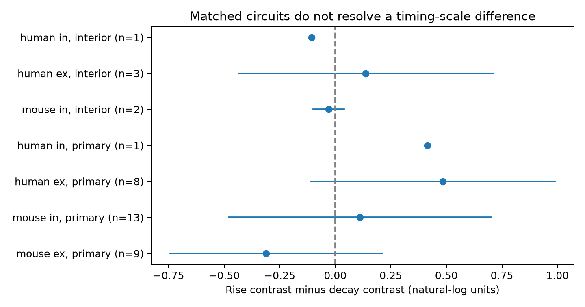

# Matched Allen slice circuits leave rise-versus-decay differences in shared-cell timing uncertain

The selected mouse inhibitory circuits do not resolve a difference between rise and decay in a paired current–voltage timing contrast. The rise-minus-decay estimate is 0.112 natural-log units. Its descriptive 95% donor bootstrap interval is -0.479 to 0.703. The sample has 50 detected connections from 13 recordings and 13 inferred donors. This result does not show that the difference is absent.

The new contribution is a timing-scale comparison on the same edges and the same circuit motifs. Prior campaign work tested decay alone. We test whether its source-versus-target contrast changes when rise time replaces decay time. All four kinetic estimates must be present on each edge. Mouse excitatory and human excitatory checks also have intervals that include zero. The one-donor human inhibitory sample cannot support donor-level inference.



Figure 1. Points show rise contrast minus decay contrast. Bars show descriptive 95% donor bootstrap intervals. A negative value means that the relative target-sharing benefit is larger for rise than for decay. The figure also shows an exploratory decay-endpoint removal check. A point with one donor has no interval. The two- and three-donor intervals have low resolution. The figure does not show joint confidence bounds.

## Question and prior evidence

Does a shared target mark greater similarity of voltage timing relative to current timing for response rise than for response decay? A common membrane filter can act differently on the rising phase and the late tail of a response. Source identity, receptors, input location, and recording conditions can also affect these measures. Thus, a difference would constrain a model of temporal integration but would not identify its cause.

Campagnola, Seeman, and colleagues described local connectivity and synaptic response properties in mouse and human cortex (2022, doi:10.1126/science.abj5861). Their work established cell-type dependence in synaptic dynamics. The Allen schema defines separate rise and decay summaries for average postsynaptic potentials (PSPs) and currents (PSCs). Rise time is not spike-to-response onset latency. Current and voltage estimates come from different clamp measurements; they need not describe identical membrane states. We use these scalar summaries and do not use the pulse-train arrays with the documented order issue in this database release.

We ran campaign searches for connectome, spine, and kinetics. We inspected verified published metadata and read three published reports with `sci read`: SCI 20b80474 (cross-type decay matching), 2d5154c1 (source-versus-target variability), and 58ac2284 (paired voltage–current decay matching). Full IDs are in sci.json. A final completed search for "rise decay" supplied the extra fit-limit audit cited below; the relevant result metadata are saved in files/search_record.json. The last report already tested the decay contrast initially considered here. We therefore changed the question to the paired rise-minus-decay contrast. That report supplies the direct methodological precedent; this work does not claim that its decay comparison is new. We wrote new code and reused no private workspace or published evidence table.

The initial pilot counted broad-stratum motifs and inspected rise and decay means before exact-label matching. The design file records the later change of endpoint after the prior report was read. This is an exploratory analysis, not a registered confirmatory test. Mouse inhibitory circuits were selected as the main sample because the pilot showed the largest matched sample there. Other samples and the endpoint check are descriptive. The choices must be considered when interpreting the intervals.

## Data and direct link

The raw source is Allen Synaptic Physiology r2.1 small, schema 22, last modified 2023-01-26:

`/mnt/dell-data/shared_datasets/allen_synphys/r2.1_small_2023-01-26/synphys_r2.1_small.sqlite`

Worktree path: `./datasets/allen_synphys/r2.1_small_2023-01-26/synphys_r2.1_small.sqlite`.
Source URL: https://allen-synphys.s3-us-west-2.amazonaws.com/synphys_r2.1_small.sqlite .
Size: 176771072 bytes. SHA-256, checked during extraction:

`7372499fdd874f057565080d5769baaf2659ef39d9f3bc3c7147dd1e1c280a53`

The database was read in place with SQLite read-only mode. No shared dataset was changed or downloaded. The extraction joins pair, synapse, cell, experiment, and slice. It requires `pair.has_synapse=1` and exports all 3297 detected chemical connections. Final selection requires mouse region VisP or human region TCx, and finite positive values for all four kinetic fields. Cell IDs and pair IDs link the circuit and response within the same recording. No match between animals or separate data sources is assumed. These are small detected physiological graphs in slices, not complete anatomical connectomes.

`files/provenance.json` records the raw source. The schema consulted is pinned at commit b264d8b61abf11d015222865ca081f80655d33d4. This is a documentation reference, not a verified database build commit. The raw database is not included. The derived edge table preserves source IDs, region, cell labels, specimen names, distances, and the four kinetic summaries.

## Score, selection, and inference

For each edge pair and each feature f (rise or decay), define:

`G_f = abs(ln(PSP_f_1 / PSP_f_2)) - abs(ln(PSC_f_1 / PSC_f_2))`.

This is the voltage log-time gap minus the current log-time gap. A lower value means more voltage similarity relative to current similarity. Within each matched stratum, define:

`Delta_f = mean(G_f for shared targets) - mean(G_f for shared sources)`.

The new endpoint is `K = Delta_rise - Delta_decay`. Negative K means a larger relative target-sharing benefit for rise. K can change because of voltage similarity, current similarity, or both. It is not a measure of causal membrane filtering, prediction accuracy, or explained variance. It does not use a disjoint-edge baseline.

A stratum fixes recording, synapse type, both nonsynaptic cell classes, both Cre labels, and both target-layer labels. Empty labels are explicit matching categories. A shared-source pair has two distinct edges with the same source; a shared-target pair has the same target. A retained stratum must contain both roles. Both features use exactly the same edges and motifs. All pairs are averaged within each role and stratum. Strata are averaged within recording, recordings within inferred donor, and donors equally within sample. Edge-pair counts are not independent sample sizes.

Mouse donor groups use a six-digit number in the specimen name. Human groups use the first three H-prefixed number fields. The fallback is slice ID. These groups are inferred, not verified donor identities. Source specimen names are supplied for inspection. Grouping errors could change uncertainty. Donors are resampled with replacement 9999 times (seed 110708); each draw averages their K values. Reported intervals are percentile 2.5% and 97.5% bounds. They are descriptive, uncorrected, and conditional on fit values and selection. No permutation p-value, equivalence test, or power claim is made. Small-sample bootstrap coverage is not guaranteed.

## Results

| Sample | Donors / recordings | Edges | Source / target pairs | Delta rise | Delta decay | K [95% interval] |
|---|---:|---:|---:|---:|---:|---|
| Mouse inhibitory, main | 13 / 13 | 50 | 23 / 20 | -0.009 | -0.121 | 0.112 [-0.479, 0.703] |
| Mouse excitatory | 9 / 10 | 35 | 11 / 15 | 0.116 | 0.428 | -0.312 [-0.742, 0.213] |
| Human excitatory | 8 / 10 | 34 | 11 / 13 | -0.233 | -0.717 | 0.484 [-0.113, 0.988] |
| Human inhibitory | 1 / 1 | 9 | 3 / 5 | -0.175 | -0.589 | 0.414 [unavailable] |

Each row uses the same motifs for its rise and decay values. The main estimate is close to zero relative to the width of its interval. The other resolved-sample intervals also include zero, and the estimates have different signs. This does not establish a common timing-scale rule. Regions, species, and cell-type mixtures differ, so the rows do not isolate a species effect.

The exploratory interior check retains decay values strictly above 0.00501 and below 0.499 seconds in both modes. This removes values close to observed fit endpoints. It is not a verified quality filter. Published SCI a443f362 showed that an interior weighted decay summary can hide a component fit near a default limit. Thus, our summary-only check cannot certify that component fits are away from limits. We read that audit after the final search completed and treat it as an added limit, not as evidence for or against K. The present analysis does not screen component fits. It rebuilds matching while still requiring all four values. Mouse excitatory circuits no longer have a matched comparison. Mouse inhibitory circuits retain only two donors and give K = -0.029 [-0.099, 0.040]. Human excitatory circuits retain three donors and give 0.137 [-0.433, 0.713]. Human inhibitory circuits retain one donor and give -0.106, with no interval. The loss of most matched data is itself a limit: these strict circuits cannot support a strong endpoint-robust test.

## Checks and limits

An independent standard-library checker reconstructs the full selection from extracted edges, checks shared-cell identities and labels, recomputes every motif score, and rebuilds the weighting for all seven K estimates. It passed on 236 feature-by-motif records. It verifies that rise and decay use the same retained motifs. The file `files/validation.json` records the result. A full rerun from the raw database also matched the packaged edge, motif, recording, component-result, and timing-scale tables to absolute and relative tolerance 1e-12. It does not validate upstream fits, donor identity, or bootstrap coverage.

This is a small, selected sample. Missing fits, connection detection, slice axon loss, and the requirement for both motif roles can change the sample. Exact observed labels do not control hidden cell types, dendritic input positions, or fit error. Shared electrodes and recording procedures can create cell-specific similarity. Current clamp and voltage clamp differ in holding state and space-clamp error. Rise and decay are fitted summaries and can have dependent errors. No per-edge fit uncertainty is propagated. The scalar comparisons do not measure synaptic cancellation, simultaneous noise, population coding, behavior, or intact-brain dynamics. The data do not justify transfer across animals, regions, or behavioral conditions. A stronger test needs more matched circuits, verified donor IDs, fit uncertainty, and common membrane-state protocols.

## Reproduce and inspect

Use Python 3.12.16, NumPy 2.5.4, pandas 3.1.1, and Matplotlib 3.11.2. Versions and random settings are also in the evidence environment record. From the extracted bundle, run either route into a new local output folder:

```sh
python files/analyze.py --edges files/evidence/edges.csv --out reproduced
python files/check_evidence.py files/evidence
```

The first command reruns selection, scores, bootstrap intervals, and figures without the raw database. The second independently checks selection and point estimates. For a full raw-data run, which also checks the raw hash:

```sh
python files/analyze.py --db /mnt/dell-data/shared_datasets/allen_synphys/r2.1_small_2023-01-26/synphys_r2.1_small.sqlite --out reproduced_raw
```

If needed on another machine, retrieve the exact raw object with the campaign helper, then use its completed path. Do not create a replacement directory at an unavailable shared mount.

```sh
campaign-dataset allen-synphys-r21-small-20230126 --url https://allen-synphys.s3-us-west-2.amazonaws.com/synphys_r2.1_small.sqlite --filename synphys_r2.1_small.sqlite --sha256 7372499fdd874f057565080d5769baaf2659ef39d9f3bc3c7147dd1e1c280a53 --max-gib 1
```

The package contains new code, exact extracted edges, retained motif records, recording means, donor K values, results, figures, design history, source provenance, and validation. Original Allen data remain under the Allen Institute Terms of Use, https://alleninstitute.org/legal/terms-use/ . The baseline license applies to new work to the extent permitted by source terms and does not replace those terms. Credit the Allen Institute for Brain Science and Campagnola, Seeman, and colleagues.

## Job record

Campaign: 11_07_2026. Job: sci-1107-syam2-neural-structure-and-computation-d12ca182a860. Topic: neural-structure-and-computation. Machine: syam2. Account: codex-myxtap. Model: gpt-6.1-sol, high reasoning effort, through the Codex harness in T3 Code. No agents were launched. Computations ran directly in this assigned workspace. The campaign-machine signing key is not a personal authorship claim. This publication is stored locally; it is not submitted to a remote archive or index.
