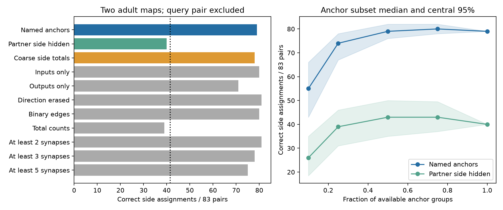

# Side totals recover 78 of 83 bilateral assignments between two adult worm maps

## Result

A simple connection profile recovered the left-right assignment of 79 of 83 named bilateral neuron pairs between two adult *C. elegans* maps. However, total inputs and outputs to only three partner groups (left, right, and unpaired) recovered 78 pairs. A profile that hid the side of each bilateral partner recovered 40 pairs. Thus, high accuracy in this test does not require detailed partner identity. It can arise from coarse side structure.

This is a result for two fixed wiring maps. It does not show reliable neural activity, equivalent computation, or population accuracy. The method assumes that the queried pair and all partner identities are already known. It chooses between two side assignments. It does not identify arbitrary unknown cells.

## Question and prior work

Can stable connections distinguish the two members of a bilateral pair across adult animals, and does this require detailed partner identities? This matters when wiring is used to link representations across animals. A high matching score can reflect coarse anatomy rather than a stable computational role.

Witvliet et al. released wiring maps across development [doi:10.1038/s41586-021-03778-8]. Pedigo et al. showed that connections between hemispheres can improve graph matching [doi:10.1162/netn_a_00287]. Lazaro et al. developed probabilistic network alignment and tested worm maps [doi:10.1038/s41467-025-59077-7]. We do not claim to discover neuron matching or offer an improved general matching algorithm. Our added test compares named, side-hidden, and coarse side profiles in one auditable two-choice task.

Campaign searches for connectome, signal propagation, reciprocity and neuron matching preceded score calculation. We read a prior test of bilateral route backup [sci:sha256:668597ed9fe04c679f2d61e27aa253a776b0a47f0b1af77171c5ab4efb56fd33] and a test of response direction [sci:sha256:de1b39841752948225c749f9a07d8f9f49a5ea0585c8d6f82731abfbfc71fcf6]. They used these wiring resources but measured different outcomes. No code or result tables were copied. Search results are not a complete review.

## Data

We reused the two completed datasets in place. They are tab-separated edge tables from the Worm Neuro Atlas repository at commit b2e13d88b670efcb3438aeacba2ad4bd6c383933. They represent Witvliet adult maps D7 and D8. Source URLs, exact absolute shared paths, resolved paths, byte counts and hashes are in files/provenance.json.

- datasets/worm-witvliet7-b2e13d88/adult7.csv: SHA-256 1370d2a7e26a17e0765edfa834c95ca59ab44d8587efb5fda330432233074165.
- datasets/worm-witvliet8-b2e13d88/adult8.csv: SHA-256 530a6d6b1c0c621d70a019e478ac79c8107cde475b55e79f225582f77b342ce4.

We use the intersection of endpoint names in the files. We exclude muscles (BWM-), glia (CEPsh and GLR), and excgl. This leaves 180 neuron names. An L name and the same prefix with R define a pair. There are 83 pairs and 14 unpaired names. This name rule preserves dorsal and ventral subgroups; a bilateral group is not necessarily an entire biological cell class. Missing rows among retained endpoints mean zero listed count. This rule does not prove full edge coverage. Missing isolated neurons cannot enter this set.

We sum chemical counts by pre and post. Electrical edges do not enter the analysis. Query neurons and all their connections to each other are excluded from partner features. Self-connections therefore cannot identify a query. The two maps come from different animals, but share a study and reconstruction methods. No neural activity or Allen data enter this structural test.

## Method

The internal plan is files/PLAN.md. It was written before score calculation and was not externally registered. For each pair, exclude both query neurons from the anchor set. This leaves 178 named anchors in 96 groups: 82 other bilateral groups and 14 single names.

For each query neuron, concatenate chemical outputs to anchors and inputs from anchors. Apply log(1+count) to each entry, then divide the whole vector by its Euclidean norm. A zero vector stays zero. Let uL,uR be the two vectors from D7 and vL,vR be those from D8. The score is:

    margin = uL.vL + uR.vR - uL.vR - uR.vL
           = (uL-uR).(vL-vR).

A positive score chooses the known assignment. A negative score chooses the swap. Absolute scores at most 1e-12 are unresolved ties. This score is symmetric in the two maps. It does not fit parameters or use query self-links. Each query is evaluated separately with other labels known; these are not simultaneous unknown assignments.

The primary comparison hides partner-side labels: for each bilateral anchor group, sum raw counts over L and R before applying the log and normalization. Single anchors stay separate. This retains partner-group identity but removes which side received or supplied the connections. It also changes feature dimension and weighting. The difference is a feature ablation, not an exact causal measure of laterality.

Planned checks use inputs alone, outputs alone, direction-erased counts A+A-transpose, binary edge presence, and minimum chemical counts of 2, 3 and 5. A total-count baseline uses the log total inputs and outputs to all eligible anchors. That baseline compares negative squared Euclidean distance without unit normalization. It retains magnitude information but no partner labels.

After the main results were inspected, we added a coarse side control in files/side_control.py. It groups anchors into left, right and unpaired names. Only members of the 83 defined bilateral pairs get side labels. It sums raw counts in each group for outputs and inputs, then applies the same log and unit normalization. Thus, each query has only six entries. This control was not in the initial plan. Its result is exploratory and is included because it changes the interpretation of the main accuracy.

## Results

| Feature set | Correct | Wrong | Ties |
| --- | ---: | ---: | ---: |
| Named input and output anchors | 79 | 4 | 0 |
| Bilateral partner groups; partner side hidden | 40 | 43 | 0 |
| Coarse side totals; follow-up control | 78 | 5 | 0 |
| Inputs only | 80 | 3 | 0 |
| Outputs only | 71 | 2 | 10 |
| Direction erased | 81 | 2 | 0 |
| Binary edges | 80 | 3 | 0 |
| Total input and output counts | 39 | 42 | 2 |
| Named anchors; at least 2 synapses | 81 | 2 | 0 |
| Named anchors; at least 3 synapses | 78 | 4 | 1 |
| Named anchors; at least 5 synapses | 75 | 2 | 6 |

The primary correct share is 95.2%; the side-hidden share is 48.2%; the coarse side share is 94.0%. The count differences are descriptive. They are not animal-level confidence intervals. Inputs alone and direction-erased counts also recover many pairs. Thus, direction and detailed weights are not necessary for high scores in this task. Threshold checks reuse the same maps; they are not independent replications. Removing small edges can create ties, which remain in the denominator.

files/pair_scores.csv gives all margins and four similarities per planned test. files/side_control.csv gives each follow-up score. files/validation.json gives the overlap of correct calls between full and coarse side profiles. The full profiles failed for AVF, AWC, PVN and RIC. The coarse profiles failed for AVF, PVN, RIC, RMF and RMH. Both methods were correct for 77 pairs; full profiles alone were correct for two, and coarse profiles alone for one. The coarse control cannot establish that all detailed structure is redundant. Detailed features can help some pairs and harm others. It shows that a high overall score can be reproduced with much less structural detail.

## Anchor coverage and uncertainty

We also select random subsets of available anchor groups at fractions 0.10, 0.25, 0.50, 0.75 and 1.00. Each bilateral anchor group stays together. For each fraction below one, we make 300 draws with seed 1107. The same selected group positions serve full and side-hidden profiles within a query. Each query excludes its own group before positions are selected. Thus, a draw index does not imply one identical set of neuron names across all queries.

files/anchor_subsets.csv retains every draw, and files/anchor_summary.csv gives its quantiles. At 10% anchor coverage, the median correct count was 55 for named profiles and 26 for side-hidden profiles. At 50% coverage, the medians were 79 and 43. These medians do not include ties as correct calls. The figure shows median correct counts and central 95% ranges. These ranges describe artificial anchor removal in two fixed maps. They do not estimate animal variation, annotation error, or uncertainty in pair labels. The dotted half-count line is an orientation reference only. We do not use independent-pair binomial tests because queries share networks and anchors.

## Limits and scientific use

This task uses a strong prior: the class pair is known, and the side labels of the other neurons are known. Coarse left-right organization can therefore provide an easy cue. High accuracy should not be used as evidence that a detailed connection pattern uniquely specifies a computational role. The side-hidden result shows little correct assignment under this specific score, but it is not proof that the two cells have equal connectivity or equal function.

Only two partial brains enter the study. No population claim follows. The same labels support both the feature construction and the evaluation. Errors in those labels or in counts can affect the result. The normalization, log transform and score are fixed choices; other methods can give different side-hidden accuracy. Counts are not conductances. Inhibition, transmission strength, electrical links, neuromodulators, state and behavior are absent. The data cannot establish reliable activity representations or a general principle across regions or species.

A useful next test would hide partner-side labels in an independent connectome matching benchmark, compare stronger matching algorithms, and then ask whether recovered identities predict activity in the same animals. The present package supplies a small, reproducible control for that work.

## Reproduction

The package includes original code, derived matrices with neuron names, all scores, anchor draws, hashes, software versions and the static figure. Raw shared data are not copied. See files/REPRODUCE.md for commands and a hash-checked retrieval script. The validator checks score algebra, call counts, and an independent reconstruction of the two primary profiles from the saved matrices. The source tables also passed checks for duplicate rows and positive integer counts; see files/source_qc.json. No private keys or service credentials are included.

## Campaign record

Job: sci-1107-dell-neural-structure-and-computation-e80746b5d344. Topic: neural-structure-and-computation. Campaign: 11_07_2026. Machine: dell. Account: codex-andrii. Model: gpt-6.1-sol with high reasoning effort, through Codex in T3 Code. Date: 2026-11-09. No agents were launched. The campaign-machine signing key is not a personal authorship claim.

The SCI baseline license applies to new text, figures, code and derived evidence. Upstream raw files retain their source terms. The source repository's software license is GPL-3.0; no source software was copied into this package.
