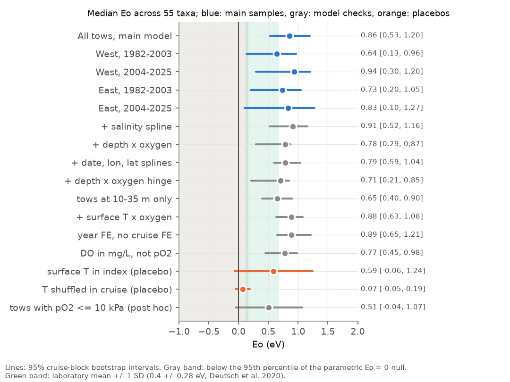
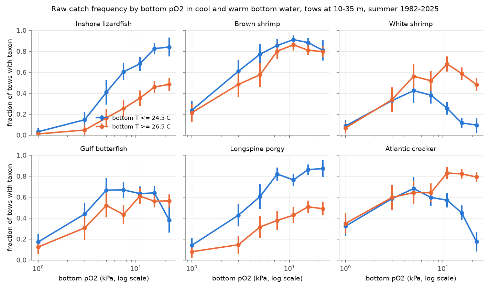
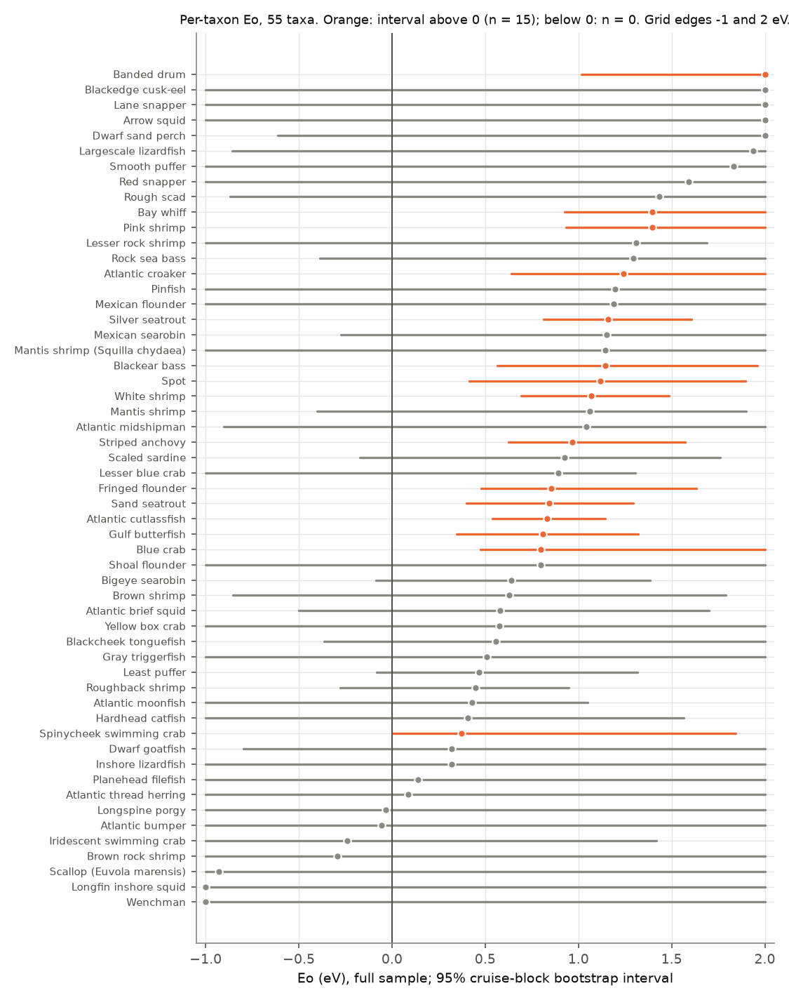

# Warm bottom water moved the oxygen response of demersal trawl catches toward higher oxygen on the northern Gulf of Mexico shelf, 1982-2025

## Summary

Nutrient pollution from the Mississippi and Atchafalaya rivers causes low bottom oxygen
(hypoxia) on the Louisiana and upper Texas shelf each summer. Warming can make the same
oxygen level more stressful, because animals need more oxygen in warm water. The
metabolic index model (Deutsch et al. 2015, 2020) gives this effect one number, Eo (eV).
If Eo is more than zero, the oxygen level at which a species is lost goes up as the water
gets warmer. Laboratory values have a mean near 0.4 eV (Deutsch et al. 2020).

We tested this prediction in the field. We used 3,330 summer SEAMAP 40-ft shrimp trawl
tows (102 cruises, 1982-2025) at 5-50 m depth, from 94.5 W to 89.0 W. Each tow has bottom
dissolved oxygen, temperature and salinity. 780 tows had oxygen below 2 mg/L. For each of
55 common taxa (fish, shrimp, crabs, squid, one scallop), we fitted a presence-absence
model with cruise fixed effects, depth and temperature splines, day or night, and tow
time. The oxygen term is a spline of the metabolic index. We found Eo by profile
likelihood and found the uncertainty with a cruise-block bootstrap.

Main results:

- The median Eo across 55 taxa was **0.86 eV (95% interval 0.53-1.20)**. 48 of 55 taxa had
  Eo above zero. 15 taxa had intervals above zero. No taxon had an interval below zero.
- The result repeated in four independent region and period samples: west 1982-2003
  0.64 (0.13-0.96), west 2004-2025 0.94 (0.30-1.20), east 1982-2003 0.73 (0.20-1.05),
  east 2004-2025 0.83 (0.10-1.27).
- A parametric null with Eo = 0 and the real station layout gave median values from
  -0.09 to 0.20 eV (100 replicates; p = 0.01). Temperature shuffled within cruises gave
  0.07 (-0.05 to 0.19).
- Nine model checks kept the median between 0.65 and 0.91, all with intervals above zero.
  The weakest checks were a depth x oxygen hinge term (0.71, 0.21-0.85) and tows at 10-35 m
  only (0.65, 0.40-0.90).
- A simpler model gave the same direction. The log odds of catch at hypoxic tows
  (DO < 2 mg/L) fell by a further 0.066 per degree C (median over taxa; interval 0.017-0.119).
  This term did not repeat in the west 1982-2003 sample (median +0.013).

Main limitation: the estimate uses the full shape of each catch-oxygen curve. For some
inshore taxa (white shrimp, Atlantic croaker), cool and well-oxygenated tows had *fewer*
catches (Figure 1). That part of the curve can come from habitat or thermal preference,
not from oxygen supply. A post hoc check that used only tows with pO2 <= 10 kPa gave
0.51 eV with an interval that includes zero (-0.04 to 1.07). Thus, the data show that
the catch-oxygen relation moves with bottom temperature, but they do not clearly show
that the low-oxygen avoidance threshold alone moves. Bottom temperature and depth are
strongly related (r = -0.73), and trawl absence can mean escape from the net path, not
loss from the area.

## 1. Question

Does bottom-water temperature change how strongly low oxygen removes demersal taxa from
trawl catches in the northern Gulf of Mexico summer hypoxic zone? This is a test of an
interaction between climate (temperature) and pollution (nutrient-driven hypoxia) on
species distributions. We wrote the analysis plan before we fitted any species model
(files/ANALYSIS_PLAN.md). Deviations are listed at the end of that file.

Prediction under the metabolic index: pooled Eo > 0 in all four region-period samples.
Null: Eo near 0 (the oxygen effect does not depend on temperature).

## 2. Data

Source: SEAMAP Gulf Shrimp/Groundfish Survey CSV package (GSMFC, updated 2026-06-08;
ZIP SHA-256 1c5c3b75...38477b7). The retrieval recipe and table hashes are in
files/PROVENANCE.md. The raw package is not in this bundle; the derived tables are.

Selection (files/data/sample_counts.csv):

| Step | Tows |
| --- | --- |
| Summer groundfish cruises, 40-ft shrimp trawl | 13,778 |
| 94.5-89.0 W, station depth 5-50 m, haul not flagged bad | 3,993 |
| Valid bottom DO, T and S | 3,520 |
| Bottom sample within 3 m of water depth | 3,342 |
| One tow per station | 3,330 |

Region and period samples:

| Sample | Tows | Tows with DO < 2 mg/L | Cruises |
| --- | --- | --- | --- |
| West (94.5-91.5 W), 1982-2003 | 938 | 156 | 36 |
| West, 2004-2025 | 1,010 | 159 | 37 |
| East (91.5-89.0 W), 1982-2003 | 946 | 320 | 55 |
| East, 2004-2025 | 436 | 145 | 39 |

There was no summer survey in 2020. Bottom temperature at hypoxic tows was 21.8-28.6 C
(5th-95th percentile).

Taxa: species-level codes with presence in at least 15% of normoxic tows (DO >= 4 mg/L).
This rule does not use the hypoxic response. 55 taxa passed (files/data/taxa_names.csv).

## 3. Methods

Oxygen partial pressure: pO2 (kPa) = DO / O2 solubility x 0.2095 x 101.325, with the
Garcia and Gordon (1992) solubility at bottom T and S.

Metabolic index: log Phi = ln pO2 + (Eo / kB)(1/T - 1/Tref), with T in K, Tref = 298.15 K,
kB = 8.617e-5 eV/K.

Model, for each taxon and sample: logistic regression of presence on cruise fixed effects
(weak ridge penalty, prior SD about 3.2 logits), natural splines of log depth (3 df),
bottom temperature (3 df) and log Phi (3 df), day or night (solar elevation), and log
minutes fished. The temperature spline is separate from the index. Thus, Eo is found only
from how the oxygen response changes with temperature, not from the direct temperature
effect.

Eo: profile likelihood on a grid from -1.0 to 2.0 eV (step 0.1), with a parabolic
refinement. Estimates at a grid edge are kept at the edge (7 of 55 taxa in the full
sample).

Pooled statistic: the median Eo across taxa. Uncertainty: cruise-block bootstrap. Each
resample draws cruises with replacement and uses the same draw for all taxa. Thus, the
interval includes the correlation between taxa that share tows. 100 resamples for the
five main samples and 50 for each model check.

Method checks:

- Simulation with the real covariates (Figure 4, left): the method recovered Eo = 0, 0.4
  and 0.8 eV with small bias (means -0.02, 0.44 and 0.74 for a steep response). A pure
  mg/L threshold with no physiological Eo gave a mean of 0.07 eV.
- Parametric null (Figure 4, right): for each taxon, we fitted the model with Eo = 0,
  simulated presence from it, and profiled Eo again. The median across taxa was -0.09 to
  0.20 eV in 100 replicates.

## 4. Results

### 4.1 Pooled Eo

| Sample or check | Median Eo (eV) | 95% interval | Taxa with Eo > 0 |
| --- | --- | --- | --- |
| All tows, main model | 0.86 | 0.53-1.20 | 87% |
| West, 1982-2003 | 0.64 | 0.13-0.96 | 76% |
| West, 2004-2025 | 0.94 | 0.30-1.20 | 75% |
| East, 1982-2003 | 0.73 | 0.20-1.05 | 67% |
| East, 2004-2025 | 0.83 | 0.10-1.27 | 67% |
| + salinity spline | 0.91 | 0.52-1.16 | 87% |
| + linear depth x ln pO2 | 0.78 | 0.29-0.87 | 85% |
| + day-of-year, longitude, latitude splines | 0.79 | 0.59-1.04 | 87% |
| + depth x oxygen hinge terms | 0.71 | 0.21-0.85 | 76% |
| Tows at 10-35 m only | 0.65 | 0.40-0.90 | 85% |
| + surface T x oxygen terms | 0.88 | 0.63-1.08 | 87% |
| Year fixed effects instead of cruise | 0.89 | 0.65-1.21 | 87% |
| DO in mg/L instead of pO2 | 0.77 | 0.45-0.98 | 85% |
| Placebo: surface T in the index | 0.59 | -0.06-1.24 | 73% |
| Placebo: bottom T shuffled within cruise | 0.07 | -0.05-0.19 | 62% |
| Post hoc: tows with pO2 <= 10 kPa | 0.51 | -0.04-1.07 | 69% |

Full table: files/results/pooled_eo_ci.csv.

Interpretation of size: with Eo = 0.86 eV, the pO2 that gives the same index value is
2.2 times higher at 29 C than at 22 C. With the laboratory mean of 0.4 eV, the factor is
1.4. The field estimate is higher than the laboratory mean but in the laboratory range
(-0.2 to 1.3 eV, Deutsch et al. 2020). Field Eo can include behaviour, prey and habitat
effects. Thus, the field and laboratory values do not measure the same thing.

Surface temperature has a correlation of only 0.10 with bottom temperature here. In the
surface-temperature placebo, the median was 0.59 but the interval included zero. Because
surface temperature varies less (SD 1.0 C vs 2.6 C), the same small shift in the index
needs a larger Eo. Thus, this placebo is weak. When we added surface temperature x oxygen
terms to the main model, the bottom-temperature Eo did not change (0.88).

### 4.2 Raw pattern

Figure 1 shows raw catch frequency for the six taxa with the strongest oxygen response,
for tows at 10-35 m. All six had their lowest catch frequency below about 2 kPa. In warm water, the
curves for most taxa are lower or move to the right. For white shrimp and Atlantic
croaker, cool water with high oxygen had few catches. This upper part of the curve also
affects Eo.

### 4.3 Per taxon

The 15 taxa with intervals above zero: pink shrimp, white shrimp, blue crab, spinycheek
swimming crab, Atlantic croaker, spot, silver seatrout, sand seatrout, banded drum, Gulf
butterfish, Atlantic cutlassfish, striped anchovy, bay whiff, fringed flounder and
blackear bass. Brown shrimp had Eo = 0.63 with a wide interval (-0.85 to 1.79). Per-taxon
intervals are wide; 7 taxa reached a grid edge. Table: files/results/taxon_eo_full.csv.

### 4.4 Simple hypoxia x temperature model

We replaced the index spline with a hypoxic indicator (DO < 2 mg/L) and its interaction
with (T - 25 C). The median log odds ratio for presence at DO < 1.5 vs >= 4 mg/L was
-1.39 (-1.60 to -1.20). The median interaction was -0.066 per C (-0.119 to -0.017).
By sample, the median interaction was -0.11 (east 1982-2003), -0.14 (east 2004-2025),
-0.15 (west 2004-2025) and +0.01 (west 1982-2003). Thus, this simpler test did not
repeat in one of four samples.

## 5. Limitations

1. The pooled Eo uses the full catch-oxygen curve. The low-oxygen part alone gave an
   uncertain value (0.51, -0.04 to 1.07; post hoc). We cannot say that the avoidance
   threshold alone rises with temperature.
2. Bottom temperature and depth are strongly related (r = -0.73). Depth x oxygen terms
   made the likelihood gain about three times smaller, but the median stayed 0.71 with
   an interval above zero. Other habitat factors that change with temperature can remain.
3. Trawl absence is not death or absence from the area. In hypoxia, animals can move up
   into the water column or to the edge of the hypoxic zone (Craig 2012). This changes
   catchability, not only distribution.
4. Bottom oxygen was measured once per station, with different instruments over 43 years
   (Winkler, sensors, CTD). The bottom sample can be up to 3 m above the bottom.
5. Survey dates moved earlier after 2011. Cruise fixed effects and the day-of-year check
   address this in part.
6. The bootstrap used 100 or 50 resamples, so interval ends are approximate. Percentile
   p-values cannot be smaller than 1/101.
7. Taxa share tows. The pooled median is not a mean of independent tests. The joint
   bootstrap accounts for this, but the 55 taxa do not give 55 independent results.
8. Several model checks were added after we saw the first results (see the plan file).

## 6. Files

- files/ANALYSIS_PLAN.md: plan written before the species models, plus deviations.
- files/PROVENANCE.md: data source, retrieval recipe, SHA-256 values, job record.
- files/REPRODUCE.md: commands to run the analysis again.
- files/code/: build_tables.py (selection and pO2), mi_core.py (model and profile),
  run_profiles.py (all samples, checks and resamples), null_parametric.py,
  simulate_recovery.py, summarize.py (pooling and figures).
- files/data/: stations.csv (one row per tow, with DO, T, S, pO2, depth, cruise),
  presence_selected.csv.gz (55 taxa x 3,330 tows), catch_long.csv.gz (all taxa, counts and
  weights), taxa_names.csv, taxa_prevalence.csv, sample_counts.csv.
- files/results/: pooled_eo_ci.csv, taxon_eo_full.csv (with profile LR values and
  secondary terms), secondary_summary.json, pooled_by_replicate.csv,
  all_replicates_long.csv.gz (every per-taxon estimate of every resample),
  null_parametric.csv, sim_recovery.csv.
- files/figures/: four PNG figures.

## 7. Provenance and roles

Campaign 11_07_2026, job sci-1107-dell-climate-pollution-biodiversity-2adf74e73727, topic
climate-pollution-biodiversity, machine dell, account claude-andrii. An automated research
agent (Claude Opus 5.5, model ID claude-opus-5-5) selected the question, wrote the code,
ran the analysis and wrote this text. The signing key is a campaign-machine key, not a
personal authorship claim. Data: SEAMAP (GSMFC, NOAA NMFS SEFSC and Gulf state partners).

## References

- Deutsch C, Ferrel A, Seibel B, Portner H-O, Huey RB (2015) Climate change tightens a
  metabolic constraint on marine habitats. Science 348:1132-1135. doi:10.1126/science.aaa1605
- Deutsch C, Penn JL, Seibel B (2020) Metabolic trait diversity shapes marine
  biogeography. Nature 585:557-562. doi:10.1038/s41586-020-2721-y
- Craig JK (2012) Aggregation on the edge: effects of hypoxia avoidance on the spatial
  distribution of brown shrimp and demersal fishes in the Northern Gulf of Mexico. Marine
  Ecology Progress Series 445:75-95. doi:10.3354/meps09437
- Garcia HE, Gordon LI (1992) Oxygen solubility in seawater: better fitting equations.
  Limnology and Oceanography 37:1307-1312. doi:10.4319/lo.1992.37.6.1307
- SEAMAP Gulf data download: https://seamapdata.gsmfc.org/pages/download-form.php
