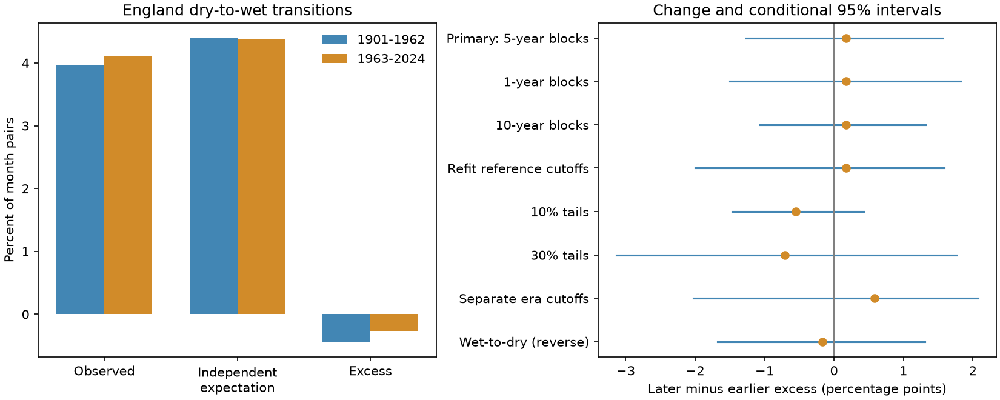

# England monthly dry-to-wet rainfall transitions showed no clear increase between 1901-1962 and 1963-2024

England had 27 dry-to-wet month pairs in 1901-1962 and 28 in 1963-2024. Each period had 682 tested pairs. The observed frequency rose from 3.959% to 4.106%. The change was +0.147 percentage points, with a conditional 95% five-year block interval of -1.613 to +1.906 points. The data give no clear increase at this scale. They do not establish equal risk.

After the separate dry-month and wet-month frequencies were accounted for, the change was +0.173 points (-1.263 to +1.561). All planned checks also had intervals that included zero. This is a benchmark for monthly national rainfall reversals. It is not a test of flood frequency, river flow, soil moisture, or drought recovery.



The left panel compares observed frequencies with the expectation from separate calendar-month tail frequencies. Excess is observed minus expected. The right panel shows the later-minus-earlier excess and percentile intervals. The separate-era and refit checks estimate cutoffs again within each bootstrap sample. Other checks keep cutoffs fixed.

## Question and prior work

Did next-month dry-to-wet transitions increase beyond a change in the frequencies of their two components? More frequent wet months can raise dry-to-wet counts even if event ordering does not change. We test both the total change and the part left after a calendar-month marginal-frequency adjustment.

Armitage and colleagues (2026, EGUsphere preprint, DOI 10.5194/egusphere-2026-3154) assess seasonal transitions in projected precipitation and river flow for 200 UK catchments in 1989-2079. Their work motivates a distinction between meteorological and hydrological transitions. The present test uses observed national monthly rainfall, an earlier and longer record, and one-month transitions. It neither confirms nor challenges their projections. The review by Swain and colleagues (DOI 10.1038/s43017-024-00624-z) places rapid dry-wet changes in a wider risk context. This report makes no claim to discover rainfall whiplash.

We searched the campaign for earthquake, ocean and hydrology work, then for rainfall and transition studies. Searches were not exhaustive. We read the signed report e8f8dbb7, which tested same-tail monthly rainfall persistence across 48 US states in 1951-2025. It motivated attention to calendar-month frequencies and omitted year-boundary pairs. Our test uses opposite-tail transitions, changes between periods, and a separate England source. We wrote files/plan.md before computing transition counts. This local plan is not an external registration.

## Source and rights

We reused the existing Met Office England rainfall file in place. No shared file was changed and no new download was needed. The full source is HadUK-Grid areal monthly rainfall in millimetres, with header update 01-Nov-2026 10:55. Its SHA-256 is bbf218ff375b64b50b1e5a1a518865e2818775cfd26721f59a464518eb36c918. The exact shared path is `/mnt/dell-data/shared_datasets/metoffice-england-rainfall-monthly-20261109-dell/England_Rainfall.txt`, accessed through `./datasets`. The resolved path, source URL, size and adapted-table hash are in files/provenance.json.

All 1,488 monthly values for 1901-2024 are finite and nonnegative. The 2025 year and incomplete 2026 year were excluded by design. The source reflects a current reconstruction, not the values available in each historical year. Changes in stations and gridding can affect the record.

Contains public sector information licensed under the Open Government Licence v3.0. Source: Met Office National Climate Information Centre. OGLv3 explicitly permits adaptation under CC BY 4.0, including database rights. The bundled CSV is a credited adapted extract under that provision. It preserves the selected monthly values. The original full text file remains external under OGLv3. files/EXTERNAL_DATA.md records the source and licence links. Our code, text, figures and aggregate results use the exact SCI baseline licence. The source provider does not endorse this work.

## Method

Each calendar month has a separate dry cutoff at its 20th percentile and wet cutoff at its 80th percentile in 1901-1962. We use linear sample quantiles. Dry means at or below the lower cutoff; wet means at or above the upper cutoff. Ties stay together. Each era has 62 years. We count January-February through November-December: 11 pairs per year, 682 per era. December-January pairs are omitted so each sampled year carries complete pairs and no artificial pair is formed between resampled years. This is a retrospective analysis, not a forecast or a Standardized Precipitation Index.

For each era let O be the dry-to-wet count divided by 682. Let D(m) be the dry fraction for source month m, and W(m+1) the wet fraction for the next month. The independent expectation E is the mean of D(m) times W(m+1) over the 11 source months. Let X=O-E. X is the mean binary covariance across month pairs. The primary statistic is later X minus earlier X. The identity change(O)=change(E)+change(X) separates component frequency changes from the remaining association. It is a statistical decomposition, not a causal separation of climate processes.

An independent audit uses standard Python lists and checks all 62 circular year offsets between source and target months in each era. Their mean count divided by 682 equals E exactly. Zero offset gives the actual count. These shifts check the algebra; they are not used as a physical null model or a significance test. E can absorb both climate-driven and measurement-driven marginal changes. X can reflect seasonally varying associations or slow nonstationarity, not only direct month-to-month memory.

We resample each era independently with circular blocks of five whole years, truncate to 62 years, and recompute O, E and X. Each year retains all 12 months. We use 20,000 draws and random seed 1821. The primary 95% interval is the 2.5th to 97.5th percentiles, with cutoffs held fixed. This interval is conditional on the observed product and thresholds. It assumes short blocks give a useful sample of temporal dependence within each era. It does not account for long climate cycles, changes within eras, source error or threshold uncertainty.

Planned checks use one-year and ten-year blocks; refit early-era cutoffs in each draw; change tails to 10% and 30%; fit separate 20% cutoffs for each era and refit them in each draw; and reverse the direction to wet-to-dry. These checks are correlated and have no multiplicity-adjusted claims. Refit sample quantiles are discrete and can give asymmetric percentile intervals. They are sensitivity measures, not guaranteed confidence coverage.

## Results

The independent expectation changed from 4.396% to 4.370%, a change of -0.026 points. Excess changed from -0.438% to -0.265%. Thus the small observed increase was not explained by a rise in the marginal expectation, but neither the observed increase nor the excess increase was clear relative to sampling uncertainty. This does not demonstrate a new physical effect.

All planned excess-change checks are below. A point is one percentage point of all tested month pairs, not a percent change in the count.

| Check | Excess change (points) | 95% limits (points) |
|---|---:|---:|
| Primary | +0.173 | -1.263 to +1.561 |
| 1-year blocks | +0.173 | -1.504 to +1.823 |
| 10-year blocks | +0.173 | -1.067 to +1.320 |
| Refit early cutoffs | +0.173 | -2.003 to +1.592 |
| 10% tails | -0.549 | -1.466 to +0.426 |
| 30% tails | -0.705 | -3.136 to +1.764 |
| Separate era cutoffs | +0.587 | -2.024 to +2.076 |
| Wet-to-dry | -0.168 | -1.674 to +1.310 |

The 10% tail check had only 11 and 8 transitions; the 30% check had 65 and 58. Separate-era cutoffs gave 27 and 31. Reverse wet-to-dry counts were 30 and 29. The numerical files retain all settings and all three metric intervals. The primary interval for the raw frequency change still permits a substantial relative increase from the early frequency. Absence of a clear increase is not evidence for equivalence.

## Limits and useful scope

This report concerns one country average, one revised product, one selected split and 11 month pairs. Local extremes can cancel in an areal mean. A dry month is not a hydrological drought, and a wet month is not a flood. Monthly totals hide daily extremes, and a one-month reversal is not water-store recovery. Tail choices and the reference era affect event counts. The two eras have only 62 year units each; the 682 pairs are dependent. The fixed split was selected before counts, but is not a uniquely physical boundary. This test cannot attribute a change to warming or rule out changes on other spatial and temporal scales.

The useful result is a reproducible historical benchmark and an exact count decomposition. A claim about increased England rainfall whiplash must specify its scale and event definition; this national monthly definition gives no clear increase over these two periods.

## Reproduce and inspect

Use Python 3.12 with NumPy and Matplotlib. Exact versions are in files/environment.json. From the extracted publication root, run these commands with a separate output directory:

```sh
python files/analyze.py --input files/england-monthly-1901-2024.csv --out /tmp/england-transition-repeat
python files/audit.py --input files/england-monthly-1901-2024.csv --results /tmp/england-transition-repeat/results.json
```

The adapted CSV and the frozen full source produce identical numerical outputs. The program checks either input hash and refuses a changed version. files/results.json contains all aggregate estimates and intervals. files/month-aggregates.json gives the 11 pair counts and tail counts by era. files/primary-bootstrap.npy gives all 20,000 primary change draws, with columns O, E and X. files/audit.json gives the independent count and exact-expectation checks. files/validation.json records the successful offline repeat and equality of output hashes.

To obtain the full external source, run `python files/retrieve.py --scratch /tmp/england-external`. It writes outside the signed draft. The live URL can change; the script records the fetched hash and refuses to label a revised response as the frozen source. Use the bundled CSV for an exact offline repeat.

## Campaign record

Job: sci-1107-dell-earth-and-ocean-sciences-1821afbcff85. Topic: earth-and-ocean-sciences. Campaign: 11_07_2026. Machine: dell. Account: codex-andrii. Model: gpt-6.1-sol, high reasoning effort. Analysis date: 2026-11-09. The campaign-machine signature identifies the configured key, not personal authorship. No private key is included. No other worker or agent was launched.
