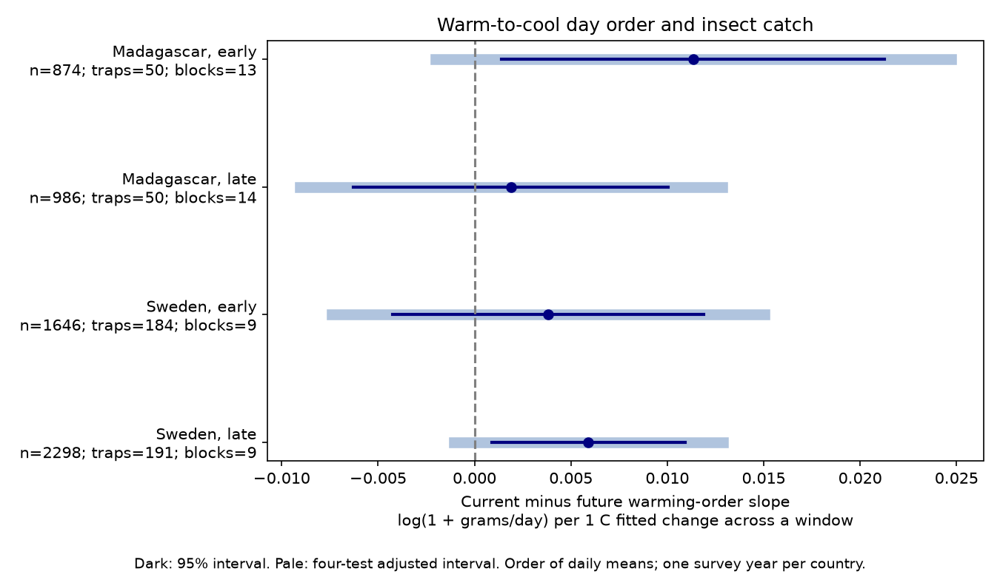

# Temperature-order contrasts had intervals across zero in four insect-catch samples in Sweden and Madagascar in 2019-2020

## Question and result

Does the order of warm and cool days have a link to flying insect catch beyond mean temperature and its variation? The same daily values can occur in a warming or cooling sequence. Their means and standard deviations (SDs) are the same. A response to order could reflect delayed activity, recovery, or capture conditions. This study tests temporal specificity. It cannot identify those causes.

We tested whether the order of warm and cool days had a different link to insect catch during collection than just after collection. Four country and period models used 5,804 measured catches in Sweden and Madagascar in 2019-2020. Models controlled mean weather, temperature variation, rain frequency, trap, season and collection duration. All four current-minus-future slope estimates were positive, from 0.0019 to 0.0113 log(1 + grams/day) per C of fitted temperature change across a window. All four adjusted 95 percent intervals included zero. Five of six sensitivity sets also had no adjusted interval apart from zero. A 5-9 day duration filter gave a positive adjusted interval in later Sweden. The results do not establish a stable collection-window link or the absence of a temperature-order effect. Each country has one survey year. The period split separates seasons at repeated traps. Catch combines insect abundance, flight activity and capture conditions. Coarse weather, selected samples, few time clusters and remaining observation bias limit inference. The package gives code, source hashes, aggregate results and a figure. External raw and catch-level data remain outside the package.

| Country | Period | Catches | Traps | Time blocks | Contrast | 95% interval | Four-test interval |
|---|---|---:|---:|---:|---:|---|---|
| Madagascar | early | 874 | 50 | 13 | +0.0113 | +0.0014 to +0.0213 | -0.0020 to +0.0247 |
| Madagascar | late | 986 | 50 | 14 | +0.0019 | -0.0063 to +0.0101 | -0.0091 to +0.0128 |
| Sweden | early | 1646 | 184 | 9 | +0.0038 | -0.0043 to +0.0119 | -0.0074 to +0.0150 |
| Sweden | late | 2298 | 191 | 9 | +0.0059 | +0.0009 to +0.0109 | -0.0011 to +0.0129 |

Units are log(1 + grams per trap-day) per C of fitted temperature change across a window. These are model slopes, not percent changes in insect populations. Early Madagascar and later Sweden had marginal intervals above zero. Their four-test intervals included zero. A positive estimate in all four samples does not establish four independent replications: each country repeats traps across seasons. No formal difference test between countries or periods was done.

## Prior work and scope

Van Dijk and colleagues studied climate and insect biomass seasonality in these networks (2024; DOI 10.1098/rspb.2024.0090). Their work motivates controls for season and effort. The current study asks whether ordered changes in daily mean temperature have a link beyond its mean and SD. It does not measure extreme heat or use a biological stress threshold.

Before fits, we searched the campaign for phenology, climate, pollution, cherry frost, Sweden, Madagascar, insect temperature order, warming and cooling. We read SCI c5aa436241129d1d01e4fa0d6a74395fc271da4623e5a3c0d666074bdb7d5c1e and adapted its published MIT code. That study tested temperature SD. Our new target is day order, with SD as a control. Source records overlap. This is not independent validation of that study. Files/plan.md records the local plan before fits; it is not a public registration.

## Data and observation bias

We reused six CSV files from Zenodo record 11205860, version 1, 16 May 2024, a mirror of Dryad DOI 10.5061/dryad.ghx3ffbtk. We also read the source README.xlsx. Files/provenance.json records the exact shared path, resolved path, URL, size and SHA-256 hash for each CSV. Files/metadata_source.json gives these fields for the spreadsheet. All seven MD5 values matched the live archive metadata. Files/source_audit.json records the checks and CC0 declaration. No shared file was changed or downloaded.

Sweden covers 2019 and Madagascar covers August 2019 to July 2020. Habitat selection and volunteer sampling do not give random national samples. About 75 percent of Malagasy catches were processed in the source study. Swedish collection duration varies by season. Early means midpoint survey day at most 183; late means greater than 183. Survey day 1 is 1 January in Sweden and 1 August in Madagascar. These periods are separate seasons, not independent years or the same calendar season across countries.

We exclude Swedish rows with no sample ID. Those rows contain zeros inferred from snow, not measured catches. We retain measured zeros. We exclude invalid mass or duration, durations outside 3-21 days, absent trap weather and incomplete weather windows. Sweden retains 3,944 of 4,737 source rows; Madagascar retains 1,860 of 1,861. Files/selection.json gives counts by exclusion. Equal catch weights do not undo missing catches or weather coverage selection. Trap intercepts address stable habitat and location. Catch per day and log duration address part of effort. They cannot separate abundance from insect flight and capture efficiency.

## Method

The response is log(1 + measured grams / duration in days). Collection start is twice the midpoint minus collection day. In Madagascar it matches the explicit placement day. The current weather window excludes placement day and includes collection day. Past and future windows have the same integer length and touch the current boundaries without overlap. Fractional measured duration sets the catch rate; integer days set weather exposure. Partial-day error remains.

For each window, let x be evenly spaced positions from -0.5 to +0.5. Let T be daily mean temperature in C. The order metric is sum(x times T) divided by sum(x squared). It is the fitted end-to-end change across the window. Positive values mean warming in fitted order; negative values mean cooling. This metric does not require monotonic weather. It is not a temperature trend per day. Reversing the days changes its sign while the mean and SD stay fixed. Window duration still changes its interpretation; we control duration and test a narrow duration filter. Files/order_support.csv gives observed metric quantiles.

Each country-period OLS model has trap and 14-day midpoint-block intercepts, log duration, and latitude times annual and half-year sine and cosine terms. For past, current and future windows it includes order, temperature SD, mean temperature and its square, mean precipitation and its square, and wet-day fraction (precipitation greater than 1 mm). Mean temperature is centered and divided by 5 C. Precipitation is divided by 5 mm and wet fraction by 0.25. Order and SD are unscaled. The internal variable name Wet in code refers to order, not rain. All models have full column rank. Primary condition numbers range from 2,462 to 41,113. This warns of difficulty separating weather and seasonal terms.

The primary contrast is current order slope minus future order slope. Its error uses the full covariance. Two-way cluster covariance uses trap and midpoint time block. Student t intervals use the smaller cluster count minus one degrees of freedom. Four-test Bonferroni intervals use critical probability 1 - 0.05/8. The four primary fits have only 9-14 time blocks. Serial dependence across block boundaries and shared weather across traps can make intervals too narrow. The model assumes an adequate conditional mean and adequate independence between clusters.

Future weather is a specificity check, not an established causal negative control. Persistent weather can link past, current and future conditions. Subtraction can remove real persistent responses or retain seasonal bias. An uncertain contrast is not evidence of no order effect. It can occur with nonzero component slopes.

## Sensitivity and validation

Five sensitivity sets had all four adjusted intervals across zero: 7-day blocks, 28-day blocks, linear mean-weather controls, log(rate + 0.01), and removal of SD controls. The 5-9 day filter gave one positive adjusted interval, in later Sweden: +0.0078 [+0.0006, +0.0149]. The primary later Swedish interval was [-0.0011, +0.0129]. This filter changes the sample. It does not establish a stable result. All sensitivity estimates were positive; files/estimates.csv gives all component slopes, errors, sample sizes and intervals. Adjustment covers four tests within each set, not all sensitivity sets.

Files/validate.py checks all weather windows against direct masks on raw temperature rows. It uses scalar covariance arithmetic, verifies reversed-order signs and checks source hashes and unique samples. Files/validation.json records the maximum error. A second least-squares solver checks every fitted contrast and the normal equations; files/numerical_checks.json gives errors. These are checks of computation. They cannot validate field measurements or causal assumptions.

## Limits and next use

This study measures no species identity, richness, distribution, pollution or long-term change. One year per country cannot establish a climate-change response. Country and period fits test transfer across different ecological settings, with shared traps within each country. Selected habitats, missing catches, coarse daily weather, seasonal collection changes and few time clusters limit inference. Taxon-level catches, hourly local weather, flight observations and separate population counts over several years could test whether order effects reflect activity or abundance. The present result limits a claim about a common short-term order response; it does not rule out that response.

## Reproduce

Use Python 3.12 with numpy, pandas, scipy, statsmodels, matplotlib and openpyxl. Exact versions are in files/environment.json. Use a separate workspace with a datasets/ link and an output directory outside this package:

~~~sh
python /path/to/package/files/retrieve.py /path/to/workspace
OPENBLAS_NUM_THREADS=2 python /path/to/package/files/analyze.py /path/to/workspace /path/to/output
python /path/to/package/files/validate.py /path/to/workspace /path/to/output
~~~

Retrieval checks the six data hashes. If a file is absent it calls campaign-dataset with the exact URL and hash. This requires that helper on a new host. The spreadsheet is cited and hashed but is not required by computation. The working_panel.csv file stays in external output. Compare estimates.csv, selection.json, support.csv and numerical_checks.json with the signed copies. Figure bytes and last floating-point digits can vary by library version. SCI verification checks integrity and does not run the analysis.

## Rights and assignment

Our text, figures and aggregate model results use the SCI baseline CC BY 4.0 terms. Code uses MIT. External raw data and record-level tables are outside the bundle. Files/EXTERNAL_DATA.md gives attribution and code credit. The baseline LICENSE is unchanged.

Job: sci-1107-dell-climate-pollution-biodiversity-e4962ec55faa. Topic: climate-pollution-biodiversity. Campaign: 11_07_2026. Machine: dell. Account: codex-andrii. Model: gpt-6.1-sol, high reasoning effort, in T3 Code through the Codex harness. Date: 9 November 2026. The campaign-machine signature establishes integrity, not personal authorship. Private keys remain outside the package. No remote upload or index submission was made.
