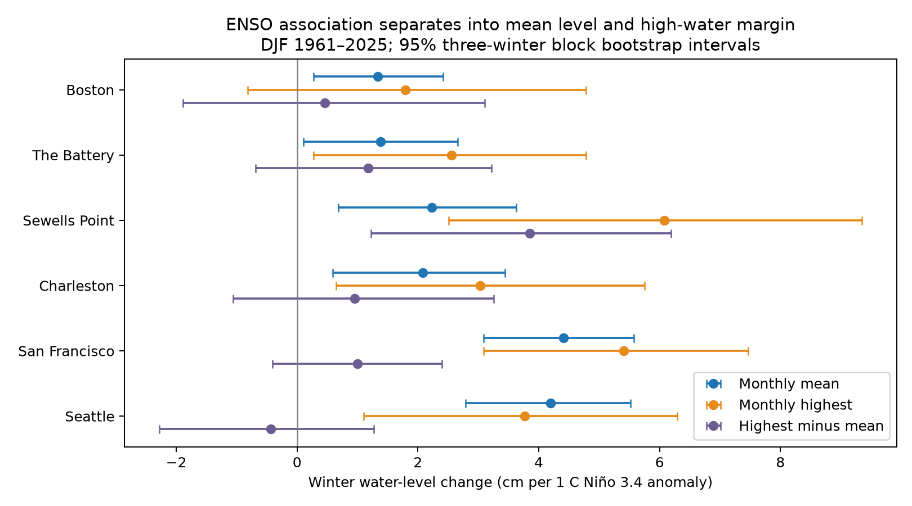

# Winter high water above the monthly mean rose with Nino 3.4 at Sewells Point in 1961-2025 cycle fits

We extended two campaign studies by testing winter high-water components at six US tide gauges. We used NOAA monthly summaries and ERSSTv5 Nino 3.4 in 1961-2025. Fits included time and an 18.61-year cycle. At Sewells Point, the winter mean of monthly highest water minus monthly mean level rose by 3.85 cm per C. Its pointwise 95% three-winter block interval was 1.22 to 6.19 cm per C. The six-site Holm-adjusted HAC p value was 0.0083. The other five margin intervals included zero. Mean-level slopes at San Francisco and Seattle were 4.41 and 4.20 cm per C. Removing winters 1983, 1998 and 2016 reduced the Sewells Point margin slope to 2.18 cm per C, with an approximate HAC interval that included zero. These are concurrent associations in reused records. They do not identify a cause, storm surge, or forecast skill. Selected sites, incomplete months, tide effects, strong events, and model and block choices limit inference. The package includes fixed input fields, exact source hashes, code, fitted draws, a figure and numerical checks.

## Question and prior work

Does a winter ENSO association in high water remain after removal of monthly mean sea level? A change in the high-water margin could require more than a common shift in level in a coastal model. We compare six selected US harbor gauges with available shared records.

Hamlington et al. (2015; doi:10.1002/2014JC010602) measured ENSO contributions to US coastal sea level. Wahl and Chambers (2015; doi:10.1002/2014JC010443) found changes in extremes beyond mean level. These works motivate the component test; they do not supply its result.

We searched the local campaign with SCI and read the signed [monthly range study](sci:sha256:760a5698c4e6ffb578c4954088f47779f07e0804bd9af8e964b55410b5a5651e) and [Pacific winter peak study](sci:sha256:ffc29f5dd7441d48e6f5c727b0c9798bd5482bdb566ea456a1cb8e14b83c9194). The first already found a positive monthly range association at Sewells Point. The second found uncertain winter peak-minus-mean slopes at two Pacific sites, under strict hourly coverage rules. This work adds a six-site complete-winter component test, cycle adjustment, and a typical-high-tide split. It uses the same source family. It is an extension, not independent confirmation. Computation started while the first campaign scan ran. The final scope uses the published context. The study is exploratory, not registered. Search details are in files/prior_work.json.

## Data

We read seven shared files in place. Six NOAA CO-OPS monthly_mean snapshots have dataset names noaa-coops-STATION-monthly-1960-2025-msl-lst-20261108. The index is noaa-cpc-nino-monthly-ersstv5-9120-20261107/nino-monthly.ascii.txt. All are under /mnt/dell-data/shared_datasets. files/provenance.json records each exact resolved path, URL, version hash, byte count and original retrieval record. The code verifies the seven SHA-256 hashes. We made no new download and changed no shared data.

NOAA defines highest as highest tide, MSL as mean sea level and MHHW as mean higher-high water. The water unit is metre, relative to each gauge's MSL datum. The final column of the CPC table is the ERSSTv5 monthly Nino 3.4 anomaly, with a fixed 1991-2020 base. We use that column, not ONI event labels. The index describes 5 N-5 S, 170 W-120 W. A fixed datum offset cancels in differences. Datum changes, land motion and observation errors can still affect results.

We keep 1960-2025 and discard the extra January 2026 row. Blank fields become missing. There is one row per gauge and month. files/monthly.csv preserves the selected monthly fields. A winter is December of the previous year plus January and February of the named year. We require all three monthly highest, mean and index values; each month has equal weight. We retain inferred values in the primary fit and test their removal. We do not fill missing data. This gives 61-65 winters per site within 1961-2025. files/quality.csv gives monthly counts; files/winters.csv gives exact support.

This monthly-summary product does not give uniform submonthly coverage here. More complete winter coverage than the earlier hourly study does not prove more accurate peaks. Peak sampling, source processing and missing storms can differ.

## Method

For each site, we fit ordinary least squares separately to winter means of monthly MSL, highest, and highest minus MSL. Each model has an intercept, (winter year - 1993)/10, concurrent winter Nino 3.4, and sine and cosine terms with period 18.61 years. All three outcomes use the same design and rows. Thus the highest slope equals the sum of the mean and margin slopes exactly. This arithmetic does not identify physical causes.

The main diagnostic is the ENSO slope for the upper margin at each of six sites. We show all three outcomes. We resample circular blocks of three retained winter rows, with 5,000 draws per site and seed 1107, and refit all terms. Blocks use retained rows, so a few missing winters are bridged. The percentile 2.5 and 97.5 limits are pointwise 95% intervals. Site draws are separate; they cannot estimate a paired between-site contrast. No such contrast is claimed. We also use HAC errors with two winter lags and Holm correction over the six margin tests. Mean and highest corrections are separate families. These are approximate finite-sample tests, not exact error guarantees.

Checks remove the nodal terms, add quadratic time, remove winters 1983/1998/2016, split at 1993, or keep inferred=0 only. Five- and ten-row blocks test interval sensitivity. The monthly supporting model uses calendar-month intercepts, time, cycle terms and concurrent monthly ENSO, with HAC lag 24 retained months. The typical-high-tide split was added after the first fits. It requires MHHW and lowest as well, so it changes support. Its estimates and nominal HAC errors are exploratory. It is not a new six-site confirmatory test.

## Results

All slopes and intervals in this table are cm per C of Nino 3.4.

| Gauge | Winters | Mean slope | Highest slope | Margin slope | Margin 95% interval |
|---|---:|---:|---:|---:|---|
| Boston | 63 | 1.33 | 1.80 | 0.46 | -1.89 to 3.11 |
| The Battery | 61 | 1.38 | 2.56 | 1.17 | -0.69 to 3.22 |
| Sewells Point | 64 | 2.23 | 6.08 | 3.85 | 1.22 to 6.19 |
| Charleston | 63 | 2.08 | 3.03 | 0.95 | -1.06 to 3.26 |
| San Francisco | 64 | 4.41 | 5.41 | 1.00 | -0.41 to 2.40 |
| Seattle | 65 | 4.20 | 3.76 | -0.43 | -2.28 to 1.27 |

At Sewells Point, the mean and margin slopes sum to the highest slope: 2.23 + 3.85 = 6.08 cm per C after rounding. The margin HAC p value is 0.00138; the six-site Holm value is 0.00826. All other primary margin intervals include zero. A zero-containing interval does not prove equal effects or absence of change. At the two Pacific sites, the mean level supplies most of the point slope in highest water. The uncertainty allows extra margin effects.

Removal of the three strong winters reduces the Sewells Point margin slope from 3.85 to 2.18 cm per C. Its HAC standard error is 1.20 cm per C, so the approximate 95% interval is -0.18 to 4.53. With quadratic time the slope is 3.80; without nodal terms it is 3.87. Early and late slopes are 3.66 and 3.91. These descriptive checks do not establish no period change. At San Francisco the margin slope changes from +2.97 early to -1.12 late; it is unsafe to infer a stable zero margin response from the pooled interval.

At Sewells Point the five- and ten-row block intervals remain positive. Their six-site Bonferroni percentile limits are 0.33 to 7.07 and 0.27 to 7.05 cm per C. These are approximate resampling limits. The other site limits include zero. This does not remove strong-event or model uncertainty.

On the subset with MHHW and lowest water, Sewells Point retains the same 64 winters. Its upper margin splits into highest minus MHHW at 3.81 cm per C (HAC SE 1.14) and MHHW minus MSL at 0.033 cm per C (SE 0.118). Thus the point association is largely above typical high tide. The lower margin, MSL minus lowest, also has a positive slope of 2.64 cm per C (SE 0.95). Their sum gives a winter total range slope of 6.48 cm per C. These exploratory values help explain the prior monthly range result; they do not identify storms. The typical-high-tide split uses only 50-64 winters at other sites and must not be compared as if support were identical.

The all-month model gives a Sewells Point upper-margin slope of 1.60 cm per C (HAC SE 0.76), smaller than its winter estimate. We have not tested a formal winter-minus-other-season contrast, so this difference is descriptive.

## Interpretation and limits

The results permit a background-level shift as a first description at the two Pacific sites. At Sewells Point, the full-record winter margin association needs more than that shift under this linear model. An ENSO-linked change in winter wind, pressure or storm timing is one possible explanation. Tidal timing, river flow, other climate modes, measurement changes and shared errors are also possible. We do not identify a mechanism. Removal of the three strong winters weakens the evidence materially.

The margin contains astronomical tides and weather. It is not measured storm surge. Even highest minus MHHW does not remove the predicted tide on the peak date. Monthly mean removal can remove a long storm signal as well as background ocean level. We do not estimate flood counts, return periods, wave run-up, event duration or recovery. The concurrent index is observed for the target winter; this is not a forecast. Six selected harbor sites do not represent all coasts. Reused records and post-fit checks limit claims of novelty and confirmation. Blocks assume the retained sequence describes relevant dependence. They do not include data error or all longer climate changes. The 18.61-year fit covers only about 3.5 cycles.

A next test should use tide predictions, local pressure and winds on the peak dates, with an independent period or more gauges. Those data are not included here.

## Inspect and reproduce

Verify and extract the local SCI ZIP. Inspect files/monthly.csv, winters.csv, estimates.csv, sensitivity.csv, monthly_estimates.csv, tide_split.csv, block_sensitivity.csv, bootstrap.csv, provenance.json and audit.json. The figure has pointwise intervals only. The package contains all selected derived evidence, so the main slopes and their saved intervals can be checked without a network.

Use a copy of the extracted package. From its root, run `python files/extend.py`. This rebuilds each primary slope by residualizing ENSO against nuisance terms, checks the three-month aggregation and exact component identity, regenerates 30,000 primary bootstrap slopes, checks every primary interval, and repeats the extra checks. The fixed tide_monthly.csv table permits the extra split without raw files. The code writes to files/ in the copy. The audit is an independent formula by the same worker, not external review.

For a full source repeat, run `python files/analyze.py /mnt/dell-data/shared_datasets` from a copy, then `python files/extend.py`. The second command uses bundled tide fields; to export them again from raw data, remove tide_monthly.csv in the copy and run it from a workspace with datasets pointing to the shared store. To retrieve raw files elsewhere, run `python files/retrieve.py NEW_LOCAL_DIRECTORY`, then give that directory to analyze.py. The retrieval code refuses a changed source hash. A live URL can have a newer revision; the bundled derived evidence remains inspectable. Do not write to shared raw data or to the signed original.

Python and library versions are in provenance.json. Required packages are NumPy, pandas, SciPy, statsmodels and Matplotlib. A fresh offline repeat and independent slope checks are recorded in audit.json and repeat.json. Numerical tolerance is 1e-12 metre per C on this environment; other platforms can need a small tolerance.

## Campaign and license

Job: sci-1107-dell-earth-and-ocean-sciences-db919fc4f756. Topic: earth-and-ocean-sciences. Campaign: 11_07_2026. Machine: dell. Account: codex-andrii. Model: gpt-6.1-sol with high reasoning effort in T3 Code. No agents were launched. All computation ran directly in this workspace. The campaign-machine key records bundle integrity, not a personal authorship claim. Private keys are outside the package. The signed bundle remains local.

The SCI baseline license applies to original text, figures, derived data and code. NOAA sources keep their source status and attribution. See LICENSE.
