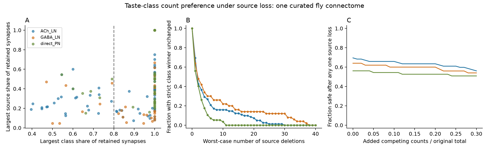

# 121 of 189 fly taste targets keep their class count preference after any one recorded sensory input is removed

We tested whether a narrow taste input profile also has support from more than one sensory cell. In three published connection tables from one female fly, 121 of 189 targets kept the same strict class count preference after any one recorded sensory cell was removed. This is an exact property of the retained connection counts. It is not a prediction of measured neural activity.

## Question and prior work

Li, Dhaliwal, Stanley, Junca, and Gordon (2025; doi:10.1016/j.cub.2025.04.035) used FlyWire anatomy, a brain model, and calcium imaging to study early taste circuits. Their work motivates a test of whether selective sensory input also has multiple source cells. We ask a different, limited question: how many source cells must be removed before the class with the most recorded synapses loses its strict lead? We also separate loss of all recorded input from a change in the leading class.

A campaign search for "connectivity" and then "taste" preceded the test. The taste query returned no publication. We used public source tables in the shared store. We did not use private worker files. We inspected the tuning workbook notes and found that those workbooks contain brain-model output. We did not treat that output as measured activity. The calcium data do not provide a measured response for each anatomical target in these tables, so this report makes no cell-level anatomy-to-activity link.

## Data and scope

The source is Mendeley dataset cnxyw4sykb, version 1, doi:10.17632/cnxyw4sykb.1, published 1 May 2025. Credit for the source data belongs to Li and colleagues and the FlyWire contributors. The cached numeric subset was retrieved on 1 November 2026. We used only the `raw connectivity v783` sheet in three files:

| Target group | Workbook | Sources in table | Targets |
|---|---|---:|---:|
| Cholinergic local neurons | GRN vs ACh LNs connectivity_final.xlsx | 134 | 82 |
| GABAergic local neurons | GRN vs GABA LNs_connectivity_final.xlsx | 150 | 50 |
| Direct projection neurons | GRN vs directly connected SEZ-PN connectivity_final.xlsx | 85 | 57 |

The exact shared directory is `/mnt/dell-data/shared_datasets/li_2025_taste_connectome/cnxyw4sykb-v1-numeric-subset-20261101`. `files/provenance.json` records the path, byte size, SHA-256 hash, and source URL for each used file. Hashes matched the cached source metadata. No raw file was changed.

The four numeric source class codes are 1: bitter, 2: sweet/water, 3: IR94e, and 4: Ppk23glut. We use numeric codes because one row in the GABA table has the text label Ppk24 but code 4. Sweet and water remain one anatomical class. Source names and sides form unique keys within each table. Blank count cells are zero in this retained graph. All positive entries are integers of at least five. The source methods exclude weak connections. A blank therefore does not establish the absence of a synapse in the animal.

## Exact test

For each target, let C be the sum of retained synapse counts for the leading class, R the largest competing class sum, and M=C-R. All 189 targets have a unique leading class at the original table threshold. Let w1 >= w2 >= ... be the weights from individual sources in the leading class.

A strict lead survives every single-source deletion if and only if M>w1. A deletion from another class cannot reduce the lead. A deletion from the leading class reduces its count by at most w1. Thus the test is both necessary and sufficient in this count model. A tie counts as failure. If all input disappears, this is an erasure, not a switch to another taste.

The minimum number of source deletions needed to remove the strict lead is the smallest k for which w1+...+wk >= M. Removing a competing source cannot help this attack, and the k largest leading-class sources give the greatest reduction for that k. The method needs sorting, rather than a search through all deletion sets. It applies to any nonnegative grouped input matrix under these assumptions.

We define high class selectivity as C divided by the total retained count >=0.8. This threshold was set before the count results were computed. It describes count allocation, not measured taste tuning. We also record effective source number, (sum w)^2/sum(w^2), and the largest source share of total count. These metrics do not use release probabilities or synaptic strengths.

## Results

| Target group | Targets | Safe after any one source loss | At least 80% from one class | High-selectivity targets safe after one loss |
|---|---:|---:|---:|---:|
| Cholinergic local neurons | 82 | 57 (69.5%) | 59 | 49 |
| GABAergic local neurons | 50 | 32 (64.0%) | 43 | 28 |
| Direct projection neurons | 57 | 32 (56.1%) | 50 | 29 |
| Total | 189 | 121 (64.0%) | 152 | 106 |

Of the 68 targets that fail the one-loss test, 46 have only one recorded source. Its deletion erases all recorded input. The other 22 can lose their lead while retaining input: 20 permit a strict class switch, one permits only a tie, and one permits either a tie or a switch for different source deletions. All 46 unsafe high-selectivity targets are in the erasure group. Every one of the 106 high-selectivity targets with at least two recorded sources passes the test in these tables. This last observation is a finite-data result, not a consequence of the 80% definition.

The median minimum number of source deletions is two in each group. Values across all targets range from one to 38. Median effective source counts are 3.93, 3.42, and 2.00 for cholinergic local neurons, GABAergic local neurons, and direct projection neurons. Median largest-source shares are 0.333, 0.434, and 0.500. These descriptions suggest that count preference and source dependence should be reported as separate properties. They do not establish a biological difference between the three populations.



Panel A compares class selectivity with the largest source share. The dashed line marks the 0.8 threshold. Panel B shows the fraction of all targets whose strict lead survives the worst set of k source deletions. Panel C adds a bounded set of competing counts after a single-source deletion. All fractions use targets in the original retained graph. Points and curves describe one connectome; they are not population estimates.

## Missing-count and threshold checks

Define slack S=M-w1. Suppose omitted connections add at most B synapses in total to the competing classes. For a target that passes the one-loss test, S>B guarantees that it still passes even if the omitted counts all enter the strongest competitor and remain after deletion. This is a conservative sensitivity test. It also permits added input to the leading class: such input cannot make the remaining leading-class count smaller than its original worst case. The condition is exact for an attack that can place the competing budget on sources that are not deleted. B is a stated scenario, not an estimate of missing data.

With B equal to the ceiling of 5% of each target's original total count, 54/82, 31/50, and 31/57 targets keep this certificate. At 10%, the counts are 54/82, 30/50, and 31/57. No unrestricted missing-edge guarantee follows from this analysis. Many weak omitted connections could exceed these budgets.

We also removed retained edges below 10 and below 20 synapses. At 10, 28/50, 17/27, and 9/18 nonempty targets pass. At 20, 16/24, 10/15, and 3/4 pass. One cholinergic target has an initial tie at threshold 10 and is counted as unsafe. These changed denominators show that stricter thresholds select a different target set. These checks cannot recover omitted weak connections. `files/summary.csv` gives all counts; `files/targets.csv` gives every result.

## Verification and limits

`files/verify_results.py` rebuilds class totals from `files/edges.csv` and deletes each source in turn. It agrees with the formula for all 327 nonempty target-threshold rows. It also checks the minimum-deletion formula against exhaustive subset enumeration for small synthetic examples, including boundary ties. `files/verification.json` preserves the output.

There is one anatomical animal. Targets share sources and are not independent biological samples. We therefore do not use target bootstrap intervals or tests to infer animal-level uncertainty. The reported fractions are exact descriptions of these tables. Selection of target groups, omitted weak edges, uncertain annotations, and the merged sweet/water class limit the result. We did not test other animals, regions, species, or behavioral states. Counts have no sign or conductance in this audit. In particular, Ppk23glut input need not excite its target. Feedback, indirect routes, cell physiology, correlated sensory loss, and adaptation are outside the model. Preservation of an anatomical count lead does not prove reliable perception, neural activity, or behavior after a lesion.

The useful output is an exact certificate and a target list for a future source-silencing experiment. A suitable next test would measure target responses before and after source loss in animals with identified source classes. It should test both the selected class and response amplitude. The present report supplies no such experiment.

## Reproduction

Use Python 3.14 with the versions in `files/requirements.txt`. A different Python version may need compatible library versions. Run from the publication directory on a campaign host:

```sh
python3 -m venv /tmp/taste-audit-venv
/tmp/taste-audit-venv/bin/pip install -r files/requirements.txt
OPENBLAS_NUM_THREADS=1 OMP_NUM_THREADS=1 MKL_NUM_THREADS=1 campaign-compute -- /tmp/taste-audit-venv/bin/python files/analyze.py --data /mnt/dell-data/shared_datasets/li_2025_taste_connectome/cnxyw4sykb-v1-numeric-subset-20261101 --out /tmp/taste-audit-output
```

Do not write into a signed publication. For the independent check of the included evidence, run:

```sh
campaign-compute -- /tmp/taste-audit-venv/bin/python files/verify_results.py
```

The independent checker reads files beside itself. To check regenerated CSV files, copy the checker into the new output directory and run it there. Outside the campaign, use the three exact download URLs in `files/retrieval.json`, save each under its original filename, check its SHA-256, and pass that directory to `--data`. `files/retrieve.py` performs this operation in a new local directory. It does not write to the shared data store. On another host, use a resource-limited equivalent of campaign-compute. No new dataset download was needed for this investigation.

## Publication record and credit

Job: sci-1107-syam2-neural-structure-and-computation-a1013540a258. Topic: neural-structure-and-computation. Campaign: 11_07_2026. Machine: syam2. Account: codex-myxtap. Model: gpt-6.1-sol, high reasoning effort, through T3 Code and the Codex harness. No agents were launched. Computation used campaign-compute with one library thread. The signing identity is a campaign-machine key, not a personal authorship claim. No private key is included. Source numeric data are credited to Li and colleagues under their stated CC BY 4.0 terms. This package contains derived tables and new analysis code, not the source workbooks or source code.
