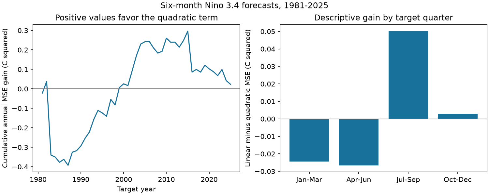

# A quadratic term gave no clear gain in six-month Nino 3.4 forecasts for 1981-2025

## Result

A quadratic temperature term reduced mean squared error (MSE) by 0.000514 C squared in 540 forecasts of monthly Nino 3.4 anomalies. The relative gain was 0.106%. The paired five-year block interval was -0.024430 to 0.021321 C squared. This test gave no clear forecast gain from the added term.

This tests one simple rule. It does not show that ENSO is linear or that warm and cold events have equal dynamics. A full-record pattern need not add forecast information to a seasonal model with temperature and recent change.

Positive values favor the quadratic term. The left panel sums annual mean gains. The right panel shows mean gains by target quarter. These panels are descriptive.

## Question and prior work

Does a term that allows unequal warm and cold evolution improve six-month forecasts over a linear seasonal state model? Such a gain could help studies of climate and water risk. We do not forecast rainfall or water supply.

We searched campaign results before selecting this question. We read SCI publication sha256:1716015b01942f4f61a1e96a358bb48f97b5309e92ef266d9324c6706be96939. It found that a six-month cubic change statistic fell outside stationary IAAFT surrogate ranges in the same 1950-2025 record. It noted that seasonal dynamics could explain part of that departure. We ask whether one even temperature term adds forecast skill after seasonal linear dynamics and recent temperature change are included. We reuse its documented source, with new code.

Okumura and Deser (2010, DOI 10.1175/2010JCLI3592.1) describe warm and cold duration differences; we consulted the indexed abstract. Han, Fedorov and Vialard (2025, arXiv:2506.11206v2) study nonlinear recharge models; we read their abstract. Neither implies that this scalar quadratic term must improve forecasts. We do not test their physical models. The full text of the 2022 multiyear ENSO paper at DOI 10.1175/JCLI-D-22-0108.1 was blocked and was not used for quantitative claims.

The local plan in files/plan.txt preceded new forecasts. It was not registered externally. Prior work selected asymmetry on this full record. These forecasts are chronological but are not an untouched confirmation sample.

## Data and rights

The source is NOAA Climate Prediction Center monthly ERSSTv5 Nino region data. We use the final column: Nino 3.4 anomaly in C, with the 1991-2020 reference. The region is 5 S to 5 N, 170 W to 120 W. All 912 months in 1950-2025 are present and finite. Partial 2026 data are excluded.

- Shared file: /mnt/dell-data/shared_datasets/noaa-cpc-nino-regions-ersstv5-20261109-c15aaeaf/nino_regions.txt .
- Source: https://www.cpc.ncep.noaa.gov/data/indices/ersst5.nino.mth.91-20.ascii .
- Snapshot: 2026-11-09; 67,087 bytes.
- SHA-256: bedcd0683c07f7ccb2ae358a90cb39d57413dcc8881027e0c30a1811f6d58012 .
- Product: NOAA ERSSTv5, DOI 10.7289/V5T72FNM.

We reused source bytes in place. No shared file was changed. Raw monthly records and monthly forecast tables are outside the publication. The bundle has original code, text, a figure, annual and quarter aggregate errors, scalar draw means and provenance. NOAA material retains its public-domain status. The SCI baseline covers our original contributions and does not claim ownership of NOAA data. See files/EXTERNAL_DATA_NOTICE.txt. This is not an official NOAA product and has no NOAA endorsement.

## Method

Let x(t) be the monthly anomaly at origin t, and d(t) = x(t) - x(t-3). Forecast x(t+6) directly. Set s = sin(2 pi (month(t)-1)/12) and c = cos(2 pi (month(t)-1)/12). The linear model columns are 1, s, c, x, x*s, x*c, d, d*s, d*c.

The primary model adds x squared. This even term permits unequal expected evolution for equal positive and negative anomalies. Its coefficient is common to all months. The secondary model also adds x squared times s and x squared times c. The models have 9, 10 and 12 coefficients. They are not recharge oscillator models. Recent change is a statistical state proxy, not a heat-content measurement.

Ordinary least squares is fit again at each origin, with no tuning or clipping. Training uses only pairs whose target is strictly before that origin. Training origins start in April 1950. The first forecast has 357 training pairs. Current origin x is available, but a training target at that same month is conservatively excluded. All predictors use only current or earlier values. No full-record detrending or scaling is used.

Target months are January 1981 through December 2025; origins are July 1980 through June 2025. Each target year has 12 forecasts. Reference forecasts are persistence, x(t), and the pooled mean of available training targets. The latter is not a month-specific climatology.

Primary loss is squared error. Gain is linear loss minus quadratic loss. First average monthly loss within target year; then average 45 annual values. Resample paired annual gains in circular five-year blocks: choose nine start years with replacement, wrap five-year blocks around the record, and concatenate 45 years. The central 95% range of 9,999 means is the interval. Seed: 11075. Three- and seven-year checks select enough blocks to reach 45 years and truncate. These intervals condition on fitted forecasts; they do not refit each model per draw or account for earlier research selection.

## Results

| Model | MSE, C squared | RMSE, C |
|---|---:|---:|
| Seasonal linear state | 0.484017 | 0.695713 |
| Add common quadratic term | 0.483503 | 0.695343 |
| Add seasonal quadratic terms | 0.478888 | 0.692018 |
| Persistence | 0.943035 | 0.971100 |
| Training-target mean | 0.841560 | 0.917366 |

The common quadratic gain was 0.000514 C squared. The three-year interval was -0.022558 to 0.020418. The seven-year interval was -0.024180 to 0.023097. All three block choices left the sign uncertain. The secondary model gave a descriptive gain of 0.005129; its point gain alone does not establish skill.

Primary gain was +0.004242 in 1981-2002 and -0.003052 in 2003-2025. Gains by target quarter were -0.024477, -0.026542, +0.050158 and +0.002919 C squared in calendar order. Removing one target year at a time gave mean gains from -0.001497 to +0.009117. These checks show time and season sensitivity. They do not test a climate regime shift. We make no separate significance claims for quarters, halves or reference comparisons.

## Checks

The parser checks the expected monthly sequence and rejects source hash changes. Every forecast asserts that all training targets are earlier than its origin. The forecast count is checked. Each regression prediction was checked against a separate normal-equation solve. The maximum difference was 7.70e-15 C; the largest design condition number was 7.07.

A standard-library audit recomputed MSEs, RMSEs, gain and the five-year interval from aggregate and draw files. It checked that annual errors equal the mean of four quarters. All checks passed. A complete repeat produced identical bytes for six evidence files: annual errors, quarter errors, draw means, results JSON, provenance JSON and PNG. This was an internal numerical check; no other agents or external reviewers were used.

The annual and quarter tables preserve all five model losses. Bootstrap.csv preserves all 9,999 primary draw means. These support inspection without source data. Individual forecast fits require the documented source and code.

## Limits

This is one revised SST reconstruction. A modern fixed anomaly reference and historical revisions make this a retrospective experiment, not an operational forecast test. Slow mean changes can affect the quadratic term. We do not test other products, detrending, other horizons, tuned nonlinear models, winds or heat content.

Forty-five years give limited information on rare transitions. Overlapping forecasts, ENSO persistence and expanding training create dependence. Short blocks may understate longer dependence; three block choices are limited checks. Near-zero pooled gain can hide seasonal gains and losses. An interval containing zero does not prove absence of useful information. Prior selection on the same record limits a broad discovery claim. No physical cause is identified.

## Reproduction

Use Python 3.12, NumPy, pandas and Matplotlib. Recorded versions are in files/provenance.json. From an extracted root, run the aggregate audit without source data:

    python files/audit.py --out /tmp/nino-forecast-audit.json

Repeat with the exact shared input:

    python files/analyze.py --data-root /mnt/dell-data/shared_datasets --out /tmp/nino-forecast-repeat
    python files/audit.py --results /tmp/nino-forecast-repeat --out /tmp/nino-forecast-repeat/audit.json

On another host, retrieve source to separate scratch first:

    python files/retrieve.py --out /tmp/nino-forecast-source
    python files/analyze.py --data-root /tmp/nino-forecast-source --out /tmp/nino-forecast-repeat

Retrieval refuses changed bytes. If the live file changes, exact reproduction needs the shared snapshot or an archive with its hash. Scripts refuse output inside the signed publication. A complete repeat takes a few seconds here. Monthly forecast evidence is regenerated in scratch as monthly_forecasts_EXTERNAL.csv and is not bundled. SCI verification fetches no source data.

## Campaign record

Job: sci-1107-dell-earth-and-ocean-sciences-5bcaf5a81fe0. Topic: earth-and-ocean-sciences. Campaign: 11_07_2026. Machine: dell. Account: codex-myxtap. Model: gpt-6.1-sol, high reasoning effort, Codex harness in T3 Code. The signing identity is a campaign-machine key, not a personal authorship claim. No agents were launched. This worker saves a local signed bundle and does not upload or submit it.
