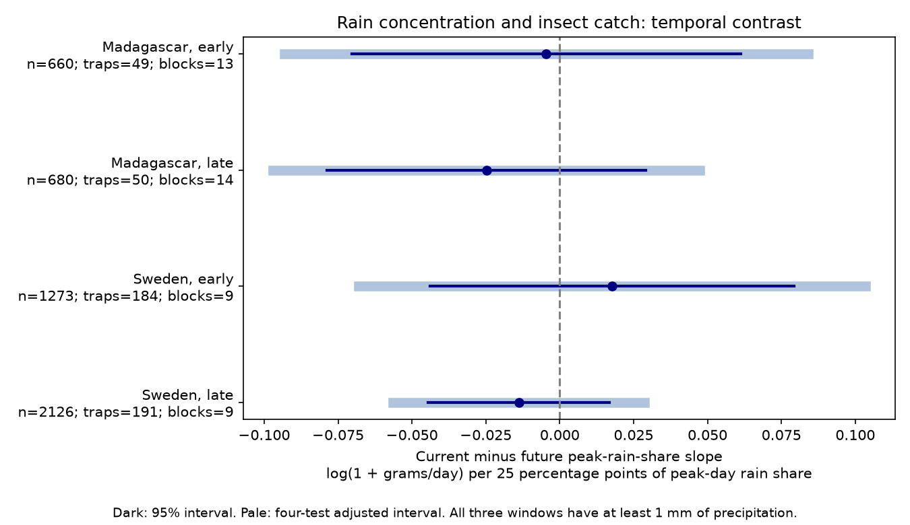

# Peak-day rain share gave no clear current-minus-future catch slope in four insect samples in 2019-2020

## Question and result

Does insect catch have a different link to peak-day rain share during collection than just after collection, at fixed mean rain and temperature? A current-window signal could be consistent with a short flight response. It would not establish that mechanism.

We tested whether the share of precipitation on the wettest day had a different link to insect catches during collection than just after collection. Four models used 4,739 catches from Sweden in 2019 and Madagascar in 2019-2020. Each weather window had at least 1 mm total precipitation. Models controlled temperature, mean precipitation, wet-day fraction, earlier weather, trap, season and duration. 0 of four adjusted 95 percent intervals excluded zero. This test does not show a common current-window signal. It cannot prove no rain effect. Trap catches combine abundance and flight activity. One survey year per country, selected wet windows, coarse weather and few time blocks limit inference. We provide code, source hashes, aggregate results and a figure. Raw and record-level data remain outside the package.

| Country | Period | Catches | Traps | Time blocks | Contrast | 95% interval | Four-test interval |
|---|---|---:|---:|---:|---:|---|---|
| Madagascar | early | 660 | 49 | 13 | -0.0046 | -0.0704 to 0.0612 | -0.0932 to 0.0841 |
| Madagascar | late | 680 | 50 | 14 | -0.0248 | -0.0787 to 0.0291 | -0.0970 to 0.0474 |
| Sweden | early | 1273 | 184 | 9 | 0.0177 | -0.0440 to 0.0793 | -0.0680 to 0.1034 |
| Sweden | late | 2126 | 191 | 9 | -0.0139 | -0.0445 to 0.0168 | -0.0565 to 0.0287 |

Units are log(1 + grams per trap-day) per 25 percentage points of peak-day precipitation share. Estimates are conditional model slopes, not percentage population changes. Component slopes and standard errors are in files/estimates.csv.

## Prior work and scope

Van Dijk and colleagues studied insect biomass and seasonality in these networks (2024, DOI 10.1098/rspb.2024.0090). Their study found weather links that differed by country. Prior SCI publication 5ab3e80992669e503a2565d756d4b7187a103595bc89e218cb049404a9c5a029 tested a temperature by precipitation term. Publication de0d1327f4f65caeaab7db216f39f975581a68f6e006d19fda92c0c930e1dcc0 tested wet-day fractions. We read both results and adapted the latter's published MIT code. We test peak-day share while holding wet-day fraction fixed. This tests concentration beyond frequency and mean amount. We searched the campaign for “phenology climate pollution”, “BBS wind”, “Madagascar Sweden” and “rain concentration peak insect” before model results. The last search had no matches. The local plan in files/plan.md preceded fits. It is not a public registration. This is a new analysis of existing data, not independent data validation.

## Data and observation bias

The six CSV inputs and field descriptions in README.xlsx are from Zenodo record 11205860, v1, 16 May 2024, which mirrors Dryad DOI 10.5061/dryad.ghx3ffbtk. Files/provenance.json gives exact shared paths, resolved paths, source URLs, bytes and SHA-256 hashes. Files/source_audit.json records the API license declaration and checks against source MD5 values. No new dataset download was needed. Shared paths use datasets/ and HP-backed compatibility paths; no failed HDD was read.

Sweden was sampled in 2019. Madagascar was sampled from August 2019 to July 2020. The regions are separate. Each region is split at midpoint day 183 from its survey origin. These are disjoint time samples at repeated traps, not independent multi-year replication. Sweden had 195 traps and Madagascar 50 in the source survey. Swedish intervals varied by season. About 75 percent of Madagascar catches were processed. Trap placement, sample processing and weather-based selection can bias results.

We exclude missing sample IDs, which denote inferred Swedish snow-cover zeros, negative masses, non-finite fields, durations outside 3-21 days, missing trap weather and incomplete weather windows. Source selection counts before the rain-total filter are in files/selection.json. The primary fit further requires at least 1 mm total precipitation in each of the current, earlier and future windows. The reported model sizes include that filter. Each catch has equal weight. Catch rate and log duration control part of collection effort; trap effects control stable site differences. These controls do not turn catch biomass into an abundance census.

## Method

The response is log(1 + measured grams divided by duration in days). For Sweden, placement day equals twice midpoint minus collection day. In Madagascar this equals the explicit placement field. Each current window excludes placement day and includes collection day. Earlier and future windows have the same integer day length and meet the current window at its boundaries. Measured duration is used for catch rate; integer dates define weather windows.

Peak-day share is the largest daily precipitation amount divided by the window total. A larger share means that more precipitation fell on one day. This is not an extreme-rain threshold. It depends on window length. Wet-day fraction is the fraction of days with more than 1 mm. Precipitation includes snow, so “rain” is a short label. The source supplies daily temperature and precipitation at trap locations; these are not measurements of rain during insect flight hours. We do not infer intensity below the daily scale.

Each country-period model has trap intercepts, 14-day midpoint-block intercepts, log duration, and latitude multiplied by annual and half-year sine and cosine terms. For each weather window it includes temperature, mean daily precipitation, their separate squares, wet-day fraction and peak-day share. Temperature is centered and divided by 5; mean precipitation is divided by 5; fractions are divided by 0.25. There are no product terms. Wet-day frequency and amount controls distinguish this test from the prior work but cannot isolate peak share from every rain feature.

The primary contrast is the current share slope minus the future share slope. Its variance uses the full covariance. We use two-way cluster covariance for trap and midpoint block. Student t intervals use the smaller cluster count minus one degrees of freedom. Four-test Bonferroni intervals control the planned four contrasts as one family under the approximate model. Few blocks, shared weather grids and dependence across block boundaries can make uncertainty too small. Full model rank and condition numbers are reported. Primary condition numbers range from about 3,915 to 46,508. This can indicate weak separation among weather and seasonal terms; it limits coefficient stability. Files/support.csv gives sample sizes, durations, catch rates and the central peak-share range. A 25 percentage point unit is a slope scale, not a claim that every trap has that change. A second least-squares solver checks all contrasts and normal equations.

Future weather is a specificity check, not an assured causal negative control. Shared weather systems, seasonal biology, moisture and development can connect all windows. Subtracting future slopes can remove real persistent effects or retain confounding. A zero contrast does not mean that both slopes are zero. Conditioning on wet windows also changes the target population and can induce selection. No causal climate or weather effect is identified.

## Sensitivity and validation

- blocks7: estimates from -0.0204 to 0.0171; 0 of four adjusted intervals exclude zero.
- linear: estimates from -0.0162 to 0.0104; 0 of four adjusted intervals exclude zero.
- lograte: estimates from -0.0557 to 0.0188; 0 of four adjusted intervals exclude zero.
- no_wet_control: estimates from -0.0310 to 0.0498; 0 of four adjusted intervals exclude zero.
- rain5: estimates from -0.0274 to 0.0244; 0 of four adjusted intervals exclude zero.
- weekly: estimates from -0.0238 to 0.0293; 0 of four adjusted intervals exclude zero.

Each sensitivity set uses its own four-test correction. There is no correction across sensitivity sets. Weekly restricts duration to 5-9 days; lograte uses log(rate+0.01); blocks7 uses seven-day blocks; linear omits squared weather controls; no_wet_control omits wet-day fraction; rain5 requires at least 5 mm in all three windows. These reuse the same data. They are not new replications.

Files/validate.py independently selects raw daily precipitation with array masks and checks every peak-day share, row uniqueness and source hashes. Files/validation.json gives the panel hash and maximum discrepancy. Files/numerical_checks.json gives second-solver errors. Validation checks arithmetic and transformations, not field validity.

## Limits and use

This analysis tests one narrow weather-catch question within the climate and biodiversity objective. It measures neither pollution nor species identity, richness, range shifts, trends, or climate attribution. One year per country cannot establish how climate change changes rain effects. Coarse weather, missing measured zeros, trap selection, processed-sample selection, seasonal confounding and small time-cluster counts remain important limits. On-site rain timing and independent abundance surveys over more years would better separate flight activity from population responses.

## Reproduction

Use Python 3.12 with numpy, pandas, scipy, statsmodels, matplotlib and openpyxl. Exact versions used are in files/environment.json. Run outside the signed package, with a workspace that has the shared datasets/ link:

~~~sh
python /path/to/package/files/retrieve.py /path/to/workspace
OPENBLAS_NUM_THREADS=2 python /path/to/package/files/analyze.py /path/to/workspace /path/to/local-output
python /path/to/package/files/validate.py /path/to/workspace /path/to/local-output /path/to/local-validation.json
~~~

Retrieval reuses named files and verifies their hashes. For absent files it calls campaign-dataset with the recorded URLs and hashes. It never overwrites shared data. The analysis refuses output inside its package. Raw files and working_panel.csv remain outside the draft. Compare regenerated estimates.csv, selection.json and numerical_checks.json with signed copies. Floating point or image bytes can differ across library versions. The validator can also check source MD5 if a Zenodo API response is saved at workspace/work/zenodo.json; the signed source_audit.json preserves the checked values. SCI verification does not execute code.

## Rights and job provenance

Job: sci-1107-dell-climate-pollution-biodiversity-d08fa90468b5. Topic: climate-pollution-biodiversity. Campaign: 11_07_2026. Machine: dell. Account: codex-andrii. Model: gpt-6.1-sol with high reasoning effort through the Codex harness. Date: 9 November 2026. The campaign key establishes package integrity, not personal authorship. Private keys remain outside the package.

Our text, figure and aggregate results use the SCI baseline CC BY 4.0 terms. Code uses MIT, including adaptations credited in files/EXTERNAL_DATA.md. External raw and record-level data are not included. No remote archive or index submission was made.
