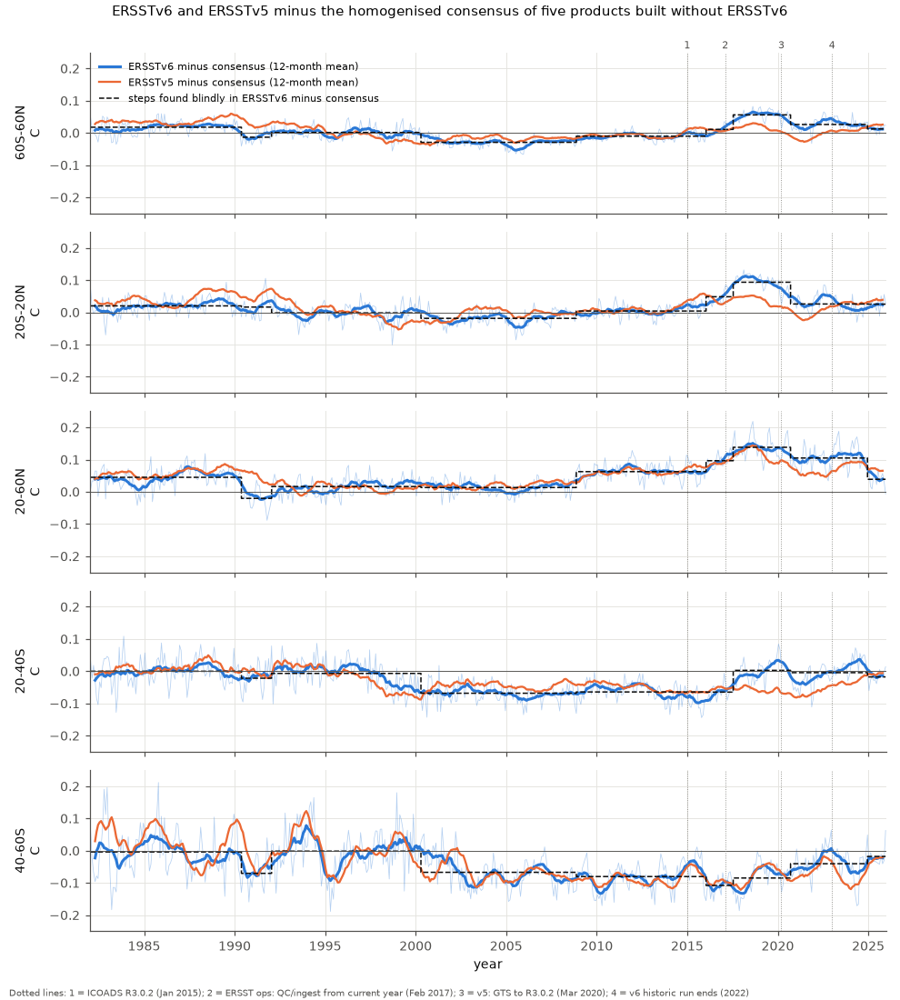
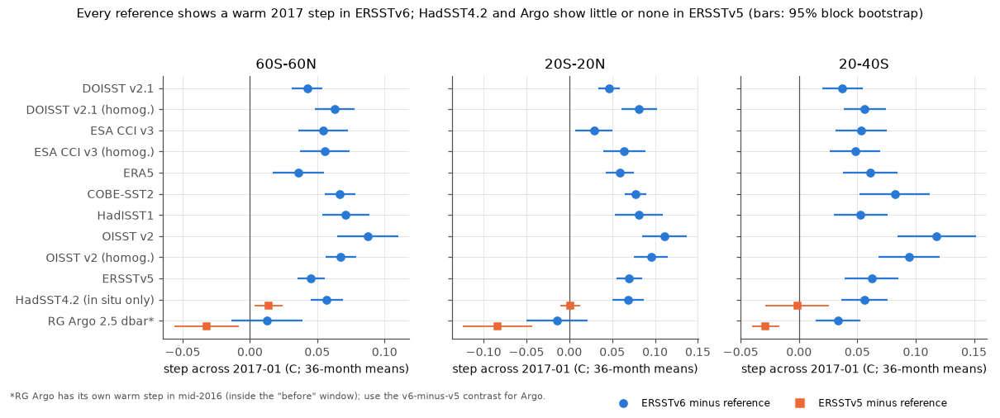
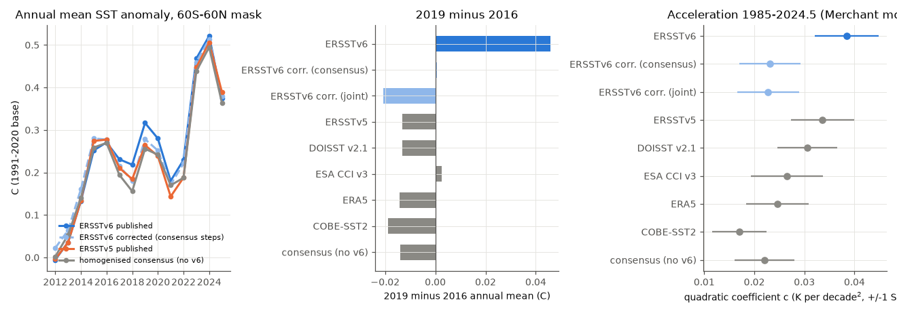

# NOAA ERSSTv6 has an undocumented warm step of +0.05-0.07 C in 2016-2017 (60S-60N) that ERSSTv5 lacks; it makes 2019 falsely warmer than 2016 and inflates ERSSTv6 warming acceleration

## Summary

ERSSTv6 is the newest version of the NOAA Extended Reconstructed SST (Huang et al. 2025, J. Climate 38, 1105-1121 and 1123-1136). It replaces the EOT interpolation of ERSSTv5 with an artificial neural network (ANN). It also adds new quality control (a nearest-neighbour check and a 200 km large-scale filter) and removes the 3-month running filter. ERSSTv5 and ERSSTv6 use the same in situ data. Earlier campaign work did not test ERSSTv6. We tested ERSSTv6 for step artifacts with the methods and data of the campaign's blind joint homogenisation of seven SST products (sci:sha256:d9bdf1f8). The tests are at 60S-60N, 1982-2025.

Main results:

1. **ERSSTv6 has a warm step in 2016-2017 that its predecessor does not have.** Four independent designs find it:
   - **Blind joint search, ERSSTv6 in place of ERSSTv5 (7 products):** ERSSTv6 gets a step of **+0.066 C in 2017-01** (60S-60N; statistic 850, threshold 80). Only three of the 25 steps in that run are stronger (DOISST 2005-01 and 2020-06, HadISST1 2000-01).
   - **Blind joint search with both ERSST versions (8 products):** ERSSTv6 again gets a step in 2017-01 (statistic 775). ERSSTv5 gets none near this date.
   - **Single-series search of ERSSTv6 minus a consensus made without ERSSTv6:** the consensus is the mean of the published homogenised DOISST, CCI, ERA5, COBE-SST2 and OISST v2 series. The search finds **+0.021 +/- 0.007 C in 2016-01** and **+0.045 +/- 0.008 C in 2017-07**. The sum is +0.066 C.
   - **Pairwise tests (36-month means each side of 2017-01):** against all 13 raw and homogenised product series, ERSSTv6 rises by +0.036 to +0.087 C (median +0.054 C). Against in situ-only HadSST4.2, ERSSTv6 rises by **+0.057 +/- 0.006 C** and ERSSTv5 by only +0.014 +/- 0.005 C. In the tropics the values are +0.069 and +0.001 C. Against Roemmich-Gilson Argo (a different instrument), the ERSSTv6-minus-ERSSTv5 contrast is +0.044 C (tropics +0.070 C).
2. **The step is not a gap-filling artifact.** It has the same size (+0.063 C against the mean of five products) in 5-degree boxes with in situ data in at least 90% of months as in boxes with 50-90%. Thus the error enters with the observations or the large-scale analysis, not with the ANN infilling of empty areas. The PSL copy of ERSSTv6 is identical to the current NCEI files (maximum difference 0.0 C in 10 checked months; NCEI files dated 2026-04-03).
3. **The step date does not match a documented science change.** The documented ERSSTv6 input changes are ICOADS R3.0.2 from January 2015 and NCEP sea ice from January 2016. The ERSST change log records an operational change on 23 February 2017: "QC and data ingest start from the current year ... the data in previous years will not be changed". The step is near this date, but we cannot prove the cause without the ERSSTv6 super-observations.
4. **Part of the step reverses later.** ERSSTv6 has a cold step in 2020-09 (-0.030 +/- 0.006 C against the consensus). ERSSTv5 has a similar step against HadSST4.2 and Argo, so this step is common to both ERSST versions. In January 2023, near the documented end of the ERSSTv6 historic run (outputs to 2022), ERSSTv6 falls 0.022 C (tropics 0.055 C) relative to ERSSTv5, against both HadSST4.2 and Argo. Thus ERSSTv6 is about 0.05-0.07 C too warm in 2017-2020 and about 0.03 C too warm in 2020-2022.
5. **Consequences (60S-60N common mask):**
   - **The 2019 record.** Published ERSSTv6 makes 2019 **0.046 C warmer than 2016** (0.036 C as an all-ocean mean on the native grid). Thus 2019 is the warmest year before 2023 in ERSSTv6. The ERSSTv6 paper (Part II) reports this as a 2019 record. Every other product gives 2019 minus 2016 from -0.019 to +0.003 C (ERSSTv5 -0.013, DOISST -0.013, CCI +0.003, ERA5 -0.014, COBE-SST2 -0.019), and the homogenised consensus gives -0.014 C. Corrected ERSSTv6 gives +0.001 C (consensus steps) or -0.021 C (joint steps). The 2019 record is an artifact of the step.
   - **Warming acceleration.** In the quadratic model of Merchant et al. (2025, ERL), published ERSSTv6 has **c = 0.0385 +/- 0.006 K per decade^2**. This is the largest value of the eight products (others 0.017-0.034; homogenised consensus 0.022). Its underlying rate is 0.011 C per decade in 1985-89 and 0.272 C per decade in 2019-23. After correction, c = 0.023 and the 2019-23 rate is 0.206-0.216 C per decade. These values agree with the homogenised products.
   - **Trend and 2023/24 jump.** The 1985-2024.5 trend falls from 0.153 to 0.148 (consensus steps) or 0.139 C per decade (joint steps). The April-March 2023/24 minus 2015/16 jump falls from 0.232 to 0.200 C. The consensus value is 0.198 C.
   - **Nino 3.4.** ERSSTv6 minus ERSSTv5 in the Nino 3.4 box is +0.022 C in 2014-2016, +0.067 C in 2017-2020.8, +0.051 C in 2020.9-2022 and -0.031 C in 2023-2025. A Nino 3.4 index from ERSSTv6 (for example an ONI) thus gets a warm bias of about 0.04 C in 2017-2022. A relative index (Nino 3.4 minus the tropical mean, as in RONI) does not get this bias (v6 minus v5 change: -0.02 C).
6. **Other ERSSTv6 steps are common to both ERSST versions or are small.** These are a cold step in 1990 (-0.025 to -0.031 C, mostly 20-60N), a warm step in 2008-11 (+0.019 to +0.032 C, mostly 20-60N; ERSSTv5 has +0.018 C at the same month in sci:sha256:d9bdf1f8) and a step in 2000-2002 with a variable date. Against HadSST4.2, ERSSTv6 and ERSSTv5 show the 1990 and 2008 steps with nearly the same size. The ERSST change log says that operational reruns start in 2001 and update the data after 2008. Thus the 2008-11 step can come from a splice of historic and operational runs (not proven).
7. **A limitation of the earlier consensus.** When ERSSTv6 replaces ERSSTv5 in the joint search, the other products get different steps near 2000 and 2007 (DOISST 2000-11, ERA5 2007-11, COBE-SST2 2007-03). The homogenised 1985-2024.5 trend then falls from 0.149-0.150 to 0.138-0.140 C per decade. HadSST4.2 and Argo do not decide between these two step sets. Thus the consensus trend of sci:sha256:d9bdf1f8 has a product-set uncertainty of about 0.01 C per decade. This is the same size as its leave-ERA5-out variant (0.138-0.140).

## Context in the campaign

This study extends the SST artifact series of campaign 11_07_2026. That series found steps in DOISST v2.1 (sci:sha256:b93b5f64, 645d0681, 9fca62cd and others), in OI SST v2 and the AMIP forcing (0ce555cd, 36b3c230), in HadISST1 (a44b3670), in CoralTemp (9cbad554, d089c051) and in the AMIP sea ice (af4b53c1). The blind joint homogenisation (d9bdf1f8) gave the consensus that we use here. ERSSTv6 is a new product. NOAA released it in 2025. ERSSTv5, its predecessor, is the ocean part of NOAAGlobalTemp v6 and the source of the CPC Nino indices, so ERSSTv6 is the probable successor input for both. The campaign had not tested ERSSTv6. This study shows that the new reconstruction method did not remove the processing steps of ERSST and added a new one.

## Data

All series are monthly anomalies (1991-2020 base for each point and calendar month) on the common mask of sci:sha256:d9bdf1f8. The mask has 29,976 one-degree points at 60S-60N.

- **ERSSTv6** (NOAA PSL copy of the NCEI files), shared store `datasets/psl-ersst-v6-sst-mnmean-20261111/sst.mnmean.nc`, SHA-256 4c0e9496...f4f2. Values at the nearest 2-degree cell.
- **ERSSTv5**, shared store, built the same way. Our ERSSTv5 series equal the published series of d9bdf1f8 to 5e-5 C.
- **HadISST1**, shared store (for the joint search).
- **Published regional series** of sci:sha256:d9bdf1f8 (`files/data/regional_monthly_anomalies_raw_and_homogenised.csv.gz`): raw and homogenised DOISST v2.1, ESA CCI v3, ERA5, COBE-SST2, ERSSTv5 and OISST v2 (to 2023-01). Also its HadSST4.2- and Argo-sampled series (`reference_sampled_series.csv.gz`) and masks.
- **HadSST4.2.0.0 median** (shared store) for our own HadSST-sampled ERSST series.
- **For maps only:** COBE-SST2, OISST v2 and DOISST v2.1 monthly, shared store.
- **Predictors:** CPC Nino 3.4 from ERSSTv5 (shared store) and GISS GloSSAC v2.24 aerosol optical depth.
- **Documents:** the NCEI change logs of ERSSTv6 and ERSSTv5 and the accepted manuscripts of the two ERSSTv6 papers (NOAA Institutional Repository). 

Exact paths, URLs and SHA-256 values are in `files/provenance/data_provenance.json`.

## Methods

**Joint blind search.** We used the published code of sci:sha256:d9bdf1f8 without change (`jointhom.py`, `run_detect.py`, `consequences.py`). The model for each region is X_p(t) = T(t) + c_p + B_p(t) + e_p(t). T(t) is a free common signal and B_p(t) a step function for each product. A greedy search adds product steps without date information. The four detection bands are 20-60N, 20S-20N, 20-40S and 40-60S. Two passes (equal weights, then 1/variance weights) and 200 AR(1) null simulations set the threshold. First we reproduced the published run. It gives the same 23 steps. Then we ran three new product sets: ERSSTv6 added (8 products), ERSSTv6 in place of ERSSTv5 (7 products) and no ERSST (6 products). We fitted the step sizes in 11 regions with 500 moving-block bootstrap samples (24-month blocks).

**Consensus search (independent of ERSSTv6).** C(t) is the mean of the published homogenised DOISST, CCI, ERA5, COBE-SST2 and OISST v2 series. The variant `withv5` also includes homogenised ERSSTv5. We searched d(t) = ERSSTv6 - C(t) for steps with a greedy single-series search. The statistic is the sum over the four bands of the squared step t-value. The threshold is the 95th percentile of the largest statistic in 300 simulations of AR(1) noise with the residual standard deviation, lag-1 autocorrelation and cross-band correlation of the data. We recalibrated the threshold once with the residuals after the first search. Step sizes have moving-block bootstrap errors (24-month blocks, 500 samples).

**Pairwise window tests.** For each reference, the step is the mean of ERSSTv6 minus the reference in the 36 months after a date minus the mean in the 36 months before. For 2020-09 and 2023-01 we used 24 months. The uncertainty is a moving-block bootstrap (12-month blocks, 1,000 samples) of the residuals. For HadSST4.2 we sampled ERSSTv6 and ERSSTv5 on the 5-degree boxes and months where HadSST4.2, ERSSTv6, ERSSTv5 and HadISST1 all have data. For Argo we used the published Argo point mask (28,369 points) and the published Argo series. RG Argo has its own warm step in mid-2016 (found in d9bdf1f8), so we use only the ERSSTv6-minus-ERSSTv5 contrast against Argo.

**Spatial and sampling tests.** We mapped the change of ERSSTv6 minus each product across a date (mean of 2017-2019 minus mean of 2014-2016). We put the one-degree points into classes by the fraction of 2014-2019 months with HadSST4.2 data in their 5-degree box.

**Consequences.** We used the published functions for linear trends, the Merchant et al. (2025) quadratic model (1985-01 to 2024-06, ENSO and aerosol terms, no solar term) and the 2023/24 jump. We used three corrections of ERSSTv6: the consensus steps, the joint steps (ERSSTv6 in place of ERSSTv5) and only the 2016-01, 2017-07 and 2020-09 consensus steps. We also computed all-ocean annual means on the native ERSST grid (all valid cells, cosine weights) and the Nino 3.4 box mean.

## Results tables

ERSSTv6 steps at 60S-60N in each design (C; `files/results/ersstv6_steps_by_design.csv`):

| Design | 1990 | 1992 | 2000-2002 | 2008-11 | 2016-2017 | 2020-09 | 2024-12 |
|---|---|---|---|---|---|---|---|
| Joint, v6 in place of v5 (size +/- SE) | -0.025 +/- 0.004 (05) | - | -0.012 +/- 0.004 (2002-05) | +0.032 +/- 0.004 | **+0.066 +/- 0.005 (2017-01)** | -0.034 +/- 0.007 | - |
| Joint, 8 products (month) | 1990-03 | - | 2001-07 | 2008-11 | **2017-01** | 2020-09 | - |
| Consensus (no v6, no v5) | -0.031 +/- 0.007 (05) | +0.015 +/- 0.007 | -0.031 +/- 0.003 (2000-04) | +0.019 +/- 0.004 | **+0.021 +/- 0.007 (2016-01), +0.045 +/- 0.008 (2017-07)** | -0.030 +/- 0.006 | -0.014 +/- 0.008 |
| Consensus with v5 | -0.029 +/- 0.006 (05) | +0.015 +/- 0.006 | -0.027 +/- 0.005 (2000-07) | +0.020 +/- 0.004 | **+0.019 +/- 0.006 (2016-01), +0.044 +/- 0.007 (2017-07)** | -0.025 +/- 0.006 | -0.019 +/- 0.009 |

The consensus-with-v5 variant also finds small steps in 1998-05 (-0.006) and 2023-04 (-0.006).

Step across 2017-01, ERSSTv6 minus reference (C, 36-month means, +/- block-bootstrap SE; `files/results/pairwise_window_steps.csv`):

| Reference | 60S-60N | 20S-20N | 20-60N | 20-40S | 40-60S |
|---|---|---|---|---|---|
| Raw products (7), median [range] | +0.054 [+0.036, +0.087] | +0.070 [+0.029, +0.111] | +0.053 [+0.025, +0.099] | +0.061 [+0.037, +0.118] | +0.035 [-0.078, +0.080] |
| HadSST4.2, ERSSTv6 | +0.057 +/- 0.006 | +0.069 +/- 0.010 | +0.077 +/- 0.010 | +0.056 +/- 0.010 | -0.007 +/- 0.021 |
| HadSST4.2, ERSSTv5 | +0.014 +/- 0.005 | +0.001 +/- 0.006 | +0.053 +/- 0.008 | -0.002 +/- 0.014 | +0.015 +/- 0.025 |
| Argo, ERSSTv6 minus ERSSTv5 contrast | +0.044 | +0.070 | +0.021 | +0.062 | -0.008 |

Consequences at 60S-60N (`files/results/v6cons.json`):

| Series | Trend 1985-2024.5 (C/dec) | c (K/dec^2) | Rate 2019-23 (C/dec) | Jump 2023/24 minus 2015/16 (C) | 2019 minus 2016 (C) |
|---|---|---|---|---|---|
| ERSSTv6 published | 0.153 | 0.0385 +/- 0.0063 | 0.272 | 0.232 | +0.046 |
| ERSSTv6, consensus steps removed | 0.148 | 0.0232 +/- 0.006 | 0.216 | 0.200 | +0.001 |
| ERSSTv6, joint steps removed | 0.139 | 0.0228 +/- 0.006 | 0.206 | 0.199 | -0.021 |
| ERSSTv6, only 2016-17 and 2020 steps removed | 0.141 | 0.0304 | 0.234 | 0.200 | +0.001 |
| ERSSTv5 published | 0.141 | 0.0336 | 0.245 | 0.190 | -0.013 |
| Homogenised consensus (no v6) | 0.149 | 0.0221 | 0.213 | 0.198 | -0.014 |

All-ocean annual means on the native ERSST grid (C, 1991-2020 base): ERSSTv6 2016 0.271, 2019 0.307, 2020 0.280, 2023 0.443, 2024 0.489; ERSSTv5 2016 0.283, 2019 0.256, 2020 0.239, 2023 0.412, 2024 0.467.

Homogenised consensus trend (1985-2024.5, C per decade) in the joint design: 0.149-0.150 with ERSSTv5 (published and reproduced); 0.138-0.140 with ERSSTv6 (`files/results/joint_swap6_g60_metrics.csv`).

## Interpretation

ERSSTv5 and ERSSTv6 use the same ships, buoys and Argo floats. The difference between them is processing. Therefore a step that is in ERSSTv6 but not in ERSSTv5, and that every other product and both independent references show, is an ERSSTv6 processing artifact. Its size, about +0.05 to +0.07 C at 60S-60N, is as large as the DOISST July 2020 step that the campaign found earlier. Its effects are concentrated in the years 2017-2022. Its effect on the 1985-2024 linear trend is small (+0.005 C per decade). But it changes statements that use recent years: the 2019 record of ERSSTv6, the shape of the warming curve (acceleration) and the recent warming rate. The ANN method did not cause the step by itself, because the step is equal in well-sampled boxes. The most probable sources are quality control or data ingest. The date is near a documented boundary in the ERSST operational stream, but this does not prove the cause.

## Limitations

- The tests find only errors that ERSSTv6 does not share with the references. A common error of all products would stay hidden.
- The consensus test uses homogenised products from one blind search (d9bdf1f8). Their own steps have errors. The joint and the pairwise tests do not depend on this consensus, and they give the same 2017 step.
- The step sizes depend on the window length and on the method (single step in 2017-01 in the joint search; two steps in 2016-01 and 2017-07 in the consensus search). The shift probably forms over 2016-2017.
- The 40-60S band does not show a clear 2017 step. Noise there is large.
- RG Argo has its own 2016 step. We used only the ERSSTv6-minus-ERSSTv5 contrast against Argo.
- We did not identify the cause. We do not have the ERSSTv6 super-observations or code. The 2017 boundary in the change log is a hypothesis.
- We tested only 60S-60N and monthly means from 1982. We did not test ERSSTv6 before 1982.
- The earlier consensus trend changes by about 0.01 C per decade when the product set changes (result 7). Thus the corrected ERSSTv6 trend is 0.139-0.148 C per decade, not one value.
- Our 2019 minus 2016 values use the campaign mask and 1991-2020 anomalies. NOAA's published global means use other weights. The all-ocean native-grid check gives the same sign and a similar size.

## Reproduction

1. Unpack the campaign bundle sci:sha256:d9bdf1f8fd55b950ba2f985c2d9e934d034ca6eee444716ace775b1e3b229d26 to `W/prior/`.
2. Make sure that `W/../datasets` holds the shared datasets named in `files/provenance/data_provenance.json`. Each one can be downloaded again from its `source_url`.
3. Copy `files/code/` to `W/code/` and run `bash code/run_all.sh` from W. It writes private downloads to `W/scratch/` and the draft to `W/result/`. Python 3.12 with numpy, scipy, netCDF4 and matplotlib is sufficient. The joint searches take 4-8 minutes each on one CPU.

Files:
- `files/code/`: all code. `jointhom.py`, `run_detect.py` and `consequences.py` are unchanged copies from sci:sha256:d9bdf1f8.
- `files/data/ersst_v5_v6_regional_monthly_anomalies.csv.gz`: ERSSTv6 and ERSSTv5 regional anomalies (common mask, Argo mask and HadSST4.2 sampling) and the corrected ERSSTv6 series (consensus steps), 1982-2025.
- `files/results/`: detection outputs of all designs, step tables, pairwise tests, consequences, sampling-class test and the NCEI file check.
- `files/provenance/data_provenance.json`: data paths, URLs and hashes.
- `files/NOTICE_external_data.md`: sources and terms of the external data.

## Provenance

Campaign 11_07_2026, job sci-1107-dell-earth-and-ocean-sciences-768a865f5439, topic earth-and-ocean-sciences, machine dell, model Claude Opus 5.5 (claude-opus-5-5). The signing key is a campaign-machine key. It is not a personal authorship claim. Analysis date 2026-11-11.

## References

- Huang, B., X. Yin, T. Boyer, C. Liu, M. Menne, Y. D. Rao, T. Smith, R. Vose and H.-M. Zhang, 2025: Extended Reconstructed Sea Surface Temperature Version 6 (ERSSTv6): Part I. An artificial neural network approach. J. Climate, 38, 1105-1121, doi:10.1175/JCLI-D-23-0707.1. Part II. Upgrades on quality control and large-scale filter. J. Climate, 38, 1123-1136, doi:10.1175/JCLI-D-24-0185.1.
- Huang, B., et al., 2025: NOAA Extended Reconstructed Sea Surface Temperature (ERSST), Version 6. NOAA NCEI, doi:10.25921/z7cw-es89.
- Huang, B., et al., 2017: Extended Reconstructed Sea Surface Temperature, Version 5 (ERSSTv5). J. Climate, 30, 8179-8205, doi:10.1175/JCLI-D-16-0836.1.
- Merchant, C. J., R. P. Allan and O. Embury, 2025: Quantifying the acceleration of multidecadal global sea surface warming driven by Earth's energy imbalance. Environ. Res. Lett., doi:10.1088/1748-9326/adaa8a.
- Kennedy, J. J., et al., 2019: An ensemble data set of sea surface temperature change from 1850 (HadSST.4.0.0.0). J. Geophys. Res. Atmos., 124, 7719-7763, doi:10.1029/2018JD029867.
- Roemmich, D. and J. Gilson, 2009: The 2004-2008 mean and annual cycle of temperature, salinity, and steric height in the global ocean from the Argo Program. Prog. Oceanogr., 82, 81-100, doi:10.1016/j.pocean.2009.03.004.
- Liu, C., et al., 2022: Blending TAC and BUFR marine in situ data for ICOADS near-real-time release 3.0.2. (ICOADS R3.0.2 reference cited by Huang et al. 2025).
