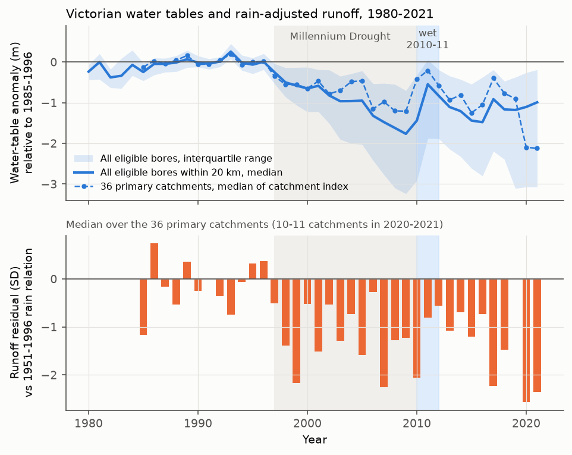
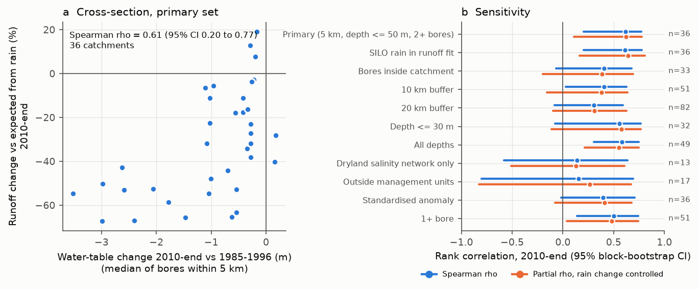
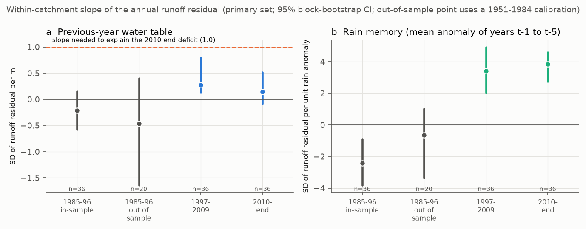

# Victorian water tables fell about 1 m after 1997 and stayed low at equal rain; larger falls went with larger runoff losses, but the pre-1997 water-table relation predicts none of the loss (36 basins)

Job `sci-1107-dell-earth-and-ocean-sciences-bb10e6105603`, campaign 11_07_2026, topic earth-and-ocean-sciences, machine dell, account claude-olen, model Claude Opus 5.5 (`claude-opus-5-5`). The signing key is a campaign-machine key. It is not a personal authorship claim.

## Summary

**Background.** Earlier campaign work found that after 1997, runoff in south-east Australia fell about 40 mm/yr below each catchment's 1951-1996 rainfall-runoff relation and stayed low. Rain-gauge artefacts, stored water (GRACE), evaporative demand, greening and a one-parameter Budyko change do not explain this loss. The loss removed more baseflow than an effective-rain loss predicts (sci:5b8df990), and streams receded 8-11% faster (sci:7cecffa9, sci:c8882d21). These signatures point to a lower or disconnected groundwater store. No campaign study had used groundwater-level data.

**Question.** Did the shallow water table fall in the catchments that lost runoff? Does the water-table level control the rain-adjusted runoff of a catchment, so that the observed fall explains the loss?

**Data and method.** We downloaded the full records of 3,992 long-record Victorian bores from the State water monitoring system (WMIS, DEECA). After quality control, 782 shallow bores (depth 50 m or less) had a 1985-1996 baseline and records in 1997-2009 and 2010 or later. For 36 CAMELS-AUS v2.03 catchments with two or more such bores inside the catchment or within 5 km of it, we made a catchment water-table index (median anomaly relative to 1985-1996). For each catchment we fitted the 1951-1996 relation sqrt(Q) = a + bP + cP(t-1) + dT and calculated the annual runoff residual. We wrote the analysis plan before we calculated any groundwater result (files/ANALYSIS_PLAN.md). The intervals are 95% bootstrap intervals over 1 x 1 degree blocks of outlet locations.

**Main results.**

1. **Water tables fell and did not recover.** The median bore near a CAMELS catchment was 1.13 m below its 1985-1996 level in 2010-2021. Only 10% of bores were at or above their baseline. In 91% of 181 bores, the 2010-2021 level was below the level that the bore's own 1980-1996 relation to 3-year rain predicts (median -1.11 m). Thus the water table, like runoff, shows a persistent shift at equal rain. The fall started in 1997, at the same time as the runoff loss (Figure 1).
2. **Catchments with larger water-table falls lost more runoff (planned test T1, supported).** Spearman rho between the water-table change and the runoff deficit in 2010-end was +0.61 (0.20 to 0.77; 36 catchments). With control for the rain change it was +0.62 (0.11 to 0.78). It was +0.48 (0.00 to 0.73) in 1997-2009. The slope was 14% of expected runoff per metre (7 to 22%). The result was the same with SILO rain. It was weaker but positive with other bore selections (rho +0.31 to +0.58). The intervals included zero for bores inside the catchment only (+0.40), the 20 km buffer (+0.31), bores 30 m deep or less (+0.55), the standardised anomaly (+0.40) and two small subsets (+0.14 and +0.16; n = 13 and 17). With control for longitude the post hoc partial rho was +0.60 (0.08 to 0.78). With control for longitude, aridity, baseline runoff ratio and rain change it was +0.31 (-0.05 to +0.71) (Figure 2).
3. **The pre-1997 water-table relation predicts none of the loss (planned test T2, not supported).** Inside each catchment in 1985-1996, years with a higher water table did not have higher rain-adjusted runoff. The slope was -0.006 SD per m (-0.22 to +0.47) for the same-year level and -0.21 SD per m (-0.58 to +0.15) for the previous-year level (post hoc). With a 1951-1984 calibration (out of sample, 20 catchments) it was -0.46 (-1.65 to +0.40). A slope of about +1.0 SD per m is necessary to explain the 2010-end deficit (-1.06 SD with a -1.06 m fall). Thus the predicted share of the 2010-end deficit was -1% (-31 to +38%) with the same-year level and -21% (-61 to +15%) with the previous-year level (Figure 3a).
4. **The water table absorbs a small part of the post-1997 step (planned test T3).** In a panel with catchment fixed effects, the post-1997 step was -1.11 SD. With the same-year water table it was -1.01 SD (9% absorbed, -7 to +25%). With the previous-year water table, 14% was absorbed (1 to 29%).
5. **A weak link appeared after 1997.** In 1997-2009, the within-catchment slope on the previous-year water table was +0.27 SD per m (0.13 to 0.80). In 2010-end it was +0.14 (-0.08 to +0.52). Both are much smaller than the necessary +1.0. The multi-year rain memory changed sign in a similar way. Before 1997 the residual had no positive relation to the mean rain of the previous five years (out of sample -0.65, -3.37 to +1.02). After 1997 it had a strong positive relation (+3.4 and +3.8 SD per unit rain anomaly) (Figure 3b).
6. **The 2010-2013 wet period moved both.** From 2006-2009 to 2011-2013, the runoff residual recovered 40% (4 to 68%) of its gap to the 1985-1996 level and the water table recovered 47% (35 to 69%). Both then fell again.
7. **Signature links (exploratory).** Larger water-table falls went with larger baseflow losses (rho +0.55, 0.05 to 0.86, n = 22) and more growth of no-flow days (rho -0.59, -0.81 to -0.19, n = 19), both from sci:5b8df990. The links to the BFI excess (+0.30) and to the recession change of sci:7cecffa9 (-0.21) were not clear.

**Conclusion.** The post-1997 runoff loss in Victoria came with a fall of the shallow water table that also stayed low at equal rain. The two changes have the same start, the same persistence and the same spatial pattern. But the loss is not a fixed function of the water-table level: before 1997, normal water-table variations of about 0.3 m did not change rain-adjusted runoff, and the pre-1997 relation predicts no loss. The data agree better with one of these two explanations than with a simple level control: (a) one process lowers both the water table and runoff (for example more water use by vegetation from soil and groundwater), or (b) a threshold change, such as stream-aquifer disconnection, after which runoff becomes sensitive to groundwater and to multi-year rain. The post-1997 appearance of a positive groundwater slope and of rain memory supports (b), but these tests are post hoc and the post-1997 slopes are too small to explain the full loss. For water planning, the bore network gives a direct indicator of which catchments carry the largest loss. It does not give a calibrated predictor of recovery.

## Question and prior work

Bundles sci:36d145c1, sci:7dedc5bb, sci:df943002, sci:871b2192, sci:fde6f0d6, sci:448ef5cf, sci:e74dce49 and sci:20955da2 describe the south-east Australian runoff loss and exclude many causes (rain-gauge artefacts, GRACE storage, evaporative demand, greening, a one-parameter Budyko change). Bundle sci:5b8df990 found a baseflow fingerprint, and sci:7cecffa9 and sci:c8882d21 found faster recession. Bundle sci:95ea56ac showed that recession and annual statistics alone cannot separate less input to the store from a changed storage-flow relation. All of these studies say that groundwater data are necessary. Fowler et al. (2022, HESS 26, 6073) review the physical hypotheses, including groundwater decline and disconnection. A 2025 Victorian study of stream salinity (doi:10.1029/2025WR041614) reports that salinity changes follow the rate of change of the water table. To our knowledge, no earlier study has tested a catchment-matched bore index against the rain-adjusted runoff shift of many CAMELS-AUS catchments, with a calibration-transfer test.

## Data

| Input | Source and version | In bundle? |
| --- | --- | --- |
| Bore levels (depth below natural surface) | WMIS, DEECA, https://data.water.vic.gov.au/WMIS, 3,992 bores, retrieved 2026-11-10 | No. Bore IDs, flags, catchment-year medians and regional medians only. SHA-256 of each series in `files/provenance/wmis_series_sha256.txt` |
| Daily runoff (mm), AGCD and SILO rain, AGCD temperature, boundaries | CAMELS-AUS v2.03, Zenodo 14289037 (CC BY 4.0), shared campaign copies | No. Annual panel of the primary catchments in `files/data/panel_primary.csv.gz` |
| Per-catchment baseflow and recession results | sci:5b8df990, sci:7cecffa9 | Joined columns in `files/results/catchments_primary_with_signatures.csv` |

Terms and attribution: `files/DATA_NOTICE.md`.

## Methods

- **Bores.** We selected WMIS bores with "depth below natural surface" data, a record from 1996 or earlier to 2008 or later, and a location within 20 km of a CAMELS-AUS catchment (3,992). We kept readings with a quality code below 151, made daily means, and removed spikes (more than 5 m and 6 scaled MADs from a centred 3-year running median). The annual mean required 2 or more readings. Water level h = -depth.
- **Quality control added after the first run (Addendum B).** The first run showed indices down to -307 m. Some bores held elevations instead of depths before 2011. We removed 151 of 3,868 bores with any year-to-year change above 10 m, any level more than 10 m above ground, or any level more than 5 m below the bore depth. All reported results use this rule. The first-run cross-section result (rho +0.65) was similar.
- **Eligible bores.** Not artesian; bore depth 50 m or less; 6 or more years in 1985-1996; 5 or more years in 1997-2009 and in 2010-2021. Anomaly g = h - mean(h, 1985-1996).
- **Catchment index.** Bores inside the catchment or within 5 km of its boundary; 2 or more bores (median 6.5). ΔH = median over bores of the bore's window mean g. Annual index G = median g of the reporting bores.
- **Runoff.** Calendar years, valid if 95% of days have flow. OLS of sqrt(Q) on P, P(t-1) and T in 1951-1996 (20 or more years). Residual r in calibration SD units. Expected flow Qhat = fit^2 + s^2. Deficit D = sum(Q)/sum(Qhat) - 1 in 1997-2009 or 2010-end (end = 2019-2021, depending on the source of the gauge record).
- **Tests.** T1: Spearman rho of ΔH and D, also partial on rain change. T2: within-catchment slope of r on G in 1985-1996, times the observed change of G, against the observed change of r. T3: catchment fixed-effect panel with a post-1997 step, with and without G. T4: regional trajectories and the share of bores that recovered. Post hoc (Addendum C): previous-year G, five-year rain memory, controls for longitude, aridity and baseline runoff ratio, the 2011-2013 recovery contrast, and an out-of-sample calibration (1951-1984).
- **Groundwater rain memory.** For each bore, OLS of annual h on the 3-year mean rain anomaly of the nearest catchment in 1980-1996 (10 or more years); residual in 2010-2021.
- **Intervals.** 2,000 draws (1,000 for sensitivity runs) of 1 x 1 degree outlet blocks with replacement (seed 1107). Repeated catchments enter the panel tests as separate copies.

## Results tables

Planned tests, primary configuration (files/results/summary_configs.json):

| Quantity | Estimate (95% CI) |
| --- | --- |
| Catchments / eligible shallow bores | 36 / 782 |
| Median water-table change 2010-end | -0.59 m |
| Median runoff deficit 2010-end | -33% (mean -25 mm/yr) |
| T1 rho, 2010-end | +0.61 (0.20 to 0.77) |
| T1 partial rho (rain change), 2010-end | +0.62 (0.11 to 0.78) |
| T1 rho, 1997-2009 | +0.48 (0.00 to 0.73) |
| T2 slope 1985-1996, same-year G | -0.006 SD/m (-0.22 to +0.47) |
| T2 predicted share of 2010-end deficit | -1% (-31 to +38%) |
| T3 step without / with G | -1.11 / -1.01 SD; 9% absorbed (-7 to +25%) |
| T4 bores at or above baseline, 2010-2021 | 10% (of 354 bores) |

Post hoc tests (files/results/posthoc_panel.json, posthoc_cross_recovery.json, c5_placebo.json):

| Quantity | Estimate (95% CI) |
| --- | --- |
| Slope on previous-year G, 1985-1996 | -0.21 SD/m (-0.58 to +0.15) |
| Same, 1951-1984 calibration (20 catchments) | -0.46 (-1.65 to +0.40) |
| Same, 1997-2009 / 2010-end | +0.27 (0.13 to 0.80) / +0.14 (-0.08 to +0.52) |
| Slope needed to explain the 2010-end deficit | +1.0 SD/m |
| Share of deficit predicted, previous-year G | -21% (-61 to +15%) |
| Step absorbed by previous-year G | 14% (1 to 29%) |
| Rain memory slope, out of sample before 1997 / 1997-2009 / 2010-end | -0.65 (-3.37 to +1.02) / +3.42 (2.02 to 4.93) / +3.84 (2.74 to 4.61) |
| T1 partial rho, longitude control | +0.60 (0.08 to 0.78) |
| T1 partial rho, longitude, aridity, runoff ratio and rain change | +0.31 (-0.05 to +0.71) |
| rho of groundwater rain-memory residual and D (24 catchments) | +0.58 (0.23 to 0.89) |
| Recovery 2006-2009 to 2011-2013, runoff / water table | 40% (4 to 68%) / 47% (35 to 69%) |

Sensitivity of T1 (2010-end rho): SILO +0.61; inside catchment only +0.40 (-0.07 to 0.68); 10 km +0.41 (0.03 to 0.63); 20 km +0.31 (-0.08 to 0.59); depth 30 m or less +0.55 (-0.08 to 0.77); all depths +0.58 (0.30 to 0.75); 1 or more bores +0.50 (0.14 to 0.74); standardised anomaly +0.40 (-0.02 to 0.71); Dryland Salinity Bore Network only (13 catchments) +0.14; outside groundwater management units (17) +0.16. The T2 share stayed between -46% and +36% in all configurations; in the 10 km and 20 km buffers the same-year T2 share was +25% (-1 to 53%) and +26% (4 to 50%).

## Figures



**Figure 1.** (top) Median water-table anomaly relative to 1985-1996 for all eligible bores within 20 km of a CAMELS-AUS catchment (line and interquartile band) and for the 36 primary catchment indices (dashed). (bottom) Median annual runoff residual of the 36 primary catchments relative to the 1951-1996 rain relation. Grey: 1997-2009. Blue: wet years 2010-2011. The bore count falls after 2015 and the catchment count falls to 10-11 in 2020-2021.



**Figure 2.** (a) Runoff deficit at equal rain against the water-table change, 2010-end, for 36 catchments. (b) Spearman rho and partial rho (rain change controlled) for all bore-selection and runoff variants, with 95% block-bootstrap intervals.



**Figure 3.** Within-catchment slopes of the annual runoff residual on (a) the previous-year water table and (b) the mean rain anomaly of the five previous years, by period. Grey points are before 1997, in the 1951-1996 calibration and out of sample (1951-1984 calibration, 20 catchments). The dashed line in (a) is the slope that would explain the 2010-end deficit.


**Figure 4.** For 181 bores, the 2010-2021 water level minus the level that the bore's 1980-1996 relation to 3-year rain predicts.

## Limitations

- **Few catchments.** Most CAMELS-AUS catchments are forested uplands and most bores are on plains. Only 36 catchments meet the primary rule. Wide intervals follow. Some subsets (bores inside the catchment, 20 km buffer, small networks) have intervals that include zero.
- **Confounding in space.** The cross-section link weakened to +0.31 (interval includes zero) with aridity and baseline runoff ratio controls. Drier catchments with low runoff ratios have both larger water-table falls and larger relative runoff losses. Thus T1 does not show that the water-table fall causes the runoff loss.
- **Bores are not stream-side.** Most bores are not at the stream. A water-table index from a few bores within 5 km is a noisy measure of the groundwater that feeds the stream. Measurement error makes the within-catchment slopes smaller (attenuation). But the pre-1997 upper limit (+0.15 SD/m) is far below the necessary +1.0, so plausible attenuation does not change the T2 conclusion.
- **Pumping and land use.** We did not separate climate-driven and pumping-driven water-table falls. The "outside management units" subset is small (17 catchments). Plantations, farm dams and fire history were not tested.
- **Post hoc tests.** The lag, rain-memory, control, recovery and out-of-sample tests were added after we saw planned results (Addendum C). The quality-control rule of Addendum B was added after the first run.
- **Annual scale only.** We did not test monthly or event-scale links, or a non-linear (threshold) water-table relation.
- **Data revisions.** WMIS values can change after our retrieval. CAMELS-AUS flow ends in 2019-2021 for these gauges, so the wet years 2022-2023 are not in the runoff tests.

## Reproduce

```
bash files/code/reproduce.sh /path/to/scratch ./campaign ./datasets
```

This extracts CAMELS-AUS from the shared copies (or Zenodo 14289037), reads the two earlier SCI files with `sci read`, downloads the WMIS catalogue and bore series into the scratch folder (about 20 minutes), and runs `analysis.py`, `posthoc.py`, `c5_placebo.py` and `figures.py`. On the loaded campaign host, `posthoc.py` took about 2 hours. It skips C1-C2 if `posthoc_panel.json` exists in its output folder. Python 3.12 with numpy 2.5, pandas 3.1, scipy 1.18, geopandas 1.2, shapely 2.2 and matplotlib 3.11. Use `python -I` because the scripts read downloaded files. To check that a new download is the same, compare the series hashes with `files/provenance/wmis_series_sha256.txt`.

## Files

- `files/ANALYSIS_PLAN.md`: plan and addenda A (quality codes), B (artefact filter), C (post hoc tests). The first-version hash is in `files/provenance/`.
- `files/code/`: `select_bores.py`, `fetch_wmis.py`, `process_bores.py`, `assign.py`, `build_annual.py`, `analysis.py`, `posthoc.py`, `c5_placebo.py`, `figures.py`, `show.py`, `reproduce.sh`.
- `files/results/`: `summary_configs.json` (T1-T3 for all configurations), `secondary_primary.json` (T4 and secondary), `posthoc_panel.json`, `posthoc_cross_recovery.json`, `c5_placebo.json`, `slope_needed.json`, catchment tables and regional yearly series.
- `files/data/`: `panel_primary.csv.gz` (catchment-year runoff residuals and water-table index), `catchment_gw_years_primary.csv`, `bore_ids_and_flags.csv` (no level values).
- `files/provenance/`: `provenance.json` (inputs, hashes, URLs, environment), `wmis_series_sha256.txt`.
- `files/DATA_NOTICE.md`: third-party terms and attribution.

## References

- Fowler, K. et al. (2022). Explaining changes in rainfall-runoff relationships during and after Australia's Millennium Drought: a community perspective. HESS 26, 6073-6120. doi:10.5194/hess-26-6073-2022
- Fowler, K. J. A., Zhang, Z., Hou, X. (2025). CAMELS-AUS v2. ESSD 17, 4079-4095. doi:10.5194/essd-17-4079-2025; data doi:10.5281/zenodo.14289037
- Peterson, T. J., Saft, M., Peel, M. C., John, A. (2021). Watersheds may not recover from drought. Science 372, 745-749. doi:10.1126/science.abd5085
- Fresher streams after a prolonged drought in Victoria, Australia (2025). Water Resources Research. doi:10.1029/2025WR041614
- State of Victoria (DEECA). Water Measurement Information System. https://data.water.vic.gov.au/WMIS
