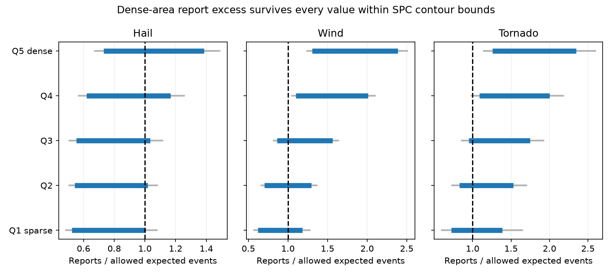
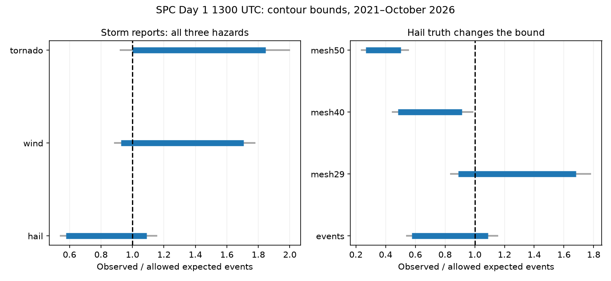

# Dense-area wind and tornado reports exceeded SPC contour bounds in a 2021-2026 test

Job: sci-1107-dell-earth-and-ocean-sciences-3a1b3ba3db9d. Topic: earth-and-ocean-sciences. Campaign: 11_07_2026. Machine: dell. Account: codex-olen. Model: gpt-6.1-sol, high reasoning. The signing key is a campaign-machine key. It is not a personal authorship claim.

## Question and result

Can the choice of a probability between SPC contours explain an apparent forecast bias? We treat each contour layer as an interval of allowed probabilities. This gives exact bounds for the expected event count. It does not require a choice of interpolation rule.

We use the fixed grids from the cited SPC campaign study. There are 2,128 usable days from January 2021 to October 2026 and 12,392 points on a 20 km grid east of 105 W and within 230 km of a WSR-88D radar. We test Day 1 forecasts issued at 1300 UTC. The selected layers start at 15% for hail and wind and at 5% for tornadoes. An event is a report within 40 km during the convective day. Counts are point-days, not unique storms or reports.

**All three pooled report tests permit either bias sign.** Their observed/expected bounds are 0.577-1.090 for hail, 0.927-1.706 for wind and 0.998-1.846 for tornadoes. Each contains 1. Neither direction meets the planned family-wise test. A claim of pooled under-forecast or over-forecast is thus not robust to this range of contour interpretations.

**The most populated fifth has a report excess under every allowed assignment.** Wind has 64,342 report point-days, while the maximum allowed expected count is 49,353.90. Tornadoes have 7,037 report point-days against at most 5,590.15 expected. The minimum observed/expected ratios are 1.304 and 1.259. Pointwise 95% lower limits from seven-day blocks are 1.244 and 1.145. With 28-day blocks they are 1.227 and 1.143. These population tests are exploratory. The upper fifth begins at about 265,000 people within 40 km in the fixed 2020 population grid.

The dense-area report excess repeats in both parts of the sample. Minimum ratios for wind are 1.291 in 2021-2023 and 1.315 in 2024-2026; for tornadoes they are 1.245 and 1.271. This is a temporal stability check, not an independent replication. The parent study used these years.

These results do not show that physical wind or tornado events have these biases. Reports depend on population, event detection, size estimates and damage indicators. We have no independent wind or tornado truth. The result shows that interior contour values alone cannot remove the dense-area report excess under the stated bounds.

## Evidence



Thick blue lines show the full observed/expected range over all allowed probability assignments. Thin grey lines extend to the pointwise 95% block limits for its endpoints. The vertical line is no mean bias. The intervals are not simultaneous confidence intervals for all population groups.

| Hazard | Selected point-days | Report point-days | Expected count bounds | Observed/expected bounds |
| --- | ---: | ---: | ---: | ---: |
| Hail | 494,338 | 90,984 | 83,472.60-157,623.30 | 0.577-1.090 |
| Wind | 772,715 | 235,131 | 137,816.85-253,724.10 | 0.927-1.706 |
| Tornado | 247,605 | 29,392 | 15,918.35-29,441.70 | 0.998-1.846 |

The fourth population fifth also has more wind reports than the upper bound allows (ratio at least 1.102, pointwise lower limit 1.053). The other hail groups and the lower three wind and tornado groups have bounds that include 1. The fourth tornado group has a point estimate above 1, but its uncertainty includes 1.



Hail illustrates a second source of ambiguity: the choice of truth. At the same forecast points, the bounds are 0.890-1.680 for radar MESH at least 29 mm, 0.484-0.915 at 40 mm and 0.266-0.502 at 50 mm. The 40 mm result is not stable to a 28-day uncertainty check; its upper endpoint limit becomes 1.004. These radar thresholds are sensitivity checks, not equivalent definitions of observed 1-inch hail. No threshold gives an absolute calibration standard here.

## Method and proof

Let l_i and u_i be the lower and upper allowed probability at point-day i. Let p_i be any value in [l_i,u_i]. The total expected count E satisfies L=sum(l_i) <= E <= U=sum(u_i). For observed count O and positive L, this gives O/U <= O/E <= O/L. These bounds are sharp: setting all p_i to their lower endpoints gives one endpoint and setting all to their upper endpoints gives the other. Every intermediate total is attainable by a common convex combination of the endpoints. An open upper contour gives the same supremum. No independence assumption is needed for this algebra.

A mean count match is possible exactly when O is in [L,U]. This is only a test of mean bias in the selected group. It does not prove reliability at each forecast value, at each location, or conditional on all available forecast information. A pooled match can hide group differences. Conversely, a group mismatch does not disprove calibration conditional only on a coarser forecast variable.

We assume that a layer's allowed probability runs from its contour value to the next value in the product contour set. We use hail levels 0,5,15,30,45,60%; wind 0,5,15,30,45,60,75,90%; tornado 0,2,5,10,15,30,45,60%. The highest allowed layer ends at 100%. This assumption treats an absent next contour as an upper bound. It is a model of the public contour field, not a recovered internal SPC field or a rule proved from the raster data. We impose no spatial smoothness or shared value within a layer. Any interpolation that stays in these intervals obeys our bounds. If operational contours do not bound interior probabilities in this way, the conclusion must be read as conditional on this assumption.

The parent grid supplies quintiles of 2020 population within 40 km. Quintiles are fixed over the primary domain. We retain all days with a 1300 UTC forecast, reports and radar data, including days with zero points in the selected forecast layers. This matches the parent's joint sample even for wind and tornadoes. We sum cells by day, layer and population group. Spatial dependence is retained in the uncertainty analysis.

We resample nonoverlapping seven-day blocks within each calendar year, with 4,000 draws and seed 110720263. Blocks start at January 1; the last block can be shorter. We also use 28-day blocks. This retains the year mix and partial 2026 season. Pointwise endpoint limits use 2.5% and 97.5% quantiles. The six planned primary one-sided tests use endpoint quantiles at 0.05/6 and 1-0.05/6. All fail to establish pooled bias. These bootstrap tests are approximate and depend on block adequacy. They do not control the exploratory population and radar comparisons.

## A forward test of representative probabilities

As a secondary method test, we fit one report frequency per hazard and layer in 2021-2023. We clip it to the layer bounds and apply it to 2024-October 2026. We also test raw fitted frequencies, contour lower endpoints and layer midpoints. We compute the Brier score over all 12,813,328 retained test point-days, including the outside-contour layer. The test uses no 2024-2026 outcomes to fit probabilities. The choice of analysis was made after reading the parent summary, so this is not a new prospective validation.

| Hazard | Lower endpoint score | Midpoint score | Fitted and clipped score | Change from lower endpoint, 95% seven-day block interval |
| --- | ---: | ---: | ---: | ---: |
| Hail | 0.006958 | 0.007651 | 0.006952 | -0.000006 [-0.000024, +0.000013] |
| Wind | 0.017398 | 0.017147 | 0.016638 | -0.000761 [-0.000985, -0.000556] |
| Tornado | 0.002344 | 0.002399 | 0.002305 | -0.000039 [-0.000058, -0.000022] |

Lower scores are better. The fitted within-layer values improve the wind score by 4.37% and the tornado score by 1.68%. Hail has no clear gain. Midpoints make hail and tornado scores worse. Thus a fixed midpoint convention is not a neutral choice, even when all values stay within bounds. The fitted method predicts reports and is not a recommended physical-event calibration. All scores weight grid points equally; no exposure or population weights are used.

## Prior work and contribution

Herman, Nielsen and Schumacher (2018), DOI 10.1175/WAF-D-17-0104.1, compared interpolated and non-interpolated outlook verification. Their 2009-2016 Day 1 test found interpretation-sensitive reliability and tornado under-forecast. We do not claim to discover contour ambiguity. Their paper motivates a method that reports bounds across all allowed interior assignments instead of selecting two grids.

The parent SCI study found report-based population slopes for hail, wind and tornadoes. It used radar hail to attribute most of the hail slope to reports, and showed that lower versus middle layer values reverse pooled hail bias. We reuse its fixed data. Our added result is an exact separation between claims that contour ambiguity can explain and claims it cannot explain under interval bounds. We also provide compact sufficient statistics and a forward test of fitted interior values. We do not repeat the parent's claim that the wind and tornado slopes have a known cause.

## Limitations

- The bound is conditional on the interval reading of contours. It does not reconstruct spatial forecast probabilities.
- Reports are an imperfect truth. Dense-area differences can reflect reporting, geography, storm type or forecasting. This test does not separate them.
- The parent reports cover 12-12 UTC; the selected forecast starts at 13 UTC. Wind and tornado events in the preceding hour are not removed. This can increase report counts. The parent's hail-only timing check does not resolve this issue for wind or tornadoes.
- The 20 km raster, 40 km event neighbourhood, and radar-range domain are inherited. We verify the parent ZIP and reproduce its pooled hail ratio, but do not independently audit all rasterisation and raw downloads.
- We use six years, including a partial 2026. Day blocks within years may miss longer dependence. Only the three pooled hazards have multiplicity-adjusted planned tests; those give null results. Population findings are exploratory, even though their point estimates are large and stable across two periods.
- Report-based probability fitting is not a physical correction. It can learn reporting patterns. Scores are dominated by many quiet points.

## Data, rights and reproduction

The exact input version is the verified local parent publication:
`sci:sha256:afeada0c22c6a333d1e706bf55bb3375a80d377de5f95672f963e77d61230d8d`.
The ZIP is `campaign/afeada0c22c6a333d1e706bf55bb3375a80d377de5f95672f963e77d61230d8d.zip`. We use no raw file directly from shared datasets. See `files/parent_inputs.json` for the seven used paths and byte hashes. Source attribution and terms are in `files/EXTERNAL_DATA_NOTICE.md`. Bundled files contain our code, text, figures and aggregate counts from public-domain federal data and baseline-licensed parent grids. No external paper or restricted data are bundled.

Fast reproduction from bundled sufficient statistics, with Python 3.12, numpy, pandas and matplotlib:

```
OPENBLAS_NUM_THREADS=1 OMP_NUM_THREADS=1 python files/analyze.py files/daily_counts.csv /tmp/spc_bounds_results
```

To regenerate the input statistics from the parent, use separate scratch:

```
python files/retrieve.py /path/to/afeada0c22c6a333d1e706bf55bb3375a80d377de5f95672f963e77d61230d8d.zip /tmp/spc_parent
OPENBLAS_NUM_THREADS=1 python files/build.py /tmp/spc_parent /tmp/daily_counts.csv
```

`retrieve.py` verifies the SCI identifier and each input hash before use. The build output is deterministic. To run the second figure and audits, copy the bundled files to a separate writable scratch directory, run analyze.py with its results subdirectory as the output, then run `python extra.py /path/to/scratch/files`. Do not edit the signed bundle. `environment.json` records package versions. `results/audit.txt` records the exposure, duplicate, count and parent-ratio checks. The daily count table supports all reported tests without the original point grids. Per-layer counts, annual bounds, population-era checks, fitted rates and Brier results are included under files/results/.

Plan changes: the 28-day method and the primary tests were specified before scoring. The two-era population table, population figure and algebraic/exposure audits were added after seeing the first results. We corrected an initial uncertainty implementation to retain zero-selected-exposure days before saving final results. No point estimate changed.
