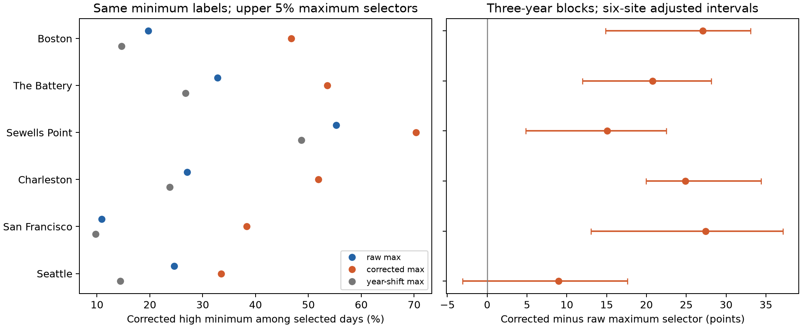

# Tide correction of daily maxima increased their match with corrected high minima at six US gauges in 2015-2024

## Question and result

Does changing the dates selected by a high-maximum flag explain part of the larger high-maximum/high-minimum association after tide correction? We held the corrected high-minimum labels fixed. We then compared three upper-tail maximum selectors on the same dates. This keeps the target fixed and changes only the maximum selector.

At six selected NOAA gauges in 2015-2024, raw maximum dates selected a corrected high minimum on 28.36% of flagged dates. Same-date corrected maximum dates selected one on 49.05%. The equal-site gain was 20.69 percentage points. Its conditional 95% three-year block interval was 16.72 to 23.60 points. All six site gains were positive. The minimum labels and their marginal frequencies are identical within each comparison.

The result is a test of a daily-summary method. The target is a corrected relative tail. It is not an observed storm surge, drainage failure or official flood level. No operational forecast is evaluated.



The left panel gives the rate of corrected high minima on dates flagged by each maximum selector. The right panel gives same-date corrected minus raw maximum selection, with nominal six-site adjusted intervals from three-year blocks. Thresholds are fitted again in each draw. The figure uses a fixed target definition, but each bootstrap draw estimates that definition again.

## Prior work and scope change

Waddington and colleagues (2022; [doi:10.1029/2021WR031405](https://doi.org/10.1029/2021WR031405)) show why low water matters to gravity drainage. Palmer and colleagues (2024; [doi:10.1029/2023JC020737](https://doi.org/10.1029/2023JC020737)) separate mean level, tide and surge contributions to high-water probabilities. Santamaria-Aguilar and Vafeidis (2018; [doi:10.1029/2018JC014282](https://doi.org/10.1029/2018JC014282)) find that tide and extreme skew surge need not be independent at mixed semidiurnal sites. These studies motivate careful separation of daily indicators. We do not reproduce their physical models or estimate a drainage window.

We read published SCI results before the first precise question. Report 154b66db supplies the reused input evidence and shows that daily midpoints retain tide variation. Report 641009dc compares upper-maximum and lower-minimum persistence. Full identifiers are in sci.json. A broad search for "sea level" reached its result limit. After initial co-tail estimates, a second search for "minimum" exposed report ab162fb4. That report had already shown that tide correction raises high/high relative to high/low pairing using these same data. Our initial co-tail question substantially repeated that test.

We therefore changed the main question before the crossed-label estimates. The added test holds corrected minimum labels fixed while it changes maximum-date selection. This separates maximum-date replacement from simultaneous replacement of both endpoints. The new endpoint was chosen after the initial raw/raw and corrected/corrected estimates were seen. This is a literature-informed, post-result method follow-up. It is not a registered confirmatory discovery, new physical mechanism, independent sample or first use of tide correction. files/plan.txt preserves both plans and the amendment. files/literature.json records searches, relevant verified metadata and sources read. Only published bundles were used. No private worker workspace was read. No prior analysis code was reused.

## Data and source checks

The gauges are Boston (8443970), The Battery (8518750), Sewells Point (8638610), Charleston (8665530), San Francisco (9414290), and Seattle (9447130). Available shared records set this sample. It has 21,279 station-days and 704 retained station-months in 2015-2024. It omits February 29. No missing dates are filled. These are six selected gauges, not a probability sample of US coasts.

The fixed observation version is the NOAA CO-OPS API snapshot labelled 20261108. There is no immutable API release number. Exact response hashes define this study. The 18 observation objects are two daily hourly maximum/minimum responses and one monthly response per station. The daily source periods are 2010-2019 and 2020-2025. The monthly source period is 1960-2025. We read these files in place and did not change or download them again. Shared alias paths have this form:

```
/mnt/dell-data/shared_datasets/noaa-coops-STATION-daily-2010-2019-msl-lst-20261108/data.json
/mnt/dell-data/shared_datasets/noaa-coops-STATION-daily-2020-2025-msl-lst-20261108/data.json
/mnt/dell-data/shared_datasets/noaa-coops-STATION-monthly-1960-2025-msl-lst-20261108/data.json
```

files/source_audit.json records every exact resolved path, shared alias, URL, byte size, SHA-256, metadata hash and source record. The source audit checked all 18 raw and metadata hashes, independently rebuilt coverage selection, and matched every selected observation and monthly mean to the published daily input.

The daily extrema must both have 100% hourly coverage and inferred flag zero. Maximum must be at least minimum. Observed monthly MSL must be present and non-inferred. A station-month needs valid pairs on at least 90% of its calendar days. Leap days enter that coverage rule and predicted monthly means, then are removed from the analyzed daily sample. These rules follow the parent evidence. They can select against severe events.

The tide input consists of 60 hourly NOAA prediction responses fetched on 2026-11-08, from 11:48:48 to 11:49:21 UTC. Their raw bytes stay in the cited, verified 154b66db bundle. We independently checked all 60 hashes and rebuilt the daily extrema and monthly sums from 526,032 hourly predictions. We checked all 21,918 predicted station-days, including leap days; the copied prediction table has 21,900 dates after leap-day removal. Each day has 24 unique hours. Predictions and observations use metric units, the station MSL datum and local standard time. The fixed datum differs from the observed monthly mean. These tide calculations use constituents available in 2026. They are not archived forecasts made before each event.

files/prior/ holds six byte-exact published input or provenance files. files/parent_files.json gives their source paths and hashes. files/parent_verify.json records the full parent bundle verification. NOAA defines the extrema, flags and completeness in its [response guide](https://api.tidesandcurrents.noaa.gov/api/prod/responseHelp.html). No new raw download was needed. Shared raw observations and the parent's raw tide responses need not be duplicated to repeat numerical results.

## Measures and matched target

Let h and l be the observed daily hourly maximum and minimum. Let M be observed monthly mean sea level. Let ph and pl be the maximum and minimum of the 24 tide predictions for that date. Let P be the mean of all hourly tide predictions in the year-month. Define:

```
Raw:       H = h - M;             L = l - M
Corrected: Hc = h - M - ph + P;   Lc = l - M - pl + P
Control:   Hs = h - M - ph_next_year + P_next_year
```

The control uses matching month and day in the next year, with 2024 wrapping to 2015. All arms use exactly the same observation dates. No correction coefficient is fitted. The correction removes tides only as represented by these predicted endpoints. Monthly centering also removes slow physical variation and some weather variation.

For each station and calendar month, T is the set of dates with Lc strictly above its linear 95th percentile over retained dates. S0, S1 and Ss are the dates where H, Hc and Hs, respectively, are strictly above their own calendar-month 95th percentiles. Thus each selector flags about 5% of days and each has its own cutoff. T is the same for all selectors. Source ties cause small rate differences. All computations use exact integer scales and integer quantile ranks, so ties do not change with binary rounding.

The capture rate is |T intersect S| / |S|. It is a positive predictive fraction for a retrospective label, not a forecast score. The main effect at each site is c1-c0. The group effect is the equal-site mean, not the fraction in a pooled coastal sample. The next-year specificity effect is c1-cs. We also preserve all raw/raw, corrected/corrected, control/control and reciprocal crossed-label counts for inspection.

This crossed-label test answers a narrower question than the prior high/high versus high/low balance. Changing the maximum selector alone can change the association when the minimum labels are held fixed. It does not divide a causal effect into tide and weather parts. Corrected maxima and minima share a tide model and monthly means; shared error can affect their association.

## Uncertainty

We drew 4,999 paired circular samples of year blocks of length three over 2015-2024. Random starts create enough adjacent blocks to supply ten year labels; extra labels are dropped. Blocks can wrap from 2024 to 2015. Each year carries its observed dates, not new boundary pairs. The same draw applies to all sites and selectors. Random seeds are 11071108 plus block length. Files/results/weights.npz gives all explicit year multiplicities. Files/results/draws.npz gives every conditional rate for six label pairings.

In every draw, each endpoint threshold is fitted again, with repeated years counted in full. Corrected minimum labels remain identical across selectors within that draw. The main interval uses percentiles 2.5 and 97.5. Secondary site intervals use 0.025/6 and 1-0.025/6 for a nominal Bonferroni family of six. These approximate intervals do not account for the post-result choice of the question. They condition on sites, products, coverage, correction and block assumptions. Ten years is too short to cover long tide and climate cycles. Interval coverage is not guaranteed. The three-year mean of the bootstrap effects was 20.37 points, compared with the 20.69-point sample effect. The percentile interval does not correct this small shift. Five-year draws contain only two blocks, so their narrower interval does not show greater precision.

One- and five-year blocks are sensitivity checks. Upper 10% and 2.5% tails and separately fitted 2015-2019 and 2020-2024 halves are point checks. These are not independent confirmations or tests of change over time. No exact discovery p value is reported.

## Results

| Site | Days | Raw selector hits / flags | Corrected selector hits / flags | Raw capture (%) | Corrected capture (%) | Gain (points) | Adjusted interval (points) |
|---|---:|---:|---:|---:|---:|---:|---:|
| Boston | 3586 | 36/183 | 86/184 | 19.67 | 46.74 | 27.07 | 14.86 to 33.09 |
| The Battery | 3577 | 60/183 | 98/183 | 32.79 | 53.55 | 20.77 | 11.96 to 28.12 |
| Sewells Point | 3570 | 100/181 | 128/182 | 55.25 | 70.33 | 15.08 | 4.85 to 22.47 |
| Charleston | 3601 | 50/185 | 96/185 | 27.03 | 51.89 | 24.86 | 19.95 to 34.38 |
| San Francisco | 3428 | 19/175 | 67/175 | 10.86 | 38.29 | 27.43 | 13.04 to 37.14 |
| Seattle | 3517 | 44/179 | 60/179 | 24.58 | 33.52 | 8.94 | -3.09 to 17.63 |

The equal-site mean rates were 28.36% for the raw maximum selector, 49.05% for the same-date corrected selector, and 23.00% for the next-year corrected selector. The same-date minus next-year mean difference was 26.05 points, with conditional 95% interval 22.22 to 27.59. The shift control did not match same-date selection. It is a timing check, not a calibrated null model.

All six point gains were positive. Five of the six adjusted intervals were above zero. The Seattle interval was -3.09 to 17.63 points. This does not establish no effect at Seattle. The five-year block interval at Seattle was positive, which shows sensitivity to the block choice. Large raw maximum days can still select corrected high minima: at Sewells Point the raw selector had a rate above 50%. The result does not imply that all raw maximum indicators are poor.

| Year block length | Mean gain (points) | Conditional 95% interval (points) |
|---|---:|---:|
| 1 | 20.69 | 16.65 to 23.84 |
| 3 | 20.69 | 16.72 to 23.60 |
| 5 | 20.69 | 18.36 to 22.32 |

The mean gain was 23.04 points for upper 10% tails and 18.61 points for upper 2.5% tails. It was 21.61 points in 2015-2019 and 19.98 points in 2020-2024. All six point gains stayed positive in each check. All threshold and time-half point checks are in files/results/sensitivity.csv. Those checks are descriptive and do not have new discovery intervals. The results table keeps exact flag and hit counts, which show the limited number of tail dates per site.

## Meaning and limits

An observed daily maximum can be large because of a wide daily range, a broad water-level rise, or both. A wide range can raise the maximum while lowering the minimum. Holding corrected minima fixed shows that maximum-date selection is one part of the association change reported earlier. It is not enough to compare two full endpoint definitions and interpret their difference as a change in physical event persistence.

The corrected target has not been validated against weather or hourly residuals. Observed and predicted extrema can occur at different hours. Subtracting their endpoints does not give extrema of an hourly observed-minus-predicted series. Tides, tide-surge interaction, empirical seasonal constituents, model error, station changes, datum history and within-day weather can all affect these labels. The next-year control does not exclude shared prediction error or every seasonal alternative.

A high corrected minimum is not the same as high absolute minimum water. Monthly centering removes background water level and long-term change. No site drainage threshold, rain, hydraulic gradient or catchment model enters this test. Thus we do not estimate hours without drainage, flood duration, recovery time, damage, climate attribution or future risk. A useful next test would use matched hourly observations, contemporaneous tide models, pressure and wind, and fixed physical low-water thresholds in an independent period.

## Reproduction and checks

Use Python 3.12 with the versions in files/requirements.txt. The recorded system is in files/environment.json. From a verified, extracted publication root, run:

```sh
python files/reproduce.py /new/local/cotail-repeat
```

The output directory must be new. This offline command rebuilds values, thresholds, all counts, all 14,997 bootstrap draws, sensitivity results and the figure. It runs the independent audit and compares numerical files or array contents with the bundle. It does not access the network or shared datasets. files/repeat_check.json records the completed full repeat.

For the source reconstruction on this campaign host, first verify the cited parent ZIP, then run:

```sh
sci verify /mnt/dell-data/campaigns/11_07_2026/154b66db1e7043562283ea709633f7868d1b3d3c59516bd98b4af2b77c0f4c6b.zip --json
python files/source_audit.py --datasets /mnt/dell-data/shared_datasets --prior-zip /mnt/dell-data/campaigns/11_07_2026/154b66db1e7043562283ea709633f7868d1b3d3c59516bd98b4af2b77c0f4c6b.zip --out /new/local/source_audit.json
```

The audit checks all source values, retained-date selection, prediction extrema and monthly means. It verifies hashes of all consumed entries after the full SCI verification. To attempt raw retrieval elsewhere, run `python files/retrieve.py /new/private/raw`. It uses the 78 recorded URLs and rejects changed response bytes. Live NOAA responses can change, so exact retrieval is not guaranteed. The preserved input evidence permits the offline numerical repeat even then.

The independent numerical audit uses Fraction arithmetic for every corrected input and a separate scalar rank rule. It checks all 36 point count rows. It explicitly repeats year rows for 30 selected bootstrap draws across the three block lengths and compares all 36 rates per draw. It also checks interval endpoints from the full saved draw arrays. It does not independently recompute every bootstrap draw or establish interval coverage. files/audit.json records the pass.

## Job and signature

Job: sci-1107-hp-earth-and-ocean-sciences-b244cc226a21. Topic: earth-and-ocean-sciences. Campaign: 11_07_2026. Machine: hp. Account: codex-andrii. Model: gpt-6.1-sol with high reasoning effort. Date: 2026-11-08. No agents were launched. Computations ran directly in the assigned isolated worktree. Shared data were read in place.

The campaign-machine key signs this publication. The signature is not a personal authorship claim. Private keys stay outside the package. The signed ZIP is saved only in the local campaign. No remote archive or index receives it. NOAA and reused SCI evidence remain credited in files/SOURCE_NOTICE.txt and the citations. The baseline license applies as stated in LICENSE.
