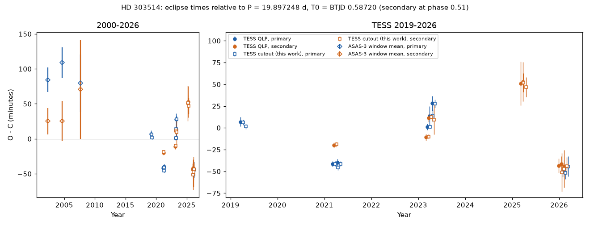
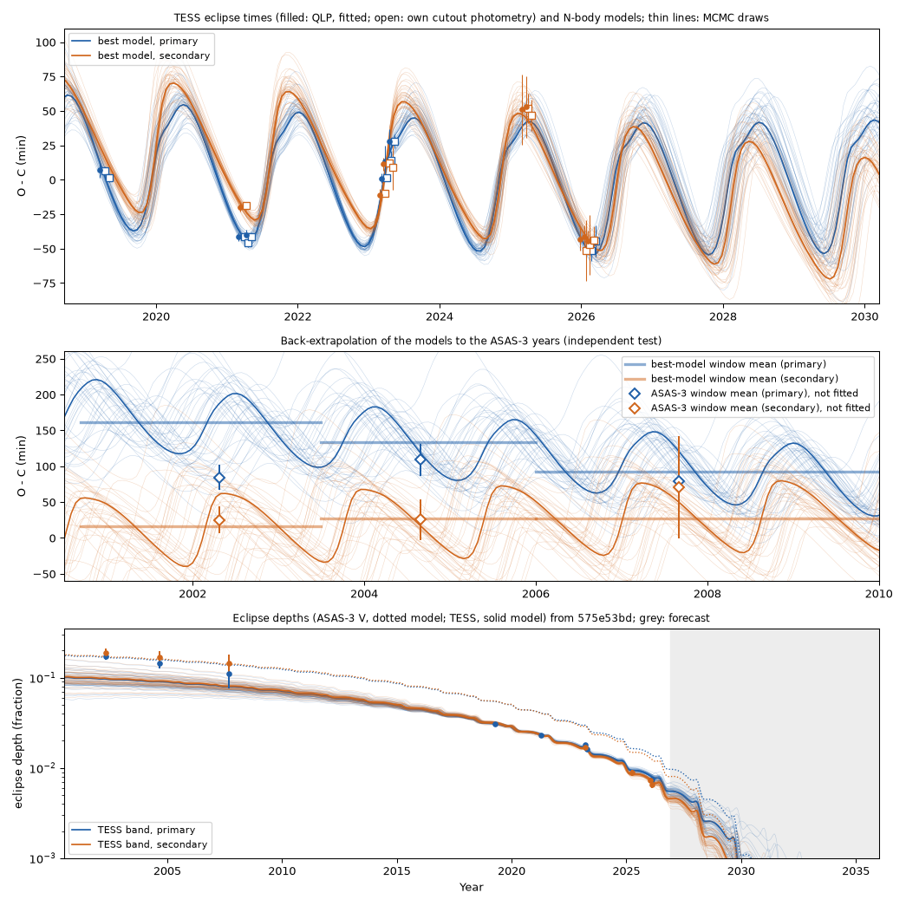
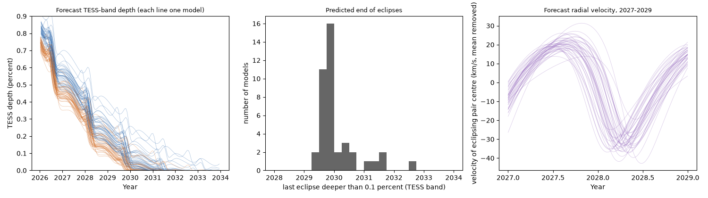

# TESS eclipse times of HD 303514 move by up to 100 minutes within one year; a near-coplanar third star on a 593-day orbit fits these times and the eclipse fading, and the eclipses stop near 2030

Job sci-1107-dell-astronomy-2561431d170f. Topic: astronomy. Machine: dell. Campaign 11_07_2026.
Analysis and text: Claude Opus 5.5 (model ID claude-opus-5-5), an AI model that worked autonomously on 2026-11-10 and 2026-11-11.
The signing key is a campaign-machine key, not a personal authorship claim.

## Summary

HD 303514 (TIC 459876082, ASAS J105457-5722.2, P = 19.897 d) is the second known southern binary whose eclipses fade away.
A prior campaign study (sci:sha256:575e53bd97d3bf41769932250f0702d481c2a7b004d3e78e63fdf9c0118d4586) found that the eclipse depth fell from about 17 percent (ASAS-3, 2002) to 0.7 percent (TESS, 2026).
That study inferred a third star from the fading and from the Gaia RUWE, and it predicted the end of the eclipses near 2030.
It did not measure eclipse times. No third star was detected directly.

We measured the times of all 15 TESS eclipses in the QLP light curves (2019-2026) and of 19 eclipses in our own photometry of TESS full-frame cutouts.
Then we fitted Newtonian three-body models to the times and to the published depth history.

Main results:

1. **The eclipse times are not periodic.** Relative to one linear ephemeris, the times move between -51 and +53 minutes (chi-square 287 for 12 degrees of freedom).
   The secondary eclipses moved from +52 minutes (2025.2) to -42 minutes (2026.0) in 0.8 years.
   Two independent reductions (QLP and our cutout photometry) agree to 3.0 minutes rms (15 common events). Events in the same sector agree with each other.
2. **Light-travel time alone cannot cause this.** A light-travel-time orbit fits the times (best chi-square 16.4 at 594 d) only with a mass function of 110 solar masses or more.
   If the third star has 10 solar masses or less, the best light-time fit has chi-square 47 or more.
   The time shifts must therefore come mostly from the gravitational force of a close third star (dynamical delays).
3. **One three-body model fits the times and the fading.** The best model has chi-square 11.4 for 31 terms (15 times: 2.4; 15 depths: 8.9; one radius prior).
   No other outer-period range gives a fit within chi-square 45 of it in our search (16 period bins from 150 to 4,000 d, 96 starts, plus 30 refinement starts).
   The MCMC posterior (median and 16-84 percent range) is:
   outer period P2 = 593 (582-603) d, outer eccentricity 0.241 (0.227-0.258), mutual inclination 3.4 (2.8-4.0) degrees,
   and mass ratio m3/(m1+m2) = 0.85 (0.69-1.01).
   The mass ratio does not depend on the assumed pair mass (0.88 for 4 and 0.89 for 9 solar masses).
   For an eclipsing pair of 6 solar masses, the third star has about 5 (4.1-6.0) solar masses.
4. **The model also explains why the eclipses fade.** With a mutual inclination of only 3.4 degrees, the orbit of the eclipsing pair precesses with a period of about 116 years.
   This turns the sky inclination of the pair from about 92 to 98 degrees and back.
   The same model fits the 15 published depths from 2002 to 2026 (chi-square 8.9). The model is stable for 100,000 years.
5. **An independent test partly agrees.** The ASAS-3 eclipse times of 2001-2009 were not used in the fits.
   The models predict that the primary eclipses came about 90-160 minutes later than the secondary eclipses in that interval (apsidal motion of the pair, e = 0.017).
   ASAS-3 shows primary offsets of +84, +109 and +80 minutes and secondary offsets of +25, +25 and +70 minutes.
   For the best model, four of the six ASAS-3 values agree within 1 sigma and one within 1.1 sigma. The 2002 primary value is 77 minutes (4.4 sigma) earlier than predicted.
   The chi-square of the six values is 21 for the best model and 27 for the median posterior draw (a linear ephemeris gives 55).
6. **Predictions.** The eclipses become shallower than 0.1 percent (TESS band) in 2029.8 (68 percent range 2029.6-2030.5; 95 percent range 2029.5-2031.6).
   In the best model they return after about 2071.
   The eclipse times continue to move by about +-50 minutes with the 593-day period (table in `files/results/forecast/`).
   The centre of mass of the eclipsing pair moves with a radial-velocity semi-amplitude of about 27 (23-30) km/s. The total range in 2027-2029 is about 54 (47-60) km/s.
   Spectroscopy in 2027-2028 can test this model directly.

The result supports the prior forecast that the eclipses end near 2030. It replaces the inferred third star by a measured outer orbit.
It also shows that the prior estimate of an outer period of a few years was correct in order of magnitude.

## Question and prior work

Can eclipse times show the third star that turns the orbit of HD 303514? If yes, does one physical model explain both the times and the fading eclipses?

Prior campaign work on this line:

- sci:sha256:575e53bd97d3bf41769932250f0702d481c2a7b004d3e78e63fdf9c0118d4586 found the fading eclipses of HD 303514 in ASAS-3 and TESS. It gave 15 depths, a linear-drift forecast (end near 2030) and an order-of-magnitude outer period of about 4 years. It did not measure times in detail. It used TESS sectors 10, 37, 63, 64, 90, 99 and 100, but not sector 36.
- sci:sha256:2f7e9f37cf9b0c374980f84c993d79da289d91bdb335277d932a356202a2dede fitted a constant-precession model to the same depths. It found an end in 2029.7-2031.0, or as late as 2032 for other dilutions.
- sci:sha256:d86cdb9d63aa4b20908f744a4745bc1e9fbe1a27f93ac748be2e54f6a738da5b and sci:sha256:7b4f5bd71be63c1e6ab2b4416ad8949869875227baf942d4d8a4196f06721359 studied the first vanishing-eclipse system, HD 93683, where spectra and interferometry later found the third star (a Be star on a 2.44-year orbit).

We searched the campaign (`sci search` for HD 303514, vanishing eclipse, eclipse timing) and the web (2026-11-10). We found no published eclipse-timing study or spectroscopic orbit of HD 303514.
The ESO archive has no spectra of it. Gaia DR3 has no non-single-star or variability solution for it.

## Data

| Data | Source and version | Use |
| --- | --- | --- |
| TESS QLP light curves of TIC 459876082, sectors 10, 36, 37, 63, 64, 90, 99, 100 | MAST HLSP QLP (doi:10.17909/t9-r086-e880), retrieved 2026-11-10; hashes in `files/data/provenance/qlp_files.csv` (seven of them equal the hashes of 575e53bd) | 15 eclipse times (main data set) |
| TESS full-frame cutouts, 21 x 21 pixels, same sectors | MAST TESScut API, retrieved 2026-11-10/11; hashes in `files/data/provenance/tesscut_files.csv` | our own aperture photometry; 19 eclipse times (check) |
| ASAS-3 V light curve | astrouw.edu.pl cgi, retrieved 2026-11-10, SHA-256 8fd5041c24142e4f225c072732c4f36cc8f22750016c5e96ad69612e6bea1ffc (same as in 575e53bd) | window-mean eclipse times 2001-2009 (independent test) |
| 15 eclipse depths 2002-2026 | 575e53bd, `files/data/systems/HD303514_fT0.7_fA0.88_geom_points.csv` (ZIP SHA-256 9b638ca51c93a720bff404eefd1e4725c0f6ccdbbd391e7041264a177ef0e358) | depth history in the joint fit; copied to `files/data/depths_prior_575e53bd.csv` |
| Gaia DR3 | AIP TAP mirror, retrieved 2026-11-10 (the ESA archive returned HTTP 503) | astrometric quality values of HD 303514 |

The campaign `datasets/` store had no TESS, ASAS or Gaia data for this star, and we did not add a shared dataset.
Raw data are not in this bundle. `files/code/get_data.sh` downloads them into scratch. `files/EXTERNAL_DATA_NOTICE.md` gives sources, terms and acknowledgements.

## Methods

### Photometry and eclipse times

- **QLP:** SAP flux, QUALITY = 0, normalized by the median of the sector (`files/code/fit_times.py`).
- **Cutouts:** per-cadence background from the faintest 40 percent of pixels; aperture of the N brightest pixels within 3 pixels of the target, with N chosen to minimize the 1-hour scatter outside eclipse (11-20 pixels; `files/code/photometry.py`). The 14-arcsec neighbour (Gaia G = 12.7) is inside both apertures; it dilutes the eclipses but does not change their times.
- **Eclipse model for timing:** twin stars (radius ratio 1) with quadratic limb darkening (0.30, 0.25), sky separation z = sqrt(b^2 + v^2 (t - tc)^2). Depth scale, b and v are shared by the events of one type in one sector. Each event has its own time and a quadratic baseline over +-0.6 d. An event is used only if the core (+-0.25 d) and both sides have at least 60 percent of the cadences.
- **Errors:** the largest of (1) the covariance error scaled by the reduced chi-square and (2) the residual-permutation spread, multiplied by an injection factor. For the injection factor, we injected the fitted sector template 40 times at times outside eclipse in the same sector, timed it with the same code and took the robust standard deviation of the normalized errors (factors 1.0-2.7). The adopted errors are 3.1-25 minutes.
- **ASAS-3:** the loader of 575e53bd (first aperture, grades A/B). Gaussian primary and secondary dips with widths fixed by an all-data fit; in each of three windows (2000.7-2003.5, 2003.5-2006.0, 2006.0-2010.0) a free depth and a free time offset for each eclipse type. Errors: the larger of the covariance error and a 300-draw bootstrap (`files/code/asas_times.py`). HJD(UTC) was shifted by +65 s to TDB.

### Light-travel-time test

`files/code/ltte_test.py` fits a linear ephemeris (with a free secondary offset) plus a Keplerian light-time orbit (Irwin 1952) with a common delay for both eclipse types, on 120 outer periods from 100 to 20,000 d (25 starts each).
A second run bounds the amplitude by the barycentric orbit of the pair for a third star of at most 10 solar masses (60 periods).

### Three-body model

`files/code/triple.py` integrates three point masses with REBOUND 4.4.10 (WHFast, Jacobi coordinates, fixed step P/100).
Stars 1 and 2 are twins with total mass M12 (6 solar masses by default). The observer is on the +z axis.
For each requested eclipse, a Keplerian guess of the conjunction of the requested type and Newton iterations give the time of minimum sky separation of stars 1 and 2.
We add the light-travel time of the pair centre of mass.
The sky separation at conjunction, divided by (R1 + R2), gives the eclipse depth through the same twin limb-darkened model, with one free dilution factor for the TESS band (fT) and one for V (fV).
(R1 + R2)/a has a Gaussian prior of 0.1055 +- 0.005 from the eclipse widths of 575e53bd.
Free parameters (15): inner osculating period, e cos w, e sin w, sky inclination and mean longitude; outer period, sqrt(e) cos w, sqrt(e) sin w, mutual inclination, node angle about the inner orbit normal, mean longitude and mass ratio q3 = m3/M12; fT, fV and (R1 + R2)/a.
The inner node on the sky is fixed at zero. States that fail the Mardling and Aarseth (2001) stability criterion get a penalty.
The fit uses the 15 QLP times and the 15 depths. The cutout times and the ASAS-3 times are used only as checks.

### Search, refinement and posterior

- `files/code/fit_triple.py`: 16 log-spaced bins of outer period from 150 to 4,000 d, 6 random starts per bin. Each start matches the mean eclipse period and phase, then fits the times, then the dilutions, then all parameters (bounded least squares).
- `files/code/refine.py`: the 6 best states and 4 perturbed copies of each (15 of the 30 jobs finished; we stopped the rest, which were perturbations of states with chi-square of 57 or more). Two more runs with M12 = 4 and 9 solar masses.
- `files/code/mcmc.py`: emcee, 36 walkers, 1,500 steps, flat priors inside the bounds, outer period within +-30 percent of the best value. We used the second half of the chain. The integrated autocorrelation time is about 95 steps, so the chain is about 16 autocorrelation times long; the percentiles are approximate.
- `files/code/check_states.py`, `forecast.py` and `longterm.py`: the independent checks, the forecasts for the best state and 40 posterior draws, and integrations of the best state for 3,000 and 100,000 years.

## Results



**Figure 1.** Eclipse times relative to P = 19.897248 d, T0 = BTJD 0.58720 (secondary at phase 0.51). Left: ASAS-3 window means and TESS. Right: TESS only. Filled circles: QLP. Open squares: our cutout photometry.


**Figure 2.** The 15 QLP eclipse events with the fitted timing model. The dotted line is the linear-ephemeris time.

### TESS eclipse times (QLP, used in the fits)

| Sector | Type | Year | O-C (min) | Error (min) |
| --- | --- | --- | ---: | ---: |
| 10 | P | 2019.24 | +6.9 | 5.3 |
| 36 | P | 2021.20 | -41.5 | 3.1 |
| 36 | S | 2021.23 | -20.1 | 3.1 |
| 37 | P | 2021.31 | -40.1 | 4.0 |
| 63 | S | 2023.19 | -10.9 | 4.0 |
| 63 | P | 2023.22 | +1.1 | 3.4 |
| 63 | S | 2023.25 | +11.3 | 4.6 |
| 64 | P | 2023.27 | +13.4 | 11.2 |
| 64 | P | 2023.33 | +28.1 | 8.4 |
| 90 | S | 2025.21 | +50.9 | 25.2 |
| 90 | S | 2025.26 | +53.0 | 22.5 |
| 99 | S | 2026.02 | -43.5 | 8.2 |
| 99 | S | 2026.08 | -41.5 | 8.6 |
| 100 | P | 2026.11 | -50.6 | 5.9 |
| 100 | S | 2026.13 | -44.7 | 8.1 |

The cutout photometry adds four events (sector 10 cycle 80, sector 37 cycle 116, sector 64 secondary 153, sector 100 cycle 206). The best model gives chi-square 7.9 for all 19 cutout times (`files/results/check_refine1.csv`).

### Model fit



**Figure 3.** Top: TESS times and the models (thick: best state; thin: 40 MCMC draws). Middle: back-extrapolation to 2000-2010 with the ASAS-3 window means (not fitted); horizontal bars are the depth-weighted window means of the best model. Bottom: depths from 575e53bd and the model depths (solid: TESS band; dotted: V band).


**Figure 4.** Left: chi-square of each local three-body fit against outer period. Right: chi-square of the 15 TESS times for light-time-only fits (orange: free amplitude, with its mass function dotted on the right axis; green: third star of at most 10 solar masses) and for the times part of the three-body fits. The times alone can be fitted near several outer periods; only the 590-day family also fits the depths.

| Quantity (MCMC, M12 = 6) | 2.5 % | 16 % | 50 % | 84 % | 97.5 % |
| --- | ---: | ---: | ---: | ---: | ---: |
| Outer period P2 (d) | 574 | 582 | 593 | 603 | 615 |
| Outer eccentricity | 0.215 | 0.227 | 0.241 | 0.258 | 0.295 |
| Mass ratio m3/M12 | 0.54 | 0.69 | 0.85 | 1.01 | 1.24 |
| Mutual inclination (deg) | 2.5 | 2.8 | 3.4 | 4.0 | 5.1 |
| Inner sky inclination (deg, one mirror branch) | 94.1 | 94.5 | 94.8 | 95.1 | 95.4 |
| Inner eccentricity | 0.0167 | 0.0169 | 0.0171 | 0.0173 | 0.0176 |
| TESS dilution factor fT | 0.22 | 0.28 | 0.35 | 0.43 | 0.50 |
| V dilution factor fV | 0.40 | 0.48 | 0.64 | 0.80 | 0.96 |
| Outer semi-major axis (AU) | 2.89 | 2.97 | 3.06 | 3.19 | 3.32 |
| Pair velocity semi-amplitude (km/s, edge-on) | 19 | 23 | 27 | 30 | 34 |

`files/results/mcmc_summary.csv` gives all values. The fits find the same family on both mirror branches of the inner inclination (94.6 or 84.8 degrees, chi-square 11.4 and 11.5). The MCMC sampled only the first branch.

The light-travel-time part of the timing signal is about 15 (13-16) minutes. The rest is the dynamical delay of the close tertiary.
The low dilution factors (fT about 0.35) mean that the eclipsing pair gives only about one third of the light in the TESS aperture. A third star with a mass similar to the pair would give much of the remaining light, so the low dilution agrees with the fitted mass ratio. This is a consistency, not a measurement of the light ratio.

### Gaia DR3

Gaia DR3 5340518844454692224 has G = 10.70, parallax 0.687 +- 0.097 mas, RUWE 5.89 and astrometric excess noise 0.87 mas (significance 587).
For a faint third star, the model predicts a photocentre orbit of about 1.0 (0.8-1.1) mas, which is of the same size as the excess noise. A bright third star would make the photocentre orbit smaller.
But ipd_frac_multi_peak = 82 and phot_bp_rp_excess_factor = 1.36 show that Gaia also saw a second image in most scans. The 1.5-mas outer orbit cannot cause a separate image, so a fourth, resolved star (separation of about 0.1-1 arcsec) is likely also present. Thus the RUWE alone is not evidence for the close third star. Gaia DR3 has no non-single-star solution for this source.

### Long-term behaviour


**Figure 6.** Inner-orbit sky inclination of the best model. The green band shows where eclipses can occur.

The best state stays regular for 100,000 years (energy error below 1e-6; mutual inclination 3.42-3.48 degrees; outer eccentricity 0.239-0.242). The inner inclination oscillates between 91.6 and 97.7 degrees with a period of about 116 years. In this model, the eclipses stop near 2030 and return near 2071.

## Predictions



**Figure 5.** Left: forecast TESS-band depth for the best state and 40 MCMC draws. Middle: year of the last eclipse deeper than 0.1 percent. Right: radial velocity of the centre of mass of the eclipsing pair (mean removed).

- **End of eclipses:** 2029.8 (68 percent range 2029.6-2030.5; 95 percent range 2029.5-2031.6) for a depth limit of 0.1 percent in the TESS band. This agrees with 575e53bd (2030.1) and 2f7e9f37 (2029.7-2031.0).
- **Eclipse times:** `files/results/forecast/eclipse_forecast_2027_2029.csv` lists every primary and secondary eclipse from 2026.8 to 2029.6 with median times, 16-84 percent ranges and depths. For example, the primary eclipses near 2027.6 come about 41 (34-47) minutes early and those near 2028.45 about 42 (30-55) minutes late relative to the linear ephemeris. The median 16-84 percent spread of a forecast time is 20 minutes.
- **Radial velocity:** `files/results/forecast/rv_pair_forecast_2027_2029.csv`. The pair centre should move from about +20 km/s (2027.7) to about -30 km/s (2028.3), relative to its mean. Spectra that measure the systemic velocity of the eclipsing pair at four or more epochs in 2027-2028 can confirm or reject the model.
- **Third star:** with a mass similar to the eclipsing pair, the third star should be visible in the spectrum, with an opposite velocity of about 27/q3 km/s semi-amplitude.

## Limitations

- The timing errors come from one simple eclipse template and an injection calibration. Systematics larger than these errors (for example from scattered light in sectors 63, 64 and 99) would change the fit statistics.
- The three-body model uses twin point masses, no tides, no relativity and no stellar rotation. The depth model is a twin limb-darkened model with constant dilutions per band. The pair mass (6 solar masses) is assumed; only the mass ratio is constrained.
- The global search is not complete: 96 random starts in 16 period bins and 15 refinement jobs. Other solutions can exist. The MCMC is about 16 autocorrelation times long, uses one mirror branch, and gives approximate ranges.
- The independent ASAS-3 test agrees for five of six values (within 1.1 sigma) but disagrees by 4.4 sigma for the 2002 primary value; the back-extrapolation over about 10 outer orbits is sensitive to the parameters.
- The depth data are from the prior study and inherit its methods and errors. The fitted dilutions are low (fT 0.28-0.43), and we have no measured light ratio.
- We have no spectra. The third star is detected only through its effect on the eclipses.

## Reproduction

Python 3.12 with `files/code/requirements.txt`. All outputs go to a new scratch folder:

```bash
bash files/code/run_all.sh /path/to/unpacked/publication /path/to/new/scratch 12
```

`run_all.sh` downloads the external data (`get_data.sh`, about 0.6 GB), repeats the photometry and timing, the light-time tests, the search, the refinements, the MCMC (several CPU hours in total), the checks, the forecasts and the figures. Random seeds are fixed, but local optimizers can end at slightly different states on other platforms. The stored results allow a check without new fits:

```bash
python files/code/forecast.py files/data/tess_qlp_eclipse_times.csv files/data/depths_prior_575e53bd.csv files/results/refine1_best.jsonl /tmp/fc --dchi2 1e9 --maxn 1
python files/code/longterm.py files/results/refine1_best.jsonl 0 3000 /tmp/lt.csv --every 1
```

On the campaign host, TESScut downloads took 4-15 minutes per sector. Pin `rebound==4.4.10`; REBOUND 5 has a different integrator interface.

## Files

- `files/figures/`: figures 1-6.
- `files/data/`: QLP and cutout eclipse times and sector shapes, ASAS-3 window times, the 15 prior depths, photometry metadata, provenance hashes.
- `files/results/`: all search, refinement and mass-test states (`search3.jsonl`, `refine1.jsonl`, `refine_m4.jsonl`, `refine_m9.jsonl`, `refine1_best.jsonl`), MCMC chain (every 5th step) and summary, 40 posterior draws, check tables, light-time grids, long-term integrations, forecasts and logs.
- `files/code/`: all code; `run_all.sh` gives the order.
- `files/EXTERNAL_DATA_NOTICE.md`: external sources and terms.

## Provenance

Campaign 11_07_2026, job sci-1107-dell-astronomy-2561431d170f, topic astronomy, machine dell, account claude-sci, model Claude Opus 5.5 (claude-opus-5-5).
External data were retrieved on 2026-11-10 and 2026-11-11 from the sources in the Data section. A network outage on the host (2026-11-11, 00:12-06:01 PST) interrupted one search run; we restarted the search from the beginning (`search3`), and earlier abandoned runs are not used.
