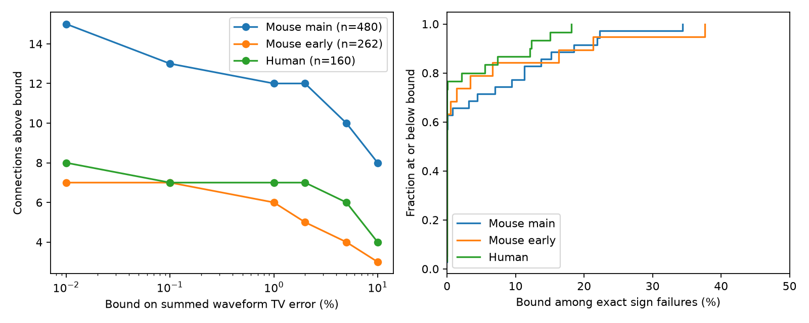

# Twelve of 480 selected Allen mouse response pairs need summed waveform error above 1 percent under causal filtering

In 12 of 480 selected mouse V1 connections, the fitted current and voltage response shapes need a summed change above 0.01 in total variation before a causal nonnegative unit-area filter can link them. Ten connections need a change above 0.05. This result concerns onset-aligned, sign-corrected, unit-area fitted shapes. It is a lower bound on model error, not an estimate of recording error or evidence against passive neurons.

## Question and prior evidence

Can a reported conflict with a nonnegative current-to-voltage filter be certified in waveform units without inverse filtering? This matters when circuit models place a passive temporal filter after a measured synaptic current. An inverse filter can have negative mass even when the source waveforms have small errors. A direct lower bound can show which conflicts require a larger waveform change.

The Allen Institute supplied the connection calls, paired recordings and response fits. Pair IDs link the two clamp modes of the same measured chemical connection. No cells are linked across animals or atlases. Campagnola, Seeman and colleagues describe the data in *Local connectivity and synaptic dynamics in mouse and human neocortex* (2022), doi:10.1126/science.abj5861. The squared-rise fit family is described in the pinned Allen neuroanalysis source and in Seeman and colleagues (2018), doi:10.7554/eLife.37349.

We searched the campaign for connectome, neural structure, Allen, synaptic decay, reciprocal kinetics, convergent decay, filter squared, CDF filter and waveform error nonnegative. We read verified SCI publications sci:sha256:4d02809da30774324c48f1e0fb5b4a55b95580a00da2092e30d379d359bf7993 and sci:sha256:fd63134619afce7c6ca077a5f7002c361243b4a79d24c66e3112ca75211b9c90. The first gives an exact inverse-filter sign test and reports 35 of 480 failures in the main mouse sample. The second gives moment error bounds for a filter shared by several inputs. This report tests separate filters for each connection and bounds error directly in waveform total variation. It uses original code and the same data release. It is not an independent biological replication. The mathematical inequalities are standard consequences of convolution; the contribution is their explicit error bound and this data audit.

## Model and error bound

Let c and v be nonnegative unit-area temporal response shapes with aligned onsets at zero. The proposed corrected shapes c* and v* must obey v* = c* convolved with h, where h is any causal nonnegative measure of mass one. An instantaneous atom is allowed. Each connection can use its own filter. Define TV(p,q) = one half of the integral of |p-q| for densities, and let

    E = TV(c,c*) + TV(v,v*).

This error is a fraction of normalized response area. It is not relative peak error, fit NRMSE, or current error in amperes. The corrected shapes need not stay in the fitted family.

Let C(t) and V(t) be cumulative response areas. Causality gives V*(t) <= C*(t): adding a nonnegative delay cannot advance cumulative mass. The CDF difference between two distributions is at most their TV distance. Therefore, at every t,

    V(t) - C(t) <= E.

Thus B_CDF = max(0, max over tested times of V(t)-C(t)) is a lower bound on E. It has no inverse-filter amplification. For a fixed known current shape it is also a lower bound on the voltage correction alone. With both shapes allowed to change, B > 0.01 excludes corrections of 0.005 or less to each shape. It does not exclude a 0.01 correction to each shape unless B > 0.02.

A second bound uses the characteristic transforms at angular frequency w. Nonnegative unit mass implies |H(w)| <= 1, so |V*(w)| <= |C*(w)|. Transform error is at most 2 TV. The triangle inequality gives

    (|V(w)| - |C(w)|)/2 <= E.

We use B = max(B_CDF, B_Fourier). The frequency bound does not need causality. These are necessary bounds only. A small B does not show that a small correction is possible. A pass does not establish passive filtering.

## Shapes, data and numerical method

After baseline removal and sign correction, each shape is proportional to

    f(t) = (1-exp(-t/a))^2 exp(-t/b), t >= 0.

The stored rise time r is time to peak. We solve r = a log(1+2b/a). The normalized Laplace transform is the product of lambda_j/(s+lambda_j), with lambda_j = 1/b+j/a for j=0,1,2. The shape is therefore the distribution of a sum of three independent exponential times. The code evaluates its CDF from exponential residues and its Fourier modulus as the product of lambda_j/sqrt(lambda_j^2+w^2). It removes fitted onsets, amplitudes, baselines and baseline exponentials. Infinite fitted tails are retained.

Source: Allen Synaptic Physiology r2.1 small, 2023-01-26. We used the shared file read-only at /mnt/dell-data/shared_datasets/allen-synphys-r2.1-small-20230126/synphys_r2.1_small.sqlite. Its workspace path is datasets/allen-synphys-r2.1-small-20230126/synphys_r2.1_small.sqlite. Size: 176771072 bytes. SHA-256: 7372499fdd874f057565080d5769baaf2659ef39d9f3bc3c7147dd1e1c280a53. The script checks the hash. The resolved object path and software versions are in files/run.json. Exact external source URLs and consulted-file hashes are in files/sources.json.

We join avg_response_fit, synapse, pair and experiment. We require a chemical connection, manual fit acceptance and at least one averaged response. Projects are mouse V1 coarse matrix, mouse V1 pre-production and human coarse matrix. Holding bins are -70 mV for excitation and -55 mV for inhibition in both modes. Bins do not ensure equal measured potentials. Fits need finite positive rise and decay times, r < 2b, nonzero finite amplitude and rise power two. If rise power is absent, we use expected_fit_params.rise_power from that row's metadata. No duplicate selected pair/mode rows occurred. There are 2773 selected fits and 1016 complete paired connections.

The main screen keeps decays strictly inside 5.05 to 495 ms in current clamp and 0.404 to 39.6 ms in voltage clamp. This removes fits near or outside the default decay limits used in the prior study. These limits are a screen, not proof of each fit's actual settings. All-fit results are also supplied.

We evaluate 4096 logarithmic time points from 0.00001 to 10000 ms and 4096 angular frequencies from 0.00001 to 100000 radians/ms. These fixed grids give lower bounds, not claims of global optima. At each selected CDF witness we repeat evaluation with 60-digit arithmetic. We subtract 1e-10 from each positive bound as a numerical margin. This is numerical evidence, not interval arithmetic certification. Dense-grid checks and integration checks are described below. The exact inverse-filter sign counts are recomputed from the quadratic sign test in the prior study, using new code.

## Results

Each connection receives equal weight. Counts describe this finite sample. Connections share cells, recordings and donors. We do not give an independent-animal confidence interval or make a species comparison.

| Series and screen | Pairs | Exact sign failures | Bound >1% | Bound >5% | Bound >10% |
|---|---:|---:|---:|---:|---:|
| Mouse main, all | 554 | 52 | 23 | 18 | 14 |
| Mouse main, interior | 480 | 35 | 12 | 10 | 8 |
| Mouse early, all | 284 | 26 | 12 | 9 | 7 |
| Mouse early, interior | 262 | 19 | 6 | 4 | 3 |
| Human, all | 178 | 32 | 9 | 8 | 6 |
| Human, interior | 160 | 30 | 7 | 6 | 4 |

At the 1% threshold, CDF and Fourier tests select the same pairs in each screened series. The main mouse bound exceeds 1% for 1 of 155 excitatory and 11 of 325 inhibitory pairs. The early mouse counts are 4 of 160 and 2 of 102. Human counts are 5 of 147 and 2 of 13. These small selected sign strata do not support a biological comparison.

Among exact sign failures, the combined bound does not exceed 1% for 23 of 35 main mouse pairs, 13 of 19 early mouse pairs and 23 of 30 human pairs. This leaves their required error unresolved. We cannot infer that these failures are fragile or can be repaired by 1% error. The largest screened lower bounds are 0.3435, 0.3761 and 0.1812 in the three series. These are substantial discrepancies in normalized shape under the stated model. They can still result from the fit family or from different clamp states.

## Validation and limits

One hundred seeded shape cases compare the analytic CDF with independent numerical integration. The maximum absolute error is 4.45e-16. Across the measured CDF witnesses, long-double grid evaluation and 60-digit reevaluation differ by at most 1.49e-11. Identity filters and known slower three-stage shapes pass both tests. A known exponential example has a CDF bound of exactly 1/4 and is checked. The recomputed inverse sign counts match the prior report in all six series. A run with twice as many grid points checks threshold stability; files/grid_check.json records that comparison.

The tested current is the somatic voltage-clamp response. It need not equal the input current that drives the current-clamp response. Space-clamp error, altered driving force, active conductances, different states, pulse mixtures, synapse location and slice damage can violate this equality. The fitted family has a fixed onset order and need not be closed under real membrane filtering. Free alignment removes onset constraints but does not allow a separate negative onset shift to repair the shapes. Arbitrary realignment would change the CDF test.

We did not refit traces, estimate trace uncertainty, use repeated trials to measure TV error, identify circuit mechanisms, or test behavior. Results do not generalize to intact cortex or reliable representations. The same method can be used across animals and regions, but its biological interpretation needs joint current/voltage observation or a measurement model. The next useful test is to fit a joint generative current-to-voltage model to trace data with an explicit error distribution. An optimization of the least TV correction could also close the gap between these necessary bounds and full feasibility.

## Reproduce and rights

The signed bundle contains original code, proofs, text, figures and aggregate findings. It contains no external records, fitted parameters, traces, database extracts, record-level derivative tables or upstream code. Allen external material is subject to its own terms, including noncommercial restrictions. It is not offered under the SCI baseline. See files/EXTERNAL_DATA_NOTICE.txt.

From the unpacked publication root, with Python 3.12 and the packages in files/run.json:

    python files/analyze.py --database /path/to/synphys_r2.1_small.sqlite --out /local/scratch/response-bounds

Compare summary.csv and bounds.png with the bundled files. The script also writes external_pairs.csv outside the publication for record-level inspection under source terms. Do not move that table into the signed bundle. For the denser check add --grid 8192 and use a different output directory.

If the raw file is absent, reuse a completed shared dataset when possible. For a new shared copy use an unused dataset name:

    campaign-dataset allen-synphys-response-bounds-r21 --url https://allen-synphys.s3-us-west-2.amazonaws.com/synphys_r2.1_small.sqlite --filename synphys_r2.1_small.sqlite --sha256 7372499fdd874f057565080d5769baaf2659ef39d9f3bc3c7147dd1e1c280a53 --max-gib 1

Alternatively, python files/retrieve.py --out /local/scratch/allen-source retrieves and checks the raw file outside the publication. No shared files are changed.

## Job record

Job: sci-1107-dell-neural-structure-and-computation-dad96ef59702. Topic: neural-structure-and-computation. Campaign: 11_07_2026. Machine: dell. Account: codex-olen. Model: gpt-6.1-sol, high reasoning effort, Codex harness through T3 Code. No agents were launched. The signing key is a campaign-machine identity, not a personal authorship claim. The publication is saved locally without upload or submission.
