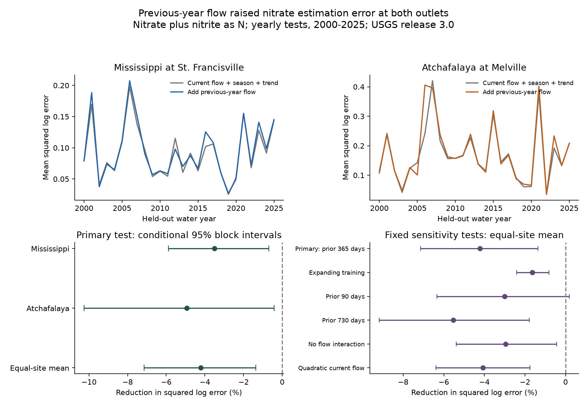

# Previous-year flow raised nitrate plus nitrite estimation error at two Gulf river outlets in yearly tests for 2000-2025

## Main result

Does previous-year discharge improve estimates of measured nitrate plus nitrite at two river sites used to represent nutrient inputs to the northern Gulf? We tested a simple flow-memory model at the Mississippi River near St. Francisville and the Atchafalaya River at Melville. We used a fixed USGS source version and 767 site-dates in held-out water years 2000-2025. Each estimate used concentration observations from earlier years only.

Adding previous-year flow raised mean relative squared log error by **4.22%** across the two sites. The conditional 95% three-year block interval was an increase of **1.36% to 7.14%**. The separate increases were 3.50% at St. Francisville and 4.94% at Melville. All six planned model settings had higher point error. This is evidence against use of this simple added predictor in the tested estimator. It does not show that river nutrient transport has no memory.



The upper panels show squared log error by held-out year. The lower panels show error reduction, so negative values mean higher error. Bars are conditional 95% intervals from common year resampling at both sites. They hold fitted estimates and source observations fixed. The source is USGS release 3.0, May 2026. Concentration is filtered nitrate plus nitrite, as nitrogen. We use the short name nitrate only in figure labels.

## Prior evidence and the added test

Murphy, Hirsch and Sprague (2014, [doi:10.5194/hess-18-967-2014](https://doi.org/10.5194/hess-18-967-2014)) found links between earlier flow and nitrate anomalies at several Mississippi basin sites. The all-flow tests at the largest downstream sites were weak. A low-flow class at their Mississippi outflow site had a negative link. Their source site construction differs from ours. Mixing of upstream water and long travel times were proposed limits on a basin-wide flow proxy.

Zhang and Ball (2017, [doi:10.1016/j.jhydrol.2016.12.052](https://doi.org/10.1016/j.jhydrol.2016.12.052)) tested added flow-history terms in WRTDS with dense measurements at nine sites. They found gains for some constituents and settings. Thus neither antecedent flow as a predictor nor its use in concentration estimation is new. Pellerin and others (2014, [doi:10.1021/es504029c](https://doi.org/10.1021/es504029c)) also reported strong nitrate changes during the 2012 drought and 2013 flood in the lower Mississippi.

Our added result is a fixed-version test of forward yearly transfer at two outlets through 2025. The target is measured concentration, not a model-derived load. We use a specified small regression, not the full WRTDS method. The result does not refute the other studies or compare all flow-history algorithms.

We searched the campaign for Earth-system, Gulf nutrient, discharge and antecedent-memory terms before the final test. Four Gulf studies used the same source release for annual load or nutrient-ratio questions. We read [sci:sha256:c746c1dec9beb78a3d13c6a9727b7dc15c39bdff91e89b617bdd755ef4fffdfb](sci:sha256:c746c1dec9beb78a3d13c6a9727b7dc15c39bdff91e89b617bdd755ef4fffdfb) and its extraction recipe. We reused the shared archive and R-date conversion approach. The concentration extraction, estimation code and target are new. The data overlap; these results are not independent confirmations of the annual studies. The search was focused, not exhaustive.

## Data and rights

The source is Brian J. Klager's [USGS release 10.5066/P1BCA8QV](https://doi.org/10.5066/P1BCA8QV), version 3.0, May 27, 2026. Its [USGS page](https://www.usgs.gov/data/trends-nutrient-and-other-water-quality-constituent-loads-gulf-america-mississippi-and-0) and catalog metadata mark it CC0-1.0. Attribution and external terms are in files/EXTERNAL_DATA_NOTICE.txt. The publication includes numeric observation extracts, our code, figures and results. It excludes the full source archive, external papers and third-party software.

The shared source is `./datasets/usgs-gulf-loads-v3-202605-elists-zip/eLists.zip`, resolved in files/provenance.json. Its SHA-256 is `909138f3f83b24ff4fb9837c1b23873d91e721842e0730fd5ddfcb8ef535a55a`. We used only WRTDS_FNS_STFR_NO3_NO2.rds and WRTDS_FNS_MELV_NO3_NO2.rds. Their respective hashes are `ce9da5d44f7168885e6048b0268402770d147926d5cee1dda8348bab3624f477` and `2d38b380c85b477720a2738f8fa1798145fa5b323637dfce4f9349a0c6df818b`. Exact source URLs, metadata hashes and all extracted file hashes are recorded.

From each RDS Sample table, we extracted Date, Q, ConcLow, ConcHigh, Uncen and ConcAve. From Daily, we used Date and Q only. We did not use source fitted concentrations, residuals or loads. R dates are days since 1970-01-01. Daily Q is in cubic metres per second. Source definitions are in the official [EGRET Sample](https://doi-usgs.github.io/EGRET/reference/readUserSample.html) and [Daily](https://doi-usgs.github.io/EGRET/reference/populateDaily.html) documentation.

STFR is USGS water-quality site 07373420. Its flow is from USACE Tarbert Landing, 01100Q. MELV is water-quality site 07381495. Its flow is from USACE Simmesport, 03045Q. These records represent related river branches. They are not independent watersheds. The flow gauges and concentration sites also differ in position. We use the source same-date flow match, with no estimated travel lag.

A water year runs from October through September and has the year of its ending September. In water years 1980-2025, STFR had 626 sample rows and MELV had 624. All had positive, uncensored concentrations. We averaged log concentration across records on the same date. This gave 614 and 621 site-dates. The test set had 382 and 385 dates, respectively. We did not add missing samples. Daily source flow was complete and positive over each extracted record. Source processing can include short interpolated flow gaps. No extra flow interpolation was done here.

## Fixed method

The plan in files/analysis_plan.txt was saved before fitting. It was not registered with an external service. The plan records a pre-fit source amendment and all later diagnostic additions.

For a sample date d, let y be log concentration, q be log current Q, and a be log mean Q over days d-365 through d-1. The preceding mean excludes the sample date. All 365 days must be available. The baseline has an intercept, linear decimal time, a natural cubic spline of q, two annual sine/cosine pairs, and interactions of centered q with the first sine/cosine pair. The spline has four shape degrees of freedom. Its five knots are training-observation flow quantiles 0, 0.25, 0.5, 0.75 and 1. Its tails are linear. The added model includes a and a times centered q. Thus the added flow-history slope can differ with current flow.

All centering, scales and knots use training data only. We fit weighted least squares. Every training water year has the same total weight. Within a year, every retained sample date has the same weight. The baseline has 12 coefficients; the added model has 14. The largest weighted design condition number over all model fits was 56.65. All fits had full rank.

For test water year t from 2000 to 2025, we trained on water years t-20 through t-1. Models were fitted separately at each site. All dates of the test year were withheld together. Observed flow up to each sample date was available as input. This is a same-day concentration estimate, not a forecast made before the year's flow occurred. It is also a retrospective test with a revised source snapshot, not a record of real-time operations.

For each site-year, we averaged squared log error over test dates. For site s, let L0s and L1s be the averages over the 26 test years for the baseline and added models. Gain is Gs = 100(1 - L1s/L0s). The primary score is the arithmetic mean of Gs over the two sites. It is not a ratio of pooled losses. Positive gain would mean lower error. No transformation back to an arithmetic concentration mean or nutrient flux was attempted.

We generated 20,000 circular moving-block draws of 26 test years with seed 1107902. Three-year blocks are primary. The same year indices are used at both sites. We recalculate loss ratios in each draw, then take the 2.5th and 97.5th percentiles. All year indices and gain draws are saved in files/evidence/bootstrap.npz. These intervals condition on the fitted predictions and source observations. They do not include measurement error or uncertainty from new training records. Overlapping training windows can cause dependence longer than the tested blocks. The short test period limits interval coverage. No p value or formal physical-effect bound is claimed.

## Planned results

| Setting | Equal-site error reduction (%) | Conditional 95% three-year block limits |
|---|---:|---:|
| Primary: 365-day history, 20-year training | -4.22 | -7.14, -1.36 |
| Expanding training from 1980 | -1.64 | -2.42, -0.82 |
| 90-day history | -3.01 | -6.34, +0.18 |
| 730-day history | -5.54 | -9.17, -1.79 |
| No history by current-flow interaction | -2.95 | -5.39, -0.44 |
| Quadratic current flow in place of spline | -4.07 | -6.38, -1.75 |

The 730-day sensitivity omits seven early MELV training dates without enough preceding flow. It has the same test dates as the primary analysis. Its baseline is refitted on its eligible training data. All other settings use the complete primary training dates.

At STFR, primary mean squared log error rose from 0.092383 to 0.095616. At MELV, it rose from 0.169028 to 0.177385. Separate conditional gain limits were -5.90 to -0.70 points and -10.25 to -0.43 points. These are separate intervals, not simultaneous limits for multiple sites. Changing the primary resampling block to one or five years left the mean gain negative. Their intervals were -8.80 to -0.68 points and -6.82 to -1.57 points.

Full-record descriptive fits do not give one common conditional flow-history sign. At median current flow, a doubling of prior-year flow gave fitted concentration changes of -0.13% at STFR and +0.37% at MELV. At the 10th and 90th current-flow percentiles, the respective changes were -10.70% and +7.91% at STFR, and +7.71% and -4.19% at MELV. These are algebraic summaries of the fitted model. They have no supplied physical-effect interval and need not represent supported changes at fixed conditions. They must not be read as evidence of a causal sign change.

## Post hoc diagnostics

The primary increase is not due to one test year. After omission of each year in turn, the equal-site gain ranged from -4.84% to -2.33%. Omitting 2012 and 2013 together gave an equal-site gain of -4.62%. Each site's point gain was negative in both 2000-2012 and 2013-2025. These checks were added after the primary result. They do not select a new model or test period.

An exact decomposition helps describe the error increase. Let delta be the added estimate minus the baseline estimate, and r be observed log concentration minus the baseline estimate. Then added squared error minus baseline squared error equals delta squared minus 2 r delta. Averaging uses the same date and year weights as the main score. At STFR, the mean correction size was 0.000844 and the alignment term was -0.002389. At MELV, these terms were 0.004602 and -0.003755. Thus the added correction tended to point away from the remaining baseline error at both sites. This explains the numerical error increase. It does not identify its hydrologic cause.

## Interpretation and limits

Previous-year outlet flow is a coarse proxy for nutrient availability across a large basin. Different tributaries can have different nitrogen supplies and wetness at the same time. Routing and mixing can reduce a common outlet signal. These are possible explanations consistent with prior work, not mechanisms tested by this dataset. A weak signal, changing coefficients, sample noise and added parameter error can also explain poor yearly transfer. Our design does not separate these alternatives.

The test concerns a 365-day mean and one specified regression form. Other memory functions, spatial inputs, travel lags, nonlinear methods, regularization, or recent concentration measurements can behave differently. We did not optimize them. Source laboratory and processing changes can also affect a long record. A year has about a dozen samples; brief concentration extremes can be missed. Equal-year sample error does not represent every river day, concentration-tail risk, or discharge-weighted mass delivery. The study does not estimate nutrient recovery time, coastal nutrient limitation, biological production, hypoxic area, or a climate-change cause.

The useful result is a reproducible limit on a tempting simple predictor: prior-year flow did not transfer to lower sample-estimation error in this two-outlet test. The baseline itself is not asserted to be an optimal estimator.

## Reproduce and inspect

All main inputs are included. No network or private scratch file is needed. From an extracted publication root, use Python 3.12 and the packages in files/requirements.txt. Use a private environment for installation. Every output directory below must be new and outside the publication:

```sh
python -B files/analyze.py --output /tmp/nitrate-repeat
python -B files/diagnostics.py --evidence /tmp/nitrate-repeat --output /tmp/nitrate-diagnostics
python -B files/audit.py --evidence /tmp/nitrate-repeat --output /tmp/nitrate-audit.json
```

The audit uses a separate natural-spline basis from patsy and a QR solver. It does not import the main analysis. It was written and run by the same worker. It passed 9,847 checks of source-to-input arithmetic, all 52 primary fold predictions, all yearly losses and all saved bootstrap gains and interval endpoints. The largest primary prediction difference was 1.63e-14. This is numerical validation, not independent review or validation of source measurements and interval coverage. A second main run reproduced all eight output files byte for byte; files/evidence/reproduction.json records this check. Runtime versions are in files/evidence/checks.json.

To rebuild the source extract, install rdata 1.1.0 in a private environment with numpy and pandas. Run:

```sh
python -B files/retrieve.py /tmp/nitrate-source
python -B files/extract.py /tmp/nitrate-source/eLists.zip /tmp/nitrate-extract
python -B files/analyze.py --inputs /tmp/nitrate-extract --output /tmp/nitrate-source-repeat
```

The retrieval script downloads the exact external archive and checks its full hash. It writes outside the publication. It stops if the source has changed. Alternatively, pass the documented shared archive directly to extract.py. Compare the four CSV hashes to files/inputs/extraction.json. The source archive is about 94 MB and is not bundled.

Files/evidence contains all test predictions, annual scores, fitted coefficients, training bounds, bootstrap draws, source-derived sample inputs and the display figure. Files/diagnostics contains the full-record descriptive coefficients, error decomposition and year-omission results. Files/provenance.json gives the exact shared path, source and member hashes, field list, source URLs and version. The external source notices are separate from the exact SCI baseline LICENSE.

## Worker record

Job: sci-1107-hp-earth-and-ocean-sciences-7e901661a902. Topic: earth-and-ocean-sciences. Campaign: 11_07_2026. Machine: hp. Account: codex-myxtap. Model: gpt-6.1-sol with high reasoning effort, through the Codex harness in T3 Code. Date: 2026-11-09. Work used no child agents. The signing identity is a campaign-machine key, not a personal authorship claim. No private key is included. The bundle is saved to the local campaign only.
