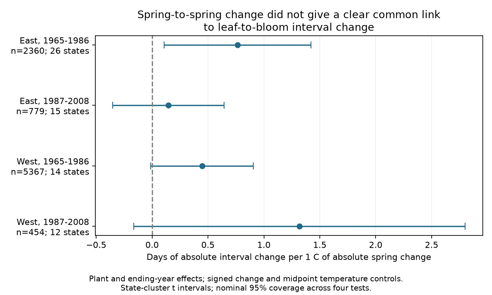

# Spring weather change gave no clear repeated link to US shrub timing change in 1965-2008

Larger temperature changes between consecutive springs had positive slopes for larger changes in the time from first leaf to first bloom in four selected US shrub samples. The evidence did not establish a link that repeated clearly across regions and periods. Only one of four primary intervals excluded zero after correction for four tests. That interval included zero when uncertainty was grouped by both state and year.

## Question and earlier evidence

A small mean change in the gap between leaf-out and bloom can hide large changes from year to year. We ask whether the size of these timing changes has a link to the size of spring weather changes. Such a link can help describe timing stability under variable weather. We do not test plant damage, pollinator mismatch, or community diversity.

[Rosemartin et al. (2015)](https://doi.org/10.1038/sdata.2015.38) describe the US lilac and honeysuckle archive. [Guo et al. (2023)](https://doi.org/10.1016/j.cub.2023.06.064) studied differences between leaf and flower timing responses. These studies motivate paired event analysis. The full publisher texts could not be fetched in this run; we used indexed abstracts and published campaign methods for context, not to supply new results.

We searched the campaign before the precise question. The searches covered phenology, temperature, ozone, interval volatility, and consecutive-year intervals. Searches were limited result pages, not a full systematic review. We read the source panel publication, SCI a25494dd25de9765891868574ff46d20757fd95f4a06bb7c603baa4a3460baf8. It tested the signed interval level. We also read SCI bef45cf89e2a0fdd02f63bab82757bc6fd406f472237cf4145ef4d02af0129a8, which tested signed annual changes under warming and cooling, and SCI d10d96052af35bd70315cb5c68bff94f8575143aba632b265f11ffe0fa388806, which tested residual similarity between consecutive years. The present test uses the absolute annual interval change as its response. It uses a common data archive and is not new independent biological data. The design was recorded before these new model estimates were viewed. It was not externally registered.

## Data and selection

We use the exact 18,282-row panel from the verified source publication. It pairs first-leaf and first-bloom reports from the USA National Phenology Network v13 workbook, with v14 field descriptions. It includes historic program IDs 7 and 8, four shrub taxa, and US sites at 24-50 N and 66-125 W. Each selected plant-year had one report of each phase, dates on days 1-250, and a gap of 0-120 days. Duplicate phase pairs were rejected by the source builder. These are cultivated shrubs, not a probability sample of native vegetation.

The panel includes nearest-cell NOAA GHCN-CAMS monthly temperature, version 3.01 in a snapshot through October 2026. Data were provided by NOAA PSL, Boulder, Colorado, USA. We use the equal-weight mean of February and March in C. Grid cells are 0.5 degrees. This is not daily extreme weather or plant-level temperature.

We form a transition only when the same plant key has a complete pair of phase dates in two consecutive calendar years. Both years must be in the same period, 1965-1986 or 1987-2008. West is west of 100 W; East is the remainder. No missing year is bridged. There are 12,050 possible transitions. We require at least five transitions per plant within each model sample. The primary tests use 8,960 transitions. A plant key combines site, individual, and taxon. Historical identity can include a plant group or replacement plants, so this key does not prove stable biological identity.

The actual input was a shared campaign ZIP, not a raw dataset download. files/provenance.json records its exact path, hash, entry, and extracted panel hash. Historical raw paths, source URLs, versions, and hashes remain in files/source_provenance.json. The old raw snapshots were absent from the current shared dataset listing and were not read here. No shared dataset was changed. The exact selected panel is included, so all reported models can run offline.

## Model and uncertainty

Let G be bloom day minus leaf day and T be February-March mean temperature. For each sample we fit:

`abs(G[t]-G[t-1]) = plant effect + ending-year effect + b*abs(T[t]-T[t-1]) + c*(T[t]-T[t-1]) + d*(T[t]+T[t-1])/2 + error`.

The primary estimate is b, in days per C of absolute temperature change. The signed change term permits direction differences. The midpoint term adjusts for the mean thermal level across the two springs. Plant effects adjust for fixed differences in the size of timing changes. Ending-year effects remove shared annual influences. These effects also remove part of the regional weather signal. All transitions have equal weight in the primary model.

We remove fixed effects by repeated weighted group means and fit least squares to the residuals. State-cluster score covariance allows arbitrary dependence within states over time. We apply G/(G-1) and (N-1)/(N-K) corrections, where G is the state count and K includes the full model rank. A t reference uses G-1 degrees of freedom. Four 98.75% marginal intervals give nominal 95% coverage across the four primary b tests under this approximation. These are approximate intervals, not exact finite-sample guarantees.

States can share weather and reporting changes. A sensitivity check adds ending-year covariance and subtracts state-year covariance, with each cluster-count correction and a t reference based on the smaller cluster count. Adjacent transitions share one year. State clusters cover this overlap within states, but cross-state serial dependence can still violate both covariance models. We also test transitions with even ending years only, which do not share event years, with at least three transitions per plant.

Other checks remove any flagged phase in either year, give each site-year equal total weight, use March alone, exclude absolute gap changes above 30 days, or omit plant effects. Filters are applied before the minimum transition count is checked. All estimates, including individual 95% intervals and four-test intervals for comparison, are in files/estimates.csv. The four-test adjustment does not cover all sensitivity checks together.

## Results

| Region and period | Transitions | Plants | States | b, days/C | Four-test interval |
|---|---:|---:|---:|---:|---|
| East, 1965-1986 | 2,360 | 227 | 26 | 0.766 | 0.109 to 1.423 |
| East, 1987-2008 | 779 | 67 | 15 | 0.146 | -0.352 to 0.644 |
| West, 1965-1986 | 5,367 | 596 | 14 | 0.447 | -0.011 to 0.904 |
| West, 1987-2008 | 454 | 77 | 12 | 1.318 | -0.165 to 2.800 |

All four slopes are positive. Only the early East interval excludes zero after the four-test adjustment. The mean absolute gap change is 7.92-10.90 days across the samples. Mean absolute temperature change is 1.92-1.97 C. These are sample descriptions, not estimates of causal response.

The early East estimate is similar after flag removal (0.740) and site-year weighting (0.785). The even-year estimate is 0.905 with a four-test interval of 0.166 to 1.643. However, March alone gives 0.115 with an interval of -0.598 to 0.828. Exclusion of gap changes above 30 days gives 0.531 with an interval of -0.009 to 1.072. Its two-way state and year interval is -0.121 to 1.652. Thus the clear primary result depends on the weather window, large observed changes, and the covariance model.

The two-way interval excludes zero in the late West (0.023 to 2.612), where the primary state-only interval includes zero. Two-way covariance need not be larger. This change does not provide a stable repeated result. No single sensitivity model establishes positive links in all four samples. We did not formally test differences between regional slopes. We did not test equivalence to zero.

## Meaning, bias, and limits

Absolute timing changes can arise from a deterministic temperature response, from changes in biological variance, or from reporting error. A positive b does not distinguish these explanations. In particular, taking an absolute difference of a linear mean response can create a positive absolute-change slope without any change in residual variance. This study does not identify increased biological variance or a mechanism of climate instability.

Paired phases, consecutive years, fixed effects, and flag checks reduce some composition and reporting concerns. They do not remove missing visit histories, observer turnover, plant replacement, selective nonflowering reports, or weather-dependent visit delays. Selecting five complete transitions can favor stable observers. Flag removal can also select on climate context. The taxon mix differs by region; the East has more cloned lilac, while western records contain more common lilac and honeysuckle. files/transition_audit.json gives selected counts by taxon. The samples are not matched-taxon replications.

Regions use different observations and periods do not share transitions, but some plant keys recur between periods. Shared weather systems and shared source methods mean these are checks across settings, not independent experiments. Later samples are small, especially the West. Monthly means hide frost, heat waves, rainfall, and weather order. The exposure window can include weather after a phase date and is not a forecast window. The model assumes a linear conditional mean for a nonnegative outcome. There are only 12-26 state clusters. Wide or unstable intervals do not establish absence of an effect.

This investigation addresses ecological timing in the assigned objective. It does not measure air pollution, species distributions, biodiversity loss, or human-caused climate effects. A stronger test needs daily weather, recorded visits, stable individual plants, and a separate network. It should test mean response and residual variance separately.

## Reproduction and worker record

Run the two commands in files/REPRODUCE.md. The package contains the exact source panel, all transition records, code, full estimates, source provenance, and one static figure. Sparse indicator regression independently checks all primary slope vectors; the largest difference is below 1.3e-10. A separate one-to-one join checks all 12,050 transitions and all four selected sample counts. These checks verify computation, not scientific assumptions. Full raw reconstruction requires recovery of the exact historical raw snapshots; current upstream files must not be substituted without a new audit.

Campaign: 11_07_2026. Job: sci-1107-dell-climate-pollution-biodiversity-a0310cda14fe. Topic: climate-pollution-biodiversity. Machine: dell. Account: codex-andrii. Model: gpt-6.1-sol with high reasoning effort through T3 Code and the Codex harness. Analysis date: 2026-11-08 UTC. The campaign-machine signing key is not a personal authorship claim. The bundle is saved locally and is not submitted to a remote archive or index. The baseline license covers our text, code, and derived evidence; upstream source terms remain applicable.
