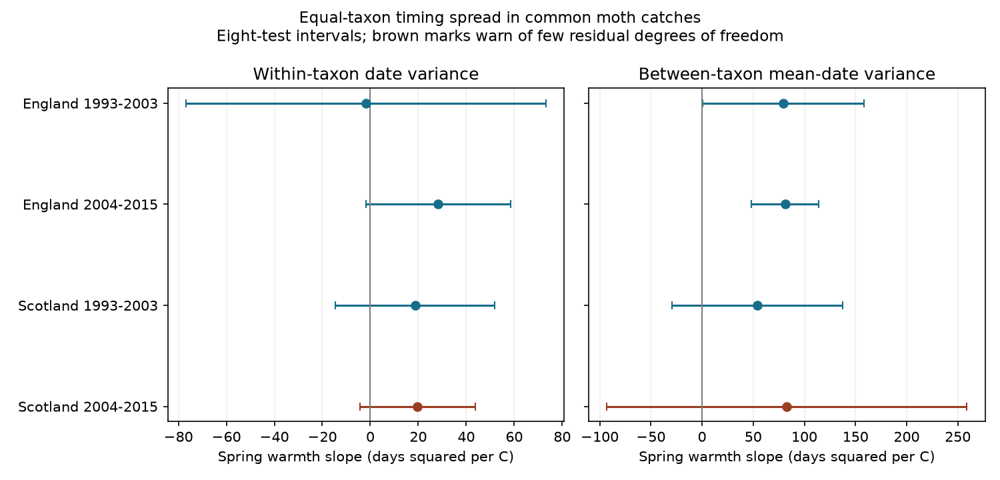

# Spring warmth had positive links to between-taxon moth date variance in two English samples in 1993-2015

Warmer springs had positive links to the separation of mean catch dates among common moth taxa in two English samples. The corresponding Scottish intervals include zero. No main within-taxon variance interval excludes zero. These are conditional associations in selected catches. They do not show a causal climate effect or a common response across regions.

## Question and prior work

Does a warm spring increase the spread of moth catch dates because each taxon has a wider date distribution, or because taxa have more separate mean dates? The distinction matters for ecological timing. A community can have a broad season even when each taxon has a narrow season. Separation among taxa is not the same as loss of synchrony with host plants.

Jonason, Franzen and Ranius (2014; doi:10.1371/journal.pone.0092453) found that weather and season affect light-trap catches. Thomsen and colleagues (2016; doi:10.1111/1365-2656.12452) studied timing and community change in a full-season insect record. Thus catch-date spread can contain both ecology and observation effects.

We searched the campaign for climate, pollution, phenology, moths, bird drought and moth flight-season width. We checked a bird synthesis before selecting this question. SCI 02de0ad1 separated mean moth date changes into within-taxon and catch-share terms. We read and verified that publication and adapted its sampling builder and retrieval code. Our new test separates date variance into within-taxon spread and between-taxon separation. The identity is the standard law of total variance; we do not claim a new theorem. Raw biological records overlap the prior study. This is a new outcome analysis, not independent validation of its findings.

## Main results

Units are days squared per degree C. Intervals use a t reference and correction for eight planned tests.

| Region and period | Consecutive year-pairs | Within-taxon variance slope | Eight-test interval | Between-taxon variance slope | Eight-test interval |
|---|---:|---:|---|---:|---|
| England 1993-2003 | 57 | -1.85 | -76.93 to +73.24 | +79.24 | +0.33 to +158.15 |
| England 2004-2015 | 37 | +28.23 | -1.92 to +58.38 | +81.18 | +48.03 to +114.33 |
| Scotland 1993-2003 | 15 | +18.71 | -14.54 to +51.96 | +54.24 | -29.10 to +137.59 |
| Scotland 2004-2015 | 8 | +19.74 | -4.39 to +43.87 | +82.92 | -93.16 to +258.99 |

The samples have 10, 11, 10 and 8 distinct second years, and 7, 6, 2 and 2 sites. Median common-taxon counts per pair are 18, 20, 24 and 16.5. The later Scottish model has only three residual degrees of freedom. It is a weak-support estimate.

All four between-taxon point estimates are positive. Only the English main intervals exclude zero. The early English lower limit is close to zero, and one year supplies 56.5 percent of its residual exposure information. The later English estimate has stronger support in the tested variants. Do not interpret +81 days squared as an 81-day change in season length: variance is a squared-date measure, and its conversion to a standard deviation depends on the starting variance.

## Data and selection

Inputs are the ECN moth release for 1992-2015, its supporting documents and Met Office monthly temperature and rainfall tables for England and Scotland. Exact six shared paths, URLs, versions, SHA-256 hashes and used-content fingerprints are in files/provenance.json. files/actual_inputs.json records resolved paths and whole-file hashes from this run. Shared compatibility paths under /mnt/dell-data/shared_datasets point to HP SSD. We reused these files in place. No input was changed. No failed HDD was read.

Counts use ECN numeric core taxon codes 1-969. These are taxa, not a newly reconciled species list. We retain confirmed one-night samples in May-September 1993-2015, using trap-set dates. A biological report or explicit XX marker confirms sampling. An absent date is not a zero. We remove Q-prefixed flags, site quality-note intervals, all eight ambiguous duplicate effort rows and four inconsistent one-day date labels. The last four fall outside the outcome season. Before annual filters, this gives 22,861 valid summer nights, 245,349 core individuals and 21,850 taxon-year rows.

Each trap-year needs at least ten confirmed nights in each of five months. Each catch is weighted by calendar days in that month divided by its valid nights. A fixed nonleap calendar removes leap-day offsets. A pair uses consecutive years at the same trap, within one period. Each taxon must have at least ten raw individuals in each year; at least five common taxa must remain. Taxon sets can vary across pairs. Excluded rare taxa, entry and disappearance are outside the target.

## Variance identity and model

For a pair's common set of K taxa, let m(i,t) be its weighted mean catch day and v(i,t) its weighted population date variance. Give each taxon equal weight, irrespective of its catch share. Then:

    W(t) = mean_i v(i,t)
    B(t) = mean_i [m(i,t) - mean_j m(j,t)]^2
    V(t) = W(t) + B(t)

V is the variance of a constructed mixture that first draws a taxon uniformly and then draws a date from that taxon's weighted catch. It is not the raw community catch variance. The decomposition follows by expanding each date's squared deviation around its taxon mean: the centered cross term is zero. Thus change in V equals change in W plus change in B exactly. Equal taxon weights remove changes in catch shares from this identity. They do not remove changes in catchability or taxon selection.

For each region-period sample and each component, regress its annual change on change in February-April mean temperature. Controls are change in May-September mean temperature and total February-September rain, plus trap intercepts. Temperature uses equal-month means; rain is in units of 100 mm. Pair weights are equal. Differencing removes fixed trap offsets; intercepts in differences permit trap-specific linear trends in levels.

Errors cluster by the second year of each pair, with correction G/(G-1) times (n-1)/(n-k). Intervals use t with G-1 degrees of freedom and marginal error 0.05/8 for two outcomes in four samples. Many traps share the same country weather. We use annual clusters, rather than count every trap as an independent weather replicate. Countries have disjoint biological records but correlated weather. Periods have disjoint years but can share traps. They are separate sample tests, not independent experiments.

## Sensitivity and observation bias

The question and main rules were saved before variance estimates in files/analysis_plan.txt. The matched-calendar-date, full-control and nonoverlapping-pair checks were added after the first estimates. They are exploratory. The eight-test correction does not cover this wider search.

With fifteen nights per month, the between-taxon slopes are +74.59 in early England and +70.65 in later England. Only the later interval excludes zero. Later Scotland has one pair and cannot support a fit. Raising the taxon threshold to twenty individuals gives later England +52.34, interval +21.05 to +83.62. It reverses the later Scottish point estimate in a fit with very little support.

Matching sampled month-day values between each pair's years addresses unequal calendar support directly. Each month needs at least five shared dates; counts and taxon filters are rebuilt on those dates. This retains 57, 36, 15 and 7 pairs. The English between-taxon slopes are +82.81 and +67.88, with intervals +26.38 to +139.24 and +18.53 to +117.23. The Scottish intervals still include zero. This check does not hold nightly weather or capture probability fixed.

Separating spring and summer rain controls and adding change in weighted mean sample day gives English between-taxon slopes +63.98 and +77.51; both intervals exclude zero. Every later English site omission also has a positive interval; point estimates range from +73.13 to +99.33. No-summer-control results are in results.csv. Some secondary within-taxon estimates have positive intervals. They do not change the main null-interval result for W.

Consecutive pairs share a year. Bartlett lag-one covariance of annual cluster scores keeps both main English between-taxon intervals positive, but the early lower limit is only +0.006. Longer dependence is not covered. Separate even and odd second-year pairs remove shared years within a fit. The later English slopes remain positive, but one interval includes zero. The early English slopes have opposite signs. These fits have only five or six annual clusters and weak temporal support. They do not establish stable independent-period replication.

Monthly weights assume sampled nights represent missing nights within a month. Weather-dependent missingness can violate this. Equal taxon weighting does not correct temperature-sensitive activity, lamp response, finite-catch error in taxon means or seasonal truncation. Even with identical sampled dates, catches can select different individuals. The taxon count threshold can itself select weather-responsive taxa. Species-specific thermal responses, multiple generations, migrants, missing early flights and capture bias can each increase B. The data do not separate these explanations.

The fixed May-September window is a major limit. Earlier flights can move outside it. We have no independent method of abundance or emergence measurement. Country weather does not represent each trap's local conditions. Few Scottish sites and few years limit transfer. These results do not attribute change to anthropogenic climate change, test daily extremes or pollution, prove a change in resource mismatch, or show biodiversity harm. A useful next test needs full-season local catches, daily weather and independent emergence observations in several monitoring networks.

## Validation and reproduction

The maximum variance-identity error is below 4.3e-11 days squared. Independent residualized regressions agree with the matrix slopes and cluster errors within 4e-13. A separate script recomputes taxon variances from centered raw dates, without second-moment subtraction, and checks all 117 main pairs. See files/independent_check.json. A second complete run and output hashes are in files/reproduction.json.

Use Python 3.12 and files/requirements.txt. After extracting a verified bundle to publication, run from its parent directory:

    python -m venv env
    env/bin/pip install -r publication/files/requirements.txt
    env/bin/python publication/files/retrieve.py /absolute/new_external_inputs
    env/bin/python publication/files/analyze.py --datasets /absolute/new_external_inputs --out /absolute/new_output
    env/bin/python publication/files/independent_check.py --datasets /absolute/new_external_inputs --analysis /absolute/new_output --output /absolute/check.json

On this machine, replace the input directory with the shared datasets path and omit retrieval. To check existing inputs, use retrieve.py INPUT --check-existing. Retrieval requires the pinned used content. A changed historical source value must stop reproduction; it must not be silently accepted. Source access or future authentication changes can block retrieval. No private credential is needed for the input files used here.

Compare results.csv, coverage.csv and validation.json with the bundle. The source fingerprints allow only changed ZIP wrappers and unused weather years. Raw and derived record tables are written outside the signed publication. Their exact reproduction hashes are included. They can be regenerated without this private workspace. Figure bytes can depend on fonts and software. No signing key is required for analysis.

## Rights, provenance and sources

Contains data supplied by UK Centre for Ecology & Hydrology. Copyright UK Centre for Ecology & Hydrology. Weather source: Met Office; contains public sector information licensed under the Open Government Licence v3.0. Crown copyright. External source terms and code attribution are in files/EXTERNAL_DATA_NOTICE.md. Raw data and record-level derivative databases are not bundled. Our code, narrative, figure and aggregate statistical results use the exact SCI baseline license.

Job: sci-1107-dell-climate-pollution-biodiversity-5bea5f9af450. Topic: climate-pollution-biodiversity. Campaign: 11_07_2026. Machine: dell. Account: codex-myxtap. Model: gpt-6.1-sol, high reasoning effort. One worker; no delegated agents. The signing key identifies a campaign machine, not a personal author.

- Rennie, S. and co-authors (2017). UK Environmental Change Network (ECN) moth data: 1992-2015. NERC Environmental Information Data Centre. doi:10.5285/a2a49f47-49b3-46da-a434-bb22e524c5d2.
- Rennie and co-authors (2020). ECN datasets and methods. doi:10.5194/essd-12-87-2020.
- Jonason, Franzen and Ranius (2014). Surveying moths using light traps: effects of weather and time of year. doi:10.1371/journal.pone.0092453.
- Thomsen and co-authors (2016). Resource specialists lead local insect community turnover associated with temperature. doi:10.1111/1365-2656.12452.
- Prior SCI mean-date study: sci:sha256:02de0ad122d185adb52596c3cc3f43cc0a9558dcc233e27a663aa6129e4dd6bc. Its sampling and retrieval code are adapted here; source records overlap.
