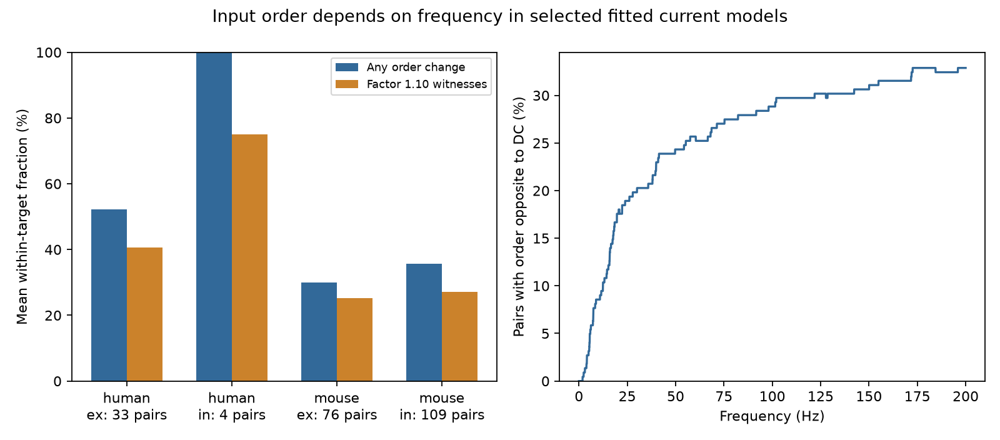

# Frequency changes input strength order in 77 of 222 selected Allen squared-rise current models

## Result

In 77 of 222 comparisons, two inputs to the same target changed their transfer-magnitude order between zero and 200 Hz. Each comparison used two detected connections of the same sign. The calculation used resting-current fits from Allen Synaptic Physiology r2.1 small and assumed a squared exponential rise with an exponential decay. The sample contained 369 distinct connections to 173 targets. This is a result about fitted linear response models. It is not a measurement of frequency routing in a living circuit.

In 73 comparisons the order changed once. In four it changed twice. These four pairs had the same order at zero and 200 Hz but the opposite order at some intermediate frequencies. Thus, checks at the two endpoints can miss a change in input order. Of all 77 pairs with a change, 61 retained opposite orders at two sampled frequencies when each transfer magnitude could independently change by a factor of 1.10. Two of the four pairs with two changes met this condition.



The left panel gives equal weight to each target, then averages across targets within each group. Orange bars require the factor-1.10 condition. The right panel pools all 222 comparisons and shows the fraction with order opposite to zero frequency. Comparisons share cells and experiments. The line is a descriptive model summary, not a population estimate or a measure of information transfer. Human inhibitory data have only four comparisons.

## Question and prior work

Can one scalar connection weight preserve the strength order of convergent inputs over a frequency band? If two transfer magnitudes reverse order, no fixed scalar order can preserve both. This matters when a circuit simulation replaces measured response kernels with a common kernel and keeps only scalar edge weights.

Campagnola, Seeman, and colleagues (2022), doi:10.1126/science.abj5861, measured local wiring and synaptic physiology in mouse and human cortex. Brunel and colleagues (2001), doi:10.1103/PhysRevLett.86.2186, showed how synaptic filtering affects neuronal frequency responses in models. The general importance of synaptic filters is established. Our contribution is a within-target frequency-order audit on the released resting-current fits, with a polynomial method to find crossings and an explicit bounded-error test.

We searched the campaign for connectome, synaptic, charge and frequency before analysis. We read SCI publication `sha256:3eaa990a582ba924ac4ae7b36b48055dc3084ffa10a1be3956a1df8b75fffb2a`. That report compared peak and integrated current. We reuse its SQL query, selection rules and rise-time conversion, with attribution under its MIT code terms. We do not reuse its external record tables. That report does not test frequency crossings. Our plan was saved in files/plan.txt before the first frequency calculation. The searches were targeted checks, not a systematic review or a claim of priority across all work.

## Data and selection

Source: Allen Institute for Brain Science, Synaptic Physiology, release r2.1 small, source file dated 2023-01-26.

Shared path used:

`/mnt/dell-data/shared_datasets/allen-synphys-r2.1-small-20230126/synphys_r2.1_small.sqlite`

Source URL: https://allen-synphys.s3-us-west-2.amazonaws.com/synphys_r2.1_small.sqlite

File size: 176,771,072 bytes. SHA-256, recomputed before analysis:

`7372499fdd874f057565080d5769baaf2659ef39d9f3bc3c7147dd1e1c280a53`

The database was opened read-only. files/audit.json records the resolved shared object path and software versions. We changed no shared data and made no new shared download.

The query joins pair, synapse, resting_state_fit, experiment and slice by released IDs. We require a detected chemical connection. The initial join has 3,296 rows. Mouse VisP or human TCx selection leaves 3,175. Requiring distance from zero through 500 micrometres and at least one manually accepted voltage-clamp average fit leaves 2,246. We then require a finite resting current with the expected sign, magnitude at least 1 pA, positive finite onset-to-peak time r and decay constant d, d at most 300 ms, and r less than 2d. Excitatory current is negative; inhibitory current is positive. We use its absolute magnitude P. These rules leave 1,800 connections. Only targets with at least two eligible same-sign inputs enter comparisons. Every unordered pair enters once.

The manual acceptance flag refers to an average fit, not necessarily to each resting fit. The resting table has no rise-power field. Inspected Allen fitting code fixes rise power at two, but these current source commits do not prove the exact code used for this historical database. Power two is an explicit assumption. Exact method URLs and hashes are in files/method_sources.json. No Allen source code is bundled.

## Model and crossing method

For time t after onset, the absolute response is

`h(t) = P (1-exp(-t/u))^2 exp(-t/d) / N`, for t >= 0.

Here r is time to peak, not the exponential rise constant u. Solve

`r = u log(1+2d/u)`

with the negative branch of Lambert W. N is the unnormalized kernel evaluated at r. Set `lambda_k = 1/d + k/u`, for k = 0, 1, 2. Direct integration gives

`H(s) = [2P/(u^2 N)] / [(s+lambda_0)(s+lambda_1)(s+lambda_2)]`.

If Q is total fitted charge, then

`Q = 2P / [u^2 N product(lambda_k)]`,

`abs(H(iw))^2 = Q^2 product(lambda_k^2) / product(lambda_k^2+w^2)`.

The three-pole form avoids subtraction of nearly equal exponential integrals. A fitted onset delay adds a phase factor of magnitude one and does not affect this order test. We omit baseline terms.

For two inputs a and b, equality of squared magnitudes reduces to

`Q_a^2 product(lambda_ak^2) product(lambda_bk^2+w^2)`

`- Q_b^2 product(lambda_bk^2) product(lambda_ak^2+w^2) = 0`.

This is a polynomial of degree at most three in w squared. Thus there are at most three positive crossing frequencies unless the two magnitudes are identical at every frequency. We solve in scaled coordinates `x=(f/200)^2` and retain real roots strictly inside the band. Each root must change sign in adjacent intervals. This excludes a tangency. The tested sample had no three-crossing pair. The upper bound is not a claim that three crossings are possible for all parameter constraints. Identical transfer functions would give a tie at all frequencies and no strict order change; none affected these results.

For a second check and for bounded-error witnesses, we evaluate log magnitude ratios on 4,001 equally spaced frequencies from 0 through 200 Hz. If L is log(abs(H_a)/abs(H_b)), define

`m = exp(min(max(L), -min(L))/2)`

when the sampled ratios have both signs; otherwise set m=1. A reversal is retained under independent multiplicative changes between 1/factor and factor in every transfer magnitude at the two witness frequencies if `m > factor`. We use factor=1.10. This is a sufficient finite-witness test. It is not a measured parameter error interval. It permits frequency-dependent errors but does not guarantee the assumed kernel family or biological fit accuracy. It does not require a persistent order at either endpoint.

## Counts and sensitivity

| Group | Comparisons | Targets | Experiments | Any change | Two changes | Factor-1.10 witnesses | Equal-target change fraction |
|---|---:|---:|---:|---:|---:|---:|---:|
| Mouse excitatory | 76 | 61 | 56 | 19 | 1 | 16 | 30.1% |
| Mouse inhibitory | 109 | 85 | 66 | 38 | 2 | 30 | 35.7% |
| Human excitatory | 33 | 23 | 21 | 16 | 1 | 12 | 52.2% |
| Human inhibitory | 4 | 4 | 4 | 4 | 0 | 3 | 100% |

Experiments can occur in more than one row. The target fractions differ from pooled comparison fractions because each target has equal weight. We give no confidence interval or species test: the claim describes these finite fitted models, not a sampled animal population. Repeated cells, donors, missing fits and selection prevent an independent-pair interpretation. The small human inhibitory sample cannot support generalization.

| Selection | Comparisons | Any change | Two changes | Factor-1.10 witnesses |
|---|---:|---:|---:|---:|
| Primary | 222 | 77 | 4 | 61 |
| Current floor 0.1 pA | 246 | 86 | 4 | 69 |
| Current floor 5 pA | 105 | 31 | 2 | 20 |
| Decay at most 100 ms | 214 | 70 | 2 | 54 |

Each sensitivity rule changes the sample. These results do not show stability of every pair. All group results are in files/aggregate.csv. Record-level crossings can be regenerated into external scratch. They are excluded from this publication to keep external data rights separate.

## Checks and limits

The analytic complex transform agreed with independent time-domain quadrature for four shapes at 0, 1, 20 and 200 Hz. Maximum relative error was 2.70e-10. The fast-rise, long-decay test initially exposed insufficient quadrature resolution. Splitting the integration at rise and decay scales corrected that check. The final cubic roots had maximum absolute log-ratio residual 7.11e-15. Crossing counts from the cubic and from the 0.05 Hz grid agreed for every pair in every selection. The grid alone is not a proof that no narrow crossing was missed; the cubic supplies the root search. Source hash and unique connection IDs are asserted in the code.

The frequency axis refers to the Fourier transform of a fixed impulse response. It is not presynaptic pulse repetition rate. We assume linear superposition and omit short-term plasticity, active dendrites, conductance changes, recurrent effects and target spike generation. At 200 Hz these omissions can be substantial. Resting fits and long fitted decay tails need not predict actual current trains. The inspected resting response code uses a 10 ms minimum duration, so long tails can rely on extrapolation. A common target membrane filter would cancel from the pairwise ratio, but different dendritic locations need not share that filter.

The 1.10 condition bounds transfer magnitudes, not rise and decay parameters. We do not have parameter covariance or repeated-fit errors and do not assert that real errors lie in this range. Clamp quality, holding potential, slicing, cell classes and fit selection can affect orders. There is no behavioral condition comparison, cross-region replication, or direct demonstration of reliable neural representation. The data support a model reduction warning: retaining only one scalar strength can remove frequency-dependent relative input strength. A useful next experiment would repeat long current responses at multiple inputs to a common target and test the predicted crossings with uncertainty on each kernel.

## Rights and reproduction

The signed package contains original analysis code, narrative, aggregate scientific results and an original aggregate plot. It contains no external database, source response trace, row extract or derivative record-level database. Allen external materials remain subject to Allen terms. The separate files/EXTERNAL_NOTICE.txt identifies those materials and required attribution. Those terms do not apply as extra conditions to our bundled original work. The exact SCI baseline LICENSE is unchanged.

From an unpacked bundle with Python 3.12 and files/requirements.txt installed in a private environment:

```
python files/retrieve.py /your/scratch/synphys_r2.1_small.sqlite
python files/analyze.py --db /your/scratch/synphys_r2.1_small.sqlite --out /your/scratch/frequency_analysis
```

On the campaign machine, skip retrieval and use the shared source path above. Both scripts reject output inside the publication. Retrieval refuses to overwrite an existing file and verifies its hash. The analysis regenerates aggregate.csv, frequency_aggregate.csv, audit.json and figure.png, plus external pair tables in the chosen scratch directory. Compare numerical aggregates with the bundled files. Paths and image pixels can differ across systems. The analysis includes all numeric checks. No private workspace is needed after retrieval from the documented source. Pin files/requirements.txt to reproduce this run; package availability can change.

## Campaign record and code attribution

Job: sci-1107-dell-neural-structure-and-computation-51e31e79223d.
Topic: neural-structure-and-computation. Campaign: 11_07_2026.
Machine: dell. Account: codex-myxtap. Model: gpt-6.1-sol, high reasoning effort.
Analysis date: 2026-11-09.

Original code and narrative were produced for this campaign job. Query, selection and conversion code are adapted from SCI publication 3eaa990a582ba924ac4ae7b36b48055dc3084ffa10a1be3956a1df8b75fffb2a, campaign job sci-1107-dell-neural-structure-and-computation-3b9065552215, under its SCI baseline MIT code license. The baseline LICENSE preserves that permission. The signing identity is a campaign-machine key and makes no personal authorship claim. This job saves the signed publication locally and does not upload or submit it.
