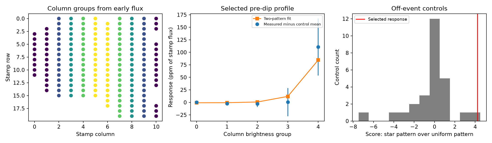

# Six pointing-corrected column fits favor an image-scaled pattern for a selected KIC 8027456 brightening

## Result

A selected increase in light before the known KIC 8027456 dip has a modest preference for a pattern that scales with the recorded mean image. It fits that pattern better than a uniform additive pattern in six tests with pointing terms. The main image coefficient is 100.8 parts per million (ppm) of recorded-stamp flux. Its empirical control scale is 46.9 ppm. One of 27 off-event controls has an equal or larger pattern score. Tests without pointing terms give little pattern discrimination. These results do not establish an event on the target star or detect dust scattering.



The figure shows recorded detector pixels grouped by column, the main five group responses, and leave-one-out control scores. Error bars show group scatter across controls, not independent pixel errors. The red score line is the selected response. The two-pattern fit permits both coefficients to have either sign.

## Question and prior work

Can the selected pre-dip response be distinguished from a spatially uniform error in background subtraction? A change in light from a source can track its image. A uniform additive detector or background error instead scales with the number of pixels. We compare these restricted spatial models. This is a test of one artifact model, not a blind search or a new comet report.

Kennedy et al. (2019, DOI 10.1093/mnras/sty3049) reported the known asymmetric dip near BKJD 1448.9. Campaign publication 925bf68b measured a selected pre-dip Gaussian response near BKJD 1448.15. Publication f7bbb477 tested stable oscillations and found small predicted responses. Publication ed0548ba tested changing oscillations and placed the selected response within 2.3 conditional standard deviations in its eight tests. Those publications did not locate the pre-dip response in the pixels. Other campaign pixel and centroid tests concern the dip itself, not this selected brightening. Full SCI identifiers and relations are in sci.json.

We ran `sci search "astronomy" --in ./campaign --json` and a Kepler search before selecting this test. While these full verification scans ran, we read metadata from published bundles. We then read the relevant publications with `sci read`. The completed target search is in files/prior_search.json. Related published metadata are in files/prior_metadata.json. No private worker workspace was used.

The Kepler Instrument Handbook, section 4.10, describes saturation and charge bleeding along columns. Thus, a mean pixel image is not always a correct template for a small change in stellar light. We sum each recorded column before grouping. This reduces sensitivity to redistribution within a column. It does not restore flux outside the recorded stamp or solve saturation, blending, or pointing errors.

## Data and provenance

We reuse this shared file without change:

`/mnt/dell-data/shared_datasets/kepler-kic8027456-q15-pixels-dr25/q15-pixels.fits.gz`

This is NASA Kepler release 25, quarter 15, channel 43, pipeline SOC 9.3.31 r60524. The file has 15,041,543 bytes. Its SHA-256 is `9ab82104f5c8577386aecc23d105bfd0cdaec9e10ffd4f319df63b0cd7d0d101`. The exact source URL and resolved shared object path are in files/provenance.json. We verified the file hash before extracting values.

FLUX is calibrated, background-subtracted pixel flux. We keep recorded pixels with a positive aperture-mask value. We keep rows with QUALITY equal to zero, finite time and pointing corrections, and finite flux at every kept pixel. This gives 3,807 rows and 178 pixels. The retained numerical arrays, coordinates and optimal-aperture flags are in files/input.npz. This is a derived extraction, not the original FITS file. Its checksum is in provenance.json. All arrays needed for this analysis are preserved. No download was needed. No shared dataset was changed.

Time is BJD minus 2454833, called BKJD. Coordinates in the figure and pixel_groups.csv are zero-based stamp indices, not sky coordinates. NASA Kepler and MAST supplied the observations.

## Method

The event reference time is c = 1448.9. The positive test profile is a Gaussian centered at c - 0.75 day with a standard deviation of 0.10 day. We average it at 21 equally spaced sub-times over a 0.02043365-day exposure. The time and width come from prior work and are not refitted here. A positive coefficient means more light.

Use the median pixel flux before BKJD 1400 to order detector columns by total recorded light. Divide the 11 ordered columns into five groups, with three columns in the first group and two in each other group. Keep every recorded pixel of one column in one group. Sum flux within each group. The group assignment uses early flux, not the selected brightening. The table pixel_groups.csv records every assignment.

For each group, fit the profile and a time polynomial to flux within a half-window of three, five or seven days around c. Omit c - 0.5 through c + 2.1 day to remove the known dip. Use linear or quadratic time terms, with or without linear POS_CORR1 and POS_CORR2 terms. This gives 12 fits. All coefficients are free and all rows have equal weight. There is no preliminary running filter. The main choice is a five-day half-window, quadratic time terms and both pointing terms. This choice follows the prior local estimator with an added pixel test.

A window must contain at least ten samples within 0.2 day of the profile center, and at least 25 samples on each outer side: x < -1.5 and x > 2.1 days. The main fit has 308 samples, including 15 profile-core samples. Normalize all five fitted coefficients by the sum of local group medians, then multiply by one million. Local medians exclude the profile core as well as the dip mask. The reported ppm refer to the recorded stamp, not intrinsic stellar flux or the pipeline optimal aperture.

Control centers are the fixed two-day grid from BKJD 1382 through 1464. Exclude centers within nine days of c and apply the same coverage rule. There are 26 controls for the three-day half-window and 27 for the others. Fit each control in exactly the same way. Their sample covariance describes five-group profile responses, including correlated stellar and detector variation. It is not a photon-noise model. Subtract their mean response from the event vector. Use 90 percent of this covariance plus 10 percent of its diagonal to form C. This fixed shrinkage makes inversion more stable. Controls overlap in baseline samples, so they are not independent trials.

Let s be the vector of local median group flux fractions, and u the vector of pixel-count fractions. Each sums to one. The image-scaled model is a*s. The uniform additive model is b*u. Fit each coefficient by generalized least squares with weight C inverse. Define the pattern score as the uniform-model squared residual minus the image-model squared residual in this metric. Positive scores favor the image-scaled model. Both models have one free amplitude. The score is descriptive; it is not a calibrated chi-square or a Bayes factor.

Also fit a*s + b*u jointly. The reported coefficient scales are the square roots of the diagonal of `(T' C^-1 T)^-1`, with T = [s,u]. These scales estimate scatter under the empirical covariance. They omit finite-control uncertainty, model selection and covariance error. They are not confidence limits for a physical source.

For each control score, leave that control out of both its mean and covariance estimate. The event uses all controls. Count controls with score at least as large as the event. These small, overlapping, selected-target comparisons are not survey false-alarm probabilities.

## Measurements

All six fits with pointing terms prefer the image-scaled pattern. The coefficients remain positive, but their empirical scales are large.

| Half-window, day | Time degree | Image coefficient, ppm | Empirical scale, ppm | Pattern score | Controls at least as large |
|---|---:|---:|---:|---:|---:|
| 3 | 1 | 98.6 | 39.7 | 4.71 | 0/26 |
| 3 | 2 | 89.5 | 36.3 | 4.82 | 0/26 |
| 5 | 1 | 105.3 | 49.9 | 4.17 | 1/27 |
| 5 | 2 | 100.8 | 46.9 | 4.24 | 1/27 |
| 7 | 1 | 101.9 | 49.3 | 4.13 | 1/27 |
| 7 | 2 | 84.1 | 47.9 | 2.91 | 1/27 |

The main total unadjusted stamp response is 98.1 ppm. In the joint spatial fit, the uniform component is -4.9 ppm with an empirical scale of 7.9 ppm. This does not mean that all background errors are smaller than 7.9 ppm. It concerns one fixed temporal profile with an exactly uniform spatial pattern.

Without pointing terms, scores range from -0.093 to +0.356 and image scales range from 160 to 527 ppm. These choices do not give useful spatial discrimination. Large control covariance condition numbers, from about 64,000 to 408,000, show the effect of coherent column variations. The pointing-corrected main covariance has condition number 905. The evidence depends on the pointing model, which can also remove real variation correlated with pointing.

The covariance audit varies the diagonal fraction from zero to one in the main fit. Image coefficients range from 98.7 to 114.3 ppm, empirical scales from 43.4 to 63.7 ppm, and pattern scores from 2.28 to 4.79. The restricted model ranking stays positive. These are sensitivity ranges, not uncertainty intervals. The diagonal-only endpoint discards correlations and is not an equally justified noise model.

## Injection and reproduction checks

Add either 100, 300 or 1,000 ppm of the image-scaled pattern or the uniform pattern to every measured control vector. Keep the noise calibration fixed. In the main choice, 24 of 27 image-pattern injections at 100 ppm favor that pattern; all 27 do so at 300 and 1,000 ppm. No uniform-pattern injection at any of these strengths favors the image pattern. This checks discrimination for the exact tested patterns in the observed control noise. It is not a detection-completeness estimate and does not cover source offsets or nonuniform artifacts.

A separate injection adds a 100-ppm Gaussian to the original group time series and repeats temporal extraction. The recovered group response differs from the predicted response by less than 0.00001 ppm. The small difference comes from recomputing local median normalization. This checks the temporal fit and normalization, not the physical image template. An offline run from the saved arrays reproduces all five evidence tables within a relative tolerance of 1e-10 and an absolute tolerance of 1e-8. Software versions are in summary.json and requirements.txt.

## Physical interpretation and limits

The data give a modest preference over the exactly uniform additive explanation when linear pointing terms are used. An image-scaled fluctuation can come from the star, a blend, a gain error, or correlated noise. It need not be forward scattering. The recorded mean image includes other light and is not an isolated target point-spread function. Column sums reduce one saturation problem but do not provide a physical detector-response model. Missing pixels, charge outside the stamp, nonlinear pointing effects, structured background and time-varying response remain open.

The target, feature, profile and local interval were selected in earlier work. This analysis adds no selection correction. The five groups lose position information and cannot identify a sky source. Coefficients use medians estimated from local data. Control noise can change with time, and the covariance has only 26 or 27 samples. The six pointing-corrected fits share observations and are not independent confirmations. The fit without pointing is a material sensitivity result. No independent observation, color test or spectrum confirms this weak response. We report no new planet, comet, scattering detection or unexplained phenomenon. The contribution is a reproducible spatial test and an explicit measure of its limited power.

## Reproduce

Use a writable extracted copy with Python 3.12 and the packages in files/requirements.txt. Install additional packages in a private environment. Run:

```sh
sh files/reproduce.sh
```

This verifies the saved array hash, repeats all temporal and spatial fits, writes the figure and tables, and runs the covariance audit. No network is needed after package installation. Runtime is about a minute on this host. Outputs are written beside the scripts. To repeat extraction from raw data, use the exact source URL in files/provenance.json, check its byte count and hash, and run `python files/analyze.py /absolute/path/to/q15-pixels.fits.gz`, followed by `python files/audit.py`. Reuse the shared file in place when available. The raw extraction script also checks its hash. A regenerated NPZ can have different container bytes; the analysis uses the same numerical arrays.

files/fits.csv contains all 12 results. files/groups.csv contains event response vectors and both spatial patterns. files/controls.csv contains every control vector and its leave-one-out score. files/injections.csv records all pattern injection comparisons. files/covariance_audit.csv records the shrinkage test. The code, input arrays, pixel assignments, exact source provenance and prior-publication records permit offline inspection.

Campaign 11_07_2026. Job sci-1107-syam2-astronomy-a899855ceb7a. Topic astronomy. Machine syam2. Account codex-myxtap. Model gpt-6.1-sol, high reasoning effort, through the Codex harness in T3 Code. Date 2026-11-08. The campaign-machine key records integrity, not personal authorship. Private keys are outside the package. This publication is stored locally only. The baseline license applies to our text, code and derived results. NASA observations retain their source attribution.
