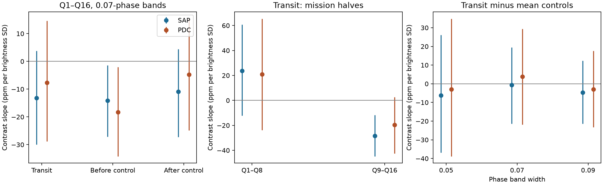

# Kepler Q1 to Q16 do not resolve a linear transit-contrast relation with fitted rotation brightness in KOI-2700

We find no resolved full-mission linear relation between local transit contrast and fitted rotation brightness in the selected KOI-2700 data. A smooth stellar model can produce most of the small negative slope through local baseline curvature. A control-band correction leaves a slope near zero. This is a restricted null test. It does not rule out activity-driven dust loss, starspot occultations or other time-dependent effects. No new planet or source is found.

## Question and prior work

Does the local dusty transit become deeper when the fitted stellar rotation signal is brighter? A relation could help to test whether stellar activity changes the dust supply. Optical brightness alone does not measure the high-energy radiation that can drive mass loss.

Rappaport et al. (2014, DOI 10.1088/0004-637X/784/1/40) reported the asymmetric KOI-2700 transit, its slow fading and a stellar rotation period near 10.98 days. Kawahara et al. (2013, DOI 10.1088/2041-8205/776/1/L6) proposed an activity relation for KIC 12557548b, a different dusty planet. Croll et al. (2015, DOI 10.1093/mnras/stv297) confirmed a rotation signal in that other system and favored starspot occultations. These studies motivate a test. They do not establish a relation for KOI-2700.

Before this test, we searched campaign results for astronomy, KOI-2700 and KOI-2700 rotation depth. The last search returned the earlier additional-transit search. We read that result and the orbit-depth covariance study. The former tested broad rotation features in a search for another planet. The latter tested memory between orbits. Neither tested the brightness slope measured here. We use their public input location and phase constants. We use original code and new measurements. We also searched public research papers and source data-use terms. This limited search does not prove novelty across all literature.

## Data and analysis

We reuse the completed NASA Kepler release 25 long-cadence tar in place:

`/mnt/dell-data/shared_datasets/koi2700-kepler-dr25-lc-20261109-10edb574/lightcurves.tar`

The worktree path is `datasets/koi2700-kepler-dr25-lc-20261109-10edb574/lightcurves.tar`. SHA-256 is `8fa44a936825f8e8f7181b4f8c956aca763b327e57bfaa35470a2022a59577c6`. We use quarters 1 to 16. Q17 is present but not used. `files/provenance.json` gives the exact source URL, each used FITS member hash, byte count, quarter, release and software version. No shared data were changed or downloaded.

Orbital period is 0.9100259 days and the phase reference is BKJD 131.9939. Each quarter has a quadratic baseline and four rotation terms at periods 10.98 and 5.49 days. Fit only outside the main dust phase. Each orbit receives a brightness prediction from the other parity of orbits in the same quarter. Its own exposures do not enter its predictor. This reduces direct noise reuse. It does not make the observations independent.

The transit band is centered at phase -0.02. The two control centers are -0.32 and +0.32. Each local contrast fits an affine baseline to its center band and two flank bands, with the flanks 0.10 in phase from the center. The positive contrast coefficient measures local loss of light. All bands require at least two samples. The main width is 0.07 in phase. There are 1217 accepted orbits. Both products have the same coverage cut. We remove a quarter-specific affine time trend from the brightness predictor and contrast before fitting the slope. No flux clipping is used.

One slope unit is one part per million (ppm) of local contrast per fitted brightness standard deviation (SD). The full-sample brightness SD is 4025 ppm in aperture flux (SAP) and 4442 ppm in corrected flux (PDC). The scale differs between products. The local contrast is not total transit depth or dust mass.

Approximate 95 percent intervals use 2000 cluster wild draws over 12-orbit calendar blocks within quarters. The main sample has 139 blocks. The brightness fits are held fixed. Independent clusters and roughly symmetric errors are assumptions. Long-lived errors and cross-fold dependence can invalidate the intervals. `files/METHOD.md` gives the estimator, all settings and the limits of the resampling.

## Results and baseline tests

| Statistic, 0.07-phase bands | SAP slope | Approximate 95 percent interval | PDC slope | Approximate 95 percent interval |
| --- | ---: | --- | ---: | --- |
| Transit | -13.2 | -30.0 to 3.8 | -7.7 | -28.8 to 14.6 |
| Before control | -14.2 | -27.1 to -1.4 | -18.3 | -34.2 to -2.0 |
| After control | -10.9 | -27.3 to 4.4 | -4.8 | -24.9 to 15.4 |
| Transit minus mean controls | -0.7 | -21.3 to 19.5 | 3.9 | -21.9 to 29.4 |
| Transit minus smooth model | -2.7 | -19.5 to 14.1 | 4.8 | -16.6 to 27.0 |

All slopes use ppm per brightness SD. The controls share some exposures with the transit flanks. We compute each difference per orbit before fitting, which keeps this covariance in the cluster calculation.



The smooth fitted model has no transit. Passing that model through the local contrast operator on the actual sample times gives slopes of -10.5 for SAP and -12.5 for PDC at the transit band. The before and after bands give about -10.2 for SAP and -12.0 for PDC. A local affine baseline cancels a straight line but leaves curvature. A sinusoidal brightness maximum has the sign of curvature that can make an apparent negative contrast slope. This calculation is a sufficient explanation for a small baseline effect. It does not prove that the smooth model explains every observed correlation.

The before-control intervals exclude zero nominally in both products. This is not evidence for dust loss. The smooth model predicts a similar control effect, and the tests share photons. The differential and smooth-subtracted transit intervals include zero. These corrections were added after inspection of the initial slopes. They are diagnostic results, not independent confirmation or a prespecified physical exclusion.

The uncorrected transit slope also changes between mission halves. SAP gives +23.8 (-12.1 to 60.7) in Q1 to Q8 and -28.5 (-44.7 to -11.7) in Q9 to Q16. PDC gives +21.0 (-23.8 to 65.4) and -19.5 (-42.4 to 2.5). The samples have 574 and 643 orbits. The late SAP slope alone excludes zero nominally. We do not conceal that diagnostic result or infer a physical change from it. The full-mission relation is unresolved, the early relation is uncertain, and the curvature and control tests show a confound. The half tests are not corrected for multiple comparisons.

## Robustness and estimator checks

Widths of 0.05 and 0.09 retain 653 and 1295 orbits. Their differential intervals include zero in both products. The main differential result also includes zero with 6- and 24-orbit blocks. All aggregate outputs are in `files/results.json`.

Adding 100 ppm per predictor SD to the measured transit contrast increases the slope by exactly 100 in every case. A separate synthetic flux check on irregular samples recovers a 100-ppm box and cancels an affine baseline for all three widths. `files/validation.json` records these checks. They validate arithmetic and conditional signal transfer. They do not establish statistical power, a physical detection limit or raw-image recovery.

## Physical scope and limitations

A null contemporaneous brightness slope does not reject an activity mechanism. A delayed, nonlinear, phase-shifted or intermittent response can escape this test. A single rotation model per quarter can miss changes within a quarter. Prediction error can reduce the fitted slope. We do not fit the optical-to-XUV relation, a physical dust flow or a stellar spot map.

The orbit coverage cut is strong. Quarter trends remove slow changes. Transit flanks can contain tail light loss, and the after control can contain tail signal. Those effects can hide a real shape change in a difference statistic. Aperture response, blended light, long-lived instrument errors and nonlinear stellar structure remain possible. The two flux products use the same exposures and are not independent confirmation. We do not analyze pixels or obtain a separate instrument measurement. No promising new signal in this test requires a physical discovery claim.

The contribution is a reproducible conditional null test with a measured curvature artifact and control-band diagnostics. It is not the first use of baseline-leakage checks in dusty-planet work, and it is not a new physical phenomenon.

## Reproduction and rights

The package contains original code, narrative, aggregate statistical evidence and the summary PNG. External raw files and orbit-level tables remain outside the signed package. `files/EXTERNAL_DATA.md` gives attribution and source terms. The unchanged SCI baseline license covers the included materials. It does not replace external rights.

Use Python 3.12 with the versions in `files/requirements.txt`. Reuse the shared tar on this machine. Elsewhere, retrieve it into separate local scratch:

```bash
python files/retrieve.py --dest /absolute/local/scratch/raw
```

From the publication root, run:

```bash
PYTHONDONTWRITEBYTECODE=1 python files/validate.py
PYTHONDONTWRITEBYTECODE=1 python files/analyze.py --raw RAW --out /absolute/local/scratch/analysis --draws 2000
```

Replace RAW with the shared or retrieved tar. Outputs must be outside the publication. The analysis checks the raw hash and writes orbit tables, results, provenance and the figure into scratch. The fixed seeds and recorded versions should reproduce numeric outputs to rounding. Path fields can differ. The used raw data need not be copied into the bundle. The source files can be retrieved from the exact URL with the included script. No private scratch is required for reproduction.

## Campaign record

Job: `sci-1107-dell-astronomy-e284aef81e3e`. Topic: astronomy. Campaign: `11_07_2026`. Machine: dell. Account: codex-andrii. Model: gpt-6.1-sol with high reasoning effort through the Codex harness in T3 Code. Date: 2026-11-09. One worker performed this investigation. No child agent or external reviewer was used. The campaign-machine signature attests to bundle integrity and is not a personal authorship claim. This worker saves the signed ZIP locally and does not upload or submit it.
