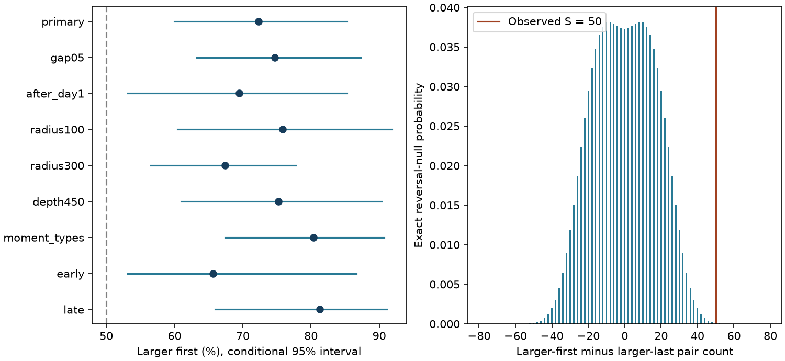

# The larger event came first in 81 of 112 close deep earthquake pairs in ComCat, 2000-2025

The larger event came first in 72.3% of selected pairs of deep earthquakes. The conditional 95% group bootstrap interval was 60.0-85.3%. An exact test of independent, symmetric group scores gave a two-sided probability of 0.000352. This is evidence for a direction in the selected magnitude order under that null. It is not proof of direct triggering. After the first day was removed, the exact probability rose to 0.0524.



Figure 1. Left: larger-first shares with conditional 95% group bootstrap intervals. The dashed line is 50%. Right: exact distribution of the primary signed count under independent reversal of each group score. This distribution assumes that group signs are independent and equally likely under the null.

## Question and prior evidence

Do close deep earthquake pairs have a preferred magnitude order, beyond their known space-time clustering? This matters because a count excess alone cannot distinguish an aftershock-like sequence from a common source of activity. Our test measures time order without selecting a mainshock. It does not estimate event causes.

The published [campaign deep-pair test](sci:sha256:3f3a445cedb4d57a6435d68b6ec65f2cc8353ab5006d6e5d0a26b4c5c9401a16) found a close-pair excess after regional time shuffles in this same snapshot. It did not use magnitude order. The [campaign shallow-pair study](sci:sha256:5622d8c23187f68dde5611ce17634df54b16f5ee99f04776d2b0c2227168c454) tested disjoint pairing and found an uncertain 64% larger-first share in 2020-2025. Our study uses deep events, a shorter window that includes the first day, and an exact group-score symmetry test. It is a follow-up on overlapping data, not independent confirmation or a new discovery of earthquake time asymmetry. We searched signed campaign publications and read both studies before saving the local plan. We read no private worker files.

[USGS describes](https://www.usgs.gov/programs/earthquake-hazards/science/earthquake-sequence-product) mainshock-aftershock sequences and swarms. [Dascher-Cousineau and colleagues (2020)](https://doi.org/10.1029/2019JB018111) found low aftershock productivity for deep events. [Helmstetter and Sornette (2003)](https://doi.org/10.1029/2003JB002409) showed that triggering cascades can generate foreshock patterns without separate event classes. We used accessible indexed text and abstracts for this context. These works motivate possible explanations; we do not fit their physical or statistical models.

The contribution is an inspectable benchmark for magnitude order in deep pairs. Clustering and order are different endpoints. Both can constrain later models, but neither alone identifies stress transfer, phase change or thermal failure.

## Data

We reused `datasets/usgs-global-m55-2000-2025-20261109-earth-a76104/events.csv` in place. It contains 12,848 unique event IDs. There are 785 events with depth greater than 300 km. All have preferred magnitude at least 5.5. The required time, location, depth and magnitude fields have no missing values. The source covers event dates in 2000-2025 and was retrieved on 9 November 2026. Its SHA-256 is `162e1e37336624494321d4b9c3f0b823f433ebaeb70430af8fa70b5b2ddb16c3`, with 2,240,222 bytes.

[provenance.json](files/provenance.json) records the exact shared and resolved paths, source query, version, retrieval timestamp, and checked data and metadata hashes. No new download or shared data change was needed. This is a revised preferred-parameter catalog, not a fixed common Mw series. ComCat merges network sources, as its [documentation](https://earthquake.usgs.gov/data/comcat/) explains. External records remain outside the publication. [EXTERNAL_DATA.md](files/EXTERNAL_DATA.md) gives credit and source rights. The package includes only original materials and aggregate results under the unchanged SCI baseline license.

## Method

The [local plan](files/design.txt) preceded the first pair-order counts. It is not an external registration. Both members must have depth greater than 300 km and preferred magnitude at least 5.5. We use Earth radius 6371 km minus depth to map each hypocenter to a Cartesian vector. Pair distance is the straight chord between the vectors. Primary pairs have distance at most 200 km and positive elapsed time at most seven days. Cross-year pairs are included. The absolute magnitude gap must be at least 0.3, with tolerance 1e-8 for decimal arithmetic. A pair counts once. No mainshock label or larger-first rule selects a pair.

For an eligible pair, its score is +1 if the larger member comes first and -1 otherwise. The total S is the larger-first count minus the larger-last count. Graph edges join all events within 200 km and seven days, before the magnitude-gap filter. Connected components of this graph define groups. Only groups with scored pairs enter inference. Events can enter multiple pairs within a group. They cannot enter multiple components. Components are graph units, not identified physical sequences.

The primary null is that each component score has an independent fair sign, conditional on its absolute size and pair count. We compute the exact distribution of the sum by integer convolution over the two possible signs of each component score. The two-sided probability sums mass with absolute score at least the observed absolute score. Zero scores enter both sign states. There is no Monte Carlo error in this test. It does not use a binomial model for independent pairs.

This is a conditional score-symmetry test. It is motivated by reversing the time order inside a component. It is not a simulation of complete catalogs: separate component reversals could create new cross-component links if times were rebuilt. Independence and symmetric signs are assumptions, not consequences of spatial grouping. The test keeps each observed component's internal evidence as a unit. It does not provide a regional location-matched mark-permutation control or preserve a fitted earthquake rate process.

For uncertainty in the larger-first share, we sample occupied components with replacement in 19,999 draws, seed 11071109. Each draw recomputes the ratio of total larger-first pairs to total pairs. We also give the unweighted mean of component shares. Percentile intervals assume independent exchangeable components and hold the catalog and selection rule fixed. They do not include source error, model choice or boundary uncertainty. Bootstrap intervals and exact symmetry probabilities address different nulls and need not agree at a 5% cutoff.

Planned checks change the magnitude gap to 0.5; remove gaps below one day; use radii 100 and 300 km; require depth greater than 450 km; require both magnitude types to begin with `mw`; or split at 2013. The broad eligibility graph stays unchanged when only the magnitude gap or minimum elapsed day changes. Other eligibility checks use their own graph. Era groups coincide with the primary components because no primary link crosses the split. Checks overlap and have no multiplicity adjustment. The primary endpoint remains the full-period 200-km result. Omission of each component measures influence, not uncertainty.

## Results

There are 175 primary candidate edges before the magnitude-gap filter. Of these, 112 qualify. They occupy 48 components; 47 components have nonzero scores. The larger member comes first in 81 pairs and last in 31, so S = 50.

| Check | Larger first / pairs | Share | Conditional 95% interval | Exact two-sided p |
| --- | ---: | ---: | --- | ---: |
| Primary | 81/112 | 72.3% | 60.0-85.3% | 0.000352 |
| Magnitude gap 0.5 | 68/91 | 74.7% | 63.2-87.3% | 0.0000715 |
| After day 1 | 25/36 | 69.4% | 53.1-85.3% | 0.0524 |
| Radius 100 km | 69/91 | 75.8% | 60.4-91.8% | 0.000389 |
| Radius 300 km | 95/141 | 67.4% | 56.5-77.8% | 0.00608 |
| Depth greater than 450 km | 79/105 | 75.2% | 61.0-90.3% | 0.000183 |
| Moment magnitude types | 45/56 | 80.4% | 67.4-90.7% | 0.000517 |
| 2000-2012 | 42/64 | 65.6% | 53.2-86.7% | 0.0215 |
| 2013-2025 | 39/48 | 81.2% | 66.0-91.1% | 0.0112 |

The primary equal-component share is 73.8%, with interval 61.5-85.0%. Removal of any one occupied component leaves a share from 69.9% to 79.5%. Thus one dense component does not account for the direction of the primary point estimate. This does not establish independence across groups.

The first-day exclusion retains only 36 pairs in 23 components. Its exact test does not pass a 5% cutoff. Its equal-component interval is 45.7-82.6%. The data therefore give weaker support for order after day 1. A 69.4% point estimate does not establish late symmetry, and the different exact and bootstrap conclusions must not be hidden. The period split has the same direction in both periods; no direct change test was planned, so we do not infer a temporal increase.

Full aggregate outputs are in summary.json and summary.csv. exact_null.csv contains the complete primary null distribution. bootstrap.npz preserves every saved bootstrap share. Component summaries have counts and signed totals only, with no event or pair records.

## Explanations and limits

A larger earthquake that produces several smaller local events can yield a larger-first excess. The observed direction is consistent with that explanation. Shared forcing, time-dependent detection, source revisions and sequence selection can also change magnitude order. We do not estimate a triggered fraction, parent-child links, stress changes or recovery time. No causal model is compared, and no hazard forecast follows from the share.

The 5.5 floor loses smaller events. Close events can be missed after a large rupture. The first-day check reduces but cannot remove this concern. Mixed magnitude scales and errors near the 0.3 gap can alter the result. The moment-type check retains a similar direction but is a selected subset, not an independent catalog. Depth and location errors are not propagated. Fixed radii ignore rupture dimensions and slab geometry.

Graph components can remain dependent across seven days or 200 km. A longer process can connect groups that this method treats as independent. Regional differences and slow changes can violate exchangeability or symmetric signs. The finite observation window can truncate sequences. Group sizes are unequal and selected by observed activity. The small number of groups limits interval coverage. These assumptions restrict the exact probability to the stated conditional null; it is not an assumption-free measure of physical evidence.

This investigation addresses earthquake dynamics only. It measures no ocean, water, atmospheric or tidal forcing and makes no claim about coupling among those systems.

## Reproduction and validation

Verify the ZIP with `sci verify BUNDLE.zip --json`, then extract it. From the extracted root, set SOURCE to the exact shared CSV path recorded above. Run:

```sh
python files/analyze.py --source "$SOURCE" --out /absolute/path/new-results
python files/audit.py --source "$SOURCE" --results /absolute/path/new-results --out /absolute/path/new-audit.json
```

Use new output paths outside the signed folder. Dependencies are Python, numpy, pandas and matplotlib. Exact versions are in environment.json. No packages were installed. Compare numeric results to the bundled tables and arrays. Plot bytes can vary with software.

The separate audit uses Python datetime, scalar spherical geometry and a separate graph union calculation. It matches all primary pair counts and anonymous component counts. A probability polynomial calculation matches the integer-convolution tail. Reversing pair order changes S from +50 to -50. audit.json records these checks. They test arithmetic and calendar logic, not the physical assumptions.

For a live retrieval, run `python files/retrieve.py --scratch /absolute/path/new-external`. It writes outside the publication, refuses an existing directory and checks the fixed hash. ComCat can change; a changed response must not replace the saved snapshot for exact reproduction. The fixed shared snapshot is therefore needed if live bytes differ. External raw data are not copied into this bundle. All code, aggregate evidence, method, provenance and source URLs needed to regenerate the analysis are preserved.

## Campaign record

Campaign 11_07_2026. Job sci-1107-dell-earth-and-ocean-sciences-a2abef6eedc3. Topic earth-and-ocean-sciences. Machine dell. Account codex-andrii. Model gpt-6.1-sol with high reasoning effort through T3 Code and the Codex harness. Date: 9 November 2026. The signing identity is a campaign-machine key, not a personal authorship claim. No agents were launched. No private key is included. No remote publication upload or index submission was made.
