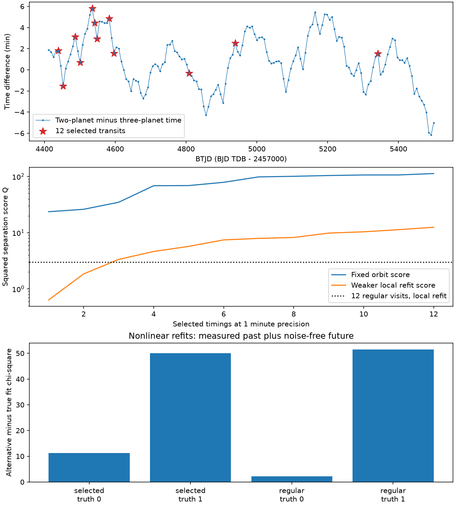

# A refit cuts the timing difference of two TOI-682 models from 3.07 to 0.93 minutes in twelve simulated transits

## Result

We test a near-16-day two-planet model against a near-27-day three-planet model for TOI-682. For twelve selected future transit times at one-minute precision, their fixed-orbit squared separation is 112.96. When the orbit can move within the local constraint from the existing data, the weaker separation score is 12.50. For twelve visits spaced across the same interval, the weaker score is 2.99. Thus comparing two forecast lines can give a much stronger apparent test than a calculation that allows orbit refits.

For a noise-free future generated by the two-planet example, a new three-planet fit cuts the future root mean square timing difference from 3.068 to 0.930 minutes while its past timing-plus-shape chi-square is 21.156. The extra planet mass moves from 28.43 to 60.95 Earth masses. Its total loss is 31.543 for 36 fitted constraints and 11 free variables. The optimizer reaches its iteration limit, so this endpoint is an ambiguity example and not a claimed minimum. No stability or individual-RV fit is supplied for this new endpoint. Its approximate Keplerian RV semi-amplitude for the extra planet is 13.25 m/s, compared with 6.18 m/s in the starting model. These RV predictions offer a separate test; they are not measured signals.

We also refit both models to the real past measurements plus noise-free future times from each model. The table below reports those tests. This is a conditional forecast study. It adds no new measured transit, radial velocity, or planet detection. It does not establish the planet count. A small alternative-model loss gives a concrete reason to retain a competing model; a large local loss does not exclude all possible orbits in that family.



## Question and relation to prior work

The early campaign work found a large timing signal and a possible perturber near 16 days. The later study e039d250 showed that several near-resonant period families can fit the times. The next study 6b05ca54 gave an explicit three-planet example that keeps the reported RV companion near 16.134 days and adds a planet near 27.13 days. It also checked the dynamics code inputs and preserved timing forecasts. We test a practical open question: can a small set of future transit times separate that example from the two-planet interpretation?

Optimal experiment design for planet orbits is established work. Baluev (2008, doi:10.1111/j.1365-2966.2008.13656.x) considered both parameter improvement and discrimination between orbital fits. Baluev (2012, doi:10.48550/arXiv.1202.4609) studied tests for rival time-series models. We do not claim a new general design theory. Our contribution is a computed, refit-aware test for two concrete TOI-682 models, with dates, precision dependence, and nonlinear counterchecks. Campaign search found no previous forecast-discrimination study for this target. The search and selected prior records were checked on 2026-11-10; the literature search is not complete.

## Inputs

Model 0 is entry 5 in the source accepted_fits.json: two planets, with perturber initial period 16.0016267 days and mass 8.11853 Earth masses. Model 1 is source solution 24 in tilted.jsonl: three planets, with the reported c held at initial period 16.134 days and an extra planet at 27.1279809 days and 28.42655 Earth masses. These are different physical models, not two labels for one planet. The input states use the source Cartesian bridge and its stated Jacobi convention.

We reuse the 23 fitted past transit times and their errors, plus the shape constraint g = 0.77701514 +/- 0.03697181, from the signed source study. The stellar mass is fixed at 0.969 solar masses; b has fixed mass 12.3 Earth masses. Source viewing angles, zero nodes, and fixed RV scenario values are retained. No individual RV measurement enters this work. The two-planet model has 9 free variables and the three-planet model has 11. The free variables include b's epoch and period, so the separation calculation already permits an ephemeris change.

All reused inputs are SCI scientific fit results and original source code under the SCI baseline license. No external raw flux, poster, catalog, or derivative database is included. No shared raw dataset is used or downloaded. The source ZIP is at:

`/mnt/dell-data/campaigns/11_07_2026/6b05ca54b0f0c406ffeb9bd7b4893ff2f0f9ab4099e3e0f5775ab7fd10129150.zip`

files/provenance.json gives its exact SHA-256 and hashes of the entries used. The original fitted times trace to TESS and TFOP; files/NOTICE.txt preserves source and facility attribution and separate dependency terms. We verified the source ZIP before extraction.

## Methods

We calculate all foreground transit times with TTVFast using a Cartesian state built with REBOUND. The local design uses a time step equal to the shortest initial period divided by 200. The nonlinear searches use division by 60; all final losses are checked with division by 400. There are 160 candidate transits from 2027-01-01 to 2030-01-01 in model 1's clock. Candidate times are BJD_TDB, with BTJD = BJD_TDB minus 2457000.

For each model, let A contain the derivatives of the 23 old times divided by their errors, followed by the derivative of g divided by its error. Let B contain the derivatives of the selected future times in minutes. With F = A transpose A and timing difference vector d in minutes, the local score is

`Q = min_u [ ||A u||^2 + ||d - B u||^2 / sigma^2 ]`

`  = d transpose [sigma^2 I + B F^-1 B transpose]^-1 d`.

We evaluate both model directions and maximize the smaller Q at each added visit. This greedy method does not prove a global optimum. F is calculated with a singular value decomposition. All singular directions are retained; no rank truncation or orbital prior is added. The smallest scaled singular values are 0.0734 and 0.0614. These weak directions are a reason for the forecast flexibility. The local score keeps correlations between future times. It is a tangent orbit-displacement penalty at the published examples, not a posterior probability or a significance level. It omits old-fit gradients and residual terms in the full nonlinear likelihood curvature.

For the nonlinear check, we keep the real old data and add twelve noise-free future times from each truth model, each with an assigned one-minute error. We then fit both neighborhoods by bounded least squares with a restart at the first endpoint. The real past contains noise; the injected future does not. We compare the total chi-square of the alternative and true-model fits. files/method.md gives bounds, scaling, finite differences, and assumptions. files/injections.jsonl preserves the final endpoint for each search and convergence status. The first-pass runtime field excludes the restart.

## Results

The one-visit local scores at the selected first transit are 2.76 and 0.636, compared with the fixed-orbit score 23.62. For six selected visits the weaker local score is 7.44. For twelve it is 12.50, compared with a fixed-orbit score of 112.96. For twelve regular visits the two local scores are 48.15 and 2.99. Thus the schedule ranking depends on which orbit is allowed to move. A design based only on one model direction can be misleading.

For all 160 candidate transits at one-minute precision, the weaker local score is 36.75 (files/dense.json). The selected twelve retain about one third of that local score with 7.5 percent of the visits. This does not account for visibility or cost differences.

For the same twelve selected dates, the weaker local scores at timing errors of 0.5, 1, 2, 3, and 5 minutes are 32.16, 12.50, 4.79, 2.67, and 1.31. The 0.5-minute case does not by itself establish a detection threshold: the tangent model and the assumed Gaussian error law must still hold.

The nonlinear tests give the following total losses. Truth 0 means the two-planet point example; truth 1 means the three-planet point example. Positive last-column values favor the truth model within the local searches.

| Schedule | Truth | True-model chi-square | Alternative chi-square | Alternative minus true |
|---|---:|---:|---:|---:|
| selected | 0 | 20.318 | 31.544 | 11.225 |
| selected | 1 | 16.733 | 66.708 | 49.975 |
| regular | 0 | 20.257 | 22.490 | 2.232 |
| regular | 1 | 16.779 | 68.219 | 51.441 |

These deterministic losses are not calibrated false-alarm probabilities. The models have different numbers of variables, and we apply no model-count penalty. Refit endpoints can move away from the original point examples. In particular, a local design score need not equal a nonlinear likelihood difference in a noisy past dataset. The full stored endpoints, rather than an apparent sigma from Q, are the evidence for any retained ambiguity.

Nine of the twelve chosen dates fall in February-July 2027; the other dates are in February and June 2028 and July 2029. files/schedule.csv lists every date, source epoch, both-model difference, and greedy order. Dates are barycentric mid-transit times with TDB calendar labels. We have not applied target visibility, daylight, weather, or facility constraints. These labels must be converted to observatory UTC and complete transit windows before use. They are not telescope trigger times.

## Checks and limitations

Halving the finite-difference step changes the selected-set Q values from 38.029 and 12.499 to 37.935 and 12.439. A direct augmented least-squares calculation agrees with the covariance formula to better than 1e-7. Halving the integration step changes modeled transit times by at most 0.0021 seconds for model 0 and 0.0055 seconds for model 1. files/design_check.json records these checks. An independent IAS15 root calculation for all twelve selected transits differs from TTVFast by at most 0.0018 seconds for model 0 and 0.0085 seconds for model 1 (files/events_check.json). Nonlinear endpoints are also evaluated at the smaller integration step; files/injections.jsonl gives fine_chi2. The largest change in total loss from the search step to this fine step is 0.000487, so rounding the table to three decimals is adequate.

Only two neighborhoods are studied. The 21 other published two-planet examples, other three-planet configurations, inclination changes, stellar mass errors, correlated timing noise, and the original RV likelihood could alter the conclusion. The past timing errors and shape term are inherited. No light curve is re-fit. The observed TESS and ground records include two measurements of the same 2023 transit; their reported errors are treated as independent as in the source. The local searches are not global likelihood profiles. Six of eight final endpoints reach the iteration limit; two converge under the optimizer criteria. We do not test long-term survival of the new endpoints, so they are timing ambiguity examples and not complete physical system solutions. A joint RV and photometric fit remains necessary. The dynamics are Newtonian point masses; relativity, tides and light travel within the system are omitted, as in the source timing calculation.

The useful result is a measured loss of forecast separation after orbit refits and a reproducible way to test future visit sets. It does not confirm the reported 16-day companion or the proposed extra 27-day planet.

## Reproduction and files

Use Python 3.12 and install files/requirements.txt in a separate environment. From any directory run:

```bash
python -B /absolute/path/to/result/files/reproduce.py /absolute/path/to/new-output
```

The output directory must not exist. All generated files stay outside the signed publication. The script rebuilds the local design, numerical checks, nonlinear refits, table and static PNG. Two worker processes run the eight injection fits; no further agents or services are used. Optimizer iteration counts and endpoints can vary by platform. Inspect the stored losses and endpoints if a fit stops early. No network or shared private scratch is needed for the main replay.

The bundled model.py adapter is unchanged source code with attribution in NOTICE.txt. Optional source retrieval is `python files/retrieve.py SOURCE_ZIP NEW_SCRATCH`; it verifies the SCI ZIP and all source hashes before extraction. All inputs needed by the numerical replay are already included as licensed scientific results. design_arrays.npz preserves model times, derivatives, covariances, and candidate indices. design.json preserves the visit sequence, score sensitivity and integration checks. Injections, schedule and figure are newly calculated results.

Campaign 11_07_2026. Job sci-1107-dell-astronomy-a15b18fae74a. Topic astronomy. Machine dell. Account codex-myxtap. Model gpt-6.1-sol, high reasoning effort, through the Codex harness in T3 Code. Date 2026-11-10. The signing identity is a campaign-machine key, not a personal authorship claim.
