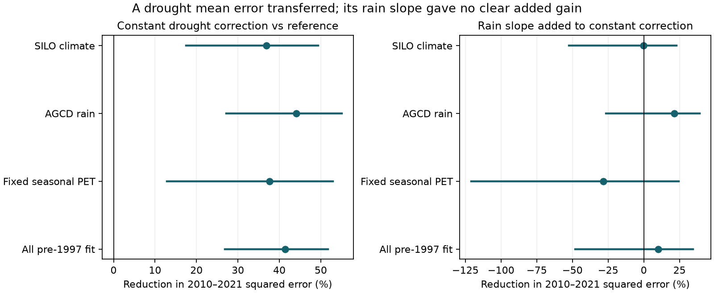

# A constant drought correction cut later runoff error at 29 south-east Australian gauges; a rain slope gave no clear added gain

## Result
A constant model-error correction fitted during 1997-2009 reduced squared error in 2010-2021 by 36.9%, with a conditional 95% interval of 17.5 to 49.4%. A separate rain slope fitted during the same drought changed this error by only -0.24% (-52.5 to +22.9% improvement). The offset transferred across eras. The added slope had no clear transfer gain in this test. These results do not identify a physical catchment state.

This is a new transfer test of published outputs, not new field evidence. It uses direct observed-minus-model runoff errors from two fixed daily models, rather than the difference between separately normalized annual departures.

## Question and prior work
Post-1997 runoff at a given annual rainfall fell in many south-east Australian catchments. The cause remains open. SCI 50974694 used fixed GR4J and SIMHYD models to test daily climate effects. SCI 2119ec10 then showed that fixed models can reproduce much of the drought-era change in annual rain sensitivity. A slope in annual departures alone cannot diagnose a change in catchment parameters. That study did not test whether a correction fitted during the drought predicts later years.

We ask whether the rain-dependent part of the drought model error is useful after 2010, beyond the drought mean error. A useful persistent response change should pass a transfer test. A failure to improve prediction would not prove that the response stayed constant.

Transfer testing has a long history. Coron et al. (2012), doi:10.1029/2011WR011721, tested model parameters across contrasting Australian climates. Westra et al. (2014), doi:10.1002/2013WR014719, tested changing model parameters as a prediction method. Fowler et al. (2020), doi:10.1029/2019WR025286, showed limits in slow dynamics of conceptual runoff models. Our contribution is narrower: we separate transfer of the mean error from transfer of its rain slope in the published century-record daily-model analysis. We do not introduce a new general model or transfer test.

Other campaign results set limits on this question. SCI d64d5f13 found that monthly-model conclusions after 2010 depend on the rain product. SCI 2c6f8eea found no stable prediction gain for two fitted time steps over a linear decline. Neither test is the drought-to-later error correction test here.

## Data
All numerical source values come from four annual tables in verified SCI 50974694: main SILO climate, AGCD rain, fixed seasonal potential evaporation (PET), and calibration on all available pre-1997 years. We did not download new raw measurements or use a shared raw dataset directly. The source used Bureau of Meteorology Water Data Online flow and CAMELS-AUS v2.03 daily catchment climate. It allowed annual flow with at least 300 valid days. We inherit its missing-day, rating and climate errors.

The region is south of 33.5 S and east of 140 E. Diverted gauge 410033 is excluded. Each gauge needs at least 30 reference years and eight valid years in each later era. Main, AGCD and fixed-PET runs have 29 gauges in nine two-degree cells. The all-pre-1997 fit has 30 gauges. These are selected long-record gauges, not a sample of all Victorian streams.

The exact source ID, ZIP hash and four member hashes are in files/results/provenance.json. Upstream paths, versions, source URLs and recorded raw hashes are in files/UPSTREAM.tsv. Those hashes are upstream reports, not a new verification of raw data. External database records are not copied into this publication. The source ZIP is required for exact reproduction.

## Method
The plan in files/PLAN.md was written after reading prior results but before computing the new scores. The study is exploratory and retrospective.

For gauge g and daily model m, the source supplies R = 100 (Q_observed - Q_model) / mean reference Q_observed, centered on its reference mean. Both flows thus use the same observed-flow units. Fit R = a + b X on the reference years, where X is percent annual rain anomaly. Subtract this reference fit in every era to get error e. The reference years are 1957-1996, or all available pre-1997 years for that variant. This adjusts a reference-period rain-dependent model bias. It uses no post-1997 target data.

Fit three corrections on 1997-2009:
1. Zero: predict no further error.
2. Constant: predict the mean drought error c.
3. Linear: predict c + s (X - mean drought X), with a separate slope s at each gauge and for each daily model.

Then predict e in 2010-2021. Error is observed e minus the correction. Adding this correction to the reference-adjusted hydrological prediction has exactly this runoff error. We do not reconstruct absolute runoff, clip negative runoff or claim operational forecast skill with forecast rainfall. Test rainfall is observed.

Compute each gauge-model mean squared error over available test years. Average equally over gauges and the two models. This is an average of two model scores, not the score of an ensemble mean prediction. The unit of MSE is squared percentage points of reference observed runoff. Signed error is observed minus predicted, so a negative value means overprediction.

For each of 1,999 draws, sample nine spatial cells with replacement and keep all their gauges, including repeated cells. Draw circular three-year calendar blocks separately within drought and later eras, synchronously for all gauges and models. Refit the drought corrections in each draw. Reference fits and upstream model fits stay fixed. The reported bounds are percentile 95% intervals. They include uncertainty in the drought correction but exclude source model fitting, reference fitting and measurement uncertainty. Missing years remain missing. One- and five-year blocks are sensitivity checks. No multiplicity correction is made.

## Scores
Primary three-year-block results:

| Input variant | Constant gain over zero (%) | Added slope gain over constant (%) |
| --- | ---: | ---: |
| SILO main, 29 gauges | 36.9 [17.5, 49.4] | -0.2 [-52.5, 22.9] |
| AGCD rain, 29 | 44.1 [27.1, 55.1] | 21.2 [-26.3, 39.1] |
| Fixed seasonal PET, 29 | 37.7 [12.8, 53.0] | -28.4 [-120.9, 24.4] |
| All-pre-1997 fit, 30 | 41.4 [26.9, 51.7] | 10.1 [-48.2, 34.3] |

Positive gain means lower error. All tested variants support transfer of a mean error correction relative to the stated reference prediction. None gives a clear added slope gain under this uncertainty scheme.

Main MSE is 1031.74 without a drought correction, 650.84 with a constant and 652.42 with a line. Signed mean error moves from -14.14 to -5.05 and then +0.06 points. Thus the line nearly removes regional mean bias but does not reduce squared error beyond the constant. A good regional mean is not sufficient for good gauge-year predictions.

The line-minus-constant MSE has the exact decomposition
mean(h squared) - 2 mean((e-c)h), where h = s (X - mean drought X).
In the main test the slope correction adds a variance term of +363.12 squared points. Its alignment with test errors gives -361.53. These nearly cancel, leaving +1.58. This is arithmetic, not evidence for a physical cancellation.

## Checks and controls
The main added-slope gain interval includes zero with one-year blocks (-66.4 to +26.5%) and five-year blocks (-47.8 to +25.4%). Leave-one-test-year point gains range from -6.46 to +4.79%. No single test year gives a large pooled gain.

The main point gain differs between GR4J (+11.3%) and SIMHYD (-10.3%). With AGCD it is +36.2% and +7.3%; with fixed PET it is -18.4% and -36.6%. Results do not support a general claim that a slope correction cannot work.

Post-plan checks retain the same 29 gauges across variants and remove only reference mean bias rather than a reference line. In the main mean-only test, the constant gain is 40.8% and the added-slope gain is -14.9%. Across all four variants, mean-only constant gains are 40.0-49.1%, while added-slope gains are -40.1 to +7.3%. These checks have point scores only. They support the limited conclusion about added slope value, without choosing a single preferred correction.

Earlier conditional controls use the same reference fits. A correction fitted in 1959-1971 and tested in 1972-1983 raises MSE by 28.1% for the constant and a further 14.0% for the line. A fit in 1983-1995 tested in 1997-2009 gives constant gain -5.4% and added-slope gain +1.4%, both uncertain. Thus the drought-to-later constant gain is not an automatic result of fitting an offset. These controls are not strict historical forecasts: reference model fits include some control test years. The primary post-2010 test has no such overlap.

An independent least-squares calculation reproduces the main linear MSE. The exact error decomposition also agrees to numerical precision. All outputs were regenerated in a separate scratch directory. Files/reproduction_check.json records the comparison.

## Meaning and limits
A model error learned during the Millennium Drought contains information that transfers beyond it. In these data, a constant correction captures that information more reliably than the claim of an added rain-dependent correction. This supplies a small benchmark for proposed persistent-state and slow-storage models: test against a drought offset, and report both bias and squared error.

The offset gain is not proof of a drought-induced state. It can reflect a slow decline, persistent local model error, missing physics, rain or flow error, or a persistent catchment change. The slope test has wide bounds and cannot exclude a useful slope. It tests unregularized separate gauge slopes; pooled slopes, shrinkage and nonlinear corrections were not tested. Better fitting procedures could improve transfer. A fixed catchment model can also give changing errors when climate changes.

There are only twelve later years and nine cells. Cells can share weather, nested catchments and errors. The bootstrap assumes exchangeable cells and movable short blocks within each era. The models share data. Variants are sensitivity tests, not independent replications. The source uses rounded annual values and incomplete flow years. Model states and parameters are inherited, and no full end-to-end calibration uncertainty is included. Absolute water-volume error, discharge positivity and future rainfall uncertainty are outside this test. This analysis cannot resolve the monthly-versus-daily model disagreement or select a physical cause.

## Reproduction and rights
From an extracted bundle run:
sh files/reproduce.sh /absolute/path/to/campaign /absolute/path/to/new-scratch

The source ZIP must be present under its exact digest filename. SCI verifies it before reading. Code writes only to the supplied scratch path. Use a new scratch directory outside the publication. Python 3.12, NumPy, pandas, matplotlib and sci-protocol are required. Numerical libraries use one thread. A repeat takes a few minutes. All computation here used at most one numerical CPU thread.

files/results/summary.csv contains all planned scores and bounds. The draw files contain every aggregate bootstrap endpoint. sensitivity.csv contains the post-plan point checks; leave_year.csv contains the twelve deletion results. cohorts.json lists eligibility. audit.json contains the independent score check. environment.json records versions. No private scratch file is required. Source raw-data reconstruction is documented in SCI 50974694.

Only original code, narrative, figure and aggregate analytical results are supplied under the exact SCI baseline license. Source rights and attribution are in files/DATA_NOTICE.md. No raw external table or record-level derivative database is bundled.

Job sci-1107-dell-earth-and-ocean-sciences-b294a968a95c; topic earth-and-ocean-sciences; campaign 11_07_2026; machine dell; account codex-olen; model gpt-6.1-sol, high reasoning effort, Codex in T3 Code. Single worker. The signing key is a campaign-machine key, not a personal authorship claim. The bundle is signed and saved locally only.
