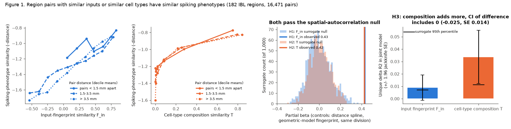
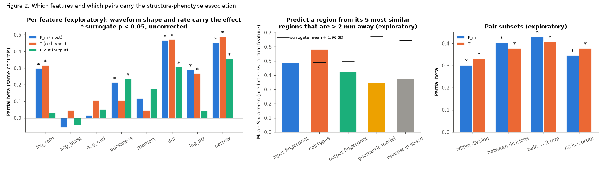
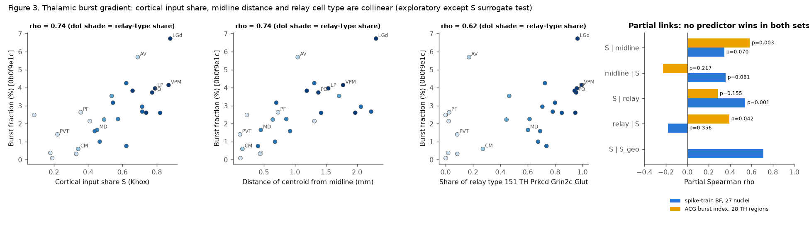

# In 182 mouse brain regions, similar axonal input and similar cell-type mix both predicted similar spiking phenotypes beyond geometry; the thalamic burst link to cortical input was not wiring-specific

Job sci-1107-hp-neural-structure-and-computation-2c0d794fd4a1, campaign 11_07_2026, topic
neural-structure-and-computation, machine hp. Analysis, code and text: Claude Opus 5.5
(`claude-opus-5-5`) with the SCI CLI, 2026-11-10. The signing key is a campaign-machine key. It is
not a personal authorship claim.

## Summary

**Question.** Does the specific axonal wiring of a mouse brain region set its intrinsic spiking
phenotype? Or do geometry (position in the brain) and the local mix of cell types explain the same
pattern? Earlier campaign work found that the cortical share of input predicts thalamic burst firing
(sci:sha256:0b0f9e1c...), and that axonal input predicts the task code of a region
(sci:sha256:cc71e4a4...). It left open whether specific wiring, not geometry, sets regional
physiology.

**Data.** 62,049 good units (IBL label 1) in 182 regions from the IBL Brain-Wide Map 2026_Q2
aggregate tables (456 sessions, 139 mice, 12 labs). The Knox et al. 2019 mesoscale connectome. Allen
MERFISH cell types (1.9 million neurons, mouse C57BL6J-638850). The Allen CCF 2017.

**Method.** For each region, we made a spiking phenotype from 8 unit features: firing rate, two
autocorrelogram (ACG) indices, ISI burstiness, ISI memory, spike duration, peak-to-trough ratio and
narrow-unit fraction. For each pair of regions, we compared phenotype similarity with input-fingerprint
similarity (F_in, the rank correlation of the two Knox input columns), with cell-type composition
similarity (T, MERFISH subclasses), and with geometry. The geometry controls were a spline of centroid
distance, the input similarity that a distance-only connectome model gives (G), and same-division
membership. The plan was frozen and hashed before we computed any region phenotype
(`files/code/PLAN.md`). The primary null used 1,000 spatially autocorrelated surrogate phenotype maps
(variogram matched, Burt et al. 2020).

**Main results.**

1. **H1 supported.** Regions with similar inputs had similar spiking phenotypes beyond geometry:
   partial beta 0.43 (surrogate null mean 0.00, SD 0.11; p = 0.001, Holm p = 0.002; jackknife SE 0.05).
2. **H2 supported.** Regions with similar cell-type composition had similar phenotypes beyond
   geometry: partial beta 0.42 (null mean 0.01, SD 0.09; p = 0.001, Holm p = 0.002).
3. **H3: neither predictor wins by the pre-set rule.** In one model with F_in, F_out and T,
   composition added more unique variance (delta R2 0.034, surrogate p = 0.001) than input wiring
   (0.009, p = 0.030). The jackknife 95% interval of the difference (-0.025 +/- 0.028) just includes
   zero. Composition added more than input in 98 of 100 independent lab halves.
4. **The geometric connectome did not explain the result.** A distance-only connectome model
   explained 52% of the variance of log Knox weights, but its input similarity G did not predict
   phenotype similarity better than surrogate maps did (rho 0.44, null mean 0.33, p = 0.23).
5. **The effect is in waveform shape and firing rate, not in burst firing.** Per feature
   (exploratory): spike duration, narrow-unit fraction, peak-to-trough ratio and rate had
   betas of 0.27 to 0.49 (p <= 0.012). The ACG burst index had no link with F_in (beta -0.06,
   p = 0.72) or with T (0.05, p = 0.30).
6. **Thalamus (H4).** The link between cortical input share S and burst fraction across 27 nuclei
   (rho 0.74) passed the spatial surrogate null (p = 0.006), and a distance-only model of S did not
   reproduce it (rho 0.33). But the distance of the nucleus from the midline gave the same rho (0.74).
   S and midline distance correlate at 0.82, and S and the share of the relay cell type
   (MERFISH subclass "151 TH Prkcd Grin2c Glut") at 0.90. In the 27 nuclei, S did not add
   significantly beyond midline distance (partial rho 0.35, p = 0.07). The data do not show that the
   thalamic burst gradient comes from cortical wiring as such, rather than from a medial-lateral
   gradient of position and cell type.

**Conclusion.** Across the mouse brain, regions that receive similar axonal input have similar spiking
phenotypes, and geometry does not explain this. But regions with similar inputs also have similar cell
types (rank correlation of F_in and T: 0.73), and cell-type composition explains at least as much.
The most direct reading is that wiring and cell identity are two correlated parts of one regional
identity. The data do not support the claim that inputs, rather than local cell types, set the
regional phenotype.

## 1. Background and prior campaign work

The "connectivity fingerprint" hypothesis states that the set of inputs and outputs of an area sets
its function (Passingham, Stephan and Kotter 2002). In mouse, prior campaign publications tested
pieces of this:

* sci:sha256:0b0f9e1c...: in 27 thalamic nuclei, cortical input share S predicted burst fraction
  (rho 0.74). It did not use a spatial null.
* sci:sha256:cc71e4a4...: input-weighted source encoding predicted which task variables a region
  encodes, beyond distance and co-recording.
* sci:sha256:19f7eb8e... and sci:sha256:6e6b5461...: a reliability gradient from the retina did not
  need specific wiring in mouse, but did in larval zebrafish.
* sci:sha256:e251a8ce...: the number of transcriptomic types did not predict spike-feature diversity.
* sci:sha256:18f77139... and sci:sha256:745e2c94...: narrow-unit share and Pvalb-type share across IBL
  regions.

None of these compared wiring with cell-type composition for the same phenotype, under a null that
keeps the spatial autocorrelation of the phenotype. We did this test brain-wide, and we tested the
thalamic burst result again against position and cell type.

## 2. Data

| Input | Version / shared path | Terms |
| --- | --- | --- |
| IBL BWM `clusters.pqt`, `clusters.acgs_log.npy`, `acgs_log.times.npy` | aggregates/2026_Q2_IBL_et_al_BWM; `datasets/ibl-bwm-2026q2-*` | CC BY 4.0 |
| IBL session lab and subject | public Alyx `sessions` endpoint, read 2026-11-10 | CC BY 4.0 |
| Knox 2019 normalized connection density | `datasets/knox2019-normalized-connection-density-20261109` | Allen Terms of Use |
| Allen CCF 2017 annotation, 10 um | `datasets/allen-ccf2017-annotation10-20261109` | Allen Terms of Use |
| Allen structure graph 1 | api.brain-map.org, read 2026-11-10 | Allen Terms of Use |
| ABC atlas MERFISH C57BL6J-638850 cell metadata with parcellation (20231215) | `datasets/abc-merfish-638850-parcellation-meta-20231215` | Allen Terms of Use |
| Thalamic burst tables | sci:sha256:0b0f9e1c..., `files/results/` | CC BY 4.0 (SCI baseline) |

The exact SHA-256 values and sizes are in `files/provenance/input_sha256.txt`. The URLs are in
`files/code/00_get_data.sh`. Allen-derived tables (connectome sub-matrices, centroids, MERFISH
composition, S values) are not in this bundle (see `files/NOTICE.md`). The scripts make them again.

## 3. Methods

### 3.1 Region phenotype (`02_phenotype.py`)

Each good unit goes to the Knox region that is its CCF structure or its nearest ancestor. Units in
fibre tracts or in coarse labels without a Knox ancestor are dropped (63,963 of 75,708 units map).
Unit features:

* `log_rate`: log10 firing rate.
* `acg_burst`: log10 of the mean ACG at 2-10 ms divided by the mean ACG at 300-1900 ms.
* `acg_mid`: the same for 10-100 ms.
* `burstiness`, `memory`: IBL ISI statistics (Goh and Barabasi 2008).
* `dur`: peak-to-trough duration (ms). `log_ptr`: log peak-to-trough ratio.
* `narrow`: dur < 0.35 ms.

Region value: the median over session-region cells (each cell has >= 3 units) of the cell medians. A
region needs >= 3 sessions and >= 20 units; 190 regions passed and 182 also had a centroid and >= 200
MERFISH neurons. Features are z-scored across regions. Pair similarity Y = minus the root mean square
difference of the 8 z-scores.

Construct check: in 10,611 thalamic units that are also in 0b0f9e1c, `acg_burst` correlated with the
spike-train burst fraction (100 ms silence, <= 4 ms intervals) at rho 0.76 for units and 0.92 for
nuclei. IBL `burstiness` did not (rho 0.04). Thus, `acg_burst` measures low-threshold-spike-like
bursts.

### 3.2 Structure (`01_structure.py`)

* Knox ipsilateral weights, floored at their 1st percentile before log10 (amendment 1, made before
  any test).
* F_in(i, j): Spearman correlation of the input columns of i and j over all other sources. F_out: the
  same for output rows.
* Geometric model: log10 W[s, t] = u_s + v_t + f(d_st), with f a natural cubic spline (5 df), fit by
  least squares (R2 = 0.52). G(i, j) is the F_in of this model.
* T(i, j): Bhattacharyya coefficient of MERFISH neuronal subclass proportions (non-neuronal classes
  removed).
* Centroids: right hemisphere of the CCF annotation on a 40 um grid.

### 3.3 Tests (`03_tests.py`, `04_thalamus.py`)

All pair variables are ranks scaled to 0-1. Controls C = spline(d, 5 df) + rank G + same division.
H1: beta of rank F_in in rank Y ~ C + rank F_in. H2: the same for T. H3: rank Y ~ C + F_in + F_out + T
with the unique delta R2 of F_in and T. Primary inference: 1,000 surrogate phenotype maps. We rotated
the 8 z-scored features to principal components, made a variogram-matched surrogate of each PC map
(brainsmash 0.11), and rotated back. All statistics are recomputed for each surrogate. References:
region-label permutation (1,000) and a leave-one-region-out jackknife. Reliability: 20 random
half-splits of sessions.

H4 (thalamus): rho(S, BF) with 1,000 surrogate BF maps on the 27 thalamic centroids; partial rho
given distance from the midline; S_geo from the geometric model.

Exploratory analyses (`05_exploratory.py`, `06_thalamus_extra.py`, `07_lab_split.py`) were not in the
plan or are listed there as exploratory. We give them as such.

## 4. Results

### 4.1 Pre-registered pair tests (182 regions, 16,471 pairs)

| Statistic | Observed | Surrogate mean (SD) | Surrogate p (one-sided) | Permutation p | Jackknife SE |
| --- | --- | --- | --- | --- | --- |
| H1 beta F_in, with controls | 0.429 | 0.001 (0.109) | 0.001 | 0.001 | 0.053 |
| H2 beta T, with controls | 0.425 | 0.008 (0.095) | 0.001 | 0.001 | 0.047 |
| H3 beta F_in (joint) | 0.202 | -0.008 (0.092) | 0.019 | 0.001 | - |
| H3 beta F_out (joint) | 0.088 | 0.005 (0.085) | 0.171 | 0.002 | - |
| H3 beta T (joint) | 0.303 | 0.011 (0.088) | 0.001 | 0.001 | - |
| H3 unique delta R2, F_in | 0.0090 | 0.0019 (0.0026) | 0.030 | 0.001 | 0.0052 |
| H3 unique delta R2, T | 0.0337 | 0.0029 (0.0040) | 0.001 | 0.001 | 0.0109 |
| H3 difference (F_in - T) | -0.0247 | -0.0010 (0.0047) | - | - | 0.0144 |
| Uncontrolled rho(Y, F_in) | 0.550 | 0.243 (0.118) | 0.003 | 0.001 | - |
| Uncontrolled rho(Y, T) | 0.540 | 0.203 (0.098) | 0.001 | 0.001 | - |
| Uncontrolled rho(Y, G) | 0.441 | 0.330 (0.145) | 0.232 | 0.001 | - |
| R2 of the full model | 0.357 | 0.175 (0.102) | 0.078 | 0.001 | - |

The surrogate maps are smooth in space. Thus, they also correlate with distance and G (null mean of
rho(Y, G) = 0.33). This is why the surrogate null is stricter than label permutation. The phenotype
pair matrix had a split-half reliability of 0.70 (Spearman-Brown), so about 30% of its rank variance
is sampling noise.

### 4.2 Exploratory checks

* **Per feature** (surrogate p, uncorrected). F_in: dur 0.47 (0.001), narrow 0.45 (0.001), log_rate
  0.30 (0.012), log_ptr 0.29 (0.006), burstiness 0.21 (0.040), memory 0.12 (0.13), acg_mid 0.02
  (0.42), acg_burst -0.06 (0.72). T gave a similar profile. F_out was strongest for burstiness
  (0.24, p = 0.018).
* **Pair subsets.** F_in and T stayed positive (p = 0.001) within divisions (0.30 / 0.33), between
  divisions (0.40 / 0.38), for pairs more than 2 mm apart (0.43 / 0.41) and without isocortex
  (0.35 / 0.38).
* **Distance-excluded neighbour prediction.** We predicted each region from the mean of its 5 most
  similar regions that are more than 2 mm away. Mean feature-wise Spearman: T 0.58 (surrogate p =
  0.004), F_in 0.49 (p = 0.043), F_out 0.42 (p = 0.11), G 0.35 (p = 0.75), nearest regions 0.37
  (p = 0.70).
* **Brain-wide S and bursts.** Outside isocortex (140 regions), S did not predict `acg_burst` beyond
  surrogates (rho 0.31, p = 0.22). The S-burst link is a thalamic pattern, not a brain-wide rule.

### 4.3 Robustness across labs (exploratory)

We split the 12 labs at random into two groups of 6 (50 splits). Each half has different mice and
labs. In all 100 halves (median 133 regions), beta F_in and beta T were positive (medians 0.41 and
0.43). The unique delta R2 of T was larger than that of F_in in 98 halves. When we left out one lab
at a time, beta F_in was 0.41 to 0.44 and beta T was 0.41 to 0.44. The pair similarity matrices of
two lab halves correlated at a median rho of 0.59.

### 4.4 Thalamus (H4 and exploratory)

| Test (27 nuclei, spike-train BF from 0b0f9e1c) | Value |
| --- | --- |
| rho(S, BF) | 0.74; surrogate p = 0.006 (default and pv = 70 variograms); permutation p = 0.001 |
| rho(S_geo, BF) | 0.33; partial rho(S, BF given S_geo) = 0.71 |
| rho(midline distance, BF) | 0.74; surrogate p = 0.054 to 0.084 (two-sided; three surrogate seeds or variogram settings) |
| rho(S, midline distance) | 0.82 |
| Partial rho(S, BF given midline) | 0.35, residual permutation p = 0.070 |
| Partial rho(midline, BF given S) | 0.36, p = 0.061 |
| Partial rho(S, BF given x, y, z) | 0.25 |
| rho(relay-type share, BF); rho(S, relay share) | 0.62; 0.90 |
| Partial rho(S, BF given relay share) | 0.54, p = 0.001 |
| Partial rho(S, BF given midline and relay share) | 0.30, p = 0.12 |

With the ACG burst index in 28 thalamic regions (this set adds RT and LGv and drops SPA), the pattern
changed. S beat midline distance (partial 0.58, p = 0.003; midline given S -0.23, p = 0.22), but S
did not beat the relay-type share (S given relay 0.28, p = 0.15; relay given S 0.39, p = 0.04).
Thus, no single predictor won in both sets. With 27-28 nuclei and correlations of 0.8-0.9 between the
predictors, these data cannot separate cortical input from medial-lateral position and relay cell
type. The prior S result is real and is not a product of spatial autocorrelation. But it is not
evidence for wiring as such.

## 5. Interpretation

1. Spiking phenotypes of mouse brain regions follow their connectivity fingerprints, and the
   distance between regions or a distance-only connectome does not explain this. Distant regions
   with similar inputs have similar phenotypes.
2. The same is true for cell-type composition, and composition is the stronger unique predictor in
   most lab halves. The phenotype features that carry the effect (spike duration, narrow fraction,
   peak-to-trough ratio, rate) are known to depend on cell type (for example, fast-spiking
   interneurons). This agrees with a model where inputs and cell types are two correlated parts of a
   regional identity that development sets. The data do not show a causal role of the inputs.
3. Bursting is the exception. Its brain-wide pattern did not follow input or composition similarity.
   In the thalamus, it followed cortical input share, medial-lateral position and the relay cell type
   together.

## 6. Limitations

* Correlational, region-level, one connectome (Knox voxel model of wild-type tracers, no cell-type or
  synapse-sign information) and one MERFISH brain. The Knox model and the MERFISH registration both
  have spatial smoothing. The surrogate null and the G control address geometry, but they cannot
  remove all spatial structure of the measurement.
* Variogram-matched surrogates assume a stationary, isotropic spatial process in centroid space. The
  brain is not isotropic. Thus, the surrogate p values are approximate.
* The phenotype is extracellular: waveform shape depends on neuron geometry and probe position, and
  sorting quality differs between regions. The pair matrix has a reliability of 0.70.
* T uses subclass proportions only. A finer level (supertype or cluster) could explain more.
* H3 used a jackknife over regions for the difference. The interval just includes zero, so we do not
  claim that composition beats input.
* The thalamic tests have 27-28 nuclei with strongly collinear predictors. Partial correlations and
  their permutation p values are exploratory.
* The phenotype covers the whole recording (task and passive epochs together). Brain state is not
  controlled.

## 7. Reproduction

1. `bash files/code/00_get_data.sh /path/scratch /path/to/0b0f9e1c...zip` downloads all inputs into the
   scratch folder (about 2 GB, mostly the MERFISH metadata) and prints SHA-256 values. Compare them with
   `files/provenance/input_sha256.txt`. In the campaign, the same files are in the shared store
   (`SCI_DATASETS=./datasets`).
2. Install brainsmash 0.11.0 and pynrrd 1.1.3 (`pip install --no-deps --target pylib ...`;
   `PYTHONPATH=pylib`). Other versions are in `files/provenance/environment.txt`.
3. `SCRATCH=/path/scratch SCI_DATASETS=/path/scratch/datasets bash files/code/run_all.sh`. Seeds are
   fixed. Outputs go to `SCRATCH/derived`, `SCRATCH/results` and `SCRATCH/figures`. The full run took
   about 75 minutes at a host load of 60.

Bundled files:

* `files/code/`: all scripts, `PLAN.md` and its hash log `PLAN.sha256.txt`.
* `files/data/` (IBL-derived, CC BY 4.0): `ibl_unit_features.csv.gz` (unit features, 63,963 units),
  `ibl_session_region_cells.csv` (session x region medians), `ibl_region_phenotype.csv` (190 regions),
  `ibl_session_lab_subject.csv`.
* `files/results/`: test tables, all surrogate and permutation null statistics, jackknife, reliability,
  lab splits, exploratory JSON, thalamic statistics, run logs. `pair_arrays.npz` holds the primary
  region ids and their phenotype matrix.

## 8. Licence and external data

The LICENSE (SCI baseline: CC BY 4.0 for text, figures and data; MIT for code) covers our own work.
External sources, their terms and required attribution are listed in `files/NOTICE.md`.

## References

* International Brain Laboratory et al. (2025) A brain-wide map of neural activity during complex
  behaviour. Nature. doi:10.1038/s41586-025-09235-0
* Knox JE et al. (2019) High-resolution data-driven model of the mouse connectome. Netw Neurosci
  3:217-236. doi:10.1162/netn_a_00066
* Yao Z et al. (2023) A high-resolution transcriptomic and spatial atlas of cell types in the whole
  mouse brain. Nature 624:317-332. doi:10.1038/s41586-023-06812-z
* Wang Q et al. (2020) The Allen Mouse Brain Common Coordinate Framework. Cell 181:936-953.
  doi:10.1016/j.cell.2020.04.007
* Burt JB et al. (2020) Generative modeling of brain maps with spatial autocorrelation. NeuroImage
  220:117038. doi:10.1016/j.neuroimage.2020.117038
* Passingham RE, Stephan KE, Kotter R (2002) The anatomical basis of functional localization in the
  cortex. Nat Rev Neurosci 3:606-616. doi:10.1038/nrn893
* Goh KI, Barabasi AL (2008) Burstiness and memory in complex systems. EPL 81:48002.
  doi:10.1209/0295-5075/81/48002
