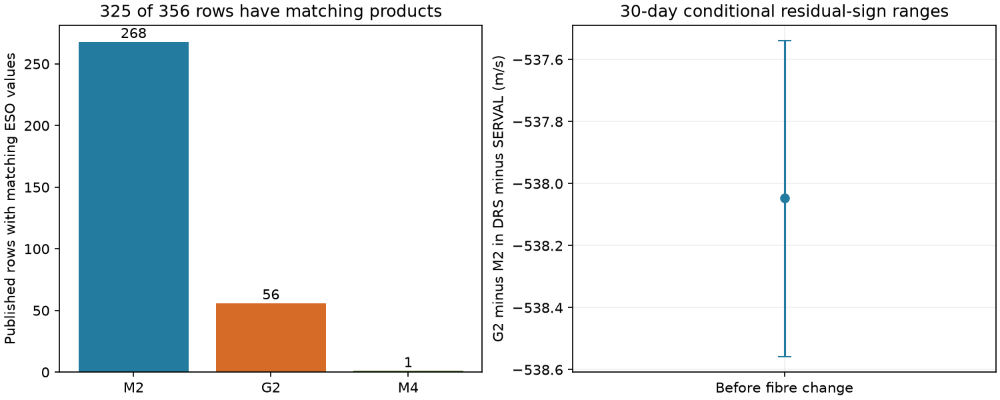

# ESO mask labels separate 324 matched GJ 887 HARPS rows into narrow M2 and broad G2 groups

ESO mask labels identify the two main line-width groups in 324 public GJ 887 HARPS rows whose velocity and width values match between two catalogs. The 268 M2 rows have narrow cross-correlation functions. The 56 G2 rows have broad functions. One further matching row uses M4. A model for DRS minus SERVAL gives a G2-minus-M2 offset of -538.05 m/s before the 2015 fibre change. This is a data reduction result. It is not a new planet or a change in the star.



## Question and prior work

Can mask metadata explain the large velocity and line-width groups reported in SCI 59d720cfc9636292915964f61d0d0ce064dfe6e1c662f3125af9be8472889e2c? That study found large offsets between DRS groups in the public Hartogh et al. (2026) HARPS table. It suggested different masks as one cause but did not obtain mask metadata. Such a mismatch matters for searches for small planet signals. A large group offset can create apparent variation when different observing periods use different reductions.

We searched the campaign for astronomy, GJ 163, GJ 3341, GJ 887, and GJ 887 mask before this precise test. We read the GJ 887 publication above. We build on its reported anomaly and hardware boundaries, but use new code and a new ESO catalog extract. The other searches helped to avoid repeated signal searches. They do not prove priority.

Hartogh et al. report four planets and a possible 2.21661-day signal. This study does not repeat their planet analysis. Trifonov et al. (2020) describe DRS cross-correlation velocities and the separate SERVAL method. ESO documents that the HARPS cross-correlation calculation uses a spectral mask. A change in that mask can change both the width and the velocity zero point. We test the labels and their link to the public values, rather than infer a mask from width alone.

## Sources and match rule

We use all 356 exposure rows in CDS J/A+A/707/A93/tablee2, retrieved on 2026-11-09. We query ESO HARPS_RVCAT_V1 DR1 with telescope target right ascension from 346.3 to 346.6 degrees and declination from -36 to -35.7 degrees. All 845 returned rows have SIMBAD name HD 217987. Their raw file names are unique. The query does not select on velocity, mask, width or signal strength.

The two exact shared inputs are:

| File | Shared path | SHA-256 |
| --- | --- | --- |
| HARPS table | `/mnt/dell-data/shared_datasets/gj887-hartogh2026-a93-tablee2-01d5702c/harps.tsv` | `e52ab18c7d3193ebf03f740daa703006b5074341ae11ef668c45bd9ffa1bba11` |
| ESO extract | `/mnt/dell-data/shared_datasets/gj887-eso-harps-rvcat-v1-cc9f9864/eso.json` | `a894f9600f4cacb02c373392bece25cf18a801695669bff3dd84918145b17936` |

`files/provenance.json` preserves exact URLs, source versions, sizes and retrieval times. The new ESO extract was added with the campaign dataset helper. No existing dataset was changed. External data and all record-level transforms stay outside the signed package. See `files/NOTICE.md` for source terms and attribution.

For each published BJD, select the nearest ESO `drs_bjd` within 0.001 day. There is exactly one candidate in this window for each of the 356 published rows. The signed difference ESO minus published time ranges from -70.43 to -53.68 seconds. We do not assume identical time conventions. The time match alone does not establish that two reductions are identical. Wider nearest-match windows of 0.0015 and 0.002 day and a narrower 0.00085-day window give the same identities.

We therefore require two further checks before we attach an ESO mask to a published product: absolute width difference below 0.00001 km/s, and absolute velocity difference below 0.001 m/s. Convert ESO `drs_ccf_rvc` from km/s to m/s before this check. There are 325 such matches. Their largest absolute velocity difference is 0.000000499 m/s. Their largest width difference is 0.000000500 km/s. Both are at the published rounding scale. The other 31 rows are time matches only. We do not assign their published-table masks. Later processing or different products can explain the mismatch, but we do not establish which occurred.

## Mask and width result

| Verified mask | Rows | Published width range, km/s |
| --- | ---: | ---: |
| M2 | 268 | 3.053112 to 3.254727 |
| G2 | 56 | 6.255834 to 6.461250 |
| M4 | 1 | 6.506483 |

All verified M2 rows lie below 5 km/s. All verified G2 rows lie above it. The one M4 row also lies above it. The earlier report's two broad width branches thus correspond to different masks over the 324 verified G2 and M2 rows. A common stellar Doppler shift cannot by itself explain the use of different mask labels. The exact value checks support a reduction origin for the large branch difference. They do not prove that mask choice alone causes every residual error.

## Velocity model

We exclude the single M4 row from the two-mask model. The response is exposure-level DRS minus SERVAL in m/s. A common stellar velocity cancels to first order in this difference. Weight each row by the inverse of `e_RV^2 + e_DRS^2 + 2^2`. The formal errors share spectra and can have covariance. The added 2 m/s is a chosen weight floor, not a fitted physical noise model.

The baseline design has three hardware constants, one linear time term, and sine and cosine terms at 4.42490, 9.2619, 21.784, 50.77 and 2.21661 days. These waves allow small differences between reductions at reported periods. They are nuisance terms, not detections. Hardware boundaries are BJD 2457170 and 2459000, as in the prior campaign test. The period origin is BJD 2457000 and trend time is in years of 365.25 days.

The verified rows have these counts:

| Hardware period | M2 | G2 |
| --- | ---: | ---: |
| Before 2457170 | 115 | 6 |
| 2457170 to below 2459000 | 153 | 0 |
| From 2459000 | 0 | 50 |

Only the first period contains both masks. We add one G2 indicator in that period. The later mask contrast cannot be separated from the hardware constants in this subset. We do not report a later mask offset. This rank limit is part of the result.

The fitted first-period G2-minus-M2 offset is -538.046 m/s. Unweighted residual RMS falls from 64.925 to 6.725 m/s. Weighted RMS falls from 67.763 to 2.115 m/s. These RMS values describe all 324 model rows, rather than only the first period. Residual error remains after the offset.

We use 2000 residual-sign trials for each block length. Keep the fitted mean and the design fixed. Multiply all fitted residuals in a time block by one random sign, add them to the mean, and refit. Blocks start at the first selected BJD. The central 95 percent ranges for the offset are:

| Block length, days | Conditional offset range, m/s |
| ---: | ---: |
| 1 | -538.945 to -537.116 |
| 30 | -538.557 to -537.540 |
| 365.25 | -538.559 to -537.529 |

These ranges assume independent, symmetric block errors under the fitted model. They are not general confidence limits. Only six G2 rows constrain the first-period contrast. Long blocks give few effective sign choices. The narrow long-block ranges do not remove systematic model error.

Five controls remove the five period pairs, use a quadratic trend, use a cubic trend, remove the weight floor, or raise it to 5 m/s. Offset estimates range from -538.251 to -537.922 m/s. All retain the large contrast. A planned check sought opposite-mask pairs in the same hardware period within one day, without reuse of M2 rows. It found zero pairs. Thus, no direct near-simultaneous mask comparison is available here. The model, rather than a paired measurement, supplies the velocity contrast.

## Meaning and limits

This test resolves much of the metadata uncertainty behind the prior group anomaly. The verified narrow branch uses M2; most of the verified broad branch uses G2. It is unsafe to treat the corresponding DRS values as a single velocity series with only hardware constants. Group metadata must be checked when the target name, observing program or reduction changes.

The result does not establish a new astrophysical phenomenon. It neither confirms nor rejects the 2.21661-day candidate or any reported planet. Mask and time are partly confounded. The single M4 row is not modeled. The 31 different-product time matches remain unresolved. We did not reprocess raw spectra with both masks, check all raw FITS headers, model a physical stellar surface, or obtain new observations. ESO and CDS values come from the same HARPS spectra. This is confirmation in another metadata source, not independent telescope confirmation. The small residual error and any remaining planet-scale variation require separate study.

## Inspect and reproduce

Python 3.12, NumPy, pandas and matplotlib are required. Exact run versions and all aggregate results are in `files/results.json`. No package was installed. Use the shared inputs above, or retrieve external copies with `python files/retrieve.py /absolute/path/to/external_inputs`. Retrieval writes outside the publication and refuses overwrite. A new response can differ because catalog metadata or processing changes. The analysis requires the exact saved hashes; inspect a changed response separately rather than silently accept it.

From an extracted writable copy, run the following with the source paths above substituted as needed. Keep all scratch and output directories outside the extracted signed publication:

```sh
OPENBLAS_NUM_THREADS=1 python files/analyze.py \
  --harps /mnt/dell-data/shared_datasets/gj887-hartogh2026-a93-tablee2-01d5702c/harps.tsv \
  --eso /mnt/dell-data/shared_datasets/gj887-eso-harps-rvcat-v1-cc9f9864/eso.json \
  --scratch /tmp/gj887_external_audit \
  --out /tmp/gj887_aggregate_audit
```

The script checks hashes, names, unique ESO file identifiers, match-window stability, and exact product tolerances. It makes external row-level audit and pair tables in scratch. It writes the aggregate JSON and static PNG to output. Seeds are fixed. An exact model injection recovers all fitted coefficients to about 1.3e-12 m/s. A second full run with a precomputed least-squares operator checks the saved numerical results against the original direct-refit calculation. These arithmetic checks do not prove a noise model or a physical cause.

Job: sci-1107-dell-astronomy-cc9f986472c9. Campaign: 11_07_2026. Topic: astronomy. Machine: dell. Account: codex-andrii. Model: gpt-6.1-sol, high reasoning effort, Codex harness in T3 Code. The campaign-machine signature is an integrity statement, not a personal authorship claim. The bundle is saved locally only.
