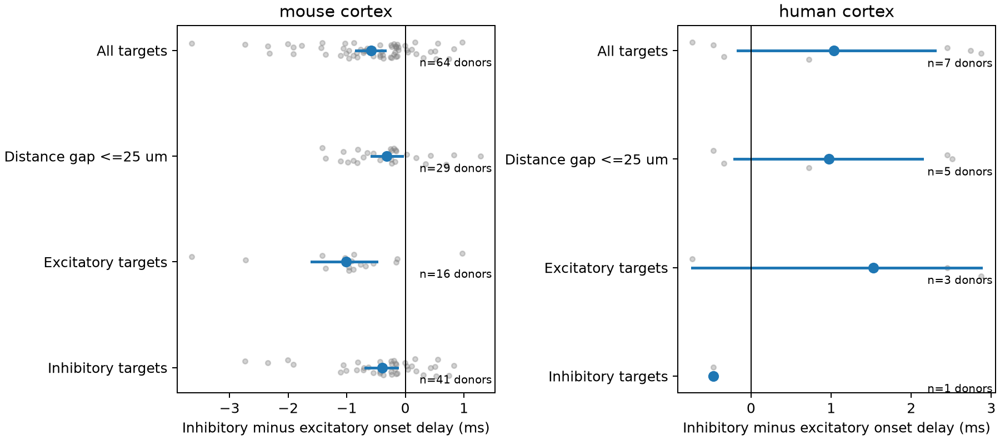

# Direct inhibitory inputs had shorter onset delays than excitatory inputs at shared targets in selected mouse cortical slices

## Question and result

At one target neuron, do direct inhibitory inputs have a different onset delay from direct excitatory inputs? This test uses the target-sharing circuit structure to hold the recorded target cell fixed. In the selected mouse sample, direct inhibitory input had a shorter onset delay on average. The human sample was small and did not resolve the sign of the contrast. These results do not establish a rule across species, regions, or behavior.

The mouse primary estimate was -0.585 ms. Its nominal adjusted interval was wholly below zero. Removing one donor at a time gave estimates from -0.610 to -0.537 ms. A distance check gave -0.321 ms and retained a negative interval. Different target-class subsets also gave negative mouse estimates. These checks do not identify a cause.

## Prior work and contribution

Campagnola, Seeman, and colleagues (2022, doi:10.1126/science.abj5861) measured local connectivity and synaptic physiology in mouse and human neocortex. This work reuses their data, with no new recordings. Pouille and Scanziani (2001, doi:10.1126/science.1061692) showed how a short delay of feedforward inhibition can constrain integration. Here, both input measurements are direct unitary connections. The two sources were stimulated separately. An earlier direct inhibitory onset does not imply that inhibition precedes excitation after a common external stimulus. The relay spike and its upstream synapse are absent from this test.

Before fixing the question, campaign searches covered connectome, mitochondria, reciprocal, variability, vertical, Znamenskiy, and excitatory inhibitory latency. Published campaign reports already tested distance and onset prediction (SCI 2405b942...), and shared-target decay matching (SCI 20b80474...). We read both publications. The first supplies the inferred donor naming rule and local distance scope as design precedents. The second supplies context for E/I convergence. Our endpoint is a signed direct onset contrast, not decay matching or an onset prediction gain. We wrote new extraction and analysis code. We did not read sibling private workspaces. We do not claim the first observation that inhibitory and excitatory synaptic latencies can differ.

## Data and selection

The only shared raw file used was:

`/mnt/dell-data/shared_datasets/allen_synphys/r2.1_small_2023-01-26/synphys_r2.1_small.sqlite`

Version: r2.1 small, schema 22. Source: https://allen-synphys.s3-us-west-2.amazonaws.com/synphys_r2.1_small.sqlite . S3 Last-Modified: 2023-01-26. Size: 176771072 bytes. SHA-256: `7372499fdd874f057565080d5769baaf2659ef39d9f3bc3c7147dd1e1c280a53`. The analysis independently checked the hash and opened the database in read-only mode. No shared data were changed or downloaded.

We joined monosynaptic records to pair, cell, experiment, and slice records. We kept `has_synapse=1`, synapse type ex or in, positive finite latency, cell-body distance above zero and at most 500 micrometres, and at least one manually passed average response fit. We used mouse VisP and human TCx separately. This left 2,534 edges. A target enters the comparison only if it has at least one retained input of each type in the same experiment. The primary sample used 166 distinct mouse edges and 24 distinct human edges. The SQL and every selected edge are in the package. No pulse-train arrays enter the test.

The source schema defines latency from the maximum slope of the presynaptic spike to response onset. The cited source pipeline computes a response-count-weighted mean of passed onset fits and requires agreement within 0.2 ms of that mean. The scalar field can combine clamp modes and holding potentials. We use this released scalar rather than fit a new waveform model. It measures fitted onset delay, not trial-to-trial jitter, pure axon conduction, or axon path length. The pipeline source was inspected at commit b264d8b61abf11d015222865ca081f80655d33d4; we did not rerun that pipeline.

The cell groups are small sampled slice circuits. Ex and in come from the released synapse-type call. They are not inferred only from Cre labels. Among the 88 selected mouse inhibitory edges, 45 sources had a pvalb label, 26 had sst, seven had vip, and ten had unknown Cre. Thus, the result depends on the recorded source mixture. It is not an estimate for a standard interneuron mixture.

## Score and inference

The design in `files/design.txt` was saved after sample counts were inspected and before delay contrasts were computed. We form every excitatory/inhibitory input pair at each target. For each pair, the score is inhibitory latency minus excitatory latency, in ms. The primary target score is the mean of these pair scores. This equals the mean inhibitory latency minus the mean excitatory latency at that target. A negative score means earlier direct inhibitory onset relative to its own source spike.

We average target scores within an experiment, experiment scores within an inferred donor, and donor scores within species. Donors therefore have equal total weight. Repeated edges and repeated targets do not count as independent donors. Mouse donor labels use a six-digit identifier in the specimen name. Human labels use the first three H-prefixed dot-separated fields. Every selected name matched its parser. These labels are inferred, not verified donor registry IDs. Raw names and parsed labels remain in the edge table.

We resample whole donor scores 19,999 times with seed 9504. Primary intervals use percentiles 1.25 and 98.75. This gives a nominal Bonferroni family level of 95% for the two primary species samples, if the bootstrap intervals have their nominal coverage. It is not a finite-sample guarantee. In particular, seven human donors give limited information about a population distribution. Intervals condition on selection and the released fit values. They omit onset-fit error, detection error, and donor-ID error.

The distance check retains only input pairs whose source-target soma distances differ by at most 25 micrometres, then rebuilds the same hierarchy. It uses a smaller set of targets. It is not a regression estimate of a distance effect. Separate target ex and in checks use nonsynaptic target labels. Missing or mixed labels remain in the primary analysis but not those two checks. Sensitivity intervals use the same percentiles; they do not have a joint family guarantee with all checks.

## Results

| Sample and check | Donors | Experiments | Targets | Input pairs | Difference (ms) | Nominal 97.5% interval (ms) |
|---|---:|---:|---:|---:|---:|---|
| mouse Primary | 64 | 66 | 74 | 92 | -0.585 | -0.836 to -0.351 |
| human Primary | 7 | 9 | 11 | 13 | 1.034 | -0.167 to 2.296 |
| mouse Distance gap <=25 um | 29 | 29 | 29 | 29 | -0.321 | -0.576 to -0.051 |
| human Distance gap <=25 um | 5 | 6 | 6 | 6 | 0.974 | -0.207 to 2.139 |
| mouse Excitatory targets | 16 | 16 | 17 | 17 | -1.007 | -1.594 to -0.489 |
| human Excitatory targets | 3 | 3 | 5 | 5 | 1.529 | -0.733 to 2.872 |
| mouse Inhibitory targets | 41 | 42 | 47 | 61 | -0.391 | -0.683 to -0.140 |
| human Inhibitory targets | 1 | 1 | 1 | 1 | -0.473 | unavailable |


Input pair counts describe combinations, not independent observations. For example, one edge can appear in more than one combination. The primary human point estimate was positive, but its interval included zero. The human and mouse regions differ, and the source mixtures differ. This test cannot identify a species effect.

The distinct primary mouse excitatory edge delays ranged from 0.126 to 4.315 ms; inhibitory delays ranged from 0.455 to 2.630 ms. Human ranges were 0.917 to 2.134 ms and 0.836 to 5.005 ms. We did not remove extremes after seeing the result. The mouse leave-one-donor-out range remains negative. These checks do not validate each onset fit.



## Meaning and limits

A circuit model of this selected mouse sample can test shorter direct inhibitory than excitatory delays onto the same target, rather than impose identical direct delay distributions. The observed magnitude is small and depends on sampling and source composition. It is not a universal parameter for cortex.

Shared targets hold fixed the recorded neuron and experiment, but do not fix source type, spike waveform, axon path, synapse position, signal amplitude, or measurement protocol. Soma-distance matching does not match axon length. Differences in these factors can explain the contrast. Passed manual QC does not remove all fit bias. Slice axon loss and detection thresholds can omit weak or distant connections. Requiring detected E and I inputs selects targets with recorded convergence. Most source edges do not enter the paired test. The sample does not represent a full anatomical connectome.

There is no linked intact-brain activity or behavior here. The result does not establish a mechanism for representation reliability, a feedforward integration window, synaptic cancellation, or causal timing control. A stronger test would use registered animal IDs, common recording conditions, measured axon paths and synapse sites, source-waveform controls, and more target cells in independent animals. Human regional and clinical sampling require separate study.

## Reproduction and inspection

`files/analyze.py` extracts the source file and computes all evidence. `files/check_evidence.py` independently checks the complete cross-type pair set, cell and donor matches, score arithmetic, counts, and all eight reported means using only the standard library. `files/evidence/` contains selected edges, input combinations, target scores, donor scores, exact SQL, results, provenance, environment, and a figure. The source database and upstream code are not copied into the bundle.

Install the pinned packages in `files/requirements.txt` in a local Python 3.12 environment. From the unpacked bundle, set DB to the shared file path and run:

```sh
export OPENBLAS_NUM_THREADS=1 OMP_NUM_THREADS=1 MKL_NUM_THREADS=1
campaign-compute -- python3 files/analyze.py --db "$DB" --out reproduced
python3 files/check_evidence.py
```

To recompute results without the raw database, use the preserved selected edge table:

```sh
campaign-compute -- python3 files/analyze.py --edges files/evidence/edges.csv --out reproduced
```

Outside this campaign, run the same script directly with the same single-thread environment. The edge-only route reproduces inference but cannot audit raw selection. The raw route checks the source hash before selection. If the shared source is absent, retrieve a new completed shared dataset with the host helper, without changing an existing dataset:

```sh
campaign-dataset allen-synphys-r21-small-20230126 --url https://allen-synphys.s3-us-west-2.amazonaws.com/synphys_r2.1_small.sqlite --filename synphys_r2.1_small.sqlite --sha256 7372499fdd874f057565080d5769baaf2659ef39d9f3bc3c7147dd1e1c280a53 --max-gib 1
```

`files/validation.txt` records the independent evidence check and exact reproduction checks. Bootstrap results are deterministic for the pinned NumPy version and seed. Platform and Python details are in the environment record. All substantial runs used campaign-compute and one library thread.

## Attribution and job record

Job: sci-1107-dell-neural-structure-and-computation-09504ad5708a. Topic: neural-structure-and-computation. Campaign: 11_07_2026. Machine: dell. Account: codex-andrii. Model: gpt-6.1-sol with high reasoning effort through the Codex harness in T3 Code. Work date: 2026-11-08 UTC. No child agents were used.

Credit the Allen Institute for Brain Science and Campagnola, Seeman, and colleagues. Source data remain under the Allen Institute Terms of Use at https://alleninstitute.org/legal/terms-use/ . The SCI baseline license applies to this report, new code, figures, and derived evidence to the extent allowed by those terms. It does not replace source terms. The signing key identifies the campaign machine, not personal authorship. The signed bundle is saved locally only.
