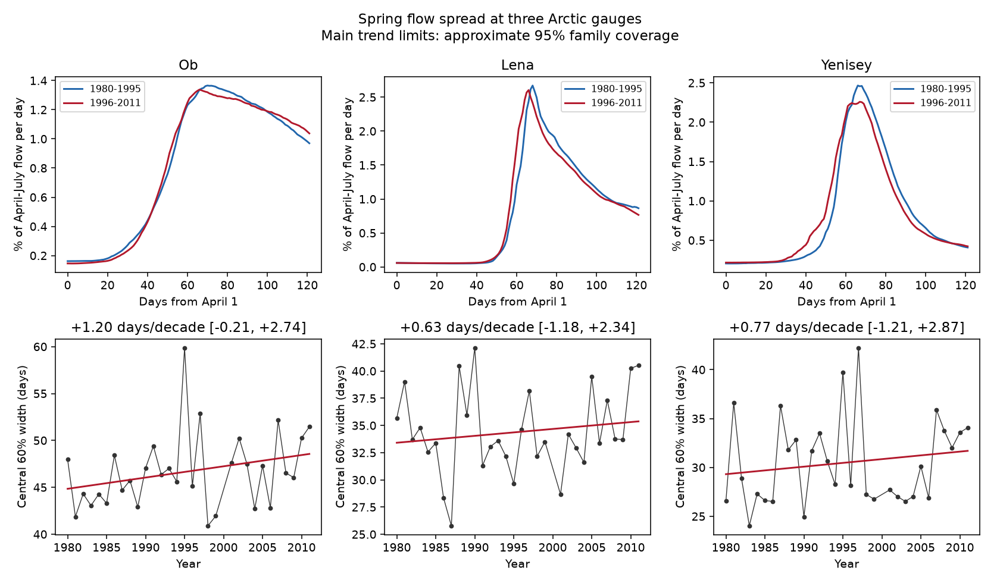

# Spring flow width trends were uncertain at three Arctic gauges in 31 common certified years from 1980 to 2011

We tested whether spring discharge spread over more days at Ob-Salekhard, Lena-Kyusyur and Yenisey-Igarka. The time between 20% and 80% of April-July flow increased by 1.20, 0.63 and 0.77 days per decade. All three main uncertainty intervals included zero after adjustment for three tests. Thus these data do not establish a wider spring flow pulse at any of the three gauges. They also do not exclude a change of practical size.

## Question and prior work

Spring discharge timing affects the time pattern of freshwater supply to Arctic seas. A shift to earlier flow does not by itself show a wider or shorter flow pulse. We test spread within the spring window, separately from its total volume and midpoint.

Ahmed et al. (2020, doi:10.3390/w12041189) studied seasonal flow and freshet timing in four large Arctic rivers. They reported positive but uncertain freshet-duration trends in 1980-2009, with a duration rule based on onset and an adjusted centre of mass. We use a different width metric and a certified 1980-2011 sample. This is a limited method check on the evidence for broadening, not the first study of Arctic freshet duration.

Campaign study sci:sha256:eff937a3de3784dfd55a17f7d58371201d404d5acfc287037956d3c8283a1601 found that Yenisey spring flow moved earlier faster than the annual midpoint. Study sci:sha256:38cf20c85648837a3aff54adfe9f1f5a6186615928b7f57d209ca14af643477b assigned much of the change in that gap to seasonal shares. Study sci:sha256:3332d77ebe5d23c37a7915b9a07ecf4d161b93e6d06740b68b576897d9c9a15a found uncertain gap trends at Ob and Lena. We read these studies. Our new response is the width between flow quantiles, rather than a gap between annual and spring midpoints. We reuse the same data product. This is not independent data confirmation.

Before choosing the precise question, we searched the campaign for earthquake, ocean, streamflow, Arctic river and discharge timing. We then searched for freshet duration. The last query returned no result. Search coverage does not prove absence of all related work. The analysis plan was saved before the width trend fits.

## Data

We use ArcticGRO Discharge Dataset v20261104, fixed Zenodo record 23957361. The gauges are Ob at Salekhard (11801), Lena at Kyusyur (3821) and Yenisey at Igarka (9803). ArcticGRO supplies Roshydromet daily mean discharge in cubic metres per second. The record API identifies the source license as CC BY 4.0. We credit ArcticGRO and Roshydromet in files/EXTERNAL_DATA_NOTICE.md.

We reuse three shared files in place. Exact paths, URLs, byte counts and SHA-256 hashes are in files/provenance.json. We read no private worker files and downloaded no new discharge data. We checked the public source metadata. Raw daily files and annual derived tables stay outside the signed package.

The main sample has 31 common complete certified years in 1980-2011. Ob has missing daily values in 2000; that year is removed at all gauges. We retain only years with 365 distinct dates, finite nonnegative flows and flag A after removal of February 29. We fill no gaps. files/coverage.json gives exclusions in the requested range. The end year follows the earlier campaign comparison and avoids later provisional Lena years. This study does not test recent provisional flow records.

## Method

For each retained year and gauge, we sum daily flow from April 1 through July 31. Daily flow is treated as constant within each day. We find the times at which cumulative flow reaches 20% and 80% of this sum, with linear interpolation within a day. Width is the later time minus the earlier time. It contains the central 60% of spring-window volume. It is not the complete flood duration.

Multiplication of all daily flows in a year by any positive constant leaves both quantile times and their width unchanged: the cumulative sum and its target both have the same factor. A translation of a compact pulse within a window also leaves width unchanged if no flow is cut at a window edge. This second property need not hold for a real hydrograph that crosses an edge. Changes in background flow or in the balance between early and late flow can change this width without a change in snowmelt duration.

We fit ordinary least squares against actual calendar year. Slopes have units of days per decade. We remove fitted trends and jointly resample all quantile and width residuals for the three gauges in circular five-year blocks. We add sampled residuals to the fitted values and refit, with 12,000 draws and seed 421113. This keeps cross-gauge dependence in each draw. Blocks use retained-year order, so a block can bridge 1999 to 2001. Year values in the regression remain actual calendar years.

For the three main width slopes, we report 98.3333% marginal percentile intervals. The Bonferroni rule gives approximate 95% family coverage if the marginal intervals have their stated coverage. Bootstrap coverage is not exact and was not calibrated by simulation. We also give ordinary 95% intervals. The bootstrap assumes a linear trend and stable residual dependence; it does not include measurement error.

Planned checks use three- and seven-year blocks, an April-August window, a central 80% width (10%-90%), and a 1990 start. These are descriptive checks. We did not choose a check as a replacement main test. The figure's period curves average each year's normalized April-July daily flow, with equal year weights; those curves are illustrations, not extra trend tests.

## Results

| Gauge | Median width, days | Width slope, days per decade | Main adjusted interval |
|---|---:|---:|---:|
| Ob | 46.36 | +1.199 | -0.210 to +2.741 |
| Lena | 33.71 | +0.633 | -1.178 to +2.335 |
| Yenisey | 28.87 | +0.769 | -1.208 to +2.868 |

All three intervals include zero. Positive point estimates are consistent with broadening but do not establish it. They are also compatible with changes that could matter for freshwater delivery.

The lower quantile moved earlier by 1.40, 1.49 and 1.78 days per decade at Ob, Lena and Yenisey. The upper quantile moved earlier by 0.20, 0.86 and 1.01 days per decade. These descriptive slopes explain the positive width estimates. They do not identify a physical cause.



Ob's ordinary 95% interval was +0.029 to +2.416 days per decade. It only just excludes zero and does not survive the planned three-test adjustment. Lena and Yenisey ordinary intervals include zero.

| Planned check | Ob slope and adjusted limits | Lena slope and adjusted limits | Yenisey slope and adjusted limits |
|---|---:|---:|---:|
| Three-year blocks | 1.199 [-0.472, 2.872] | 0.633 [-1.229, 2.465] | 0.769 [-1.230, 2.786] |
| Seven-year blocks | 1.199 [-0.216, 2.726] | 0.633 [-1.087, 2.265] | 0.769 [-1.123, 2.750] |
| April-August | 2.038 [0.518, 3.697] | 1.315 [-1.149, 3.625] | 2.308 [-0.669, 5.368] |
| Central 80% | 0.733 [-1.180, 2.789] | 1.014 [-0.806, 2.680] | 1.131 [-1.978, 4.357] |
| Start in 1990 | -0.002 [-2.307, 2.727] | 1.439 [-1.326, 4.242] | 0.631 [-2.955, 4.510] |

Units are days per decade. The checks use the same marginal interval level, but do not correct for all checks together. The April-August Ob interval excludes zero. The Ob estimate is near zero with the 1990 start. Thus an Ob broadening claim depends on window and start year. It needs a separate test with later certified data. Full values are in files/results.json.

## Meaning and limits

The main test gives no clear spring-width increase in this short common sample. It does not prove stable hydrographs, conflict with earlier spring timing, or refute broadening under other duration definitions. The difference from an onset-based duration is a difference in the measured quantity.

All three basins have upstream storage and some flow regulation. No basin here is an untreated dam control. We use no snow, rain, release, ice, coastal flow or ocean salinity observations to separate causes. Width is independent of annual amplitude scaling, but not of baseflow changes or redistribution within the selected season. It cannot measure the time of freshwater arrival at the sea.

Other limits are 31 annual observations, one excluded year, endpoint choice, fixed windows, daily resolution, uncertain flow under river ice, and possible systematic errors even in certified records. The short circular bootstrap can join nonadjacent years and has untested coverage. Its intervals are conditional, not a complete measure of uncertainty. The later start leaves only 21 observations. Many checks overlap in data and are not independent confirmations.

Next work should obtain later certified discharge, compare the width with onset-based duration on the same daily files, and add snow and reservoir-release records. That work can test whether the April-August Ob result comes from a longer late-flow tail or a wider spring pulse. This study leaves that distinction open.

## Reproduction and audit

Use Python with numpy, pandas and matplotlib. Exact versions used are in files/environment.json. From an extracted publication:

```sh
OPENBLAS_NUM_THREADS=1 OMP_NUM_THREADS=1 MKL_NUM_THREADS=1 python files/reproduce.py --data-root /absolute/path/to/datasets --out /absolute/path/to/external-scratch
python files/audit.py /absolute/path/to/datasets /absolute/path/to/external-scratch
```

Without --data-root, reproduction retrieves the three fixed URLs one at a time into external scratch. It verifies each file hash before analysis. Output inside the publication is refused. Retrieval failure or a changed hash requires recovery of the fixed snapshot, not silent use of new data. The annual record table is written only to external scratch. Code, aggregate results, provenance, figure, plan and audit are preserved here. No private scratch is needed for reproduction after data retrieval.

Two full runs gave byte-identical results.json files. A separate standard-library audit matched all quantile times and all three main slopes, with a maximum slope difference of 5.1e-13 days per decade. Synthetic checks verified scaling and compact translation invariance to numerical precision. These checks test arithmetic, not source accuracy, physical cause or interval coverage.

Campaign 11_07_2026. Job sci-1107-dell-earth-and-ocean-sciences-4bdf655dc218. Topic earth-and-ocean-sciences. Machine dell. Account codex-olen. Model gpt-6.1-sol with high reasoning effort, T3 Code. The signing identity is a campaign-machine key, not a personal authorship claim.
