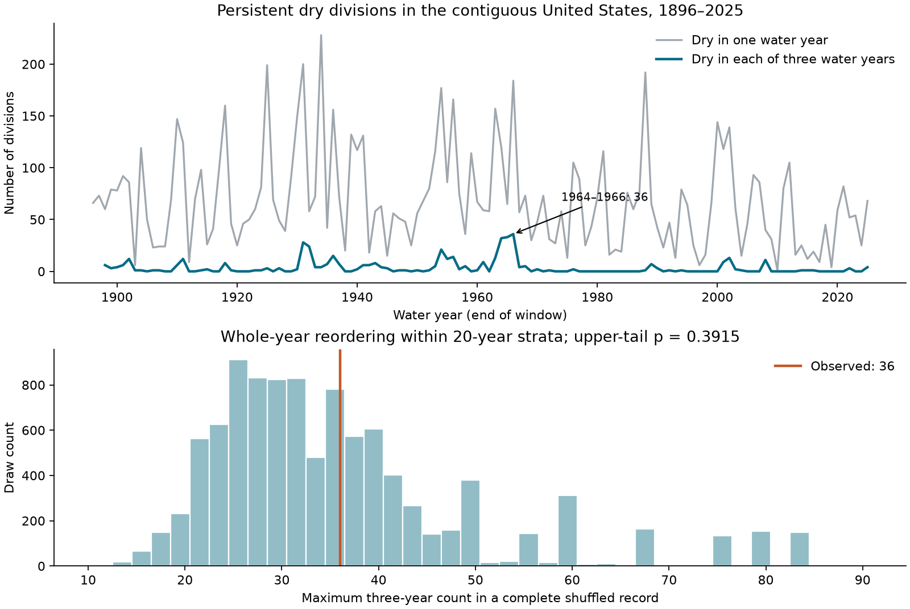
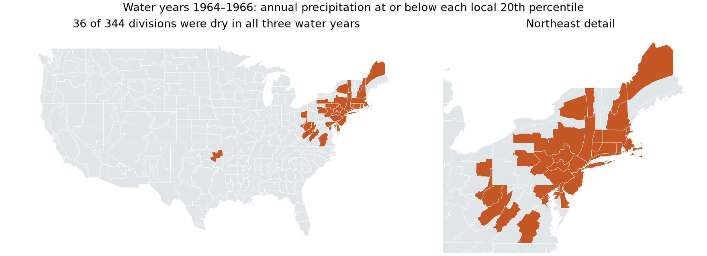
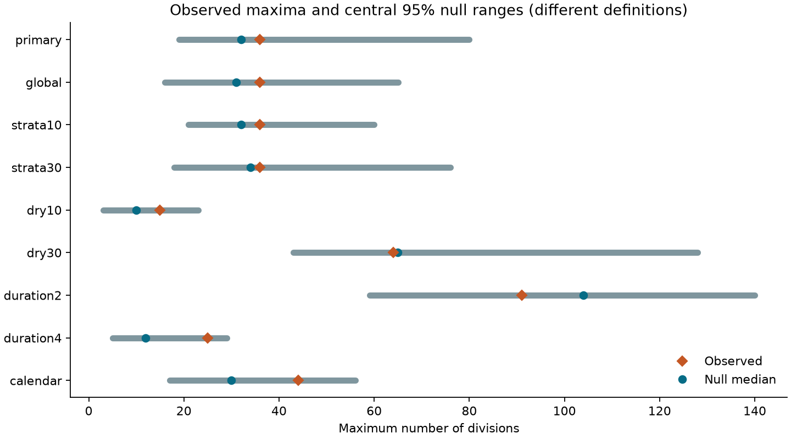

# The largest three-year dry footprint across 344 US divisions was within a shuffled-year range in 1896-2025

The largest count of climate divisions that were dry in each of the same three consecutive water years was 36. The event ran from water year 1964 through 1966. It included 10.47% of the 344 divisions in the contiguous United States. These are shares of divisions, not shares of land area.

This maximum was within the central 95% range of 19 to 80 divisions from the primary year-order reference. The reference median was 32 divisions. Of 9,999 shuffled records, 3,914 had a maximum at least as large as 36. The upper-tail randomization p value was 0.3915. Thus, this test found no clear excess in the observed maximum. It does not show that annual precipitation is independent or that water systems have no memory.



Figure 1. The top panel shows counts of dry divisions in individual water years and in three consecutive water years. A division enters the three-year count only if it is dry in all three years. The date is the last year in the window. The bottom panel shows the largest three-year count in each of 9,999 complete shuffled records. It uses one maximum per record. It does not treat adjacent windows as independent observations.

## Question and contribution

Can the order of annual precipitation fields explain an unusually large common footprint of persistent dry years? A large footprint can limit access to water from other regions at the same time. We test the largest count across a fixed 130-year record. We compare it with records that preserve national patterns within each year but change the order of years.

We define a dry water year as annual precipitation at or below a division's full-record 20th percentile. We use three separate annual tests. We do not classify a dry event from an overlapping three-year precipitation total. Adjacent candidate windows still overlap. We account for the search across these windows by recalculating the complete-record maximum in every shuffled record.

The contribution is a fixed national benchmark, a direct test of persistent footprints, and a reusable evidence package. It is a null result under a specified reference. It is not a new physical explanation for drought.

## Prior work

[Andreadis and colleagues (2005)](https://doi.org/10.1175/JHM450.1) studied drought extent, severity, and duration with modeled soil moisture and runoff. Their results place the 1930s and 1950s among the major broad droughts of the twentieth century. [The 2022 study of extensive US droughts](https://doi.org/10.1175/EI-D-21-0021.1) used tree-ring PDSI records and required broad events to last at least three years. These works show that broad persistent drought is already known. Our precipitation-only count uses another definition and a year-order test. It does not revise their drought rankings.

[Nguyen and Ombadi (2026)](https://doi.org/10.1029/2025WR041240) studied drought synchronicity in 20 US regions with precipitation and atmospheric water demand. They tested several time scales and climate predictors. Our reference retains the full observed spatial pattern in each year. It therefore asks about year order after conditioning on these patterns. It does not compare divisions with independent spatial events or test a climate driver.

[Annual memory in the terrestrial water cycle (2025)](https://doi.org/10.5194/hess-29-1319-2025) distinguishes weak annual precipitation memory from stronger memory in water stores. That distinction is necessary here: this study measures rainfall and snow water input, not recovery of stored water.

Campaign searches included `earthquake ocean drought hydrology`, `drought persistence overlap`, and `drought national divisions`. We read the signed [California persistence study](sci:sha256:1ffb84a5a2479e4f58987d90d6ccb269aab3323e3ce0c1fe049febe2548d413f) and [national dry-year correlation study](sci:sha256:70823f9e49a05939288e0d0dabbe07732fa6fadb8fe09aecf0f8a7c50ff6f4e0). The first already tests correlation caused by overlapping totals. The second tests a change in mean pair correlation between two periods. This study instead tests a maximum persistent count over the full record. We reuse public shared precipitation bytes and the second study's verified NOAA format document. All analysis code is new. No sibling private workspace was used.

## Data and fixed scope

We use NOAA nClimDiv monthly precipitation v1.0.0, file date 20261006. We include all 344 divisions in state codes 01-48. NOAA derives division means from station-based gridded estimates. The [source method paper](https://doi.org/10.1175/JAMC-D-13-0248.1) and the [saved NOAA format document](files/raw/divisional-readme.txt) describe the product. Monthly amounts are in hundredths of an inch and include the water equivalent of snow.

A water year starts in October of the previous year and ends in September of the named year. We use 130 complete water years, 1896-2025. We exclude water year 2026 to match earlier campaign work and avoid the latest water year. All required monthly values are nonnegative and present. No division is dropped. The code sums integer hundredths of an inch. It does not split tied totals through floating-point summation. [annual.csv](files/results/annual.csv) gives all 44,720 division-year records. Each record also gives a calendar-year total for a planned check.

The precipitation input was read in place at:

```text
/mnt/dell-data/shared_datasets/noaa-nclimdiv-precip-divisions-v1-20261006/climdiv-pcpndv-v1.0.0-20261006.txt
```

Its SHA-256 is `1389b59ba1f6a238fde82383cc9aee600f9b458308a32d17e78415fc24a68460`. The complete source snapshot is supplied for a repeat without network access. The map uses the existing shared NOAA climate-division geometry ZIP. Its SHA-256 is `edcfadfd390f41eafb8cd4e112d3ead7444a25e505f43fa29107f0c64516aeb3`. Geometry is used only for names and display. It has no effect on any count or test. [provenance.json](files/provenance.json) gives both exact shared paths, source URLs, versions, helper records, hashes, and the map reduction rule. No shared dataset was changed.

## Method and assumptions

The [local plan](files/analysis_plan.txt) was saved before annual drought flags and national event results were computed. It is an internal plan, not an external registration. All planned checks are reported.

Let B(y,d) equal one if precipitation in year y and division d is at or below that division's 20th percentile over the 130 water years. We use the NumPy linear quantile method. Ties remain dry together. Each division has 26 to 28 dry years, rather than an exact common count of 26. Thresholds use the full record. They are retrospective definitions, not historical forecast inputs. The measure is not a fitted Standardized Precipitation Index.

For a window that starts in year y, the primary count is:

```text
C(y) = sum over divisions d of B(y,d) * B(y+1,d) * B(y+2,d)
T = maximum C(y) over 128 windows, 1896-1898 through 2023-2025
```

The same division must be dry in every year. The divisions need not form a connected region. The count gives every division equal weight. It is not a water volume, population exposure, farm area, or US land-area fraction.

For the primary reference, we divide the annual record into consecutive 20-year strata, starting in 1896. The last stratum, 2016-2025, has ten years. Each draw randomly reorders years only within each stratum. All 344 values in a year move together. This preserves each year's dry pattern, all spatial dependence in that field, each local dry frequency, and each stratum's distribution. It removes order within strata. Windows can cross stratum boundaries. We use no circular wrap at the record ends.

We make 9,999 draws, with seed 1107891. For each draw we calculate all windows and then the maximum. The one-sided upper-tail p value is `(1 + number of null maxima >= observed maximum) / 10000`. The primary decision level is 0.05. The maximum accounts for the search over dates. It does not account for changing the drought definition. The Monte Carlo standard error of the primary p value is about 0.0049. Null quantiles describe reordered records; they are not confidence limits for the observed count or future predictions.

The inference requires years to be exchangeable within each stratum under the reference. Twenty-year strata retain some slow distribution differences, but they do not model trends, ocean states, or serial dependence within a stratum. Thus, the reference is a conditional statistical explanation, not a physical climate model. The result cannot prove a general absence of memory.

## Results and checks

The primary maximum was 36 divisions in water years 1964-1966. The count was 33 in 1963-1965 and 32 in 1962-1964. The peak divisions were in 14 states, mainly in the Northeast. New York and Pennsylvania each supplied six divisions. The [division table](files/results/peak_divisions.csv) gives each threshold, each of the three annual totals, and the flag for every division. [peak_names.csv](files/results/peak_names.csv) gives the 36 selected names.



Figure 2. Orange marks divisions that were dry in all three water years, 1964-1966. Gray marks other divisions. The right panel enlarges the Northeast. This longitude-latitude display is not an equal-area map. The source boundaries are reduced for display only. The event also includes one division in Oklahoma; the test does not require spatial connection.

The primary null mean was 36.10 divisions and its median was 32. The central 95% range was 19-80 and the 95th percentile was 67. The observed count of 36 was near the reference mean. In contrast, the largest one-year dry count was 228 divisions in 1934. Reordering keeps that one-year maximum exactly fixed. A broad single-year deficit does not require a broad intersection of three annual dry fields.

| Planned setting | Observed maximum | Peak window | Null median | Central 95% null range | Upper-tail p |
| --- | ---: | --- | ---: | --- | ---: |
| Primary: 20-year strata | 36 | 1964-1966 | 32 | 19-80 | 0.3915 |
| Global year shuffle | 36 | 1964-1966 | 31 | 16-65.05 | 0.3502 |
| 10-year strata | 36 | 1964-1966 | 32 | 21-60 | 0.2905 |
| 30-year strata | 36 | 1964-1966 | 34 | 18-76 | 0.4536 |
| 10th-percentile dry years | 15 | 1964-1966 | 10 | 3-23 | 0.2325 |
| 30th-percentile dry years | 64 | 1964-1966 | 65 | 43-128 | 0.5526 |
| Two consecutive years | 91 | 1930-1931 | 104 | 59-140 | 0.6245 |
| Four consecutive years | 25 | 1962-1965; 1963-1966 | 12 | 5-29 | 0.0717 |
| Calendar years | 44 | 1963-1965 | 30 | 17-56 | 0.1192 |

All counts in this table use equal division weights. The quantile 65.05 is an interpolation between integer null scores. Each row changes only its named feature from the primary setting. All use 9,999 draws. The checks are not independent studies, and their p values have no multiple-test adjustment. No separate discovery is claimed from them.

An equal-state check gives each state total weight 1/48, split equally among its divisions. Its maximum was 0.17957, again in 1964-1966. The null median was 0.10718, the central 95% range was 0.05169-0.21133, and p was 0.0929. This weight rule gives more weight to states with few divisions. It still does not measure land area. The four-year and equal-state checks are closer to the upper reference tail than the primary result. This sensitivity limits any broad interpretation of the null result.



Figure 3. Orange diamonds show observed maxima. Blue dots show null medians. Lines show central 95% null ranges. Each row uses its stated definition. The state-weighted fraction has a different unit and is omitted from this count plot. [summary.json](files/results/summary.json) gives exact results for every setting. [null_maxima.csv](files/results/null_maxima.csv) preserves every null score.

## Meaning and limits

For the tested definition, observed year order did not produce a clear excess over a reference that retained annual spatial fields. This is compatible with broad persistent counts arising from the observed annual patterns placed in another order. It is not evidence that all relevant drought dynamics are random. Failure to reject the reference also does not establish equality with it.

The result is conditional on one precipitation product, one fixed period, a local percentile definition, and a maximum-count statistic. It can miss temporal structure that affects other statistics. It does not test deficit severity, migration, connected regions, summer heat, atmospheric water demand, or ocean forcing. Division size and station interpolation affect interpretation. Source revisions and sparse early observations can affect the record. Annual aggregation hides droughts and recoveries within a year. Slow climate variation can violate exchangeability.

Low precipitation is one input to water availability. Soil moisture, snow, groundwater, reservoirs, water use, and evaporation can give a water system memory even when annual precipitation has little memory. This study contains none of those response measurements. It cannot estimate their recovery times, flood risk, crop loss, causal drivers, or future return periods. A useful next test would hold this protocol fixed and use an independent precipitation product and a direct water-storage measure.

## Reproduction and audit

[REPRODUCE.md](files/REPRODUCE.md) gives commands, software versions, and retrieval steps. The source, annual totals, thresholds, flags, exact permutations, null scores, figures, and code are in the package. The original map ZIP need not be downloaded for a repeat.

The [audit](files/results/audit.json) passed. A separate fixed-width parser and Decimal arithmetic checked all 89,440 water-year and calendar-year totals. It checked all 44,720 primary flags, all 128 observed window counts, all 39,996 permutation rows, and all 9,999 primary null maxima. The null calculation used Python integer bit intersections instead of the analysis array method. These checks validate data flow and arithmetic. They do not validate exchangeability or the drought definition.

The [repeat record](files/results/reproduction_check.json) reports exact comparisons from a second run without network access. All substantial computations used `campaign-compute`. Library thread limits were one. [compute_record.txt](files/compute_record.txt) records the commands. All calculations ended before signing.

## Campaign and license

Job: `sci-1107-hp-earth-and-ocean-sciences-aed2f812ba89`. Topic: `earth-and-ocean-sciences`. Campaign: `11_07_2026`. Machine: `hp`. Account: `codex-andrii`. Model: `gpt-6.1-sol`, high reasoning effort, through the Codex harness in T3 Code. No agents were launched. The signing identity is a campaign-machine key. It is not a personal authorship claim. Private keys remain outside this publication. No remote archive or index submission was made.

The SCI baseline license covers the text, figures, derived data, and code as stated in LICENSE. NOAA source material keeps its source status.
