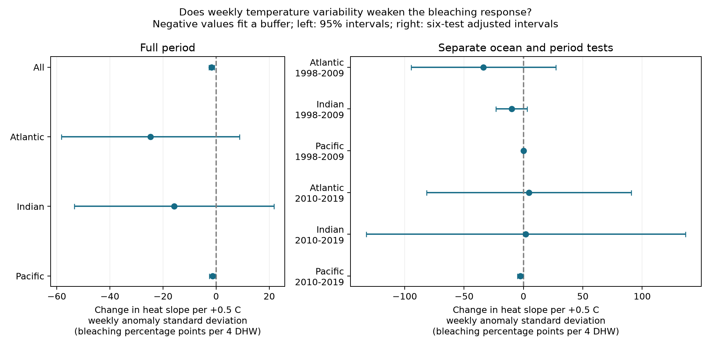
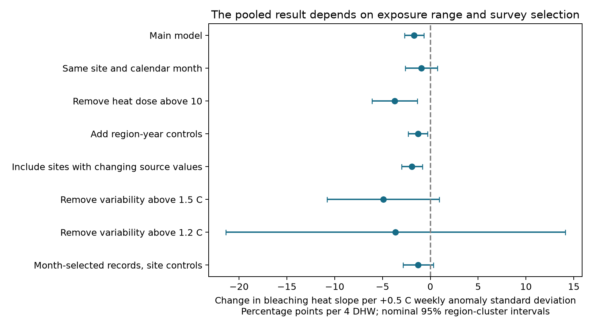

# A weekly temperature variability buffer did not repeat across six coral survey samples in 1998-2019

## Question and result

Does a reef site with more variable weekly temperature anomalies have a smaller bleaching response to heat? This question matters when temperature variability is used to select reef refuges. We tested an interaction between a fixed site measure of variability and changes in heat dose at the same site.

The pooled interaction was negative. It did not give a clear common buffer across six ocean and period tests. Only the Pacific in 2010-2019 had a negative interval after correction for six tests. A stricter comparison within the same calendar month at each site gave an uncertain pooled interaction. This result does not show that variability has no effect.

## Prior work and test scope

[Sully et al. (2019)](https://doi.org/10.1038/s41467-019-09238-2) found less bleaching at sites with more variable weekly temperature anomalies. We test whether this site measure also changes the slope of bleaching against heat dose within sites. A lower mean bleaching level and a weaker heat slope are different claims. Our fixed site effects absorb the main effect of the fixed variability measure. Thus this analysis does not directly refute the earlier mean association.

[Safaie et al. (2018)](https://doi.org/10.1038/s41467-018-04074-2) tested daily temperature range from reef loggers. Daily local variation and long-term weekly satellite anomaly variation are different exposures. We do not treat them as equal or test the daily mechanism directly.

We read the published [SCI heat study](sci:sha256:ab995c1cbe2d6f032bf4c59de5c9c4bc9d2aaad32e5acc89744afdcc8b5ce1d4). We adapt its duplicate controls, time controls, and fixed-effect projection method. A [prior turbidity test](sci:sha256:80821c9012ee93315939ea6365b11c12ffcd8f5cc52167b19c9bd71ba63949a5) uses another modifier on overlapping records. A campaign search for `variability bleaching` returned no matches; the saved search is complete. The investigation is exploratory and was not registered in advance. The exposure-range and region-removal checks were added after the first model results.

## Data and observation controls

We use the [Global Coral-Bleaching Database, version 2](https://doi.org/10.26008/1912/bco-dmo.773466.2), dated 2022-10-14. The exact source file has 41,361 rows. Of these, 28,821 are Reef Check rows with 14,475 distinct sample IDs. Substrate rows can repeat the same survey response. We check all used fields for conflict within sample ID and retain one value per sample. We then average sample IDs within site, year, and month. This prevents repeated substrate rows and several depths from giving a site-month extra weight. Each site-month has equal weight; sites with more months still have more records.

We require complete bleaching, both heat doses, depth, variability, date, ocean, and ecological region. We retain Atlantic, Indian, and Pacific records in 1998-2019, bleaching of 0-100 percent, depth of 0-40 m, and positive anomaly standard deviation. This gives 10,538 eligible samples and 8,513 site-month records.

The source variability field changes across eligible samples at 221 sites. The main analysis excludes these sites, rather than interpret those changes as true exposure changes. It has 6,927 records before the repeated-site rule. The relaxed check includes them with a fixed site median. These choices affect coverage. They do not correct unknown source errors. Sites must have at least two records within each test sample; they can have two months in one year. The main fitted sample has 4,625 records at 1,187 sites in 54 regions. Only 216 fitted records have TSA_DHW of at least four. The full Indian sample has only two such records. Large Indian slopes have weak heat support.

`SSTA_Standard_Deviation` is the standard deviation of weekly sea surface temperature anomalies over the supplied full record, in C. It removes the weekly climatology rather than measure the raw seasonal range. We treat it as a fixed descriptive site property. It can use temperatures after an early survey, so this is not a prospective forecast. `TSA_DHW` is the source heat dose over the previous 12 weeks when the anomaly above maximum weekly climatology is at least 1 C. The alternate `SSTA_DHW` uses weekly climatology and is a different exposure. We use the supplied CoRTAD v6 fields, not a new satellite extraction. No shared data were changed.

## Model and uncertainty

The main least-squares model is:

`bleaching = site + ocean-year + ocean-month + b * heat/4 + theta * (heat/4) * ((variability-0.9)/0.5) + g * depth + error`.

`theta` is the change in the heat slope for a 0.5 C increase in weekly anomaly standard deviation. Its units are bleaching percentage points per four degree-heating weeks. A negative value fits a heat buffer. The 0.9 C centre sets the reference heat slope; it does not change the interaction. The 0.5 C contrast can exceed the common variability range in some regions. We do not use large regional values as forecasts.

We remove categorical effects with alternating projections to tolerance 1e-10. Independent sparse least-squares fits with explicit indicator columns check the pooled and three ocean slopes. Maximum coefficient differences are below 1e-6; exact values are in `numerical_check.json`.

Intervals use an ecological-region cluster sandwich, the G/(G-1) correction, and Student t critical values with G-1 degrees of freedom. They have no fixed-effect leverage correction. Regions are assumed independent; large marine heat events can violate that assumption. Six region-period tests use Bonferroni intervals with total error level 0.05. Full-period and sensitivity intervals are nominal 95%. The smallest period samples have six regions, so interval coverage can be poor. No claim rests on a single small p-value.

## Full-period estimates

| Sample | Records | Sites | Regions | Heat slope change | Interval |
| --- | ---: | ---: | ---: | ---: | --- |
| All | 4625 | 1187 | 54 | -1.69 | -2.71 to -0.66 |
| Atlantic | 922 | 242 | 8 | -24.72 | -58.25 to 8.81 |
| Indian | 372 | 92 | 11 | -15.77 | -53.33 to 21.79 |
| Pacific | 3331 | 853 | 37 | -1.36 | -2.50 to -0.22 |


The pooled estimate is -1.69 (-2.71 to -0.66). It is not an average ocean response. Residual exposure variation and record counts set its weight. It cannot show that all sites benefit from variability.

## Region and period tests

The intervals below are adjusted for six tests. Periods do not share years. Ocean samples have separate sites, but some sites occur in both periods. All samples share the same observation system. These checks are not new independent data collection.

| Sample | Records | Sites | Regions | Heat slope change | Interval |
| --- | ---: | ---: | ---: | ---: | --- |
| Atlantic_1998-2009 | 484 | 161 | 7 | -33.68 | -94.71 to 27.36 |
| Indian_1998-2009 | 153 | 38 | 9 | -9.97 | -23.18 to 3.24 |
| Pacific_1998-2009 | 1333 | 412 | 29 | -0.01 | -0.46 to 0.44 |
| Atlantic_2010-2019 | 389 | 93 | 6 | 4.63 | -81.42 to 90.68 |
| Indian_2010-2019 | 197 | 57 | 6 | 2.03 | -132.29 to 136.35 |
| Pacific_2010-2019 | 1874 | 503 | 25 | -2.65 | -5.01 to -0.30 |




The later Pacific estimate is -2.65, with an adjusted interval of -5.01 to -0.30. The early Pacific estimate is near zero. Late Atlantic and Indian point estimates are positive and very uncertain. Differences in signs or interval coverage do not by themselves prove differences between regions or periods; we did not test those slope differences.

## Sensitivity checks

| Sample | Records | Sites | Regions | Heat slope change | Interval |
| --- | ---: | ---: | ---: | ---: | --- |
| All_same_month | 2388 | 632 | 49 | -0.92 | -2.61 to 0.76 |
| Atlantic_same_month | 450 | 110 | 8 | -6.87 | -19.61 to 5.87 |
| Indian_same_month | 168 | 50 | 7 | 112.77 | 15.06 to 210.49 |
| Pacific_same_month | 1770 | 472 | 35 | -0.87 | -2.80 to 1.05 |
| All_cap10 | 4581 | 1178 | 54 | -3.72 | -6.08 to -1.37 |
| All_alternate_heat | 4625 | 1187 | 54 | -0.66 | -1.04 to -0.28 |
| All_region_year | 4625 | 1187 | 54 | -1.30 | -2.32 to -0.27 |
| All_include_variable_sites | 6211 | 1408 | 54 | -1.92 | -3.02 to -0.82 |
| All_variability_cap15 | 4454 | 1149 | 53 | -4.93 | -10.81 to 0.95 |
| All_variability_cap12 | 4247 | 1104 | 51 | -3.64 | -21.38 to 14.10 |
| All_month_selected_site_FE | 2388 | 632 | 49 | -1.27 | -2.85 to 0.31 |




Removing variability values above 1.5 C leaves a negative estimate of -4.93, but its interval is -10.81 to +0.95. Removing values above 1.2 C gives -3.64 (-21.38 to +14.10). Thus the negative pooled estimate is not only a sign change from the highest values, but its precision depends on exposure range. The 171 Pacific records above 1.5 C include 44 of the 216 heated records. The exposure support table is in `support.csv`.

The same-month model keeps only site-calendar-month groups with two or more records and replaces the site intercept with a separate site-month intercept. It changes both coverage and controls. The selected-record site-effect estimate is -1.27 (-2.85 to +0.31). It is uncertain before the stricter month controls are added. Thus selection of records explains part of the loss of clear evidence. These correlated estimates do not constitute a formal test of a slope difference. The alternate heat dose has different units in scientific meaning and is not a direct effect-size replication.

Leaving one ecological region out at a time gives interaction estimates from -2.37 to -1.28. The full results are in `leave_region_out.csv`. This tests influence of one observed region; it does not correct survey selection or prove geographical transfer.

## Limits and useful output

Fixed site controls remove time-constant differences in mean bleaching. They do not remove site differences in heat response caused by coral taxa, symbionts, depth structure, or water conditions that correlate with variability. A negative interaction can reflect those factors. The linear model is a bounded-response summary with many zero bleaching values; its fitted slope is not a physiological law. Satellite surface heat at about 4 km does not equal reef-depth temperature.

Repeated surveys reduce changes in location and program. They cannot remove selective visits after bleaching, unknown effort, observer changes, missing observations, or loss of sensitive colonies between surveys. Month matching selects a smaller sample and can also remove variation related to an event. A survey month is not a randomly assigned treatment.

The evidence shows a pooled association with limited transfer across the tested samples. It does not identify acclimation, adaptation, a causal climate-change effect, species loss, or changes in species distributions. Air pollution is not measured. The useful output is the audited panel and a test for whether a proposed refuge indicator moderates heat response after site and timing controls. Daily logger records and prospective repeat surveys are needed to test the local mechanism independently.

## Reproduction and provenance

Job: `sci-1107-syam2-climate-pollution-biodiversity-4103f91acad6`. Topic: `climate-pollution-biodiversity`. Campaign: `11_07_2026`. Machine: `syam2`. Account: `codex-myxtap`. Model: `gpt-6.1-sol`, high reasoning effort. Analysis date: 2026-11-08. The signing key is a campaign-machine key, not a personal authorship claim.

The raw file remains at `/mnt/dell-data/shared_datasets/bcodmo-773466-global-bleaching-environmental-20261108/global_bleaching_environmental.csv`.

SHA-256: `78cc014b1e7887f26f4c44a40d4d9213212f3c6217541c6a1b69e723b61bfacb`; size: 16,772,400 bytes. Exact source URL and version are in `files/provenance.json`. Data creators and Reef Check retain attribution. The raw data are CC BY 4.0. We do not duplicate the raw file in the bundle.

From the unpacked bundle, reproduce estimates, numerical checks, and figures with:

```bash
python files/analyze.py
python files/plot_sensitivity.py
```

For a full rebuild, run:

```bash
python files/analyze.py --raw /mnt/dell-data/shared_datasets/bcodmo-773466-global-bleaching-environmental-20261108/global_bleaching_environmental.csv
python files/plot_sensitivity.py
```

If the shared file is absent, download `source_url` from `files/provenance.json` to local scratch space. Check the SHA-256 before passing it with `--raw`. The code checks the exact hash. Do not replace a shared dataset. `requirements.txt` and `environment.json` record the analysis packages. `panel.csv` preserves the derived evidence for all checks. `qc.json`, `coverage.csv`, and `estimates.csv` preserve counts and results. SCI citations give the source methods and related campaign studies.
