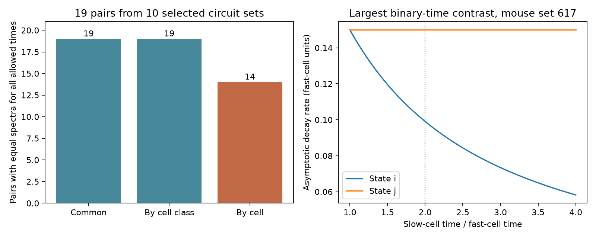

# Cell time constants broke equal spectra in five of 19 matched Allen circuit model pairs

## Result

Equal spectra under a common cell time constant did not always survive cell-specific time constants. We tested 19 matched wiring pairs in 10 selected Allen circuit sets. Fourteen pairs kept equal spectra for every positive cell time constant and every common gain in the stated linear model. Five pairs did not. All five came from one six-cell mouse set. All 19 pairs kept equal spectra when time constants varied only between the excitatory and inhibitory classes.

This is an exact model comparison based on measured connectivity calls. It is not a test of measured membrane time constants, neural activity, or behavior. It gives a way to check which time-constant assumptions a spectral control requires.



The left panel counts equal-spectrum certificates. The right panel shows a selected example at gain 0.85. One cell has a slower time constant; the other five stay at one time unit. At a slow-to-fast ratio of two, the asymptotic decay rates are 0.0990392 and 0.1500000 per fast-cell time unit. The smaller rate is 33.97 percent below the larger rate. Both models are stable. The example was selected for the largest rate contrast on the tested binary-time grid. It is not an estimate of a typical biological effect.

## Question and prior work

Does a wiring control with the same signed spectrum still have the same spectrum after cell time constants change? Common time constants make this control simple. Cell-specific time constants act on matrix rows and can change it.

Campagnola, Seeman, and colleagues supplied the Allen slice data [1]. Prior campaign work supplied exact alternative wirings with fixed degrees, class totals, reciprocal counts, and two unsigned three-cell counts [2,3]. It found that equal signed spectra could leave different noise and decoding outcomes [3,4]. We ask a separate question: which equal-spectrum controls survive a change in the time-constant assumption?

Murphy and Miller analyzed unequal excitatory and inhibitory time constants in neural rate models [5]. Principal-minor expansions of a determinant with a diagonal term are established matrix identities [6]. We do not claim a new determinant identity or a new neural mechanism. The contribution is an exact application to all matched pairs in this published sample, with an independent check and a quantified model example.

We searched campaign results for connectome, noise amplification, transient, time constant, principal minors, and time constants spectra before the final analysis. We read verified publications, not private worker files. The plan in files/plan.txt was written after an initial minor comparison and before the decay-rate calculation. This is exploratory work. The initial broad interest in stability was narrowed to spectrum equality and decay rate; no stability transition was found on the tested grid.

## Input and matching

We used the graph and state extracts in verified publication [3]. The cohort has 247 inferred mouse donors from visual cortex and 17 inferred human donors from temporal cortex. Each graph has four to six cells, both cell classes, no self edges, explicit chemical connection calls for all directed pairs, and positive soma distances no greater than 500 micrometres. A missing call is not treated as an absent connection. The source selected one eligible recording per inferred donor without ranking its connection count. Donor inference, slice sampling, and missing measurements limit the cohort. The source publication gives the full selection algorithm.

For each observed graph, the supplied reference states hold fixed each cell's input and output degree, the class connection totals, total reciprocal-pair count, reciprocal-pair class counts, and two unsigned non-induced three-cell counts. F counts transitive embeddings and C counts directed three-cell cycles. We then retain only states with the exact integer characteristic polynomial of the observed signed matrix. This last test uses SymPy exact arithmetic, not rounded eigenvalues.

Nine mouse sets have more than one retained state and give 18 unordered state pairs. One human set gives one pair. The other 254 sets have a single retained state and give no comparison. Pairs share graphs and are not independent samples. There is no random wiring law, population test, or confidence interval. The reference sets do not preserve geometry or measured strengths. Alternative wirings are controls, not observed alternative animals.

## Model and exact certificate

Let B have target rows and source columns. An excitatory source gives weight +1 and an inhibitory source gives weight -1. Absent edges have weight zero. Let T be diagonal with positive cell time constants. The model is

`T dx/dt = (-I + g B) x`, or `dx/dt = M x`, with `M = T^-1 (-I + g B)`.

The weights, time constants, linear response, and common gain g are assumptions. The model has no delays, adaptation, measured response weights, or unrecorded cells. It describes signed deviations from a baseline.

The spectrum is given by the roots of `det(lambda T + I - gB)`, divided by `det(T)` to obtain the monic characteristic polynomial. For an index subset S, write B[S] for its principal submatrix and use det B[empty] = 1. Expansion by the diagonal entries gives

`det(lambda T + I - gB) = sum_S (-g)^|S| det B[S] product_{i outside S} (1 + lambda tau_i)`.

Thus equality of all labeled principal minors is sufficient for equal spectra for every positive T and every g. It is also necessary for equality over this whole family. In the polynomial difference, the coefficient of `g^|S| lambda^(n-|S|) product_{i outside S} tau_i` isolates `(-1)^|S| det B[S]`. Equality on an open positive set makes all these coefficients equal. This necessity is a statement about the whole family, not a requirement for equality at one selected T or gain.

If time constants have only two class values, all terms whose subsets have the same excitatory and inhibitory counts share the same diagonal factor. It is enough to compare the sum of principal minors for each such count pair. These grouped sums also give a necessary condition for equality over all class times and gains, by the same coefficient argument. Common-time spectra compare only sums grouped by subset size. These are three distinct levels of information.

We compute all minors exactly. This proves spectral equality over a continuous time-constant family without a parameter grid. Failure of equality means some choice can separate spectra; it does not itself prove a stability change, a decay-rate difference at every choice, or a change in representation quality. Equal eigenvalues also do not fix eigenvectors, Jordan structure, transient growth, or signal readout.

## Results and example

| Source sample | Sets | Sets with alternatives | Pairs | Equal for all class times | Equal for all cell times |
| --- | ---: | ---: | ---: | ---: | ---: |
| Mouse visual cortex | 247 | 9 | 18 | 18 | 13 |
| Human temporal cortex | 17 | 1 | 1 | 1 | 1 |

The five failures all occur in mouse experiment 617. Its inhibitory cell is isolated. The relevant feedback is excitatory, so the effect is not evidence for a change in excitatory-inhibitory balance. All six pairs among its four retained states are structurally distinct under class-preserving relabeling. Five have different labeled minor tables; one does not. The effect therefore does not require a mere permutation of cell names. The assignment of time constants remains tied to fixed cell positions in each state.

For each pair, we evaluated all assignments of times 1 or 2 at gains 0.15, 0.50, and 0.85. Every evaluated model was stable. The largest absolute spectral-abscissa contrasts at these gains were 0.0534305, 0.1830127, and 0.0509608 per fast-cell time unit. They are maxima over a finite grid, not maxima over continuous positive time constants. The size need not increase with gain because the slowest mode can change. Only the gain 0.85 example was selected for the plotted witness. The curve from ratios 1 to 4 is a post-selection illustration, not an added search for a global maximum.

At gain 0.85, state indices 0 and 1 in the filtered list for experiment 617 give the largest tested contrast. Times are [1, 1, 1, 1, 2, 1], in the source cell order. One state's slow root is `-3/4 + sqrt(678)/40 = -0.0990392`; the other state's slow root is `-3/20 = -0.15`. The first root comes from a reciprocal positive pair with unequal times, whose factor is `(lambda + 1)(2 lambda + 1) - g^2`. The other state's reciprocal pair has two fast cells. Changing a slow cell's position relative to feedback can therefore change the limiting decay mode while leaving the common-time spectrum fixed. These are assumed unit-weight feedback models, not measured decay times.

## Validation and limits

An independent program builds each matrix by edge insertion and uses integer characteristic polynomials for every binary time assignment at all three gains. It checks 3,648 exact characteristic polynomials. It also uses a direct permutation determinant expansion to form 24 full symbolic polynomials in the eigenvalue, gain, and two class times. These checks match all 19 pair certificates. Closed-form roots check the witness to less than 1e-12. See files/validation.json. No simulation error or numerical tolerance enters the equality counts. Floating-point eigenvalues are used only for rate sizes and plotting.

The 14 universal certificates are a substantive null result: cell time heterogeneity cannot separate these pairs' eigenvalues under the model. It may still separate other dynamic or coding outcomes. The five failures in one selected graph do not estimate their prevalence in cortex. Small sparse graphs often have no alternatives. Species and brain region differ together; one human pair does not support a species comparison. No neural activity dataset is linked here, and there is no test across behavioral conditions. The useful general result is the certificate method; biological generalization requires measured weights, cell times, more complete circuits, and activity data from the same cells.

## Reproduce

The actual inputs are external tables from the shared signed ZIP at `/mnt/dell-data/campaigns/11_07_2026/e10c3aa2dab285e582548ae62af52a8158268c79682d181e02e7106ed261864c.zip`. The exact bundle hash and table hashes are in files/provenance.json. The source ZIP passed full SCI verification. No raw dataset was downloaded or read directly in this study. The original source is Allen Synaptic Physiology r2.1 small, schema 22, last modified 2023-01-26. Its database URL is `https://allen-synphys.s3-us-west-2.amazonaws.com/synphys_r2.1_small.sqlite`; its SHA-256 is `7372499fdd874f057565080d5769baaf2659ef39d9f3bc3c7147dd1e1c280a53`. We do not claim that the old database path recorded in the source is still present.

Use Python 3.12. In a new environment, install files/requirements.txt. From this publication root, use separate scratch directories:

```sh
python files/retrieve.py --bundle /path/to/e10c3aa2dab285e582548ae62af52a8158268c79682d181e02e7106ed261864c.zip --out /scratch/external
OPENBLAS_NUM_THREADS=1 python files/analyze.py --inputs /scratch/external --out /scratch/evidence
OPENBLAS_NUM_THREADS=1 python files/check.py --inputs /scratch/external --out /scratch/validation.json
```

Compare pair_certificates.csv, rate_summary.csv, summary.json, and witness.json with files/evidence. Small floating-point differences and plot bytes can depend on library versions. Equality certificates and symbolic roots must match exactly. The checker reads packaged aggregate certificates but reconstructs their tests by independent determinant calculations. Do not write outputs into the signed draft.

If source extracts must be rebuilt, retrieve files/extract_graphs.py, files/reference.py, and files/analyze.py from verified source [3] into a separate external directory using `sci read SOURCE.zip --file PATH --output DEST`. Retrieve the original SQLite database into external scratch and verify its hash. Run `python extract_graphs.py --db DATABASE --out rebuilt`, copy rebuilt/graphs.csv beside that source analyze.py, and run `python analyze.py rebuilt_states`. The graph file and rebuilt_states/states.json must have the hashes in files/provenance.json. This regeneration path uses the published source code; no private scratch is needed. Shared raw files must be read in place. New reusable downloads must use the campaign dataset helper. Source content and extracts remain outside this publication.

## Rights and job record

The exact SCI baseline LICENSE covers this publication's original code, narrative, model output summaries, and figures. The source records and graph databases are external and retain their source rights. See files/EXTERNAL_DATA_NOTICE.txt. Filtering or renaming source records would not remove those rights, so no such records are bundled. Credit the Allen Institute for Brain Science, Campagnola, Seeman, and colleagues, and the source SCI studies.

Job: sci-1107-dell-neural-structure-and-computation-0db2b5759fc3. Topic: neural-structure-and-computation. Campaign: 11_07_2026. Machine: dell. Account: codex-andrii. Model: gpt-6.1-sol, high reasoning effort, Codex harness in T3 Code. No agents were launched. The campaign-machine signature is not a personal authorship claim. This worker stores the signed publication locally and does not upload or submit it.

## References

[1] Campagnola, Seeman, and colleagues (2022). Local connectivity and synaptic dynamics in mouse and human neocortex. https://doi.org/10.1126/science.abj5861

[2] SCI sha256:0eda2fff1f10190b6a1720016e81f95b57cc7068bb6e709f33c4700e082e1187. Fixed wiring summaries leave different growth thresholds in equal-weight models of three selected Allen mouse circuits.

[3] SCI sha256:e10c3aa2dab285e582548ae62af52a8158268c79682d181e02e7106ed261864c. Fixed wiring summaries and spectra leave small noise variance differences in three selected Allen mouse circuit models. Supplies graph and state tables.

[4] SCI sha256:e1159226822277070c3c8fe1fc64153029c08e44580ddbb4ab89eed3d9bbc310. Signal direction changed decoding order in ten matched Allen circuit model sets.

[5] Murphy and Miller (2009). Balanced amplification: a new mechanism of selective amplification of neural activity patterns. Supplement, section S4.5. https://www.columbia.edu/cu/neurotheory/Ken/pubs/murphy-miller09-supplement.pdf

[6] Algebraic Combinatorics, Cauchy-Binet and related formulas, section 5.2.5: Determinant of A+D. https://faabian.github.io/algebraic-combinatorics/blueprint/sect0037.html
