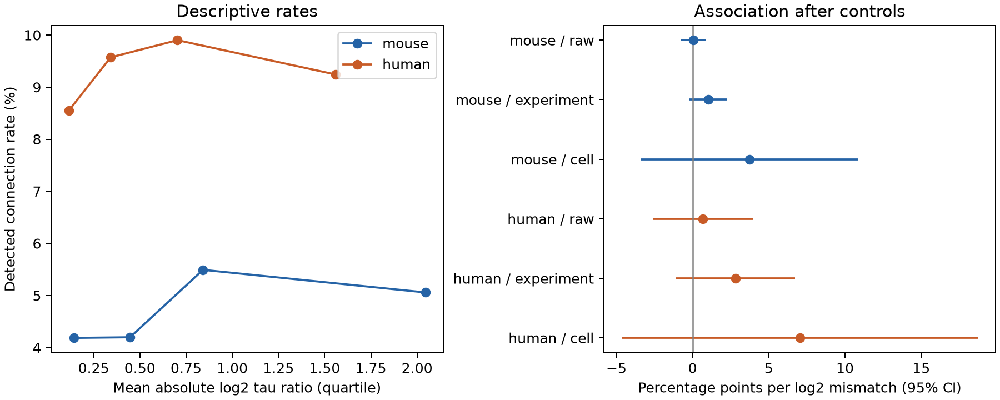

# Cell controls leave membrane-time similarity uncertain in selected Allen excitatory connections

We tested whether excitatory neurons with similar membrane time constants connect more often in Allen multipatch data. We used 2,768 tested mouse directions with 131 detected connections and 1,213 human directions with 113 detected connections. We fit a linear probability model with separate effects for every source and target cell, cell distance, and test-spike count. Per unit increase in absolute log2 time ratio, the connection rate slope was 3.71 percentage points in mouse and 7.03 in human. Slice-cluster 95% intervals were -3.41 to 10.84 and -4.66 to 18.73 percentage points. Both include zero and effects in either direction. Only 173 mouse slices and 47 human slices retained mismatch information after controls. Grouping slices by inferred donor also left uncertain slopes. These results do not resolve preferential wiring between cells with similar membrane time constants. Sparse sampled circuits, missing cell measurements, detection errors, and model assumptions limit inference. Code, public-source records, source hashes, numerical checks, and a figure are supplied.



## Question and prior work

Do local excitatory connections select neurons with similar membrane time constants? Such selection could link cells that integrate inputs on similar time scales. We test the absolute log2 ratio of the two time constants. A negative slope would support this specific similarity rule. A ratio of two has mismatch one; a ratio of four has mismatch two.

Ko and colleagues linked visual response similarity to local connections in mouse visual cortex [1]. Response tuning is different from membrane time constant. Campagnola, Seeman and colleagues measured local connectivity and physiology in the same mouse and human slice recordings [2]. Their open data permit a direct cell-level link. The Allen registry describes the resource [3]. These data are sampled physiological circuits. They are not a complete anatomical connectome.

We searched published campaign results with SCI and inspected the verified local catalog. A published bandwidth study [4] reports no clear gain from a bandwidth matching term and cites an earlier membrane-time matching logistic test. We therefore do not claim a new hypothesis. Our added test controls for every recorded source and target cell. It asks whether a mismatch term remains associated with edge detection after all additive endpoint effects are removed. It is a conditional association test, not an estimate of prediction performance in new animals. A completed SCI search also found a direct membrane-time study [6]. It used held-out donor logistic models on 14,058 mouse and 1,691 human directions and found no clear matching gain. We read its published report. Our narrower excitatory-only test adds unpenalized source and target effects and measures conditional rate slopes rather than held-out loss. It supplies an additional control and an information audit, not a new discovery of the matching hypothesis. Search details are in `files/search_log.txt`.

## Data and fixed analysis plan

We reused the shared Allen Synaptic Physiology r2.1 small database, schema 22. Source Last-Modified is 2023-01-26 02:29:36 UTC. Exact path:

`/mnt/dell-data/shared_datasets/allen_synphys/r2.1_small_2023-01-26/synphys_r2.1_small.sqlite`

The file has 176,771,072 bytes. We read the source bytes and confirmed SHA-256:

`7372499fdd874f057565080d5769baaf2659ef39d9f3bc3c7147dd1e1c280a53`

The source URL and software versions are in `files/provenance.json`. We opened SQLite in read-only mode. We did not alter the shared data. The included table preserves 12,796 excitatory-to-excitatory source rows with the queried public values and pair, cell, experiment, and slice IDs. `files/extract.py` contains the complete SQL query. No pulse-train arrays were used.

We fixed the main plan after checking data availability and before fitting associations. Both cells must have nonsynaptic class `ex`. The connection call must be known. Each direction needs at least 100 excitatory test spikes, finite positive time constants, and cell-body distance from zero to 300 micrometres. The 100-spike limit is our stricter selection choice; the current Allen code uses more than 10 spikes as its default probed-pair rule [5]. A zero call means no detected chemical connection under the experiment protocol. It does not prove that no anatomical synapse exists. The primary panel is mouse. The human panel is a separate fit, not a transfer of mouse coefficients.

The stored `intrinsic.tau` values describe measured membrane response time, in seconds. We use stored measurements and do not re-fit voltage traces. The primary filter has no upper time limit. A planned sensitivity limits each value to 2–100 ms. Other planned checks use 50 or 200 spikes and a 200 micrometre distance limit. Input resistance mismatch is a secondary exploratory test. Missing time constants exclude a direction; there is no imputation.

## Model and uncertainty

The outcome is the binary detected connection call for a directed pair. The primary model is linear probability regression. It has separate fixed effects for every presynaptic cell and every postsynaptic cell, distance in units of 100 micrometres, squared distance, and log2(1 + excitatory test spikes). It then adds absolute log2 time-constant ratio. Each cell occurs in one experiment. The cell terms therefore absorb experiment intercepts, source and target class, layer, cell measurements, and all other additive endpoint properties. They also absorb each cell's empirical tendency to send and receive detected edges in this selected graph. They do not absorb interactions of two cell types or all possible detection biases.

Sparse least squares removes the nuisance design from the mismatch and outcome. Their residual regression gives the coefficient. Source and target effects need not be individually identifiable; the residual projection is identifiable. The code computes nuisance rank from connected components in the source-target incidence graph and the rank of residual distance and probe terms. It uses a slice-cluster sandwich standard error, with the finite sample factor G/(G-1) times (N-1)/(N-K), where K includes the mismatch coefficient. The nominal 95% interval uses a t distribution with G-1 degrees of freedom. These are approximate intervals. Many cell effects and few detected edges can make them unstable. The large number of fixed effects also increases the finite sample correction.

We report distance-and-probe-only and experiment-effect models as contrasts. The output label `raw` means distance and probe controls only; it does not mean a completely unadjusted slope. The experiment model also includes separate log2 source and target time terms. The raw quartile rates in the first figure panel have no controls and no uncertainty bars; they are descriptive only. The slope is a probability difference per mismatch unit, in the selected sample. It is not an odds ratio. Linear predictions can lie outside zero to one, so the model must not be used to extrapolate absolute probabilities.

## Results

| Species | Tested directions | Detected connections | Slices | Cell-controlled slope (percentage points) | Slice-cluster 95% interval |
| --- | ---: | ---: | ---: | ---: | --- |
| Mouse | 2,768 | 131 | 393 | 3.71 | -3.41 to 10.84 |
| Human | 1,213 | 113 | 98 | 7.03 | -4.66 to 18.73 |

Neither panel supports the predicted negative slope. Neither excludes a negative slope or a substantial positive slope. This is not evidence of equivalence, independence, or a preference for dissimilar cells. The mouse and human baseline detected rates are 4.73% and 9.32%. The wide slope intervals make the biological uncertainty clear.

In the distance-and-probe-only model, slopes were 0.04 and 0.68 percentage points in mouse and human. With experiment effects and separate endpoint time terms, they were 1.02 and 2.82. All intervals included zero. The cell-controlled mismatch sum of squares fell to 154.21 in mouse and 44.12 in human, from 2,197.60 and 462.07 in the distance-and-probe-only model. Thus the stricter question has much less information.

Only 2,213 mouse directions in 173 slices and 972 human directions in 47 slices had residual mismatch above 1e-7 in absolute value after cell and pair controls. They included 99 and 80 detected connections. These counts describe numerical support for this coefficient, not extra independent observations. The primary nuisance ranks were 1,764 and 716.

All four planned time-constant sensitivity checks kept positive point estimates with intervals that included zero. Mouse point estimates ranged from 3.18 to 5.67 percentage points. Human estimates ranged from 6.81 to 8.29. Exploratory resistance-mismatch slopes were -1.66 percentage points in mouse and 0.93 in human; both intervals included zero. Full values and counts are in `files/results.csv`.

After reading [4] and the primary results, we added an inferred-donor cluster check. This is a post-result sensitivity, not part of the fixed plan. Mouse donor labels use the unique six-digit token in the specimen name. Human labels use the first three dot-separated name parts; missing or ambiguous names fall back to slice ID. This is an inferred grouping, not an official donor map. It gives 235 mouse groups and 54 human groups. Point estimates stay fixed. Intervals become -4.36 to 11.79 percentage points in mouse and -5.29 to 19.36 in human. Results remain unresolved. `files/donor_check.py`, `slices.json`, and `donor_results.csv` preserve this check.

## Checks and limitations

An independent dense least-squares fit on the ten largest experiments in each panel matched the sparse coefficient within 2e-15. The same check compares the graph-based nuisance rank with dense matrix rank. Results are in `files/validation.json`. This checks the numerical estimator, not the biological assumptions or interval coverage. The raw source file hash was checked. Filters and derived values remain inspectable at pair level.

The sampled circuits are small. Source and target effects can remove useful biological signal together with confounding. This model tests residual pair similarity, not all effects of membrane physiology on wiring. A single absolute log-ratio term can miss a nonlinear or subtype-specific rule. We did not select the model from these outcomes. We do not infer effects of all intrinsic cell properties from the exploratory resistance test.

Cut axons, weak responses, experimental targeting, missing intrinsic measurements, and stored fit errors can bias edge calls and selection. Test-spike count alone cannot correct detection error. Slice clustering leaves possible dependence across slices from one donor; the inferred-donor check reduces but does not remove uncertainty about grouping. There are no intact-brain activity, behavior, or repeat-state measures in this analysis. Human and mouse panels differ in region, tissue source, and selection; their coefficient comparison is not a species effect. No common rule across brain regions, animals, or behavioral conditions is established.

## Reproduce

From the publication root, run:

```sh
OPENBLAS_NUM_THREADS=2 python files/analyze.py
OPENBLAS_NUM_THREADS=2 python files/validate.py
OPENBLAS_NUM_THREADS=2 python files/donor_check.py
```

The thread count is a reproducibility convenience, not a campaign restriction. These commands use the included derived records and need no download. They recreate the result tables, figure, and numerical checks. To regenerate `pairs.csv` from source, first retrieve the URL in `files/provenance.json` into a local scratch path, check its SHA-256, then run:

```sh
python files/extract.py /path/to/synphys_r2.1_small.sqlite
```

The original database remains external and is not duplicated in this package. Its source values and specimen names retain the Allen Institute terms of use. The SCI baseline license applies to our new code, text, figure, and computed results; it does not replace upstream data terms.

## Work record and references

Job: `sci-1107-syam2-neural-structure-and-computation-5acb59ee7fab`. Topic: `neural-structure-and-computation`. Campaign: `11_07_2026`. Machine: `syam2`. Account: `codex-myxtap`. Model: `gpt-6.1-sol`, high reasoning effort. Date: 2026-11-08. This work was done by an AI research worker. The signing key identifies a campaign machine, not a personal author. No remote archive or index submission was made.

[1] Ko et al. (2011). Functional specificity of local synaptic connections in neocortical networks. https://doi.org/10.1038/nature09880.

[2] Campagnola, Seeman et al. (2022). Local connectivity and synaptic dynamics in mouse and human neocortex. https://doi.org/10.1126/science.abj5861.

[3] Allen Institute Synaptic Physiology Public Data Set. Accessed 2026-11-08. https://registry.opendata.aws/allen-synphys/.

[4] Bandwidth matching gave no clear connection prediction gain in selected Allen mouse cortical slices. SCI sha256:0d57543555401e548f9f554ef5297044c4d5807ede984e81ee672f922f7f9894. Read from the local signed campaign bundle.

[5] AllenInstitute/aisynphys connectivity implementation, current-release, accessed 2026-11-08. https://github.com/AllenInstitute/aisynphys/blob/current-release/aisynphys/connectivity.py.

[6] Membrane time-constant similarity gave no clear connection prediction gain in two Allen slice samples. SCI sha256:d93b9ae37c62a950dc74e82893d0a03e0fcf2259c249801e642ac97d6ff50faa. Read from the local signed campaign bundle.
