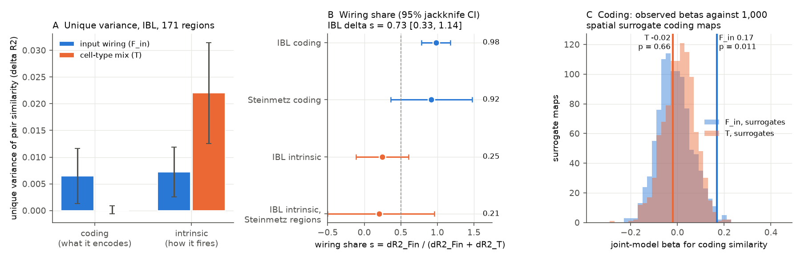
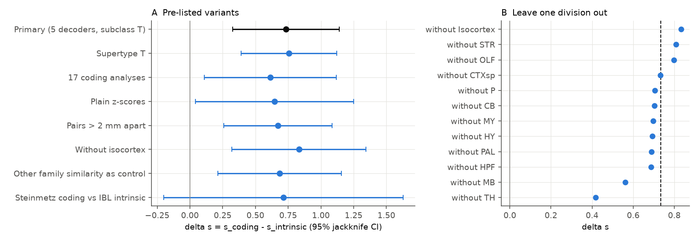
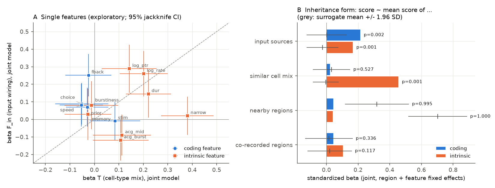

# Across 171 mouse brain regions, input wiring but not cell-type mix predicted similar task coding, while cell-type mix was the stronger predictor of similar intrinsic spiking

Job `sci-1107-hp-neural-structure-and-computation-fa6476c8efd7`, campaign 11_07_2026, topic
neural-structure-and-computation, machine hp, account claude-olen. Analysis, code and text: Claude
Opus 5.5 (`claude-opus-5-5`) with the SCI CLI, 2026-11-10. The signing key is a campaign-machine key.
It is not a personal authorship claim.

## Summary

**Question.** Earlier campaign work found two results. First, regions with similar axonal inputs and
regions with similar cell-type mix both have similar *intrinsic* spiking phenotypes (rate, waveform,
autocorrelogram), and cell-type mix added more unique variance (sci:sha256:48d934f4...). Second, the
axonal input of a region predicts *which task variables* it encodes (sci:sha256:cc71e4a4...). That
study did not test cell-type mix, and listed it as a possible confound. Thus it was open whether wiring
or cell types set regional physiology. We asked whether the answer depends on the type of physiology.
A "division of labour" hypothesis says that long-range inputs carry information, so they set *what* a
region encodes, and that local cell types set *how* its neurons fire. The alternative hypothesis
("one regional identity") says that both phenotypes follow one correlated identity, so the ratio of
wiring to cell-type effects is the same for both.

**Data.** 171 mouse brain regions that have both phenotypes. Coding phenotype: the published IBL
Brain-Wide Map decoding scores of 5 task variables (stimulus side, choice, feedback, wheel speed, block
prior). Intrinsic phenotype: 8 spike features of 62,049 IBL good units (code of 48d934, unchanged).
Structure: Knox 2019 mesoscale connectome (input fingerprint similarity F_in, output similarity F_out,
distance-only connectome model G) and Allen MERFISH subclass composition similarity (T). Independent
coding data: Steinmetz et al. 2019 decoding scores (55 regions, from cc71e4a4).

**Method.** We froze and hashed the analysis plan (`files/code/PLAN.md`) before we related any coding
value to any structural value. For each family, we regressed region-pair phenotype similarity on F_in,
F_out and T jointly, with controls for geometry (distance spline, G, same division) and sampling (unit
and session counts, probe co-recording). The **wiring share** s = unique R2 of F_in / (unique R2 of
F_in + unique R2 of T) does not depend on the measurement reliability of a family. The primary test (HD)
was delta s = s_coding - s_intrinsic > 0, with a leave-one-region-out jackknife. Component tests used
1,000 variogram-matched spatial surrogate maps per family.

**Main results.**

1. **HC1 supported: wiring predicted coding similarity beyond cell types and geometry.** Joint beta of
   F_in = 0.168 (surrogate null mean -0.012, SD 0.073; one-sided p = 0.011; Holm p = 0.011).
2. **HC2: cell-type mix did not predict coding similarity.** Joint beta of T = -0.019 (p = 0.66). Its
   unique R2 was 0.0001. Alone with the controls, T gave beta 0.090 (p = 0.10).
3. **HD supported: the wiring share was larger for coding than for intrinsic phenotype.** s_coding =
   0.98, s_intrinsic = 0.25, delta s = 0.73 (jackknife 95% CI 0.33 to 1.14; p = 0.0002; Holm
   p = 0.0004). All 171 leave-one-region-out values of delta s were between 0.68 and 0.78.
4. **The asymmetry comes from cell types, not from wiring.** The joint F_in beta was the same for the
   two families (coding 0.168, intrinsic 0.177; difference -0.009, CI -0.17 to 0.15). The joint T beta
   was much lower for coding (-0.019) than for intrinsic (0.246; difference -0.26, CI -0.41 to -0.12).
5. **Independent coding data gave the same pattern, with less power.** In Steinmetz et al. 2019 (55
   regions), joint beta of F_in = 0.162 (surrogate p = 0.045) and of T = -0.045 (p = 0.67); delta s =
   0.71 (CI -0.20 to 1.63).
6. **The inheritance form agreed (pre-listed secondary analysis).** A region's coding score followed
   the mean score of its input sources (beta 0.22, p = 0.002), but not the mean score of regions with
   a similar cell-type mix (0.02, p = 0.53). A region's intrinsic features followed both, with a much
   larger cell-mix term (0.46, p = 0.001) than input term (0.17, p = 0.001).

**Main limitations.** The evidence is correlational and region-level. The coding phenotype is a
published aggregate; we could not measure its split-half reliability. The wiring effect on coding
comes mostly from feedback decoding (single-variable beta 0.25, p = 0.005; without feedback the joint
F_in beta fell to 0.087, SE 0.068). Unique R2 values are small (coding 0.007), and a ratio of small
values is noisy: when both families were replaced by spatial surrogate maps, delta s was 0.73 or more
in 9.5% of the 1,000 pairs. The thalamus carries part of the effect (without thalamus, delta s = 0.42).
One connectome and one MERFISH brain were used. Section 6 gives all limitations.

**Figure 1.** (A) Unique variance of region-pair similarity that input wiring (F_in, blue) and cell-type
mix (T, orange) explain for the coding and the intrinsic phenotype (bars: jackknife SE). (B) Wiring
share s with 95% jackknife intervals. (C) Observed joint betas for coding similarity against 1,000
spatial surrogate coding maps.

## 1. Background and prior campaign work

* sci:sha256:0b0f9e1c...: in 27 thalamic nuclei, the cortical share of input predicted burst firing.
* sci:sha256:48d934f4...: across 182 IBL regions, F_in and T both predicted intrinsic phenotype
  similarity beyond geometry; T added more unique variance. The thalamic burst link was not
  wiring-specific.
* sci:sha256:cc71e4a4...: input-weighted source encoding predicted which task variables an IBL region
  encodes, and this replicated in Steinmetz et al. 2019 data. Cell-type composition was a listed
  confound that it did not test.
* sci:sha256:19f7eb8e... and sci:sha256:6e6b5461...: a reliability gradient from the retina did not
  need specific wiring in mouse, but did in larval zebrafish.
* sci:sha256:e251a8ce...: the number of transcriptomic types did not predict spike-feature diversity.

The connectivity-fingerprint hypothesis (Passingham, Stephan and Kotter 2002) says that the inputs and
outputs of an area set its function. Cell-type identity is a second candidate. Here we put both
predictors against two kinds of phenotype in the same regions, the same pairs and the same model.

## 2. Data

| Input | Version / shared path | Terms | Use |
| --- | --- | --- | --- |
| IBL BWM `region_info.csv` | GitHub `int-brain-lab/paper-brain-wide-map`, commit de37454 | MIT (repository licence) | Coding phenotype (5 primary and 17 secondary decoding values) and counts |
| IBL BWM `clusters.pqt`, `clusters.acgs_log.npy`, `acgs_log.times.npy` | aggregates/2026_Q2_IBL_et_al_BWM; `datasets/ibl-bwm-2026q2-*` | CC BY 4.0 | Intrinsic phenotype, probe co-recording |
| Knox 2019 normalized connection density | `datasets/knox2019-normalized-connection-density-20261109` | Allen Terms of Use | F_in, F_out, G |
| Allen CCF 2017 annotation, 10 um | `datasets/allen-ccf2017-annotation10-20261109` | Allen Terms of Use | Region centroids |
| Allen structure graph 1 | api.brain-map.org, read 2026-11-10 | Allen Terms of Use | Ontology |
| ABC atlas MERFISH C57BL6J-638850 cell metadata (20231215) | `datasets/abc-merfish-638850-parcellation-meta-20231215` | Allen Terms of Use | T (subclass) and T_sup (supertype) |
| Steinmetz 2019 region decoding scores | sci:sha256:cc71e4a4..., `files/results/steinmetz_region_scores_min1.csv` | CC BY 4.0 (SCI baseline) | Independent coding data |

The SHA-256 values and sizes of all inputs are in `files/provenance/input_sha256.txt`. The hashes of the
six shared dataset files are equal to the values that 48d934 recorded. The URLs are in
`files/code/00_get_data.sh`. External materials and their terms are in `files/NOTICE.md`.

## 3. Methods

### 3.1 Region set and phenotypes

Region set R: the 182 regions of the 48d934 primary set (>= 3 sessions, >= 20 units, a centroid,
>= 200 MERFISH neurons, all 8 features finite) that are also a `Beryl` row of region_info.csv with all
5 primary coding values. R has 171 regions (Isocortex 42, TH 27, MY 17, MB 16, CB 13, P 11, STR 11,
HPF 9, PAL 8, CTXsp 7, OLF 7, HY 3) and 14,535 pairs.

* Coding features (Z_C): `stim_dec`, `choice_dec`, `fback_dec`, `speed_dec`, `prior_dec_ep` (the same
  five as cc71e4a4).
* Intrinsic features (Z_I): `log_rate`, `acg_burst`, `acg_mid`, `burstiness`, `memory`, `dur`,
  `log_ptr`, `narrow` (48d934 definitions; `02_phenotype.py` is the 48d934 script, unchanged).

Each feature is converted to rank-based normal scores across R (Blom). Pair similarity Y_f(i, j) is
minus the root mean square difference of the scores of family f. All pair variables enter the models
as ranks scaled to 0-1.

### 3.2 Pair model

For each family f: rank Y_f ~ C + S_f + rank F_in + rank F_out + rank T.

* C (geometry): intercept, natural spline of centroid distance (5 df), rank G, same division.
* S_f (sampling): ranks of |difference of log units|, sum of log units, |difference of log sessions|,
  and the probe co-recording index (shared probes / sqrt(probes_i * probes_j)). Coding counts are
  `# good neurons` and `# recordings` of region_info; intrinsic counts are the 48d934 counts.
* Structure: F_in and F_out are Spearman correlations of the log Knox input columns and output rows
  (48d934). G is F_in of a distance-only connectome model. T is the Bhattacharyya coefficient of
  MERFISH neuronal subclass proportions.
* dR2_Fin and dR2_T: drop in R2 when F_in or T is removed from the joint model.
* Wiring share s_f = dR2_Fin / (dR2_Fin + dR2_T). If noise in Y_f is uniform, it scales both dR2 terms
  by the same factor, so s_f does not depend on the reliability of the family.

### 3.3 Inference

* Surrogate null (HC1, HC2, component tests): we rotated the scores of each family to principal
  components, made 1,000 variogram-matched surrogates of each component map on the region centroids
  (brainsmash 0.11), rotated back and recomputed all statistics.
* Jackknife (HD and all intervals): leave one region out (171 refits; scores, ranks and the spline
  are recomputed for each refit); normal 95% interval with the jackknife SE.
* Decision rule for HD (fixed in the plan): "supported" if delta s > 0, its interval excludes 0 and
  HC1 p < 0.05. Holm correction over HC1 and HD.

Pre-listed secondary analyses: supertype T; 17 coding analyses; plain z-scores; leave one division
out; each coding variable alone; pairs > 2 mm apart; regions outside isocortex; the other family's
similarity as an extra control; the inheritance form; the Steinmetz data. Analyses that are not in the
plan are labelled exploratory.

## 4. Results

### 4.1 Pre-registered tests (171 regions, 14,535 pairs)

| Statistic | Coding | Intrinsic |
| --- | --- | --- |
| Joint beta F_in (surrogate p, one-sided) | **0.168 (0.011)** | 0.177 (0.016) |
| Joint beta F_out (p) | 0.104 (0.064) | 0.097 (0.12) |
| Joint beta T (p) | **-0.019 (0.66)** | 0.246 (0.006) |
| Beta F_in alone with controls (p) | 0.222 (0.006) | 0.376 (0.001) |
| Beta T alone with controls (p) | 0.090 (0.10) | 0.358 (0.001) |
| dR2_Fin (p) | 0.0065 (0.021) | 0.0072 (0.053) |
| dR2_T (p) | 0.0001 (0.79) | 0.0220 (0.006) |
| Wiring share s [95% jackknife CI] | 0.98 [0.78, 1.18] | 0.25 [-0.11, 0.60] |
| R2 of the full model (surrogate mean) | 0.063 (0.076) | 0.308 (0.182) |

* **HD: delta s = 0.73, jackknife SE 0.21, 95% CI 0.33 to 1.14, one-sided p = 0.0002 (Holm 0.0004).
  Decision: supported.**
* Co-statistic: delta beta = (beta_Fin - beta_T)_coding - (beta_Fin - beta_T)_intrinsic = 0.26 (CI -0.02
  to 0.53). This statistic depends on reliability, and its interval includes 0.
* Exploratory decomposition: beta_Fin coding minus intrinsic = -0.009 (CI -0.17 to 0.15); beta_T
  coding minus intrinsic = -0.26 (CI -0.41 to -0.12).
* The coding and intrinsic pair similarities were only weakly related (Spearman rho 0.15).

The full coding model did not explain more variance than it did for surrogate maps (0.063 against a
surrogate mean of 0.076). Thus coding similarity has little overall spatial or structural order. The
specific F_in term is the part that is larger than in the surrogates.

### 4.2 Robustness (pre-listed)

**Figure 2.** (A) Delta s with 95% jackknife intervals for the pre-listed variants. (B) Delta s when
one brain division is left out (dashed line: primary value).

| Variant | Regions | Coding beta F_in (SE) | Coding beta T (SE) | Delta s [95% CI] |
| --- | --- | --- | --- | --- |
| Primary | 171 | 0.168 (0.067) | -0.019 (0.051) | 0.73 [0.33, 1.14] |
| Supertype T | 171 | 0.166 (0.065) | -0.017 (0.049) | 0.76 [0.39, 1.12] |
| 17 coding analyses | 169 | 0.208 (0.071) | 0.060 (0.051) | 0.61 [0.11, 1.12] |
| Plain z-scores | 171 | 0.130 (0.066) | 0.031 (0.051) | 0.65 [0.04, 1.25] |
| Pairs > 2 mm apart | 171 | 0.150 (0.066) | -0.006 (0.050) | 0.67 [0.26, 1.09] |
| Without isocortex | 129 | 0.213 (0.085) | 0.052 (0.058) | 0.83 [0.32, 1.34] |
| Other family as control | 171 | 0.153 (0.067) | -0.039 (0.052) | 0.69 [0.22, 1.16] |
| Steinmetz coding (55 regions) | 55 | 0.162 (0.116) | -0.045 (0.109) | 0.71 [-0.20, 1.63] |

Leave one division out: delta s stayed between 0.56 and 0.83 for 11 of 12 divisions. Without the 27
thalamic nuclei, delta s fell to 0.42: coding beta F_in fell to 0.10 and coding beta T rose to 0.05,
and the coding denominator (0.0021) was just above the pre-set limit of 0.002. Thus thalamic pairs
carry a large part of the coding-wiring link.

Single coding variables (secondary 6, joint model): feedback F_in 0.251 / T -0.024; choice 0.089 /
-0.052; wheel speed 0.081 / -0.053; block prior 0.070 / -0.029; stimulus -0.009 / 0.084. Stimulus
decoding is the only coding variable whose T beta was larger than its F_in beta (exploratory surrogate
p: T 0.09, F_in 0.50).

### 4.3 Inheritance form (pre-listed secondary analysis 9)

Panel of region x feature scores with region and feature fixed effects. X is the weighted mean of the
same feature over the other regions, with four weightings: Knox input weights (input sources), T
(similar cell mix), a Gaussian of distance (sigma 1 mm; nearby regions) and the co-recording index.
Standardized joint betas, with 1,000 surrogate maps per family:

| Predictor | Coding beta (p) | Intrinsic beta (p) |
| --- | --- | --- |
| Input sources (X_in) | **0.216 (0.002)** | 0.169 (0.001) |
| Similar cell mix (X_T) | **0.024 (0.53)** | **0.457 (0.001)** |
| Nearby regions (X_d) | 0.046 (0.995) | 0.041 (1.000) |
| Co-recorded regions (X_co) | 0.045 (0.34) | 0.106 (0.12) |

The distance term is small in the joint model because the other weighted means already contain most
of the spatial smoothness; in surrogate maps (which are smooth by construction) it is large. The
input-source term for coding agrees with cc71e4a4 (+0.34 in its different model). The new result is
that a cell-mix term of the same form does not predict coding, but it is the strongest term for
intrinsic features.

### 4.4 Exploratory analyses

**Figure 3.** (A) Joint betas of F_in and T for each single feature, with 95% jackknife intervals
(exploratory). (B) Inheritance form (pre-listed secondary analysis 9); grey marks show the surrogate
mean +/- 1.96 SD.

* **Single features (`exploratory_features.csv`, 200 surrogates each).** Among intrinsic features,
  the narrow-spike fraction followed cell types only (T 0.38, surrogate p = 0.005; F_in 0.02), spike
  duration mostly followed cell types (T 0.22, F_in 0.15), and firing rate followed both (F_in 0.26, T 0.20).
  But the log peak-to-trough ratio followed wiring more than cell types (F_in 0.29, p = 0.005; T
  0.14). Thus the division of labour is not exact at the level of single features. The autocorrelogram
  features showed no positive link to either predictor.
* **Leave one coding variable out (`exploratory_leave_one_variable_out.csv`).** The coding T beta stayed
  between -0.055 and 0.005 in all five cases. The coding F_in beta was 0.16 to 0.20 without stimulus,
  choice, speed or prior, but 0.087 (SE 0.068) without feedback. Without feedback, the coding
  denominator (0.0017) was below the pre-set limit, so s is not defined there.
* **Paired surrogate maps (`exploratory_delta_s_null.csv`).** When both families were replaced by
  their surrogate maps, delta s had a mean of 0.02 and an SD of 0.50, and it was 0.73 or more in 95 of
  1,000 cases. This is not the null hypothesis of HD (equal shares with real effects), but it shows
  that s is unstable when the unique variances are near zero. The jackknife interval describes the
  sampling of regions, not the noise of the phenotype estimates. For this reason, we rely more on the
  separate component results (coding T beta near zero against intrinsic T beta 0.25; difference CI
  -0.41 to -0.12) than on the size of delta s.

## 5. Interpretation

1. Across mouse brain regions, similar inputs go with similar task coding beyond geometry, sampling and
   cell-type mix. Cell-type mix, which is the stronger unique predictor of intrinsic spiking similarity
   (48d934 and this study), adds nothing to coding similarity. This removes one confound that cc71e4a4
   listed: cell-type composition does not explain its input-coding link.
2. The asymmetry is in the cell-type term, not in the wiring term. Wiring similarity predicts both
   phenotypes about equally. Cell-type similarity predicts intrinsic spiking but not task coding. This
   agrees with a partial division of labour: local cell types set how neurons fire, and wiring is
   linked to both how neurons fire and what they encode. It does not agree with a single regional
   identity that sets both phenotypes in the same ratio.
3. The data do not show that wiring causes the coding pattern. Regions with similar inputs can also
   share development, neuromodulation or behavioural state signals. The link is strongest for feedback
   (reward) decoding and depends partly on thalamic pairs.

## 6. Limitations

* Correlational and region-level. One connectome (Knox wild-type tracer model without cell-type or
  synapse-sign information) and one MERFISH brain.
* The coding phenotype is the published BWM aggregate. Its decoders depend on unit counts, sessions and
  the analysis pipeline. We controlled counts and co-recording, but we could not compute its split-half
  reliability. The wiring share is reliability-invariant only if the noise is uniform across pairs.
* Unique variances are small (coding dR2_Fin 0.0065), and delta s is a ratio of small values. Its
  jackknife interval covers region sampling only (see 4.4).
* The coding-wiring link depends mostly on feedback decoding, and partly on the thalamus.
* Variogram-matched surrogates assume a stationary, isotropic process in centroid space. The brain is
  not isotropic, so surrogate p values are approximate.
* The Steinmetz replication has the same direction but its delta s interval includes 0 (55 regions),
  and it uses the same Knox and MERFISH structure.
* Intrinsic features are extracellular. Waveform shape depends on probe position and neuron geometry.

## 7. Reproduction

1. `bash files/code/00_get_data.sh /path/scratch /path/to/cc71e4a4...zip` downloads all inputs into
   the scratch folder (about 2 GB, mostly the MERFISH metadata) and prints SHA-256 values. Compare them
   with `files/provenance/input_sha256.txt`. In campaign 11_07_2026 the six dataset files are in the
   shared store; set `SCI_DATASETS=./datasets`.
2. Install brainsmash 0.11.0, nibabel 5.3.2 and pynrrd 1.1.3
   (`pip install --no-deps --target pylib ...`; `PYTHONPATH=pylib`). Other versions are in
   `files/provenance/environment.txt`.
3. `SCRATCH=/path/scratch SCI_DATASETS=/path/datasets bash files/code/run_all.sh`. Seeds are fixed.
   Outputs go to `SCRATCH/derived`, `SCRATCH/results` and `SCRATCH/figures`. The full run took about
   70 minutes at a host load of 25-35.

Bundled files:

* `files/code/`: all scripts, `PLAN.md` and its hash log `PLAN.sha256.txt` (frozen
  2026-11-10T11:33:03Z). `01_structure.py`, `02_phenotype.py` and `common.py` are from 48d934;
  `01_structure.py` also writes T_sup.
* `files/data/` (IBL-derived, CC BY 4.0): `ibl_region_intrinsic_phenotype.csv` (190 regions, 8
  features, counts) and `setR_regions.csv` (the 171 regions of R with division, counts and probe count).
* `files/results/`: `summary_primary.json` (all primary statistics and jackknife intervals),
  `tests_primary.csv`, `null_surrogate_coding.csv`, `null_surrogate_intrinsic.csv`,
  `jackknife_primary.csv`, `secondary.json`, `leave_one_division_out.csv`, `inheritance.csv`,
  `steinmetz.json`, exploratory tables and run logs.

## 8. Licence and external data

The LICENSE (SCI baseline: CC BY 4.0 for text, figures and data; MIT for code) covers our own work.
External sources, their terms and the required attribution are in `files/NOTICE.md`. We do not bundle
the IBL region_info coding values, the Knox matrix, the CCF annotation, the MERFISH metadata, or any
table derived from the Allen sources. The scripts make them again from the source files.

## References

* International Brain Laboratory et al. (2025) A brain-wide map of neural activity during complex
  behaviour. Nature 645:177. doi:10.1038/s41586-025-09235-0
* Findling C et al. (2025) Brain-wide representations of prior information in mouse decision-making.
  Nature 645:192. doi:10.1038/s41586-025-09226-1
* Knox JE et al. (2019) High-resolution data-driven model of the mouse connectome. Netw Neurosci
  3:217-236. doi:10.1162/netn_a_00066
* Oh SW et al. (2014) A mesoscale connectome of the mouse brain. Nature 508:207. doi:10.1038/nature13186
* Yao Z et al. (2023) A high-resolution transcriptomic and spatial atlas of cell types in the whole
  mouse brain. Nature 624:317-332. doi:10.1038/s41586-023-06812-z
* Wang Q et al. (2020) The Allen Mouse Brain Common Coordinate Framework. Cell 181:936-953.
  doi:10.1016/j.cell.2020.04.007
* Steinmetz NA, Zatka-Haas P, Carandini M, Harris KD (2019) Distributed coding of choice, action and
  engagement across the mouse brain. Nature 576:266. doi:10.1038/s41586-019-1787-x
* Burt JB et al. (2020) Generative modeling of brain maps with spatial autocorrelation. NeuroImage
  220:117038. doi:10.1016/j.neuroimage.2020.117038
* Passingham RE, Stephan KE, Kotter R (2002) The anatomical basis of functional localization in the
  cortex. Nat Rev Neurosci 3:606-616. doi:10.1038/nrn893
