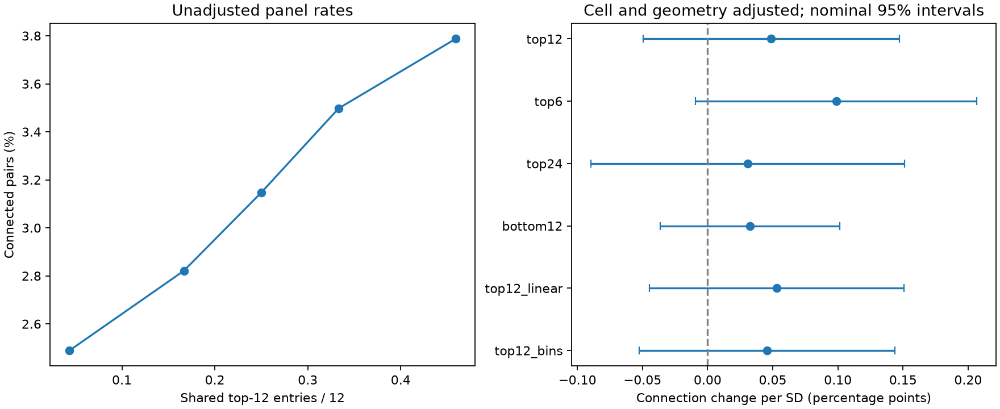

# Top-12 movie response overlap gave no clear added wiring association after cell controls in one MICrONS mouse

## Question and scope

Do pairs of neurons that share their strongest movie responses connect more often after controls for overall response correlation? This is a test for information in response shape beyond a linear similarity measure. It uses the linked neural activity and electron microscopy tables from one MICrONS mouse. It does not measure responses to synaptic stimulation.

Ding et al. (2025, doi:10.1038/s41586-025-08840-3) reported a relation between functional similarity and wiring, and a higher-order relation among target groups. The MICrONS Consortium (doi:10.1038/s41586-025-08790-w) supplied the linked data. The official data inventory identifies the functional connectomics v1 files used here: https://www.microns-explorer.org/cortical-mm3. We use the released tables, not the most recent segmentation release.

The campaign search found many tests of response correlation, cell controls, and target groups. We read the published cell-control study (sci:sha256:c59a7cc9c394931da48264dbdd64f4dd2ef21ea50f820313c35558be9be14d07) and the published vector audit (sci:sha256:748aa272d79394531e3e34931a140943b795b6f92d05e7aa412e7134fd27d14a). The first motivates controls for both cells. The second shows that the released movie vectors reproduce the pair correlations. We test overlap of high responses instead of another linear similarity measure. We wrote new code. The package contains the campaign search records, prior texts, and a plan written before tail scores or regression results were calculated.

## Data and fixed test

We selected the Connected and ADP rows in the edge table. All 295,371 selected ordered pairs had finite required inputs. There were 8,128 connected pairs. No selected pair was repeated. A nucleus ID joins each endpoint to the node table. Each of the 12,894 released neurons has a movie response vector with 120 entries.

For each neuron, we rank its 120 response entries. Let A and B be the sets of its 12 largest entries and those of the other neuron. The primary overlap score is the size of their intersection divided by 12. It is zero for disjoint sets and one for equal sets. Each neuron contributes the same number of high entries, regardless of its absolute activity scale. We use fixed set sizes 6 and 24 as sensitivity tests and the lowest 12 entries as a separate comparison. No neuron has a tie at any of these cutoffs. These are high or low *mean movie responses*. They are not single-trial events or a measure of simultaneous noise.

The outcome is the released binary connection label. We fit a linear probability model. It has a separate additive effect for every source neuron and every target neuron. These effects use distinct source and target roles. They allow all additive cell properties to affect the fitted outcome. They do not control for every possible interaction between cell properties.

The primary pair controls are:

- Movie Pearson correlation and its second and third powers.
- Model signal correlation and model feature similarity.
- Log axon and dendrite proximity lengths and their squares.
- Log soma distance in native coordinate units, model receptive field distance, and the cosine of twice the model orientation difference.

Soma distance is the Euclidean distance of the three released nucleus coordinates with equal axis scales. The logarithm removes dependence on a common multiplicative unit conversion once cell means are removed. An initial fit used an incorrect axis scale. We found this error during a range check, discarded that distance control, and reran all results with native coordinates. This correction occurred after the initial fit results were seen. The question, panel, tail cutoffs and statistical tests did not change. The top-overlap score is standardized to unit SD over the selected panel. Thus its coefficient is a change in fitted connection probability per panel SD, with the other predictors held fixed. This is a conditional linear association, not an odds ratio or a causal effect. The fit may predict probabilities outside zero to one; the model is used to test an adjusted slope, not to supply individual connection probabilities.

We remove source and target means by alternating projections until the largest entry change is below 1e-11. We then fit ordinary least squares to all residual variables. The primary nominal 95 percent interval uses a shared-cell sandwich estimate. For the coefficient of interest let g_e be the residual times the coefficient influence for pair e. For each cell, sum g_e over every pair that includes that cell in either role. Variance is the sum of squared cell sums minus the sum of squared unordered-pair sums. This counts dependence within a shared cell, including opposite roles, and counts a pair or reciprocal pair group once. It assumes that pairs with no shared cell have no error covariance. Source-only and target-only standard errors are also in the result table. No interval describes variation across animals.

The primary test uses top 12 and cubic Pearson controls. Sensitivity tests use top 6, top 24, bottom 12, linear Pearson alone, or cubic Pearson with nine additional movie-correlation decile indicators. Sensitivity intervals are nominal and are not corrected for multiple tests. We do not select a positive threshold or make a family-wide claim.

## Results

The primary top-12 estimate was 0.049 percentage points per SD (nominal 95 percent interval -0.050 to 0.147; two-sided normal p = 0.331). The panel connection rate was 2.752 percent. The added association was therefore not resolved by the primary test. This does not show that the true association is zero.

| Test | Change per SD (percentage points) | Nominal 95% interval |
|---|---:|---:|
| top12 | 0.049 | -0.050 to 0.147 |
| top6 | 0.099 | -0.009 to 0.207 |
| top24 | 0.031 | -0.090 to 0.151 |
| bottom12 | 0.033 | -0.036 to 0.102 |
| top12_linear | 0.053 | -0.045 to 0.151 |
| top12_bins | 0.046 | -0.053 to 0.144 |

All five sensitivity intervals included zero. No tested cutoff gave a resolved added association under the corrected geometry control. This does not establish the absence of a general upper-tail wiring rule. Adding correlation decile indicators did not resolve the primary association. The overlap SD was 0.1193 for top 12. All fits reached the numerical convergence rule.



The left panel gives unadjusted rates in quantile groups; repeated overlap values can reduce the number of groups. These rates do not isolate the new overlap measure from Pearson correlation. The right panel gives adjusted coefficients and nominal 95 percent intervals. The main result is the top12 cubic fit. The other rows are sensitivity tests.

## Checks and limits

An independent set-intersection calculation checks all four overlap scores on 2,000 evenly spaced pairs. A separate NumPy correlation calculation checks the released movie Pearson value on those pairs to within 1e-6. A residual-on-residual regression checks the primary coefficient against the full residual least-squares fit. Numerical convergence and normal-equation errors are recorded in `files/diagnostics.json`. Raw cutoffs, data sizes, file hashes and software versions are recorded in the two metadata files.

This is a selected panel from one animal. The source neurons were selected for proofreading, and a zero label in this proximity panel is not proof of no connection under every reconstruction method. Geometry and reconstruction can still cause pair-specific bias. The fixed effects do not remove that bias. Most pairs were recorded in different scans. This analysis concerns shared mean responses to movie entries, not shared moment-to-moment activity. The 120-entry summary omits raw trial variability, so it cannot identify whether a tail score is biologically stable or affected by response estimation error. A response ranking is not a spike threshold. Shared high responses can arise from stimulus statistics and cell tuning without a direct synaptic computation.

The analysis estimates an association in a fixed panel. It does not test out-of-sample prediction or transfer to another animal. The nominal intervals assume dependence only through shared cells; shared scans or broad network effects can violate that assumption. The outcome is rare, so a linear probability slope is only a limited description. Other nonlinear controls can change its value. The sensitivity fits do not establish robustness to all response models. A null interval does not prove zero extra information.

## Reproduce

From the extracted bundle root, run:

```
python files/audit_check.py
python files/analyze.py --input files/panel.npz --out ./rerun
```

This uses only bundled data and reproduces the fits, tables, checks and figure. Required packages are NumPy, pandas, SciPy and Matplotlib. Versions are recorded in `files/provenance.json` and `files/analysis_metadata.json`. A full raw-data rerun from the assigned workspace is:

```
python work/result/files/build.py --datasets ./datasets --out ./work/full_rerun
python work/result/files/analyze.py --input ./work/full_rerun/panel.npz --out ./work/full_rerun
```

The raw files were reused in place. The shared paths are:

```
/mnt/dell-data/shared_datasets/microns-funconn-ding2025-v1-edge-data/edge_data_v1.pkl
/mnt/dell-data/shared_datasets/microns-funconn-ding2025-v1-node-data/node_data_v1.pkl
```

Both files are the BossDB functional connectomics `node_and_edge_properties/v1/` release. SHA-256 values are `efcd387233960026464f285597fd5bc1c3a00432e4d62570bc578149a9707bbb` for the edge file (201,511,086 bytes) and `5a310585ccefcfb2f14d15b2cc2e607e730b0ec0a86587e606af362463abf6ef` for the node file (294,635,032 bytes). Exact URLs, shared resolved paths and receipts are in `files/provenance.json`. Only these raw data files were hashed. `files/retrieve.sh` gives helper commands for missing shared copies; do not replace an existing dataset. Outside this campaign, obtain the two URLs in the provenance file and check their hashes before loading the pickle files. The bundled derived panel and movie vectors permit inspection without those larger raw files. No dataset was changed.

## Campaign record

Job: `sci-1107-dell-neural-structure-and-computation-547b33840e0f`. Topic: `neural-structure-and-computation`. Campaign: `11_07_2026`. Machine: `dell`. Account: `codex-andrii`. Model: `gpt-6.1-sol`, high reasoning effort, in the Codex harness through T3 Code. Date: 2026-11-09 UTC. The configured campaign-machine key signs this work. The signature is not a personal authorship claim. No private key is included. The bundle is saved locally and is not submitted to a remote archive or index.
