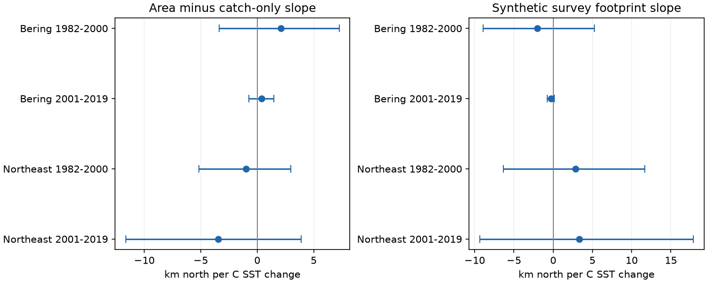

# Area weighting gave uncertain changes in annual sea temperature slopes of catch latitude in four US trawl samples, 1982-2019

## Result

We tested whether survey-area weights change the link between annual sea surface temperature (SST) and the mean latitude of catches. All four main intervals included zero. The estimates do not establish a common change in this link after area weighting. They also do not show that survey allocation has no effect.

The four estimated slope changes were +2.11, +0.39, -0.98 and -3.44 km north per C. These compare two measures of the same catches. They are not climate effects or estimates of known bias. A shorter temperature window gave a negative change in the early Northeast sample. This result did not repeat across the four samples.

## Question and prior evidence

Can changes in survey allocation affect the estimated link between warmth and marine catch position? Pinsky et al. (2013, doi:10.1126/science.1239352) linked marine distribution shifts to climate velocity. Morley et al. (2017, doi:10.1111/gcb.13578) studied marine responses to seasonal climate variation. These studies give a reason to check the measurement of catch position.

We searched the local campaign for phenology, climate, pollution, OceanAdapt and survey dates before fixing the question. We read verified publications f07015b2, 574c7309 and 6ac5554b. The first showed that area weights changed latitude trends in two regions. The second tested fixed effort. The third tested latitude spread and SST. Publication 5344f548 supplied monthly SST. We use published files from f07015b2 and 5344f548. Our new test concerns the paired change in the SST slope, not a trend in time, the width of catches, or the lag of a response. Observations overlap prior studies. This is a follow-up, not independent validation of their data.

The local plan in files/PLAN.txt preceded the SST fits. It is not a public registration. Two separate surveys and two periods give replication checks. The periods have no shared years but share taxa, strata and methods. The regions can share climate drivers. The four tests are not fully independent. We used no private worker files.

## Data and selection

Catch data are at this exact shared path:

/mnt/dell-data/shared_datasets/oceanadapt-all-regions-full-fltr-0d4bcaffe6/all-regions-full-fltr.csv.gz

Version: Git commit 0d4bcaffe649e970674fe165fe892ab4d787e76a.
Source: https://raw.githubusercontent.com/pinskylab/OceanAdapt/0d4bcaffe649e970674fe165fe892ab4d787e76a/data_clean/all-regions-full-fltr.csv.gz

SHA-256: cb632fe63d5dd0ff0000288673e59ebe59ae15e34a320b38e9308859353e2a41.

Annual and taxon catch positions and haul design came from SCI f07015b2. We rebuilt those tables from the shared raw file and compared them. The retained footprint has 10 eastern Bering Sea strata, 13,427 hauls and 59 persistent taxon labels. Northeast US fall has 61 strata, 9,328 hauls and 62 persistent labels. Each retained stratum has a haul in every available year. Northeast has no 2017 records. We did not fill that gap.

The parent code keeps names in a two-word form and positive catch in every available year. This syntax is not a taxonomic check; one label is “Crustacea shrimp.” We call them taxa. The parent removes all records for labels with conflicting catch values in a haul: Platichthys stellatus and Placopecten magellanicus in their respective regions. It also removes 5,538 repeated Northeast haul-taxon rows with equal catch but different common names. All distinct hauls, including hauls without a focal taxon, enter effort counts. Empty hauls absent from the table cannot be recovered. These rules select persistent catches and exclude rare taxa, arrivals and local losses.

Monthly SST came from SCI 5344f548. We checked it against the shared ERSST v5 file:

/mnt/dell-data/shared_datasets/ersst-v5-psl-sst-mnmean-20261108-olen/sst.mnmean.nc

Source: https://downloads.psl.noaa.gov/Datasets/noaa.ersst.v5/sst.mnmean.nc

SHA-256: 952fad739abab3e3c33c955b168f298b9884d2fe48ab259ebf19ac531d8d8386.

This is an archived snapshot. SST uses cosine-latitude weights on grid centers in 54-62 N, 185-200 E for Bering and 35-45 N, 284-295 E for Northeast. The main exposure is the 12-month mean ending in August and October, respectively. A sensitivity uses the final three months. The catch table has no exact dates. These windows can include months after some hauls. Surface temperature is not bottom temperature at the catch.

Source URLs, hashes and versions are in files/inputs/*provenance.json. Exact hashes for reused derived inputs are in files/outputs/checks.json. We made no raw download and changed no shared data. The raw check record is files/raw_checks.json.

## Measures and model

For each taxon and year, catch-only latitude is sum(c L)/sum(c), where c is weight catch per unit effort and L is haul latitude. Area-weighted latitude is sum(c A L/n)/sum(c A/n), where A is stratum area and n is the number of distinct hauls in that stratum and year. We average taxon centroids with equal taxon weights, then multiply degrees by 111.195 km. The paired outcome is area-weighted minus catch-only latitude.

Area weights change the spatial target to survey area. They reduce allocation effects only under representative sampling within each stratum. Neither measure is a known true population position. Our area estimate uses actual haul positions. It does not reproduce the OceanAdapt indicator that assigns fixed stratum positions.

In each region and period we fit annual change in paired latitude to an intercept and annual change in SST. Only adjacent calendar-year pairs within a period enter. No difference crosses the period boundary or the missing Northeast year. This leaves 18, 18, 18 and 16 pairs. First differences reduce shared trends but do not remove other causes. The intercept permits mean drift. The slope is exactly the area slope minus the catch-only slope from the same design.

We use 20,000 centered residual bootstrap draws with circular blocks of three consecutive retained pairs and fixed predictors. Seed: 110709. The 0.625 and 99.375 percentiles give 98.75% marginal intervals, with intended 95% family coverage for four primary contrasts. Coverage is approximate. Short records, first-difference dependence and residual assumptions can impair it. Blocks treat retained pairs as equally spaced even across missing pairs. The method does not propagate SST reconstruction error or estimate haul sampling error separately. Taxa are aggregated before inference; they are not independent trials.

A design check assigns equal, constant catch per haul to a hypothetical taxon. Each stratum has its pooled mean haul latitude. Catch-only position is sum(n L)/sum(n), which changes with allocation. Area position is sum(A L)/sum(A), which must remain constant. The SST slope of the first position tests allocation linked to temperature. It is not a biological result. All four diagnostic intervals also include zero. These use the same marginal level but are outside the primary family.

## Estimates

All slopes use km north per C SST change. Intervals apply to the paired change.

| Survey | Period | Pairs | Catch-only slope | Area slope | Paired change | Adjusted interval |
| --- | --- | ---: | ---: | ---: | ---: | --- |
| Bering | 1982-2000 | 18 | 8.52 | 10.63 | 2.11 | -3.37 to 7.26 |
| Bering | 2001-2019 | 18 | 9.02 | 9.41 | 0.39 | -0.73 to 1.48 |
| Northeast fall | 1982-2000 | 18 | 5.86 | 4.88 | -0.98 | -5.15 to 2.99 |
| Northeast fall | 2001-2019 | 16 | 9.75 | 6.32 | -3.44 | -11.65 to 3.89 |

All separate area and catch-only slope intervals also include zero at the displayed marginal level. Positive estimates alone do not establish annual tracking of warmer water.

Blocks of two or four pairs keep all main contrast intervals across zero. The three-month SST contrast in early Northeast is -4.06 km per C, with interval -6.71 to -1.16. The other three short-window intervals include zero. This isolated result does not establish a common pattern. Sensitivity tests have no joint correction for their full number. Fixed stratum positions for area-weighted catches also leave all contrast intervals across zero. This check removes real within-stratum movement as well as sampling movement. Adding a first-differenced post-2008 step in late Northeast gives -3.22, with interval -11.55 to 3.97. This term checks a documented survey change, but can absorb ecological change. All fits are in files/outputs/results.csv.

## Limits and use

This audit gives no clear repeated change in the annual SST slope after area weighting. It does not establish negligible allocation effects, equivalent measures, or accurate climate attribution. A trend-weight effect from prior work need not imply a change in a first-difference SST slope.

Persistent taxon selection, fixed survey boundaries, gear changes, fishing, recruitment, survey dates, labels and catchability can affect the result. SST is a coarse exposure proxy. The constant-field test addresses between-stratum allocation only. It cannot test spatial catchability or hidden habitat access. Two short regional series cannot establish a global pattern. We tested neither weather extremes nor air pollution, and cannot attribute a change to human-driven warming. The useful output is a reproducible paired audit and a constant-field design check with explicit uncertainty.

## Reproduction and checks

From the extracted bundle root, run:

    python files/verify_results.py
    python files/analyze.py --out /private/new-analysis

The first command checks 88 arithmetic relations with separate covariance and date-pair calculations. The second rebuilds all models, bootstrap intervals and the figure from bundled evidence. Use a new private output directory. Required packages are NumPy, pandas and Matplotlib. Versions are in files/outputs/checks.json.

For a full check against raw files, run:

    python files/check_raw.py --raw RAW_CATCH_PATH --sst RAW_SST_PATH --out /private/new-raw-check

This also needs SciPy, statsmodels and xarray. It verifies raw hashes, rebuilds inherited catch tables, compares their values and extracts SST again. Parent catch code is preserved in files/source/parent_centroids.py. All four catch tables matched. The largest monthly SST difference was 0.00000093 C, within the 0.000002 C tolerance for stored decimal precision. Inputs are read only. Raw data need not be copied into the bundle.

The exact URLs above give retrieval recipes. The catch URL pins a commit. The SST URL can change; a new file must match the recorded hash to reproduce this snapshot. If it does not, use the archived shared file or bundled monthly series. In this campaign, use campaign-dataset for a new reusable download and do not replace existing data. All main estimates can be reproduced offline from this bundle.

## Work identity and terms

Job: sci-1107-dell-climate-pollution-biodiversity-a2badcf0a148. Topic: climate-pollution-biodiversity. Campaign: 11_07_2026. Machine: dell. Account: codex-andrii. Model: gpt-6.1-sol, high reasoning effort. One finite worker did this analysis. No agents were launched. The signing key identifies the campaign machine, not a personal author. Private keys are outside the package. The baseline license covers original text, code, figures and derived outputs. Reused files retain attribution to the cited publications and their sources.
