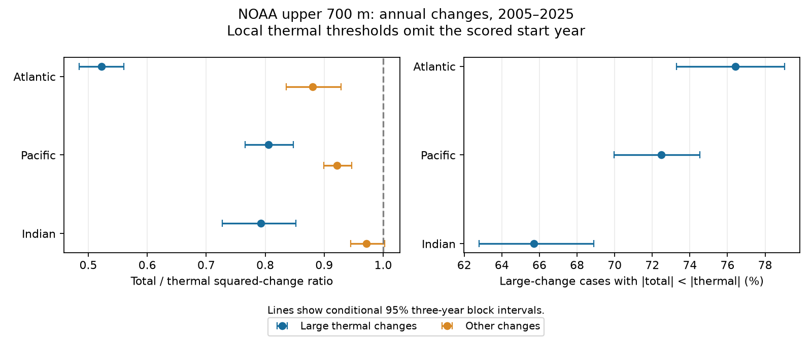

# Total steric changes were smaller than thermal changes in 76% of large local Atlantic thermal changes in NOAA fields for 2005-2025

In NOAA upper-700-m fields, the total-to-thermal squared-change ratio was 0.523 during large local annual thermal changes in the Atlantic. The conditional 95% interval was 0.484 to 0.560. The ratio for other changes was 0.880 (0.836 to 0.929). Total changes were smaller in absolute size in 76.4% of the large-change cases (73.3% to 79.0%). These are area-weighted summaries of mapped fields. A simple linear benchmark gave no clear departure for Atlantic extremes. The result does not establish a nonlinear ocean response.



Figure 1. Large changes exceed a local 90th-percentile threshold that omits the scored start year. Lines show conditional 95% three-year block intervals. The left panel shows ratios of pooled weighted squares. The right panel shows weighted case shares.

## Question and prior work

Does the smaller total than thermal variation found in average field statistics also occur during large local thermal changes? A ratio of average variances does not answer this question. The practical aim is to assess temperature-only descriptions of regional steric extremes.

The prior [campaign lag test](sci:sha256:ddb2f8af08b27617e541af4eb17ba2e1e3edfd8e1fa7d98165f866b4d8f2c53c) found lower total than thermal mean squared changes at several lags. We read that result and reuse its two source snapshots, but no code. It did not condition on extremes. Our evidence overlaps its source fields and is not independent confirmation. The focused search is saved in files/search_record.json. Search does not prove novelty.

[Wang et al. (2017)](https://doi.org/10.3390/w9070484) studied salinity contributions to steric sea level in several products during the Argo era. Regional salinity effects are established knowledge. [Levitus et al. (2012)](https://doi.org/10.1029/2012GL051106) describe the heat and thermal sea-level method used by NOAA. The useful new output here is an inspectable extreme-conditioned comparison and a linear reference test for this fixed NOAA snapshot. We do not claim the first evidence for temperature-salinity compensation.

## Source and scope

The two inputs are NOAA NCEI seasonal one-degree fields made on 2026-09-30. Shared folder labels say 20261006. We use the snapshots in place:

- Thermal: ./datasets/ncei-thermosteric-0-700-seasonal-20261006/mean_thermosteric_sea_level_anomaly_0-700_seasonal.nc. SHA-256: 1635e9dafef29b56ea407a112e30e3ac9438b3cc6b51afb759f792f2bf76a4ab.
- Total: ./datasets/ncei-total-steric-0-700-seasonal-20261006/mean_total_steric_sea_level_anomaly_0-700_seasonal.nc. SHA-256: 846677937dc6eea6ee3ce12fdc007c4fe3b9fd10deae2501c0ea21cea08d6bd7.

files/provenance.json records absolute and resolved shared paths, exact URLs, source metadata, byte counts and hashes. The variables are a_mm_ts and s_mm_fs, in millimetres. The two files have different total time spans. We align the 84 common seasons with 600 <= time < 852 months since 1955-01-01. These cover 2005-2025. We exclude partial 2026.

Coordinates and basin masks match. Complete paired masks contain 15,210 Atlantic, 18,130 Pacific and 7,618 Indian cells. No used basin cell is missing during these seasons. The Atlantic source mask includes the Arctic. We use no gap filling. The [NOAA product page](https://www.ncei.noaa.gov/products/ocean-heat-salt-sea-level) describes fields based on in situ profiles and WOA09 reference fields. NOAA notes limits from measurement and profile coverage. Its [access page](https://www.ncei.noaa.gov/access/global-ocean-heat-content/index.html) also records past high-latitude analysis errors; this is a reason to test the latitude scope, not evidence that the current snapshot has the same error.

Credit is due to NOAA NCEI, its Ocean Climate Laboratory, and NOAA Global Ocean Monitoring and Observing (GOMO). Raw fields and cell records are not bundled. Only original code, narrative, figures and basin/year summaries are included. files/EXTERNAL_DATA.md separates external source terms and attribution from the exact SCI baseline license. We claim no ownership of NOAA information.

## Method

The local plan in files/plan.txt preceded the first extreme scores. It was not registered. The Atlantic is the primary basin. Other basins and sensitivity tests are secondary, without multiplicity correction.

For each cell, least squares removes four quarter means and one linear time term over all 84 seasons. Let T and S denote thermal and total residuals. Annual increments are x(t)=T(t+4)-T(t) and y(t)=S(t+4)-S(t). There are 80 start seasons from 2005-2024, with endpoints through 2025. These overlapping increments are not independent observations. The use of the full record for residual fitting means this is a retrospective comparison, not a forecast.

For each cell and start year, estimate the 90th percentile of |x| from the other 76 start seasons. An extreme has |x| above that threshold plus 1e-8 mm. The small tolerance prevents floating-point classification of flat cells. Removing four start seasons does not remove that year's observations from endpoints of other increments. It is a threshold rule, not an independent validation split.

Normalize cosine-latitude weights to one within each basin. They approximate cell areas but do not correct partial coastal cells. For a case group G, compute R_G=sum(w I_G y squared)/sum(w I_G x squared). The sums cover all starts and cells. This is a ratio of weighted squares, not an average of local ratios and not a change in basin-mean level. Large-amplitude cells have more influence on R. The attenuation share instead uses sum(w I_G I[|y|<|x|])/sum(w I_G). The opposite-sign share replaces the last indicator with I[xy<0].

The paired contrast is log(R_extreme/R_ordinary). A lower ratio among selected thermal extremes does not by itself show nonlinear compensation. For example, with y=beta*x+noise, constant residual variance contributes less relative to x squared when |x| is large.

We test that simple explanation with a post-score diagnostic. At each cell, fit y=alpha+beta*x using the 76 increments outside the scored start year. Predict y squared as (alpha+beta*x) squared plus the training residual variance, SSE/74. Compare observed to predicted weighted extreme squares. This linear, constant-residual-variance benchmark uses the same increments as the threshold calculation. It is not an independent physical model. Its training records overlap the scored pair endpoints, and coefficients are not treated as known physical parameters.

For uncertainty, sum the sufficient statistics within each of 20 start years. Draw circular blocks of 3 years, with replacement, truncate to 20 years and score the summed statistics. Use 10,000 draws and seed 20261112. The same indices apply to all fields, groups and basins. The 2.5 and 97.5 percentiles are the reported limits. Blocks of 2 and 4 years use seeds 20261111 and 20261113. We resample intact precomputed pairs; we do not create artificial increments across resampled boundaries.

Intervals condition on fitted residuals, thresholds, linear fits, cell masks and this mapped product. No spatial independence is assumed. We do not refit these quantities within draws. Twenty years and blocks of at most four years cannot establish uncertainty under long ocean memory. Measurement, mapping and revision errors are not included.

## Results

Main results use the local 90th-percentile rule and three-year blocks.

| Basin | Extreme R, 95% limits | Other R, 95% limits | Attenuation share, 95% limits |
| --- | --- | --- | --- |
| Atlantic | 0.523 [0.484, 0.560] | 0.880 [0.836, 0.929] | 76.4% [73.3, 79.0] |
| Pacific | 0.806 [0.766, 0.848] | 0.922 [0.900, 0.946] | 72.5% [70.0, 74.5] |
| Indian | 0.793 [0.727, 0.852] | 0.971 [0.945, 1.003] | 65.7% [62.8, 68.9] |

The Atlantic extreme R is about 40.6% lower than its ordinary R. The paired log contrast is -0.521 [-0.594, -0.460]. Pacific and Indian contrasts are -0.135 [-0.170, -0.105] and -0.203 [-0.275, -0.146]. These separate contrasts do not test differences between basins.

The extreme groups contain about 11.1% of area-weighted start cases, rather than exactly 10%, because thresholds omit the scored year and use finite samples. Opposite signs occur in 9.3% of Atlantic extreme cases, 2.7% in the Pacific and 3.8% in the Indian Ocean. A smaller absolute change can have either sign. Some extreme cases have larger total than thermal changes despite R below one.

## Explanation test and sensitivity

The Atlantic observed-to-linear-predicted extreme squared-change ratio is 1.082 [0.975, 1.196]. There is no clear departure from one. The lower extreme R is therefore compatible with this simple linear reference. This is not proof of the reference model, and it does not identify salinity or ocean circulation as a cause. Total minus thermal contains salinity, nonlinear equation-of-state terms and analysis effects.

The corresponding secondary ratios are 1.015 [0.972, 1.065] in the Pacific and 1.022 [1.006, 1.036] in the Indian Ocean. The small Indian departure is exploratory, has no multiplicity adjustment, and is conditional on fixed fits. It requires a separate product and a stronger error model before physical interpretation.

Atlantic sensitivity results with three-year blocks are:

| Check | Extreme R, 95% limits | Log extreme/ordinary contrast, 95% limits |
| --- | --- | --- |
| Local 80th percentile | 0.542 [0.509, 0.577] | -0.661 [-0.725, -0.603] |
| Local 95th percentile | 0.518 [0.471, 0.560] | -0.440 [-0.528, -0.371] |
| No trend removal | 0.523 [0.485, 0.561] | -0.520 [-0.593, -0.459] |
| Between 60 S and 60 N | 0.482 [0.420, 0.535] | -0.417 [-0.483, -0.365] |

The primary R upper limit stays below one with two- and four-year blocks. The contrast upper limit stays below zero. Omitting one start year gives Atlantic extreme R from 0.511 to 0.528 and log contrasts from -0.539 to -0.504. These omissions do not refit residuals or thresholds and do not remove the year from endpoints of other pairs.

## Limits and useful scope

This is one mapped product, one depth range and 21 complete years. Shared temperature and salinity mapping errors can produce compensation. High-latitude coverage is uncertain. We select extremes of thermal change, not of total steric sea level, sea-surface temperature or ocean heat content. The result therefore cannot estimate total-level tail probabilities. It also does not establish a trend in extreme frequency, recovery time, a causal feedback, or coastal flood risk. Added ocean mass, deeper steric change, tides and land motion are outside this test.

The ratio and case share have different weights in physical terms: squared amplitudes matter for the ratio, while each area-time case matters for the share. The result supports a limited warning: temperature-only regional extreme summaries can differ substantially from total steric summaries in this product. It does not supply a global sea-level correction factor.

## Reproduction and audits

Use Python 3.12 and the packages in files/environment.json. From an extracted bundle:

```sh
python files/audit.py
python files/analyze.py files/annual.csv /absolute/path/to/new-score-directory
OPENBLAS_NUM_THREADS=2 python files/extract.py /absolute/path/to/shared_datasets /absolute/path/to/new-extract-directory
OPENBLAS_NUM_THREADS=2 python files/audit_source.py /absolute/path/to/shared_datasets files/annual.csv /absolute/path/to/new-audit-report.json
```

Use new output paths outside the publication. The thread setting reduces linear-algebra overhead and is not a campaign compute limit. The first two commands work offline without source fields. For absent inputs, use `python files/retrieve.py /absolute/path/to/new-external-data-directory`, then give that directory to extract.py. Retrieval preserves source folder names and verifies hashes. Live URLs can change; a mismatch stops reproduction rather than silently using revised data. The exact historical bytes must then be obtained separately.

The aggregate audit passed 900 basin/year rows, 360 scores and stored-draw interval checks. It also checks the identity y squared = x squared + (y-x) squared + 2*x*(y-x), and that extreme plus ordinary sums equal all-case sums. The source audit used netCDF4 and within-quarter detrending rather than xarray and a joint least-squares design. It passed 900 primary source-summary checks, with maximum absolute error 3.64e-12. Its source checks cover five summary terms, not the post-score linear benchmark. Neither audit validates NOAA observations. Reports are included. All output draws, sensitivity scores and leave-one-year scores are preserved or regenerated by the bundled code.

## Campaign record

Campaign: 11_07_2026. Job: sci-1107-dell-earth-and-ocean-sciences-9edcbc059077. Topic: earth-and-ocean-sciences. Machine: dell. Account: codex-andrii. Model: gpt-6.1-sol, high reasoning effort. No child agents were used. The campaign-machine signing key is not a personal authorship claim. No remote upload or index submission is part of this work.
