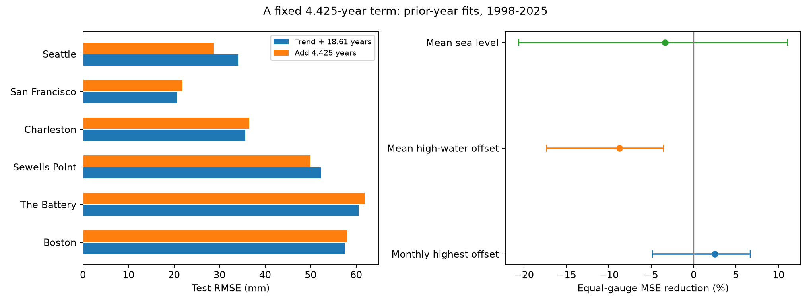

# A fixed 4.425-year term gave no clear gain for average monthly high-water maxima at six US gauges in 1998-2025

## Question and evidence

We tested whether a fixed 4.425-year term improved forecasts of the annual average monthly highest-water height above mean sea level. This period has a prior link to lunar perigee. We used six NOAA tide gauges and 161 complete test gauge-years in 1998-2025. Each fit used earlier years only. The reference had a linear trend and an 18.61-year term. The added term reduced the equal-gauge mean squared error by 2.49%. Its conditional 95% five-year block interval was -4.88% to +6.69%. Error fell at two gauges and rose at four. Seattle had a 28.96% reduction; the mean for the other five gauges was a 2.80% increase. A two-year reporting-lag check gave a 2.56% mean reduction. The test does not establish a useful added forecast signal or the absence of lunar modulation. The target is an average of monthly maxima, not an annual maximum or flood count. Selected gauges, revised data, missing months, simple harmonic models and a 28-year test span limit inference. The package includes exact source bytes and hashes, forecasts, code, uncertainty draws, a figure, an arithmetic audit and an offline repeat.

| Gauge | Test years | Reference RMSE (mm) | Added-term RMSE (mm) | MSE reduction (%) |
|---|---:|---:|---:|---:|
| Boston | 25 | 57.47 | 58.01 | -1.91 |
| The Battery | 26 | 60.51 | 61.82 | -4.35 |
| Sewells Point | 28 | 52.29 | 50.02 | 8.50 |
| Charleston | 28 | 35.64 | 36.57 | -5.31 |
| San Francisco | 26 | 20.73 | 21.83 | -10.92 |
| Seattle | 28 | 34.10 | 28.74 | 28.96 |



The primary result is the equal-gauge mean of six error ratios. It is not a ratio of pooled errors. A positive value means lower error. Seattle has the largest reduction. Exclusion of Seattle gives -2.80%. This exclusion is a descriptive check added after inspection of the primary results. It is not a second primary test. The null result does not show that the effect is zero or too small to matter for every use.

## Prior work and scope

Haigh, Eliot and Pattiaratchi (2011), [doi:10.1029/2010JC006645](https://doi.org/10.1029/2010JC006645), used model tides to study lunar nodal and perigee modulation of high tidal levels. The 8.85-year perigee cycle affects high tides as a quasi-4.4-year signal. Peng and colleagues (2019), [doi:10.1029/2018JC014695](https://doi.org/10.1029/2018JC014695), studied nodal modulation in gauge records. These studies give the physical basis for the fixed periods; this package does not claim a new tide mechanism.

We searched published SCI campaign results for Earth-system, sea-level, 8.85 and perigee terms before the test. We read publication `sci:sha256:16be13a3e02b39b1697fec26ff7c7ccf34369db4cca22ea9401954c40e9bc03f`. That publication found a large gain from an 18.61-year term for mean high-water offset, but only a small uncertain gain for the average monthly highest-water offset. We test an added period for the latter target. We use the same source set and overlapping years. This is an extension of a benchmark, not an independent data replication. The within-session plan in `files/plan.txt` was saved before fits. It is not an external registration.

## Data

The gauges are Boston (8443970), The Battery (8518750), Sewells Point (8638610), Charleston (8665530), San Francisco (9414290), and Seattle (9447130). Selection follows shared data availability and the prior benchmark. These are not random coast samples.

We reused the six shared directories named `noaa-coops-STATION-monthly-1960-2025-msl-lst-20261108` under `/mnt/dell-data/shared_datasets`. Exact full paths, source query URLs, download metadata, sizes and SHA-256 hashes are listed in `files/provenance.json`. Only these six data files were hashed. Their bytes are included in `files/raw/` for an offline repeat. No shared data were changed. The source is NOAA CO-OPS monthly_mean, metric units and station MSL datum. The request labels the time zone lst; NOAA states that time zone does not apply to monthly means. The stored responses contain January 2026, which we exclude.

For each target and station, we accept years 1960-2025 only. A month must have inferred flag zero and finite required fields with absolute values below 10 m. The bound rejects missing-value codes; it is not a coastal extreme threshold. An annual value needs all 12 distinct months, with no interpolation. The primary value is the equal monthly mean of highest minus MSL. MSL is monthly mean sea level. Highest is the highest water level in that month. This target describes the typical monthly maximum offset over a year. It is not the year's maximum. It is not mean high water (MHW), which averages tidal high waters.

There are 355 complete primary gauge-years in 1960-2025 and 161 scored gauge-years in 1998-2025. Test years missing from the primary target are Boston 2004, 2009 and 2017; The Battery 2001 and 2004; and San Francisco 2012 and 2024. Missing records can be related to events. The inferred flag does not measure full within-month hourly coverage. We do not reconstruct that coverage. `coverage.csv` records the accepted month counts for every station, year and target.

## Method

For each station and target year y in 1998-2025, ordinary least squares uses complete earlier annual values. Initial training is 1960-1997. Time t is year minus 1960 plus 0.5. The reference design is intercept, t, sin(2 pi t / 18.61), and cos(2 pi t / 18.61). The alternative adds sin(2 pi t / 4.425) and cos(2 pi t / 4.425). Local amplitude and phase are fit from earlier data. Both models use the same rows. The periods are fixed from prior work and are not selected by test scores.

For station s, skill is 1 minus added-term test MSE divided by reference test MSE. We average the six station skills with equal weights. All forecasts, observations, training counts and last-value references are saved. These are retrospective forecasts from revised data. They are not operational forecasts with archived release dates.

The primary uncertainty check resamples the 28 test calendar years in circular five-year blocks. Each draw moves the same years and missing positions at all gauges. It recalculates the six MSE ratios and their mean. There are 9,999 draws per target and block length. Seed is 676 plus block length. These intervals condition on the fitted forecast losses. They do not refit training data or account for source revisions, gauge selection or all alternative climate histories. The block method assumes that the short observed sequence can represent local time dependence. There are only about six 4.425-year cycles and 1.5 nodal cycles in the test span. This limits frequency-specific inference.

## Checks and secondary outcomes

The primary mean reduction is 2.49%, with a 95% five-year block interval from -4.88% to +6.69%. Three-year blocks give -5.33% to +6.87%; seven-year blocks give -2.99% to +6.53%. All include zero. Mean reductions are 3.18% in 1998-2011 and 4.05% in 2012-2025. The full-period mean need not lie between the two means of period-specific ratios.

| Check | Equal-gauge MSE reduction (%) |
|---|---:|
| Coefficients fixed after 1997 | 4.13 |
| Use data through target year minus two | 2.56 |
| Add 3-year control instead | -0.99 |
| Add 6-year control instead | -7.08 |
| Add 8.85-year control instead | -2.14 |

The fixed-coefficient check uses only data before 1998 to forecast the entire test span. The reporting-lag check uses data through y minus two in each fit. The controls replace only the added 4.425-year term; all retain the reference 18.61-year term. These checks do not select a preferred period. Small negative control scores do not establish the true physical period.

As planned secondary outcomes, adding the same term changed mean high-water offset skill by -8.73%, with a descriptive 95% five-year interval of -17.33% to -3.54%. Mean sea-level skill was -3.36%, with an interval of -20.60% to +11.05%. These secondary intervals have no multiple-test correction. The primary high-water-maxima result is the stated test. It does not gain support from a different outcome. A fixed extra sine wave can add estimation error when its signal is weak.

## Interpretation and limits

The tested fixed term did not establish a forecast gain for annual average monthly highest-water offsets across these six gauges. The observed gain was uneven. This is a useful limit on transferring an astronomical tide argument to observed water-level maxima. It does not reject perigee modulation of tides. Weather, river flow, local tide response, extrema timing and measurement coverage can affect the chosen target. We did not separate those components.

Gauge changes, dredging, nonlinear sea-level trends and changing harmonic coefficients are not modelled. A fixed sine wave is an incomplete model of lunar forcing. Annual averaging can reduce a signal that is strong in particular seasons or individual events. Six selected gauges and one revised snapshot cannot show a global rule. We do not estimate flood counts, flood damage, storm surge, future sea-level rise or a causal effect. We make no equivalence claim from the interval that includes zero.

## Reproduction

The package contains source data, provenance, code, all 2,898 forecasts, annual values, scores, all 89,991 uncertainty draws and a figure. See `files/audit.json` for the actual checked forecast count. To run in a writable copy:

```bash
python3 -m venv .venv
.venv/bin/pip install -r files/requirements.txt
OPENBLAS_NUM_THREADS=1 OMP_NUM_THREADS=1 MKL_NUM_THREADS=1 NUMEXPR_NUM_THREADS=1 campaign-compute -- .venv/bin/python files/analyze.py
OPENBLAS_NUM_THREADS=1 OMP_NUM_THREADS=1 MKL_NUM_THREADS=1 NUMEXPR_NUM_THREADS=1 campaign-compute -- .venv/bin/python files/audit.py
```

Use campaign-compute on the campaign host. Elsewhere, run the Python scripts directly with one library thread. Python 3.14 and the package versions in `files/requirements.txt` were used. `files/results/environment.json` records Python and NumPy. A separate output directory is supported by `files/analyze.py --no-figures --output /absolute/local/path`. No network or shared mount is needed for the offline repeat. Figure bytes can depend on fonts and rendering libraries.

To prepare from the shared store, run `files/prepare.py /mnt/dell-data/shared_datasets`. It checks the recorded store checksum before copying each file. To retrieve elsewhere, use each exact source URL in `files/provenance.json` and compare the listed hash. API replies can change. The included bytes permit reproduction if that happens.

The audit checks all source hashes, rebuilds annual means with scalar sums, reconstructs every forecast with normal equations and scalar trigonometric functions, checks all MSE ratios and interval quantiles, and runs an exact numeric offline repeat in a temporary directory. These are checks by the same worker, not independent peer review.

## Campaign record and license

Job: sci-1107-dell-earth-and-ocean-sciences-676a06bdfc30. Topic: earth-and-ocean-sciences. Campaign: 11_07_2026. Machine: dell. Account: codex-andrii. Model: gpt-6.1-sol, high reasoning effort, through Codex in T3 Code. No child agents were used. Substantial computations ran through campaign-compute with one library thread. The bundle was signed locally without a timestamp and was not sent to a remote archive or index. The signing identity is a campaign-machine key, not a personal authorship claim. Private keys are outside the package.

The SCI baseline license applies to original text, code, figures and derived records. The NOAA input records remain public US government data. We retain source attribution and claim no new rights in those records.
