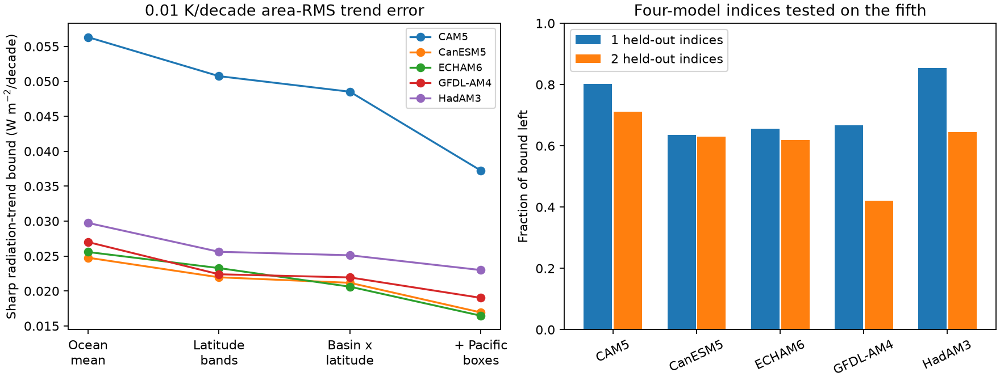
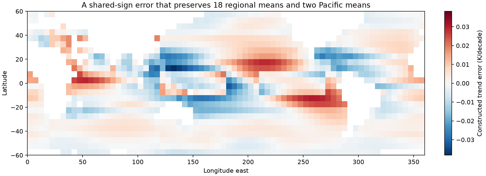

# Twenty regional SST checks leave radiative trend error in five linear model kernels

## Result

Agreement in ocean mean SST and broad regional means does not place a small bound on the radiative effect of SST trend error. We test five published atmosphere-model Green's functions on 1,350 ice-free ocean boxes at 60S-60N. The mask covers 0.61265 of the globe. Radiation means cover the globe; SST means cover this mask. SST and sea ice outside it stay fixed.

With an area RMS trend error of 0.01 K per decade, the sharp absolute radiation-trend bound is 0.0248-0.0563 W m-2 per decade if the ocean mean is exact. It is still 0.0165-0.0372 if 20 regional means are exact. At a fixed mask SST trend of 0.13 K per decade, the latter is a feedback error of 0.127-0.286 W m-2 K-1. The 0.13 value is a scale for conversion, not a measured true trend. Bounds scale directly with the error budget and inversely with this trend.

A separate bounded-error test gives one error pattern with the same radiation sign in all five models. Every box error is at most 0.02 K per decade. It preserves all 20 means. It causes at least +0.02080 W m-2 per decade in every model. If the error is constant within 20 by 20 degree cells, the maximum common lower effect is +0.01291. The corresponding feedback changes are at least +0.160 and +0.099 W m-2 K-1 at the stated SST trend. Reversing the error reverses the signs. These are exact linear-program optima under the stated constraints. They are not detected SST errors.





## Question and contribution

Prior campaign work found input steps in SST products and model forcing. It applied five model kernels to these steps. That work established effects of specific corrections. We ask a different question: what can a finite set of regional validation checks rule out, even if those checks are exact? We give sharp conditional bounds, common-sign certificates, and explicit diagnostic weights. This is a validation method for forcing data. It does not add a new estimate of the actual SST trend.

A prior campaign study (25e4afb2) bounded the effect of shared temporal errors on warming acceleration. Our bound concerns spatial errors, radiative kernels, and multiple regional checks. Cobb and Green (2025; doi:10.1002/qj.5062) show that spatial structure in SST uncertainty depends on processing. GFMIP (doi:10.1029/2023MS003700) supplies the linear response framework. Neither source establishes that the worst-case errors used here occurred.

## Method and proof

Let a_b be box area as a fraction of the globe, w_b = a_b / sum(a), and J_mb the box-summed radiation kernel. A trend error e has area RMS sqrt(sum(w_b e_b^2)). Its radiation-trend error in model m is J_m e. Let x_b = sqrt(w_b)e_b, K_mb = J_mb/sqrt(w_b). The zero-error regional checks are Cx=0, where C_rb = sqrt(w_b) times the indicator for region r. Each row can be rescaled without changing the result.

Let Q have orthonormal rows that span the rows of C. Let P = I-Q'Q. Cauchy-Schwarz gives abs(K_m x) <= epsilon norm(K_m P). Equality holds at x = plus or minus epsilon P K_m' / norm(K_m P). Thus the bound is sharp for the stated area RMS ball and exact checks. We compute it by a rank-revealing SVD. We do not fit observations or select dates.

We use four nested sets of checks: ocean mean; six 20-degree latitude bands; 18 intersections of those bands with three longitude sectors; and those 18 plus two equatorial Pacific means. Sector limits are 20-120E, 120-290E, and the remainder. They are geometric sectors, not detailed ocean basin boundaries. The Pacific regions are 10S-10N, 120-180E and 210-270E. The 18 means imply the ocean mean. The final constraint rank is 20. Regions use box centres and the source ocean mask. The reference mask is the intersection of the published 1982-2022 and 2001-2022 box sets and finite values for all six validation products.

For the common-sign test, we maximise t subject to J_m e >= t for every model, Ce=0 in the equivalent unwhitened coordinates, and abs(e_b)<=0.02. For the coarse test we restrict e to be constant in each 20 by 20 degree cell. We use scipy HiGHS. The saved primal and dual objective gap is below 1e-8, and all regional residuals are below 1e-9. The 20-degree cells can have discontinuities at their boundaries; this is a scale restriction, not a smoothness condition.

## Compact indices have limited transfer between models

The first two right singular vectors of the residual five-model kernel matrix capture 90.8% of its squared Frobenius norm after the 20 checks. This is an average squared-sensitivity measure. It is not a bound for each model. A scalar index formed from the mean residual kernel leaves 45.5-65.6% of each model's worst-case bound. If two leading modes are learned from four models and imposed as exact additional checks on the fifth, 42.1-71.2% remains. With only one mode, 63.5-85.3% remains. The model test is deterministic; the five models are not independent random samples from a population.

We also test the mean-kernel index on all 15 pairs of six published SST trend maps in each of two periods (1982-2022 and 2001-2022). We first remove the area-orthogonal projection onto the 20 regional checks. Across 150 pair-period-model cases, the RMS residual radiation signal is 0.01150 W m-2 per decade and the index prediction error is 0.00659. Thus the one-index approximation leaves material error for actual product differences too. Product pairs are dependent. These are descriptive tests, not independent evidence of true error or a confidence interval.

The lesson for validation is specific: a short list of means can miss a consequential pattern, and large kernel variance capture can hide poor model transfer. The saved mean-index weights are useful extra diagnostics. They should be used with model-specific bounds, not as a replacement for them.

## Limits

The error budgets are chosen sensitivity scales. We do not estimate their probability, spatial covariance, or occurrence. The regional checks are an ideal case with no error. Real checks can do worse. Product differences can share errors, and none is treated as truth. The largest free-RMS error in the displayed common-direction map is 0.0382 K per decade; the separate bounded test caps every box at 0.02. No claim about a specific step follows from these constructions.

The kernels are linear, annual, and model dependent. They omit atmosphere-model nonlinear responses, changing sea ice, and errors outside 60S-60N. Feedback here is per K of mask SST, not global surface air temperature. We inherit prior nearest-cell remapping and the fixed mask; we do not verify them against full model runs. Five models do not cover all possible responses. Fine-grid errors can exploit kernel structure; the 20-degree restriction reduces but does not remove the effect. No new satellite or buoy observations are used.

## Files and reproduction

files/bounds.csv gives model-specific sharp bounds and index remainders. files/bounded_common_sign.csv gives common-sign optima. files/held_out.csv gives the model-transfer test. files/spectrum.csv gives ranks and sensitivity energy. files/product_test.csv gives scalar product-pair tests. files/diagnostics.npz contains weights, the mask, and the plotted constructed errors; files/bounded_patterns.npz contains the common-sign certificates. Kernel input is bundled under CC BY 4.0 with attribution in files/NOTICE.md. The external SST trend table stays outside the publication. Exact source bundle paths, versions and used-file hashes are in files/provenance.json. No shared raw dataset was read.

To reproduce, extract this bundle to D, then run:

```sh
OMP_NUM_THREADS=1 OPENBLAS_NUM_THREADS=1 MKL_NUM_THREADS=1 python D/files/reproduce.py /path/to/campaign /path/to/separate-scratch
```

This verifies and reads the external trend table from the cited SCI ZIP. It writes inputs and outputs only to separate scratch. It needs Python 3.12, numpy, scipy, pandas, matplotlib and the SCI CLI. Exact tested versions are in provenance.json. Runtime is under one minute on two CPUs. Source bundles can be resolved by their SCI IDs if they are not in the campaign folder. The two analysis scripts include checks for exact constraint satisfaction, area RMS, attainable extrema, random feasible directions, LP feasibility and LP duality. Regenerated CSV values agree to numerical precision; PNG bytes can depend on plotting-library versions.

## Work record

Campaign 11_07_2026. Job sci-1107-dell-earth-and-ocean-sciences-f8ec2737665b. Topic earth-and-ocean-sciences. Machine dell. Account codex-olen. Model gpt-6.1-sol, high reasoning effort. No child agents. The campaign-machine signing key is not a personal authorship claim.
