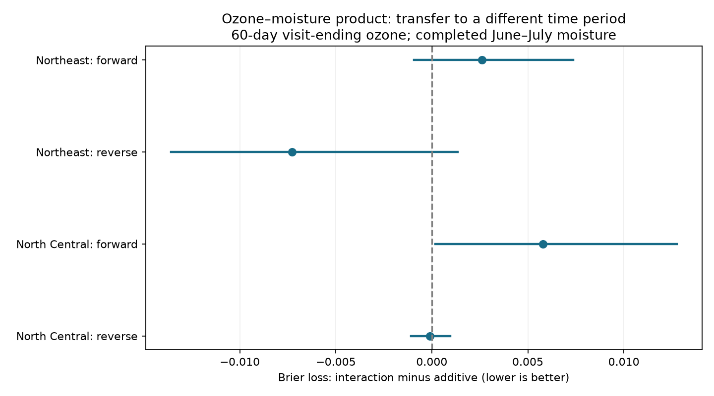

# An ozone and moisture product gave no clear time-transfer gain for forest injury in four eastern US tests in 1994-2010

We tested whether an ozone and soil moisture product improves plant injury predictions in a different time period. We used a verified public-data panel from US Forest Service surveys, EPA ozone monitors and NOAA moisture fields. Four tests used two eastern US regions and transfers between 1994-2002 and 2003-2010. Models used the same monitored sites, visit-ending 60-day ozone, completed June-July moisture, visit date, plant and species counts, and a time trend. Adding the product changed Brier loss by +0.00260 and -0.00728 in the Northeast and +0.00579 and -0.00009 in North Central states. Positive values mean higher error. All four nominal family intervals included zero. Forward models also had higher loss than a constant training injury rate. Removing the time trend changed some results. This fixed model test did not establish a common gain or absence of an ozone mechanism. Small selected samples, coarse exposure, few test years, fixed training fits and unmeasured missed injury limit the result. Code, aggregate results and verified-source retrieval instructions are included.



## Question and prior work

Does the ozone and soil moisture product help predict visible injury at the same forest sites in a different time period? Moisture can change ozone uptake through leaf pores. Smith, Morin and McCaskill (2012; doi:10.2737/NRS-GTR-103) describe injury in this survey network. Bueker and colleagues (2012; doi:10.5194/acp-12-5537-2012) model soil water effects on ozone uptake. These mechanisms do not ensure a prediction gain in a new period.

Campaign publication 268004a08eb37a3a36207332736b005b07fe9d13a4687a19b1e966f96044ecb6 built the input panel. It reported a positive pooled ozone and moisture product slope. Publication 29a66dcad4d1679fc2b2a1d38ce3f74aac627d2501d8a2fb9efa3b831e91470b found uncertain regional slopes after separating site means and annual changes. Publication 692d3bca402fba3ff66036da056504f2172019aedd516d3b1b25f447e04bc731 tested future exposure controls. We add a test of prediction loss on years withheld from fitting. This is a new analysis of overlapping data. It is not independent source validation.

Searches for phenology, climate, pollution, cherry, biosites, ozone survey timing and wildflower preceded the question choice. The model and checks were set before fitting. The study was not registered. The four-test intervals do not account for all campaign choices.

## Input and selection

We used only `files/data/analysis_panel.csv` from the verified parent ZIP. The panel has 7,036 site-years. Its SHA-256 is `b8096a35a665bd8d8dbb80c3dbdd2bf4052828b6feb15116484477f66675e31c`. `files/provenance.json` gives the exact source bundle path, bundle hash, entry hash and source URLs. The source snapshot date is 9 November 2026. We did not rebuild the raw joins. The panel values have about five significant digits. `files/parent_raw_hashes.txt` preserves the parent's raw hashes. These are not new raw-file checks.

No shared raw dataset was used. We checked relevant shared dataset names, and reused the signed campaign panel in place. The package has no raw or record-level derivative data. A retrieval script writes the exact panel to external scratch. The source terms and attribution are in `files/EXTERNAL_DATA.md`.

We use Northeast and North Central states, with sufficient years for two periods. The Pacific record is shorter and is not tested. Records need a positive plant count, complete predictors and visit day at least 214. Thus June and July end before the visit, including leap years. The primary ozone variable is W126 for the 60 days ending on the visit date, in 10 ppm-h units. This includes the full visit day, so some hours can follow the actual field visit. Moisture is the June-July CPC anomaly in local SD units against 1981-2010. Neither is measured ozone flux through leaves. We omit summer temperature because the source summer window can extend beyond the visit.

For a forward test, train on 1994-2002 and test on 2003-2010. For a reverse test, exchange those periods. Reverse tests are transfer diagnostics, not prospective forecasts. Each site must have at least three complete training records and one test record. Test outcomes do not determine selection, scaling or model fitting. The four outcome sets have 971 records in total. Some sites occur in both tests, and training and test roles exchange. These are not four independent experiments. The early North Central training sample is small. Site rules select monitored survivors and exclude new sites.

## Fixed prediction method

Both models are penalized logistic regressions. The additive model includes ozone, moisture, visit day in ten-day units, log evaluated plant count, evaluated species count, calendar year minus 2002, and one indicator per training site. The second model adds the raw ozone times moisture product. Continuous predictors, including the product, are centered and scaled using training data only. Site indicators are not scaled. No predictor uses test injury labels. Both models use scikit-learn LogisticRegression with C=1, the L2 penalty, an unpenalized intercept, lbfgs, tolerance 1e-10 and at most 10,000 iterations. Site coefficients are shrunk rather than treated as unpenalized fixed effects. There is no hyperparameter search. The product can capture site contrasts as well as annual changes; this is a prediction test, not a within-site causal slope test.

The main score is the mean squared error of predicted injury probability, called Brier loss. The target is interaction loss minus additive loss on identical test rows. A negative change is a gain. We also report log loss, mean predicted probability, observed injury frequency and the loss from the constant training injury rate. Current visit effort is available only when a survey is done. These are retrospective predictions with observed test covariates, not forecasts made before the season.

Uncertainty resamples whole test calendar years, with replacement, in 20,000 paired draws. The fitted training models stay fixed. All sites in a selected year move together. Loss sums divided by sampled row counts give record-weighted mean changes. `lo` and `hi` are percentile 95 percent intervals. `lo_family` and `hi_family` use 0.625 and 99.375 percent quantiles, a nominal Bonferroni adjustment for four primary tests. These are approximate intervals. Eight or nine test years give limited information, and serial dependence can invalidate year independence. They omit uncertainty from training data, site sampling and model choice. `sign_p` is an exact enumeration of sign flips of annual loss sums under symmetric, independent annual differences. Those assumptions are not guaranteed by the observational design; it is a diagnostic only.

Two checks use the same method: remove the time trend, or replace ozone and moisture with the parent three-month maximum ozone and June-August moisture. The latter windows can include exposure after a visit. It is a descriptive season check and cannot validate time order. Missingness can change its selected sample slightly. We do not select a preferred model from test losses.

## Results

| Test | Train records | Test records | Sites | Additive loss | Loss change | 95 percent interval |
|---|---:|---:|---:|---:|---:|---|
| Northeast, forward | 297 | 323 | 62 | 0.25493 | +0.00260 | -0.00093 to 0.00736 |
| Northeast, reverse | 928 | 365 | 161 | 0.22648 | -0.00728 | -0.01359 to 0.00136 |
| North Central, forward | 61 | 73 | 13 | 0.26589 | +0.00579 | 0.00017 to 0.01276 |
| North Central, reverse | 938 | 210 | 150 | 0.22427 | -0.00009 | -0.00109 to 0.00096 |

The forward loss changes are positive in both regions. Reverse changes are negative. All four primary family intervals include zero. The early North Central marginal interval excludes zero on the side of higher error, but its family interval does not. The sign diagnostics range from 0.133 to 0.684. Log-loss changes have the same signs as Brier changes. This result does not establish a common prediction gain or equal performance.

Forward additive loss also exceeds the constant training-rate reference: 0.25493 versus 0.24675 in the Northeast, and 0.26589 versus 0.23207 in North Central states. In the Northeast forward test, observed injury frequency is 0.41486 but the additive mean prediction is 0.23785. The interaction does not correct that underprediction. This is evidence of poor transfer for the fixed full model, not proof that ozone and moisture lack useful information.

Without the time trend, forward changes are -0.00041 and +0.00435, and reverse changes are -0.00862 and -0.00027. All four family intervals include zero. The Northeast forward additive loss falls to 0.22090. Thus time-trend extrapolation is an important part of the primary model failure. The no-trend Northeast reverse marginal gain does not survive the family interval. Seasonal product changes also have family intervals that include zero. Full values are in `files/results.csv`.

## Checks and limits

All fits converged before the iteration limit. For the eight primary fitted models, an independent Newton-Cholesky solver gives test probabilities within 1.1e-6 of lbfgs. The code checks unique site-year keys, binary injury and the exact source hash. `files/checks.csv` records convergence and solver differences. `files/annual_losses.csv` gives aggregate yearly loss sums and counts so that the uncertainty calculation can be inspected without source records.

Site indicators account for stable differences. Plant and species counts partly account for the chance to detect injury. They do not fix species identity, field skill, missed injury or protocol changes. Effort may respond to stress, so it is not a neutral causal adjustment. The source uses expert-validated calls, but missed field injury is unknown. Coarse moisture, monitor interpolation, parent matching choices and rounded values can affect transfer. Regions share weather systems. Temporal splits share sites and reuse training outcomes in the reverse test. The small early sample, shrinkage choice and linear time trend limit general use.

This study measures visible stress in selected indicator plants. It does not measure biodiversity loss, range shifts, mortality or climate-change attribution. A real physiological interaction may fail to improve this fixed prediction rule. The evidence does not rule out better mechanistic models, other ozone windows or different regularization. We did not search for them using the test labels.

## Reproduce

From the publication folder, run:

```sh
OPENBLAS_NUM_THREADS=1 OMP_NUM_THREADS=1 python files/analyze.py --campaign /path/to/campaign --scratch ../reproduction
```

The script verifies the complete parent ZIP with SCI, retrieves the exact panel, checks its hash and writes all outputs outside the signed folder. Alternatively use `--panel /path/to/exact/source_panel.csv` instead of `--campaign`. Compare generated aggregate CSV files and the PNG to those bundled here. Floating-point differences can occur across library versions. `files/environment.json` records the versions used. Python 3.12, NumPy, pandas, SciPy, scikit-learn and Matplotlib are required. No random fitting or tuning is used; the year bootstrap seed is 571108.

For raw reconstruction, retrieve the parent entries `files/code/00_retrieve.sh` and `files/code/01_fia_prepare.py` through `03_moisture.py` with `sci read --file ... --output ...` into external scratch. The parent README documents source joins and completeness rules. The archived parent panel is the exact input for this test; current public endpoints may have changed. No result depends on this worker's private scratch surviving.

## Job and rights

Job: sci-1107-dell-climate-pollution-biodiversity-57d0834cd424. Topic: climate-pollution-biodiversity. Campaign: 11_07_2026. Machine: dell. Account: codex-andrii. Model: gpt-6.1-sol, high reasoning effort. No agents were launched. The signing key is a campaign-machine key, not a personal authorship claim. The SCI baseline license covers our supplied code, text, figure and aggregate results. External records remain outside the bundle. No remote upload or submission was made.
