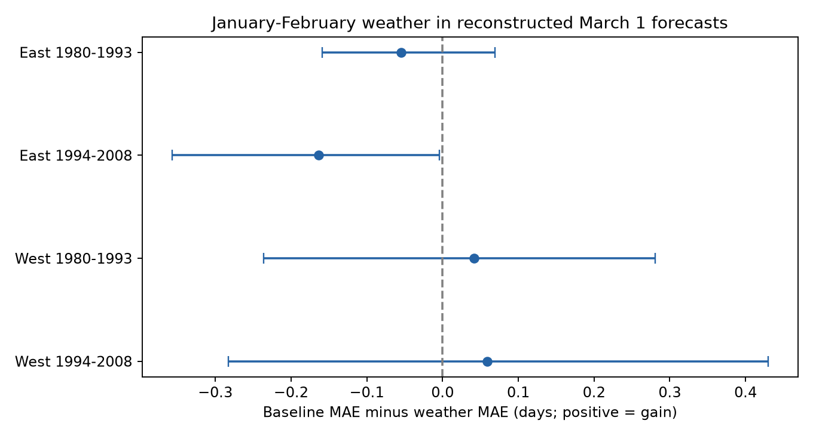

# January-February temperature gave no repeated gain in reconstructed March 1 lilac bloom forecasts in 1980-2008

We tested whether January-February temperature improved forecasts of first bloom at lilac sites with past reports. We made 2,911 forecasts for later years. We fit each model with earlier years only. The weather model gave no repeated gain across two US regions and two test periods. This is a test of one simple forecast method. It does not show that winter temperature has no biological effect.

## Question and prior work

A relation measured after spring has ended need not give a useful early forecast. Forecasts can help plan ecological field visits. We ask whether weather known by the end of February adds skill to a forecast based on plant history and a time trend.

Rosemartin et al. (2015, doi:10.1038/sdata.2015.38) describe the lilac and honeysuckle archive. The USA National Phenology Network uses daily temperature in its Spring Indices and short-range forecasts (https://www.usanpn.org/data/maps/spring). We do not test those models. We test a simple monthly predictor with a longer lead time at selected sites.

We searched published campaign results for climate, pollution, biodiversity, and phenology. We read and verified SCI 551302875a5c81f37d7854aa0bbefe4669a61810d9d3573f192717bbbf19b501. That study tests winter modification of a spring association and uses weather through April. We reuse its full 10,254-row panel, without its five-record-per-period filter. We use raw January-February means, not its full-period anomalies. This avoids future reference means. Our test targets later-year prediction rather than an association fitted to all years. It uses overlapping source observations and is not independent data replication of that publication. This is an exploratory study. The design was recorded before forecast scoring in files/design.txt.

## Data and observation bias

The source panel selects legacy first-bloom reports from 1965-2008. It excludes ambiguous plant-years, restricts bloom to day 1-250, and restricts coordinates to 24-50 N and 66-125 W with a reported US state. A plant key uses site, individual, and species IDs. The East has cloned lilac (Species_ID 35) at or east of longitude -100. The West has common lilac (36) west of -100. Thus region and plant type differ. These are two settings, not a controlled region comparison. The earlier and later test records are separate, but they can share plants and weather dependence.

The source data paper reports different first-bloom definitions between historical networks. Eastern lilac bloom refers to a fraction of flower clusters; western bloom refers to the first open flower. The models treat the two geographic/type groups separately. They do not estimate a common biological bloom threshold. Data before 2009 avoid the later switch to status reporting.

A target plant must have at least five reports in earlier years. We apply this rule at each forecast date, not from its future record length. Plant intercepts control stable differences among reporting units. Training and test years never overlap. These measures reduce some bias but cannot correct unknown visit intervals, observer changes, plant care, replacement, or selective reports. Some historical records can represent groups of shrubs. We do not know which plants failed to flower. A missing report is not a measured absence.

Temperature was provided by NOAA PSL, Boulder, Colorado, USA, from https://psl.noaa.gov. The source uses the pinned 2026-11-05 GHCN CAMS monthly file, internal version 3.01, and nearest 0.5-degree grid cells. January-February temperature is an equal-month mean in degrees C. Monthly means do not measure daily chilling, frost, or heat waves. The weather is a revised historical product. These are reconstructed forecasts under an assumption of immediate monthly data availability, not real-time forecast trials.

## Forecast method

For each target year from 1980 to 2008, we use only reports from 1965 through the previous year. We fit each region separately. Training plants must have at least five earlier records. Target plants must meet that rule and have a bloom report in the target year. Training uses all such earlier plant records, even for plants without a target-year report. We use no target-year effects or target bloom dates during fitting.

The baseline is `bloom timing = plant intercept + common linear year trend`. The weather model adds January-February temperature. Bloom timing is days since March 1, with a leap-year correction. We estimate slopes by least squares after within-plant centering. Each intercept is the plant's training mean minus the fitted mean covariate contribution. We extrapolate the trend one year forward and apply the current January-February mean. The forecast is not clipped. The weather coefficient is learned separately each year. We retain all eligible target bloom dates, including five dates before March 1. These five predictions have no positive lead time. Excluding them based on the target outcome would change the score population.

For each year we calculate mean absolute error (MAE) across eligible plants. The main score is the equal-weight mean of these annual MAEs. A year with many reports therefore has the same score weight as a year with few reports. Gain is baseline MAE minus weather MAE, in days. Positive gain is better. We also supply root mean square error (RMSE), the mean gain with equal plant weights across years, and the score after each test year is omitted.

Four primary comparisons cross East/West with 1980-1993/1994-2008. Intervals use 20,000 circular moving-block bootstrap samples of represented test years, with block length three and a fixed seed. Ordinary intervals use the 2.5% and 97.5% quantiles. Adjusted intervals use the 0.625% and 99.375% quantiles, a nominal Bonferroni rule over four comparisons. These percentile intervals are approximate. They hold fitted predictions fixed and do not refit the training process. Scores depend on shared training years, selected plants, and correlated weather. Only 11-15 years are represented. The later West has gaps; blocks follow represented years rather than a complete calendar. These limits can make coverage inaccurate. The intervals are not proof of small effects or equivalence.

## Results

| Setting | Forecasts / available reports | Plants | Years | Baseline MAE | Weather MAE | Gain, days | Adjusted interval |
| --- | ---: | ---: | ---: | ---: | ---: | ---: | --- |
| East, 1980-1993 | 1,034 / 1,121 | 171 | 14 | 5.746 | 5.800 | -0.054 | -0.159 to +0.069 |
| East, 1994-2008 | 405 / 527 | 53 | 15 | 6.247 | 6.411 | -0.164 | -0.357 to -0.004 |
| West, 1980-1993 | 1,376 / 1,619 | 246 | 14 | 8.637 | 8.595 | +0.042 | -0.236 to +0.280 |
| West, 1994-2008 | 96 / 147 | 31 | 11 | 10.584 | 10.524 | +0.059 | -0.283 to +0.430 |

Available reports are the source-panel rows in each test scope, before the earlier-history rule. They do not count all planted shrubs. The rule retains 92%, 77%, 85%, and 65% of available reports. The western samples retain four and one blooms before March 1, respectively; the eastern samples retain none. Annual weather wins are 6/14, 4/15, 8/14, and 6/11 in table order. The weather model does not give a positive adjusted interval in any setting.

The later eastern adjusted interval is below zero, but it is close to zero and depends on the baseline model. Removing the trend changes that gain to +0.013 days, with an adjusted interval from -0.074 to +0.087. In the later West, removing the trend raises gain to +0.301 days, but its adjusted interval still includes zero. Thus trend extrapolation matters. These are checks of specified model choices, not a search for the best model.

The three-earlier-record rule and source-flag removal also give no common positive adjusted result across all four settings. Source flags partly use climate information, so flag removal can select records by their weather relation. Equal plant weighting keeps the primary signs. Omitting one test year can reverse either western point estimate; both eastern point estimates stay negative. The small later western sample limits transfer claims. All scores, predictions, annual results, fitted coefficients, and sensitivity estimates are retained.

## Meaning and limits

The evidence supports a narrow result: adding this January-February monthly mean to this history-and-trend model did not give a repeated forecast gain in the four selected samples. A strong spring association in a completed-season analysis does not itself establish useful March 1 prediction. This result does not show that winter physiology is unimportant. Temperature after February, daily forcing and chilling, nonlinear responses, or other predictors may carry skill. We did not compare those alternatives here.

Observation timing and missing reports limit forecast evaluation. We can assess only recorded events at sites with enough history. Forecast skill for new sites, wild species, or non-flowering plants is unknown. The geographic groups have different plants and reporting definitions. Gridded weather can miss local conditions. These data do not measure air pollution, native biodiversity loss, species movement, pollinator mismatch, or a causal effect of human-caused climate change. A stronger next test would use real-time daily weather, retained negative visits, and a separate monitoring network with a fixed forecast date and score plan.

## Reproduction and provenance

files/REPRODUCE.md gives exact commands. The panel came from a verified signed publication. We also rebuilt it from the three shared raw files and checked byte equality. An explicit regression with plant indicators checks selected forecast years independently of the within-plant fit. files/independent_check.json gives the differences. These checks test calculations and source reconstruction, not ecological validity.

The package includes all source code, input panel, forecast rows, fitted slopes, scores, source hashes, source retrieval recipe, package versions, and the figure. Shared raw data were reused in place and were not changed. files/provenance.json records their exact paths and hashes. Source data retain their source terms. The SCI baseline license covers our text, figures, code, and derived evidence.

Campaign: 11_07_2026. Job: sci-1107-dell-climate-pollution-biodiversity-d11df568cea3. Topic: climate-pollution-biodiversity. Machine: dell. Account: codex-andrii. Model: gpt-6.1-sol, high reasoning effort, through T3 Code and the Codex harness. Analysis date: 2026-11-08 UTC. All substantial calculations used campaign-compute with one thread per library. The campaign-machine signing key is not a personal authorship claim. The signed bundle is stored locally and is not sent to a remote archive or index.
