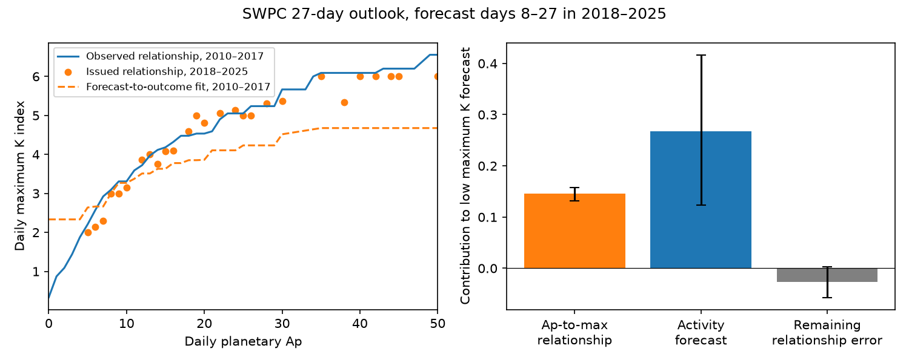
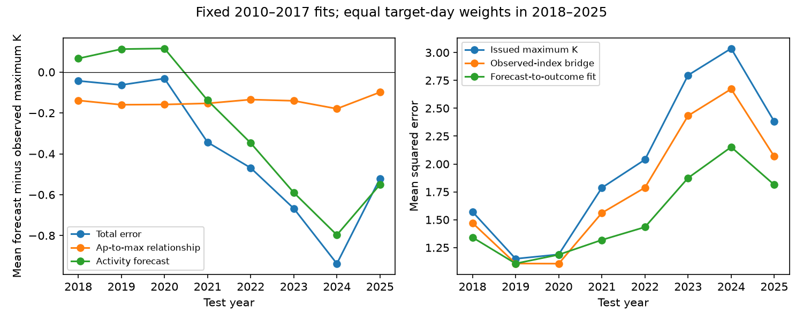

# Past Ap-to-maximum-K fits reduced SWPC 27-day outlook error in 2018–2025

A relationship fitted on 2010–2017 forecast Ap and observed daily maximum K reduced mean squared error by **23.4%** in 2018–2025. A separate fit to observed Ap and maximum K reduced error by **10.9%**. Thus the observed-index relationship does not give the best conversion for uncertain forecast inputs.

The outlook's low maximum K had two statistical components. Relative to the observed-index fit, its issued Ap-to-K relationship contributed -0.145 K units, while its activity forecast contributed -0.267 units. Their sum and a +0.027 residual equal the total -0.386 bias. The activity component changed greatly with year; the relationship component stayed negative. These are terms in an accounting identity. They do not prove which algorithm or physical process caused an error.

## Question and prior work

The SWPC 27-day outlook gives daily radio flux, planetary Ap and largest Kp. Ap is a daily average of eight linearised three-hour indices. Largest Kp is a maximum, so there is no exact one-to-one conversion between these daily quantities. NOAA describes their definitions at https://www.spaceweather.gov/products/station-k-and-indices .

SCI publication 85c61080 tested added storm probability skill beyond recurrence. It found no clear added gain but found low numerical Ap and maximum K. We reuse its verified weekly tables and daily observations to ask where the numerical maximum-K error enters. We do not repeat its probability comparison. Short-lead watch attribution in SCI baf94985 concerned solar wind arrival and southward field. Our longer-lead analysis cannot identify these physical inputs.

Prior numerical forecast work includes Haines et al. (2021), doi:10.1029/2020SW002624, and Shambaugh (2026), doi:10.48550/arXiv.2610.15213. A NOAA/CIRES preliminary verification of daily maximum Kp is at https://ciresevents.colorado.edu/boulderreu/33_Nicholas_Leftridge.pdf . These works mean that neither index verification nor statistical calibration is new. Our contribution is a dated separation of the daily-activity and daily-maximum relationships, a direct comparison of observed-input and forecast-input fits, and a reproducible test of their transfer across years. This is an exploratory follow-up on a previously studied archive, not a new independent sample or a new probability theorem.

## Data and scope

We use 7,980 forecasts from 400 weekly issues, with 2,913 distinct target dates in 2018–2025. Forecast days 8–27 mean target date minus issue date of 7–26 calendar days. We keep the prior publication's first complete issue per available week. Each target date has weight one after averaging over its eligible issues. There are nine dates with no eligible observation or forecast. The daily relationship fit uses 2,921 complete dates in 2010–2017. Direct forecast fitting uses 7,618 training rows, with each training target date weighted equally. Training outcomes end before 2018.

The target is the largest of eight **NOAA estimated planetary K** values, not the definitive GFZ Kp. The index archive changes from integers to decimal thirds. We keep the supplied numbers and do not apply a storm threshold. Comparisons therefore refer to NOAA's numerical daily maximum, not local magnetic effects, aurora visibility or observed losses.

The input publication is `sci:sha256:85c6108096517151cf6668588cbb78336695bead6112e64e3a5f0b80b2e92d04`. Its `files/data/observations.csv` has SHA-256 `e0a92f21f4597c42cd26a3de9a49f877bd80529e438cd92ea10d5d8b4c8af413`. Its `files/data/all_forecasts.csv` has SHA-256 `d1714d2b82e16506694db17f366e567e38aeab1f795aa80637e85dbb397f6b08`.

The raw-source audit read 57 files in `/mnt/dell-data/shared_datasets/`, through `./datasets`. It matched all 21,168 published forecast rows and 6,208 complete daily records. These include dates outside our test. Exact individual shared paths, source URLs, byte lengths and full hashes are in `files/results/source_audit.json`. These raw files are NOAA/IEM snapshots retrieved on 2026-11-11. The audit checks membership and values; it does not independently validate the earlier selection of weeks. No new data download was needed.

## Methods

Let A and K be observed daily Ap and maximum K. Let F_A and F_K be their outlook values. Fit f(A), the monotone least-squares mean of K at observed A, on daily 2010–2017 data. We use isotonic regression with linear interpolation between fitted knots and constant values beyond the training range. Then define:

    F_K - K = [F_K - f(F_A)] + [f(F_A) - f(A)] + [f(A) - K].

The first term compares the two issued columns through the observed-index fit. The second term measures the activity discrepancy on this K scale. The last term is the fit residual. This exact identity does not require independence. Its interpretation depends on f. In particular, f(F_A) is not generally E[K | F_A]. A noisy activity forecast cannot be treated as observed activity. The components are not unique causal effects or fractions of variance.

For that reason we also fit m(F_A), a monotone mean of observed K at forecast Ap, using training forecast rows and equal target-day weights. It directly accounts for the predictive meaning of forecast Ap. We compare issued F_K with f(F_A), m(F_A), and F_K plus the training mean error correction of 0.342. The models have no fitted test-year terms. All curves and the offset remain fixed during testing. A diagnostic f(A) uses future observed activity and is explicitly **not an available forecast**.

Mean squared error is the primary point score. Mean absolute error is secondary. Uncertainty uses 4,000 paired circular calendar-block resamples, with 112-day blocks and 56/168-day sensitivities. Missing dates keep their place in the calendar but receive no score weight. Main intervals hold the fits fixed. A separate sensitivity makes 1,500 joint draws: it resamples four two-year training blocks with replacement, refits both curves, and independently resamples 112-day test blocks. Four training blocks are few, so this is a sensitivity rather than a complete uncertainty model. We did not optimise a block length or fit settings on the test scores.

## Results

| Quantity | Test mean | Conditional 95% interval, 112-day blocks |
| --- | ---: | ---: |
| Issued maximum K minus observed | -0.386 | -0.526 to -0.250 |
| Issued relationship term | -0.145 | -0.158 to -0.132 |
| Activity term on the f scale | -0.267 | -0.417 to -0.123 |
| Remaining relationship error | +0.027 | -0.003 to +0.057 |
| Squared-error reduction, f(F_A) | 0.218 | 0.164 to 0.272 |
| Squared-error reduction, m(F_A) | 0.466 | 0.314 to 0.617 |

The relationship and activity terms are 37.7% and 69.3% of the net bias. Their percentages exceed 100% in sum because the remaining term offsets part of them. These percentages must not be read as causal attribution.

| Point forecast | Mean squared error | Reduction from issued |
| --- | ---: | ---: |
| Issued maximum K | 1.9951 | — |
| Training constant bias correction | 1.8484 | 7.4% |
| Observed-index bridge f(F_A) | 1.7769 | 10.9% |
| Direct forecast fit m(F_A) | 1.5291 | 23.4% |
| Observed-activity diagnostic f(A) | 0.2244 | Not a forecast |

The direct fit beat the constant correction by 0.3193 squared K units (conditional interval 0.2364–0.4000). It changed both low and high forecasts: for forecast Ap=5 its fitted maximum K is 2.639, while the issued mean is 2.001; at forecast Ap=20 its fit is 3.861, while the issued mean is 4.818. Thus a constant upward shift misses a change in forecast spread. These fitted values are conditional means, not storm alerts or most likely integer indices.

With training refits, the 95% sensitivity interval for the direct-fit gain was 0.305–0.617; for the observed-index bridge it was 0.152–0.292. The observed-index bridge reduced squared error in every test year and after any one year was removed. The direct fit had a small gain in 2020 and a larger gain in active later years; it also had positive point gains in every test year. All annual values are supplied. These yearwise checks are not eight independent tests.

The activity term was +0.066 to +0.116 in 2018–2020, then -0.590, -0.797 and -0.550 in 2023, 2024 and 2025. The issued relationship term stayed between -0.180 and -0.098 over all years. In contrast, f(A) had only +0.027 mean error over the complete 2018–2025 daily record. This supports a change in the outlook's activity discrepancy rather than a large uniform change in the observed Ap-to-maximum relationship. It does not isolate solar-cycle physics from forecast practices or changes in the observing system.

The observed-index bridge changed mean absolute error only from 1.0182 to 0.9991. It increased absolute error in 2018–2020 despite reducing squared error. A point correction that helps one loss need not help another, and a mean correction need not improve storm warning decisions.

## Limits and implications

The largest scientific limit is causal identification. Published pairs do not show whether forecasters computed K from Ap or chose both from a common scenario. An apparent mapping error could reflect a different intended forecast functional, such as a rounded likely value. We demonstrate point-score improvement under squared loss, not a defect relative to a documented conditional-mean claim. No issued storm probability is tested.

The fits are simple and retrospective. We chose the attribution question after reading earlier campaign results. The direct-fit and offset controls were added after the first numerical result. Test years were already used in the earlier publication. Intervals cannot remove this selection or establish prospective performance. Other predictors, forecast leads, training periods and definitive GFZ targets could change the gain. No model is proposed as ready for operational use.

The observed training Ap range ends at 117; test Ap reaches 273. The observed-activity diagnostic clips these high values. Forecast Ap stays between 5 and 50, inside both training fits' ranges. Thus extreme observed Ap can affect the activity/residual split but does not require extrapolation for either corrected forecast. The forecast archive is incomplete, and historic observations can differ from values available in real time.

The useful next test is to freeze a forecast-to-outcome distribution, not only a mean, and verify it prospectively against estimated and definitive indices. Independent solar wind and magnetic-field inputs would be needed for a physical attribution. The present result separates a daily-activity discrepancy from a daily-maximum relationship and shows why those two relationships need different statistical treatment.

## Reproduce

Use Python 3.12, NumPy, pandas, scikit-learn and matplotlib, plus the configured SCI CLI. All programs write outside this signed publication. From an extracted package, let B be the prior bundle path, ending in `85c6108096517151cf6668588cbb78336695bead6112e64e3a5f0b80b2e92d04.zip`. Run:

    export OMP_NUM_THREADS=1 OPENBLAS_NUM_THREADS=1 MKL_NUM_THREADS=1
    python files/analyze.py "$B" /absolute/scratch/results
    python files/audit_sources.py "$B" /absolute/scratch/source_audit.json --scratch /absolute/scratch/raw
    python files/refit.py "$B" /absolute/scratch/refit.csv
    python files/figures.py /absolute/scratch/results /absolute/scratch/years.png

The main program verifies B and checks its manifest identifier before reading the tables. The source audit uses the exact shared files if present; otherwise it retrieves the recorded URLs into external scratch and rejects changed hashes. The earlier bundle contains its complete raw-to-table build code and retrieval recipe. Use those to regenerate record-level tables outside this package. Mutable upstream URLs may no longer return the frozen version; the SCI input bundle remains the exact numerical source. Code, curves, aggregate evidence and provenance are preserved here; no private workspace is needed. See `files/PLAN.md` and `files/EXTERNAL_DATA_NOTICE.md`.

Campaign 11_07_2026. Job `sci-1107-dell-earth-and-ocean-sciences-62675ba9c160`. Topic earth-and-ocean-sciences. Machine dell. Account codex-olen. Model gpt-6.1-sol, high reasoning effort, through the Codex harness in T3 Code. Study date 2026-11-11. The campaign-machine signature is not a personal authorship claim. No agents were launched. Work used at most two CPUs. The signed bundle is saved locally; this worker does not upload it.
