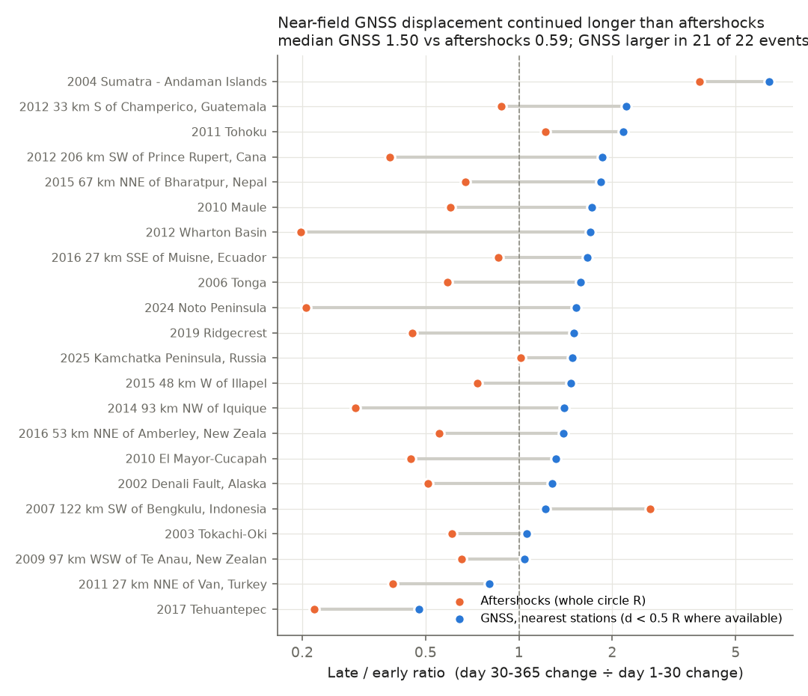
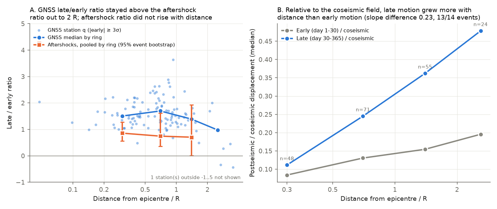
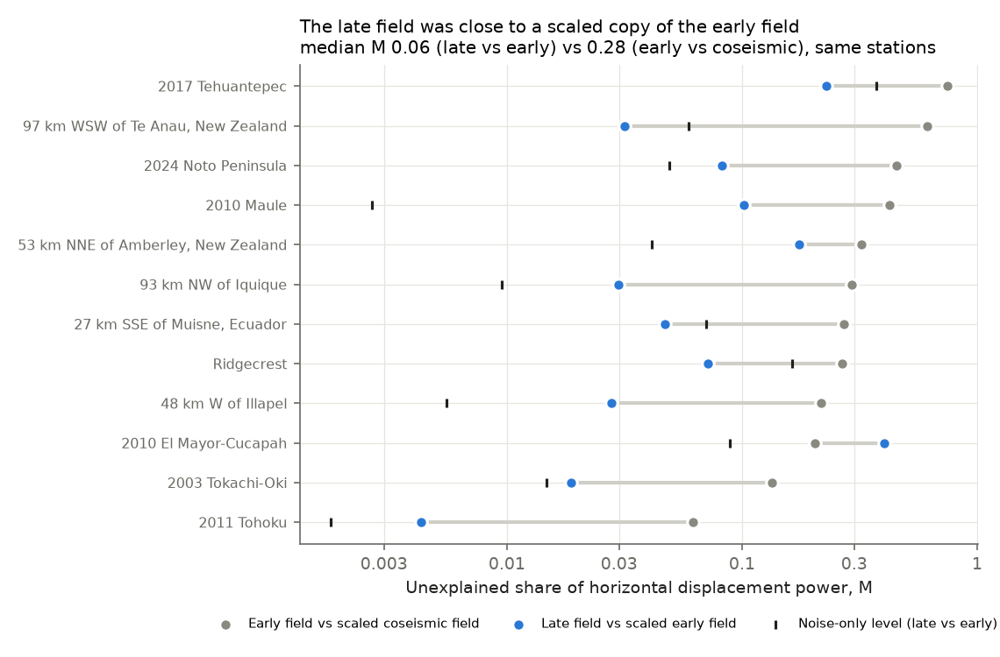

# Near-field GNSS motion in days 30-365 kept the early postseismic pattern but was 2.5 times the aftershock late-to-early ratio after 22 large shallow earthquakes (2002-2025)

**Job:** sci-1107-hp-earth-and-ocean-sciences-f731e01fde81 · **Topic:** earth-and-ocean-sciences · **Machine:** hp · **Model:** Claude Opus 5.5 (claude-opus-5-5), account claude-olen · **Campaign:** 11_07_2026 · **Date:** 2026-11-12.
The signing key is a campaign-machine key. It is not a personal authorship claim.

## Summary

A prior campaign study (sci:sha256:0a71c00223732ee37135afa976dfcaf167fd6f7038dcecd85f6f170070c9dd3b) found that GNSS postseismic displacement grows later in the first year than aftershock counts after 24 large shallow earthquakes. It left one question open: does a separate process (for example, viscoelastic relaxation in the mantle) make the late GNSS motion, or does the same source continue to move with fewer aftershocks per unit of motion?

We did a test with the spatial pattern of the displacement. If a separate, broader process makes the late motion, then (a) the late displacement field is not a scaled copy of the early field, and (b) the late-to-early ratio increases with distance. We used the same 24 events, 441 Nevada Geodetic Laboratory (NGL) stations out to 6 times the rupture radius R, and three daily-position windows: coseismic (C, to day 1), early (E, day 1 to 30) and late (L, day 30 to 365).

**Main results**

1. **Near-field mismatch (planned test P3).** At the stations nearest to the rupture (distance below 0.5 R where available), the late horizontal displacement along the early direction was a median **1.50 times** the early displacement (bootstrap 95% CI 1.33-1.69; 22 events). The aftershock late-to-early ratio in the same events was a median **0.59**. The GNSS ratio was larger in **21 of 22** events (Wilcoxon p = 1.5e-4). The difference was present for onshore crustal events (8 of 8; median 1.35 against 0.46) and for subduction-zone and offshore events (13 of 14; 1.62 against 0.61).
2. **Same pattern (planned test P2 and a benchmark).** The late field was close to a scaled copy of the early field, L = k E, with median k = 1.39. The unexplained share of late displacement power was a median **0.06** (12 events). On the same stations, the early field compared with the scaled coseismic field had an unexplained share of **0.28**, and this test rejected a scaled copy in 12 of 12 events. Thus the test can detect a change of source pattern of the size that occurs between coseismic slip and early afterslip. The late-against-early copy was rejected (p < 0.01) in 6 of 13 events with the planned noise model (10 of 13 with a less conservative noise model), but the misfit was small in most of them (exception: El Mayor-Cucapah 2010, 0.40).
3. **Distance (planned test P1).** In stations with a clear early signal, the late-to-early ratio did not change clearly with distance: median slope 0.31 per decade of d/R (95% CI -0.66 to 0.55; 13 events). Few far stations (beyond 2 R) had a clear early signal, so this test has low power.
4. **Gradual broadening relative to coseismic motion (secondary, post hoc).** With the coseismic displacement as reference (198 stations), late motion grew more with distance than early motion. The median distance slope of L/C was 0.30 and of E/C was 0.10 per decade of d/R (difference 0.23, CI 0.10-0.53; larger in 13 of 14 events). The aftershock late-to-early ratio did not increase with distance (pooled 0.86, 0.74 and 0.70 in rings 0-0.5 R, 0.5-1 R and 1-2 R).
5. **A processing error in the prior code (secondary).** The prior rule that removes steps of later M6+ earthquakes (3-day medians) can use pre-mainshock days when the step is in days 1-3. With that rule, near-field late vectors at Iquique 2014 and Illapel 2015 pointed opposite to the early vectors. A local line-and-step fit on post-mainshock days only removed this artifact. Of 550 listed station steps, only 24 were significant. The prior study's conclusion did not change: on 73 matched stations, the late share was 0.65 (published), 0.62 (prior rule, our windows) and 0.60 (corrected rule).

**Interpretation.** A separate broad process does not explain the GNSS-aftershock mismatch by itself. The mismatch is largest in the near field, and the late field keeps most of the early pattern. Thus most late surface motion near the rupture comes from a source with nearly the same surface pattern as the early postseismic source, but this source makes far fewer aftershocks per unit of motion in days 30-365 than in days 1-30. A smaller, broader component that grows with time is also present (result 4). If the surface motion follows U = A ln(1 + t/c), the near-field ratio of 1.50 gives c of about 7 days (CI 5-9 days). The aftershock ratio of 0.59 needs c near 0 and p slightly above 1. Possible causes include afterslip that continues in or just below the rupture area with fewer aftershocks per unit slip, or a near-field deep process with a surface pattern that is similar to early afterslip at these stations. The data do not separate these two causes.

## Question and hypotheses

- **H_A (same source, decreasing aftershock productivity):** late displacement field L = k E at all stations of an event; the ratio q = L·Ê/|E| does not depend on distance; near-field q is larger than the aftershock ratio rho_N.
- **H_B (separate broader late process):** L differs from k E; q increases with distance; near-field q is close to rho_N.

We wrote the plan (P1-P3, inclusion rule, noise model) in the work log before we computed any vector. We chose the secondary analyses S1-S5 after the first planned run. We identify them as post hoc.

## Data

| Source | Use | Access |
|---|---|---|
| NGL IGS20 daily positions (Blewitt et al. 2018) | tenv3 files for 441 stations | `https://geodesy.unr.edu/gps_timeseries/IGS20/tenv3/IGS20/<STA>.tenv3`, retrieved 2026-11-12. Four files and 15 earlier downloads are in the campaign store (`datasets/ngl-igs20-tenv3-<sta>-20261112`); the others were downloaded directly. `files/data/tenv3_used_sha256.csv` gives byte counts and SHA-256 of every file that we read. |
| NGL station list and step file | Station spans and coordinates; equipment and earthquake steps | Campaign store `datasets/ngl-dataholdings-20261112/DataHoldings.txt` (SHA-256 4a98b65a...) and `datasets/ngl-steps-20261112/steps.txt` (887501a4...); see `files/data/ngl_metadata_provenance.json`. |
| USGS ComCat | Events M >= Mc within min(3 R, 1500 km), days -400 to +366 | FDSN event service; query URLs in `files/data/comcat3R_provenance.csv`; files in `files/data/comcat3R/` (US Government public domain). |
| Prior campaign bundle sci:0a71c002... | Event list, R, Mc, t_first, phi_U, phi_N (`files/data/event_table.csv`) and per-station phi (`station_phi.csv`) | Campaign folder. |

## Method

1. **Stations (`01_select_stations.py`).** For each of the 24 included events, NGL stations with data from day -540 to +400 and no equipment step from day -1 to +400, in distance bins d/R = 0-0.5, 0.5-1, 1-2, 2-3.5, 3.5-6 (maximum 1500 km). At most 8, 8, 5, 5 and 5 stations per bin, by seeded random choice (475 pairs, 441 stations).
2. **Vectors (`03_vectors.py`).** Pre-event model as in the prior study: offset, rate, annual and semiannual terms and NGL steps, fit to days -540 to -0.5 with one 5-MAD rejection. Residuals after the event use the extrapolated model. Steps of other M6+ events from the NGL step file: a line-and-step fit on post-mainshock days in ts-5 to ts+5; we remove the step only if the horizontal step is at least 3 standard errors; we drop the mixed day. Window values: P0 = median of days -10 to -0.5; P1 = first complete day in 0.5-3 d; P30 = median of days 26-35; P365 = median of days 335-395. C = P1 - P0, E = P30 - P1, L = P365 - P30 (east, north, up).
3. **Noise.** A placebo at a pseudo-event 420 days before each mainshock (283 pairs) gives noise factors: RMS(|vector|/sd_h) = 1.31 for E, 3.61 for L and 1.16 for C, where sd_h is the horizontal daily scatter before the event. The late factor has heavy tails (median-based value 1.96). We used the RMS values (conservative) in the planned tests.
4. **Planned tests (`04_analysis.py`).** Inclusion: |E_h| >= 3 sigma_E (112 of 322 usable pairs, 22 events). q = L·Ê/|E|. P1: per event (3 or more stations in 2 or more bins), random-effects weighted fit q = a + s log10(d/R); median s across events with an event bootstrap. P2: weighted fit L_h = k E_h; chi-square against the placebo noise; unexplained share M = sum|L - kE|^2 / sum|L|^2 against the noise-only share. P3: median q at stations with d < 0.5 R (else < 1 R, else nearest) against rho_N = phi_N/(1 - phi_N) from the prior event table (aftershocks above Mc, background removed, same t_first).
5. **Secondary (`05_aftershock_rings.py`, `06_secondary.py`).** S1: a_E = E·Ĉ/|C| and a_L = L·Ĉ/|C| at stations with |C_h| >= 3 sigma_C; per-event distance slopes. S2b: the copy test for E against C on the same stations as a power benchmark. S4: the prior step rule against the new rule. S5: aftershock excess counts in distance rings, background from days -400 to -30 in the same ring.

## Results

| Test | n events | Result |
|---|---|---|
| P3 near-field q against rho_N | 22 | q 1.50 (CI 1.33-1.69) against 0.59; q larger in 21; Wilcoxon p = 1.5e-4 |
| P3, inclusion 2 sigma / 5 sigma | 24 / 19 | 1.50 against 0.57 (23 of 24); 1.49 against 0.60 (18 of 19) |
| P2 scaled copy L = kE | 13 | median k 1.39; M 0.071 (noise 0.049); copy rejected at p < 0.01 in 6 (10 with median-based noise) |
| S2b benchmark on the same stations | 12 | M(E against C) 0.28, M(L against E) 0.06; M(E against C) larger in 11; E against C rejected in 12 |
| P1 distance slope of q | 13 | median 0.31 (CI -0.66 to 0.55); 8 positive; random-effects pooled 0.21 (-0.19 to 0.61) |
| S1 slope of L/C minus slope of E/C | 14 | 0.23 (CI 0.10-0.53); 13 of 14 positive; Wilcoxon p = 0.007 |
| S5 aftershock ratio by ring | 24 | 0.86 (0-0.5 R), 0.74 (0.5-1 R), 0.70 (1-2 R); ring 2-3 R has too few events |
| Rotation of L against E | 106 stations | median absolute angle 4.5°, 7.4° and 11.8° in bins 0-0.5, 0.5-1 and 1-2 R |
| Vertical ratio L_up/E_up | 14 stations | median 0.96; no sign reversal |

### Per-event results

q_near: median q at the nearest included stations (number of stations). rho_N: aftershock late-to-early ratio from the prior study. s: distance slope of q. k, M, M_noise and p: scaled-copy fit of the late field on the early field. M_EC: unexplained share for the early field against the coseismic field. Empty cells: too few included stations.

| Date | Mainshock | M | Stations ok / incl. / bins | q_near (n) | rho_N | s (se) | k | M | M_noise | p (copy) | M_EC |
|---|---|---|---|---|---|---|---|---|---|---|---|
| 2002-11-03 | 2002 Denali Fault, Alaska | 7.9 | 10 / 2 / 1 | 1.28 (2) | 0.51 |  |  |  |  |  |  |
| 2003-09-25 | 2003 Tokachi-Oki | 8.16 | 29 / 15 / 3 | 1.06 (7) | 0.61 | 0.52 (0.15) | 1.10 | 0.019 | 0.015 | 0.075 | 0.134 |
| 2004-12-26 | 2004 Sumatra - Andaman Islands | 9.1 | 1 / 1 / 1 | 6.43 (1) | 3.82 |  |  |  |  |  |  |
| 2006-05-03 | 2006 Tonga | 8 | 5 / 2 / 1 | 1.58 (2) | 0.59 |  |  |  |  |  |  |
| 2007-09-12 | 122 km SW of Bengkulu, Indonesia | 8.4 | 7 / 2 / 1 | 1.22 (1) | 2.64 |  |  |  |  |  |  |
| 2009-07-15 | 97 km WSW of Te Anau, New Zealand | 7.8 | 13 / 4 / 3 | 1.04 (1) | 0.65 | 0.44 (0.48) | 1.09 | 0.032 | 0.059 | 0.771 | 0.615 |
| 2009-09-29 | 2009 Samoa | 8.1 | 6 / 0 / 0 |  | 0.32 |  |  |  |  |  |  |
| 2010-02-27 | 2010 Maule, Chile | 8.8 | 13 / 8 / 2 | 1.72 (4) | 0.60 | 0.79 (0.45) | 1.39 | 0.102 | 0.003 | 0.000 | 0.423 |
| 2010-04-04 | The 2010 Sierra El Mayor, B.C., Mexico | 7.2 | 18 / 8 / 3 | 1.31 (4) | 0.45 | -1.11 (0.92) | 1.23 | 0.402 | 0.089 | 0.000 | 0.205 |
| 2011-03-11 | 2011 Great Tohoku, Japan | 9.1 | 19 / 14 / 2 | 2.17 (6) | 1.22 | 0.55 (0.31) | 2.18 | 0.004 | 0.002 | 0.000 | 0.062 |
| 2011-10-23 | 27 km NNE of Van, Turkey | 7.1 | 11 / 3 / 2 | 0.80 (1) | 0.39 | -0.06 (2.01) | 1.08 | 0.285 | 0.434 | 0.518 |  |
| 2012-04-11 | 2012 Wharton Basin | 8.6 | 6 / 3 / 1 | 1.70 (3) | 0.20 |  |  |  |  |  |  |
| 2012-10-28 | 206 km SW of Prince Rupert, Canada | 7.8 | 13 / 1 / 1 | 1.85 (1) | 0.38 |  |  |  |  |  |  |
| 2012-11-07 | 33 km S of Champerico, Guatemala | 7.4 | 6 / 2 / 2 | 2.21 (1) | 0.88 |  |  |  |  |  |  |
| 2014-04-01 | 93 km NW of Iquique, Chile | 8.2 | 18 / 9 / 2 | 1.39 (5) | 0.30 | 0.62 (0.64) | 1.45 | 0.030 | 0.009 | 0.000 | 0.293 |
| 2015-04-25 | 67 km NNE of Bharatpur, Nepal | 7.8 | 9 / 1 / 1 | 1.84 (1) | 0.67 |  |  |  |  |  |  |
| 2015-09-16 | 48 km W of Illapel, Chile | 8.3 | 16 / 6 / 2 | 1.47 (5) | 0.73 | 0.30 (0.31) | 1.45 | 0.028 | 0.006 | 0.000 | 0.216 |
| 2016-04-16 | 27 km SSE of Muisne, Ecuador | 7.8 | 5 / 3 / 2 | 1.66 (1) | 0.86 | -1.28 (1.07) | 1.52 | 0.047 | 0.070 | 0.483 | 0.272 |
| 2016-11-13 | 53 km NNE of Amberley, New Zealand | 7.8 | 21 / 8 / 4 | 1.39 (4) | 0.55 | -1.28 (0.38) | 1.19 | 0.223 | 0.045 | 0.000 | 0.322 |
| 2017-09-08 | 2017 Tehuantepec, Mexico | 8.2 | 12 / 3 / 3 | 0.48 (1) | 0.22 | 1.89 (1.03) | 0.62 | 0.228 | 0.372 | 0.476 | 0.747 |
| 2018-11-30 | 1 km SE of Point MacKenzie, Alaska | 7.1 | 24 / 0 / 0 |  | 0.46 |  |  |  |  |  |  |
| 2019-07-06 | Ridgecrest | 7.1 | 22 / 4 / 2 | 1.51 (3) | 0.45 | -0.66 (1.86) | 1.54 | 0.071 | 0.164 | 0.834 | 0.266 |
| 2024-01-01 | 2024 Noto Peninsula, Japan | 7.5 | 27 / 11 / 3 | 1.53 (3) | 0.21 | 0.31 (0.33) | 1.96 | 0.082 | 0.049 | 0.021 | 0.455 |
| 2025-07-29 | 2025 Kamchatka Peninsula, Russia | 8.8 | 11 / 2 / 2 | 1.49 (1) | 1.01 |  |  |  |  |  |  |

## What is new

- The first spatial test of the late GNSS excess that the prior study found. It uses 441 stations out to 6 R instead of stations inside R only, and separate early and late 3-D vectors instead of one projected curve.
- A power benchmark (early against coseismic field) that shows that the shape test can detect a change of source pattern.
- A correction of the M6+ step rule in the prior code, with the effect on its result.

## Limitations

- **Far-field power.** The early signal is small beyond 2 R. Only 6 included stations are beyond 2 R, so P1 cannot detect a moderate broadening. S1 uses the larger coseismic signal, but it is post hoc.
- **Station geometry.** Offshore ruptures have only onshore stations. A different source can make a similar pattern at a few stations, especially for small networks (for example Ridgecrest, 4 included stations).
- **Pre-event trend.** We extrapolate a 540-day linear and seasonal model. A change of interseismic coupling after the event adds a late signal that grows linearly in time. The placebo controls noise and seasonal errors but not this change.
- **Noise model.** The late placebo vectors have heavy tails. The number of rejected copies changes with the noise model (6 to 10 of 13); the unexplained shares do not.
- **Aftershock ratio.** rho_N uses the whole circle of radius R and ComCat completeness from the prior study. Early incompleteness lowers early counts and raises rho_N, so the true mismatch can be larger.
- **Step handling.** Our step rule removes only significant M6+ steps. Smaller events can leave small steps. We dropped 7 pairs (mostly near Tohoku) because no clean day was available in days 0.5-3.
- **No physical model.** We did not model afterslip or viscoelastic relaxation. The interpretation uses surface patterns only.

## Open questions for later work

- Model the late field with afterslip on the rupture and down-dip, and with a viscoelastic mantle, to find which source with a near-field pattern like early afterslip fits k of about 1.4.
- Use denser networks (for example full GEONET for Japan, or InSAR) to test far-field broadening with a direct early-field reference.
- Count aftershocks in the near-field areas of each station, not in one circle.

## Reproduce

1. Make a working directory W. Copy `files/code/*` to `W/code`. Unzip the prior bundle sci:0a71c002... into `W/prior`. Put the campaign `datasets/` folder (or copies of `ngl-dataholdings-20261112` and `ngl-steps-20261112`) at `W/../datasets`.
2. Run `bash code/run_all.sh` (Python 3.12 with pandas, numpy, scipy, matplotlib, requests). The tenv3 download (about 600 MB) takes about 25 minutes at 2 parallel connections. If IPv6 hangs, put `ipv4_sitecustomize.py` as `sitecustomize.py` on PYTHONPATH. NGL reprocesses its series, so a new download can differ from the hashes in `tenv3_used_sha256.csv`.
3. To check the results without downloads, use `files/data/`: `vectors.csv` (all pairs, status, C/E/L vectors in mm, daily scatter and pre-event rates), `vectors_placebo420.csv`, `vectors_stepprior.csv`, `station_results.csv` (q, inclusion, angles), `event_results.csv`, `results*.json` (primary and sensitivity), `secondary.json`, `s1_coseismic_ref.csv`, `s2b_power_benchmark.csv`, `s4_step_rule.csv`, `aftershock_rings.csv`. Random seeds are fixed in the scripts.

External data terms are in `files/NOTICE-external-data.md`.

## References

- Blewitt, G., Hammond, W. C., Kreemer, C. (2018). Harnessing the GPS data explosion for interdisciplinary science. Eos 99. doi:10.1029/2018EO104623
- Perfettini, H., Avouac, J.-P. (2004). Postseismic relaxation driven by brittle creep. JGR 109, B02304. doi:10.1029/2003JB002488
- Ingleby, T., Wright, T. J. (2017). Omori-like decay of postseismic velocities following continental earthquakes. GRL 44. doi:10.1002/2017GL072865
- Wells, D. L., Coppersmith, K. J. (1994). New empirical relationships among magnitude, rupture length, rupture width, rupture area, and surface displacement. BSSA 84, 974-1002. doi:10.1785/BSSA0840040974
- U.S. Geological Survey (2017). ANSS Comprehensive Earthquake Catalog (ComCat). doi:10.5066/F7MS3QZH
