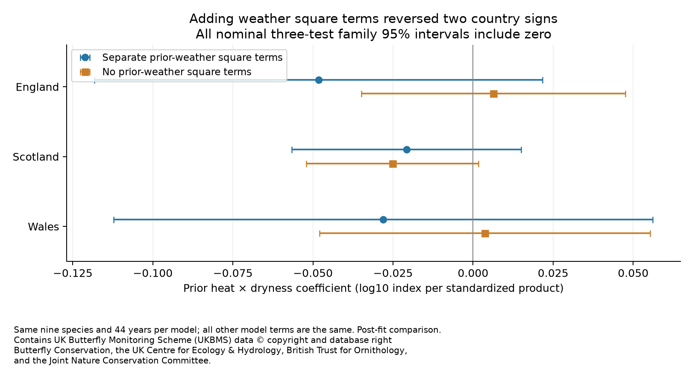
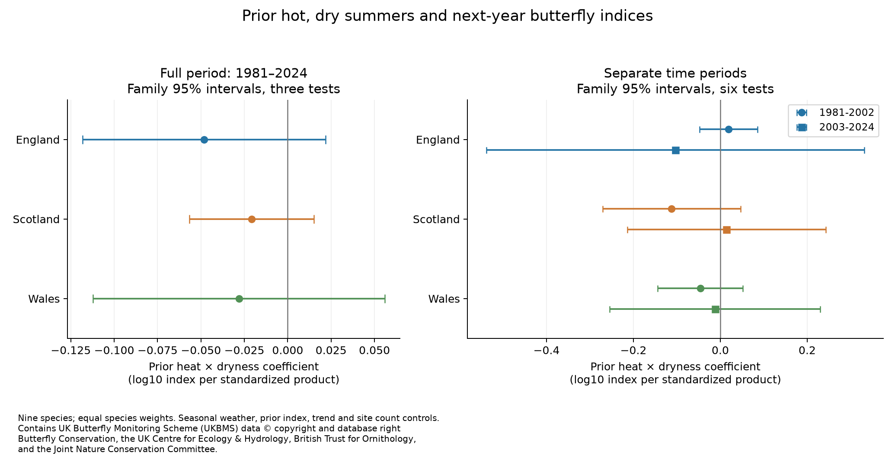
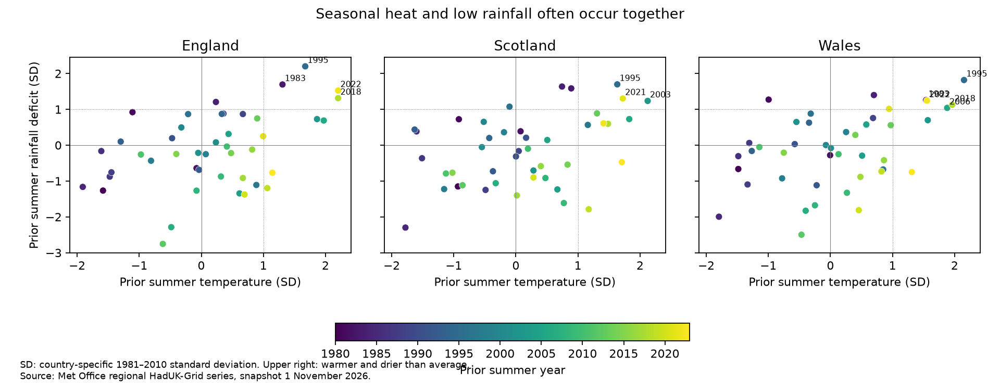

# Weather square terms changed interaction signs in two of three models of nine British butterfly species in 1981-2024

Adding separate prior-weather square terms changed the interaction sign in England and Wales. Without the square terms, beta was +0.0063, -0.0252 and +0.0037 in England, Scotland and Wales. With them, it was -0.0482, -0.0208 and -0.0281. The coefficients come from models that otherwise have the same terms and observations. All six three-test intervals included zero. This is sensitivity to model shape, not evidence that the biological effect changed.

The three full-period interaction estimates were negative, but all three corrected intervals included zero. The sign did not repeat in all country and period samples. Thus these data did not establish a common extra loss after a hot, dry summer under the tested models. This result does not establish that the effect is absent or small.



## Question and prior work

We ask whether prior summer heat and low rainfall have a combined link to next-year butterfly abundance beyond their separate effects. Damage to food plants is one possible explanation for a delayed response. More adult activity and a longer flight period can also increase counts in warm weather. The annual index does not separate these processes.

Roy and colleagues (2001) studied weather and British butterfly indices in 1976-1997. They found many current-summer associations. They also discussed delayed losses in some species after warm or dry weather. Prediction in later years was limited for many species. Their work supports a test across time, rather than a claim based on one fitted period. Our question concerns a fixed mixed-species mean and a heat by rainfall interaction; it is not a repeat of their species models. [Roy et al.](https://doi.org/10.1111/j.1365-2656.2001.00480.x).

The Generalized Abundance Index models seasonal counts and gaps in visits. This reduces one source of bias in annual indices. It does not make these indices direct counts of all living butterflies. [Dennis et al.](https://doi.org/10.1111/biom.12506).

We ran SCI searches in the signed campaign before choosing this question. We inspected the verified search cache while the full search ran. We read the campaign study of Japanese butterfly and swallow first sightings, [SCI 1a27bfa8](sci:sha256:1a27bfa85085253369c644d16904d7a96010f2bf3a4e035fedd3daaab94ae455). That study concerns dates in another network. We use no data or estimates from it. Its warning about detection also applies here. The local analysis plan was saved before outcome-weather models were fitted. This was not an external registration.

The full search finished after our primary fits and found a close prior study, [SCI e2f2fce4](sci:sha256:e2f2fce4a97d3f2fb9cb7b3a4d09597042952c93f8b42cd67bd145eeb704d3de). We read its verified text before signing this result. It used the same UKBMS release, climate snapshots and nine species in 1980-2024. It already found uncertain prior heat by dryness terms. It also showed how annual-change and level responses can have different signs. Our data are not an independent replication of that study. The new evidence here concerns sensitivity to separate prior-weather square terms and the loss of interaction information in shorter periods. We fit a prior abundance control and a linear trend; the prior study used another trend and included a current-weather interaction. Thus differences between the two studies cannot be assigned to curvature alone. Our direct comparison changes only the two prior-weather square terms within our own model. Files/PLAN_ADDITIONS.txt records this late prior-work review and the post-fit checks.

## Data and fixed sample

The UKBMS 2024 release gives log10 abundance indices by species, country and year. Each species-country series has an arbitrary offset that centers its long-run index near 2. The source combines standard transects, wider countryside surveys and targeted surveys. Its seasonal model accounts for missing parts of the flight period. Source weights give more weight to well-covered site-years. The number of contributing sites is also supplied. [UKBMS source](https://doi.org/10.5285/a70d8b0b-0ef5-484e-8195-42bcfd818229).

We first used coverage, without fitting weather models, to select species. A species needed all 45 annual indices from 1980 through 2024 and at least five sites in every year in England, Scotland and Wales. Nine species met this rule: Aglais urticae, Coenonympha pamphilus, Lycaena phlaeas, Maniola jurtina, Pieris brassicae, Pieris napi, Pieris rapae, Polyommatus icarus and Speyeria aglaja. Northern Ireland starts too late for the planned time comparison. The UK series includes the country records and is not used as another region.

The retained source panel has 1,215 species-country-years. For each country and year, we take the equal-weight mean of the nine log10 indices. This is the log of a geometric mean relative index. We use 1980 to supply the first prior index. The models then have 44 annual outcomes per country in 1981-2024, or 132 country-years in total. The same species contribute in every cell. No country means or estimates use a changing species list. These are selected, well-monitored species; they are not a representative sample of all butterflies.

Weather comes from the Met Office regional HadUK-Grid series. We use the published June-August mean temperature and total rainfall for each country. Each regional value averages 1 km grid cells. It is not a mean over the butterfly survey sites. [Met Office methods](https://www.metoffice.gov.uk/research/climate/maps-and-data/data/haduk-grid/methods).

For each country, heat is summer temperature minus its 1981-2010 mean, divided by its sample standard deviation. Dryness is mean rainfall minus summer rainfall, divided by its standard deviation over the same 30 years. Thus larger values mean warmer or drier summers. These seasonal measures do not diagnose drought, damaging heat, or local soil water. Temperature standard deviations are 0.67-0.74 C; rainfall standard deviations are 58-90 mm.

## Model and uncertainty

For each country, we fit the following annual model with equal weights:

`mean log10 index = intercept + linear year + prior mean index + prior heat + prior dryness + prior heat squared + prior dryness squared + beta * prior heat * prior dryness + current heat + current dryness + mean log site count + error`.

There are 11 fitted coefficients, including the intercept. The time variable is year minus 2002.5, divided by 10. Site count is the mean of the natural log site counts of the nine species. All weather terms are standardized as above. The separate square terms reduce the risk that a curved response to one weather variable appears as an interaction.

Beta is the mixed term in this response surface. A negative value means an extra negative departure from the separate heat and dryness terms. For a change from zero to +1 on each weather measure, the interaction adds beta log10 units. Its multiplicative contribution is 10 raised to beta. This is conditional on the other predictors. The product is also positive when both variables are negative, so it is not a flag for a hot, dry event. The full response also includes the main effects and square terms.

Annual country means, not the nine species rows, are the units for uncertainty. We use a Newey-West covariance with Bartlett weights through calendar lag 2 and an n/(n-k) correction. For gaps in a sensitivity sample, lag means a calendar-year gap. The reference is a t distribution with n-k degrees of freedom. Full-period intervals use a two-sided error rate of 0.05/3. Time checks use 0.05/6 across three countries and two periods. These give nominal family 95% coverage only if the covariance approximation is adequate. They are not exact small-sample guarantees.

Models in 1981-2002 and 2003-2024 use the same terms. They have only 22 years and 11 residual degrees of freedom each. The plan required negative estimates and family intervals below zero in all six time checks before a claim of a repeated link. This rule failed. It is deliberately strict and has low power here. We do not test whether the two period coefficients differ.

Countries contain separate survey populations, but they are not independent weather experiments. Prior summer temperature correlations between countries are 0.91-0.97. Rainfall-deficit correlations are 0.77-0.91. Common species and unmeasured national factors also connect the records. We therefore do not multiply regional evidence as if it were independent.

## Results

Each full model has 44 years and 33 residual degrees of freedom. Intervals in the next table correct for three tests.

| Country | Beta | Nominal family 95% interval | Interaction contribution at +1 heat and +1 dryness |
| --- | ---: | --- | ---: |
| England | -0.0482 | -0.1182 to +0.0217 | -10.5% |
| Scotland | -0.0208 | -0.0566 to +0.0150 | -4.7% |
| Wales | -0.0281 | -0.1122 to +0.0560 | -6.3% |

The last column is the extra contribution relative to the model with that product term set to zero. It is not the total effect of a hot, dry summer, a forecast, or a causal percent loss.

The split-period results do not give a repeated sign. All intervals in the next table include zero after correction for six tests.

| Country | Outcome period | Beta | Nominal family 95% interval |
| --- | --- | ---: | --- |
| England | 1981-2002 | +0.0187 | -0.0477 to +0.0852 |
| England | 2003-2024 | -0.1032 | -0.5382 to +0.3317 |
| Scotland | 1981-2002 | -0.1124 | -0.2711 to +0.0464 |
| Scotland | 2003-2024 | +0.0142 | -0.2142 to +0.2426 |
| Wales | 1981-2002 | -0.0460 | -0.1439 to +0.0519 |
| Wales | 2003-2024 | -0.0123 | -0.2543 to +0.2297 |



### Exposure support

Only four prior summers in England, three in Scotland and five in Wales exceed +1 standard deviation on both heat and dryness. The early and late samples have only one to three such summers each. The same events are often shared by countries. The continuous model uses all years, but strong joint events are sparse.



Condition numbers range from 45 to 657 across the planned fits. All model matrices have full rank. Full rank is not proof of useful separation. After the other terms are removed, the heat by dryness variance inflation factor is 2.0-4.8 in the full-period models. It rises to 5.2-68.0 in the time checks. Maximum leverage in those time checks is 0.74-0.90. This means that a few annual observations can have large effects on a fit. The short-period estimates and their HAC intervals need particular caution.

### Checks for bias and model choice

Removing current summer weather, removing site count, removing prior abundance, or adding current spring temperature kept all three full-period estimates negative. Their marginal 95% intervals included zero. Changing HAC lag to 1 or 3 did not establish a clear common link. These are sensitivity checks, not new confirmatory tests.

Omitting one species at a time gave beta ranges of -0.0538 to -0.0369 in England, -0.0258 to -0.0139 in Scotland, and -0.0336 to -0.0192 in Wales. Removing the outcome year after summer 1995, 2003, 2018 or 2022 did not reverse the full-period signs. These checks do not remove all effects of the events. Later outcomes can still contain a prior index from an omitted outcome year.

Requiring at least ten contributing sites for every selected species retained 44 years in England, 38 in Scotland and 30 in Wales. Beta was -0.0482, -0.0163 and +0.0278. All three marginal intervals included zero. This filter changes the years, not only data quality. The Welsh sign change therefore warns about coverage and time selection; it does not identify observation bias.

After inspecting high leverage and collinearity, we added two checks that were not in the initial plan. Dropping the two prior-weather square terms gave full-period beta values of +0.0063, -0.0252 and +0.0037. Their three-test intervals included zero. Dropping the single highest-leverage year in each fit gave one isolated negative family interval in early Scotland. The late Scottish interval still included zero. These post-fit results do not establish a repeated interaction. They show sensitivity to response shape and influential years. All 18 extra estimates are retained separately.


## Limits and interpretation

This is an observational test of one mixed-species response surface. A zero average interaction can hide opposite effects in species or habitats. The coverage rule favors common species and can exclude species of ecological interest. For example, Ringlet is absent from our nine-species set. A related campaign study tested Ringlet growth relative to Meadow Brown in England and Wales and also found no clear repeated rain slope ([SCI ff4e66e4](sci:sha256:ff4e66e4fd057450a4ab2f63761a779c802509d13e9c3e3791ebb13ac390cfdf)). It uses the same source products and a different response. Our average cannot stand in for its species-pair test. Habitat change, management, pesticides, host-plant condition and local microclimate are not measured. A linear time trend cannot remove all of these changes.

The source indices correct seasonal gaps, and a fixed species list prevents changing species composition. Site-count controls and site-count filters address only part of observation bias. We do not have visit-level detection data, changing site locations, habitat composition, or uncertainty draws for the source indices. Warm weather affects both ecology and the chance of seeing an adult. Current-weather terms cannot separate these effects. Prior abundance can contain measurement error and can mediate a weather effect. Checks without that term do not resolve the causal problem.

The small samples, sparse joint events, correlated regional weather and high leverage limit precision. HAC errors may be too small in short samples. The reported intervals can permit substantial adverse interactions. We do not treat an interval that includes zero as evidence of safety or equivalence. Air pollution, species distributions, true species loss, daily extremes and causal climate change are outside this test.

The useful output is a model sensitivity result and a set of exposure-information diagnostics for an existing evidence set. Adding separate weather curves changed two country signs. An apparent common full-period sign did not ensure a stable combined-weather response across time or model shape. The fixed-species panel is retained for inspection; it is not a new independent observation dataset. Site-level surveys and local weather, with enough independent extreme events, are needed to test the proposed food-plant mechanism.

## Data provenance

We reused shared data in place and did not change shared files. The table lists the dataset names and exact source-file SHA-256 hashes. All paths below are relative to `/mnt/dell-data/shared_datasets/`. Files/provenance.json gives absolute shared paths, source URLs, snapshot metadata, byte counts and the used ZIP member hash. The UKBMS release is collated indices 2024, DOI below. The six Met Office country series were last updated on 1 November 2026. Files under files/ retain the small public input tables, so the numerical analysis can run offline.

| Shared dataset and file | SHA-256 |
| --- | --- |
| ukbms-collated-indices-2024-eidc-20261108/ukbms_collated_2024.zip | `5f159c7f9cc992972bad17cca88961df30c48b60139a0ce9aeec95c4143b0bfd` |
| metoffice-england-tmean-monthly-20261108/England_Tmean.txt | `7c1251b2b5f416d9584e0aff97150443ce5a4c4dee79094ce8c759d3eed61f7b` |
| metoffice-england-rainfall-monthly-20261108/England_Rainfall.txt | `bbf218ff375b64b50b1e5a1a518865e2818775cfd26721f59a464518eb36c918` |
| metoffice-scotland-tmean-monthly-20261108/Scotland_Tmean.txt | `925ac3c7f1b6cac641a21f02c883ea62ae91cc578c50ef159773d62d57cc916e` |
| metoffice-scotland-rainfall-monthly-20261108/Scotland_Rainfall.txt | `8b0b2bcbdb099ae83b59c889127d7b47a89fb7187d8a09d626e37f33e85b6144` |
| metoffice-wales-tmean-monthly-20261108/Wales_Tmean.txt | `2a095626a2f35670d121344c61da14ca792b2e42b317771070e56daf437675d7` |
| metoffice-wales-rainfall-monthly-20261108/Wales_Rainfall.txt | `fd2bf28a6ab51e655d254c2941ff045335438fd1ccfef0b4001241bb262e369f` |

Botham, M.S., Middlebrook, I., Heywood, J., Harrower, C.A., Milborrow, J., Roy, D.B. (2025). United Kingdom Butterfly Monitoring Scheme: collated indices 2024. NERC EDS Environmental Information Data Centre. (Dataset). https://doi.org/10.5285/a70d8b0b-0ef5-484e-8195-42bcfd818229

Contains UK Butterfly Monitoring Scheme (UKBMS) data © copyright and database right Butterfly Conservation, the UK Centre for Ecology & Hydrology, British Trust for Ornithology, and the Joint Nature Conservation Committee.

Met Office climate data contain public sector information licensed under the Open Government Licence v3.0. Source data retain their attribution notices. See files/THIRD_PARTY_NOTICES.txt. Original text, derived data and figures use the SCI baseline terms. Code uses the MIT terms in LICENSE.

## Reproduce and inspect

Use Python 3.12 with numpy, pandas, scipy, matplotlib and statsmodels. Exact installed versions are in files/summary.json and files/environment.json. From the publication root, run:

```bash
REPLAY_DIR=$(mktemp -d)
cp -a files/. "$REPLAY_DIR/"
python "$REPLAY_DIR/analyze.py"
python "$REPLAY_DIR/diagnostics.py"
python "$REPLAY_DIR/post_diagnostics.py"
python "$REPLAY_DIR/shape_figure.py"
python "$REPLAY_DIR/validate.py"
cmp files/estimates.csv "$REPLAY_DIR/estimates.csv"
```

These commands write derived outputs in a new private temporary directory. They do not change the signed publication. Numerical inputs and all estimates are retained in files/. The independent validator checks all 69 planned and 18 post-fit models, raw country means, 264 weather calendar matches, all seven input hashes, interval arithmetic, and the HAC matrices for 65 fits with contiguous years. A pivoted QR solution agreed with the main solver to less than 1e-12. The largest HAC covariance difference from statsmodels was less than 1e-10. These checks test computation; they do not validate the ecological model or interval coverage.

To rebuild retained inputs from shared storage, run `python files/retrieve.py --output retrieved`. To retrieve from the recorded URLs into private storage instead, add `--download`. The script rejects a changed source hash. Current weather URLs can change after a new release; use the preserved input files or the exact shared snapshot when that occurs. No new download is needed for this bundle.

The plan, selected species-year rows, annual model panel, climate baselines, 69 planned estimates, 18 post-fit estimates, full design matrices, numerical validation, source hashes and code are included. Files/reproduction_check.json records a second complete analysis run. Full source archives are not required to inspect the derived evidence.

## Campaign record

Job: sci-1107-hp-climate-pollution-biodiversity-a0fd104999c2. Topic: climate-pollution-biodiversity. Machine: hp. Account: codex-myxtap. Campaign: 11_07_2026. Model: gpt-6.1-sol, high reasoning effort, through the Codex harness in T3 Code. The campaign-machine key signs this result. The signature is not a personal authorship claim. This bundle is stored locally and is not submitted to a remote service.
