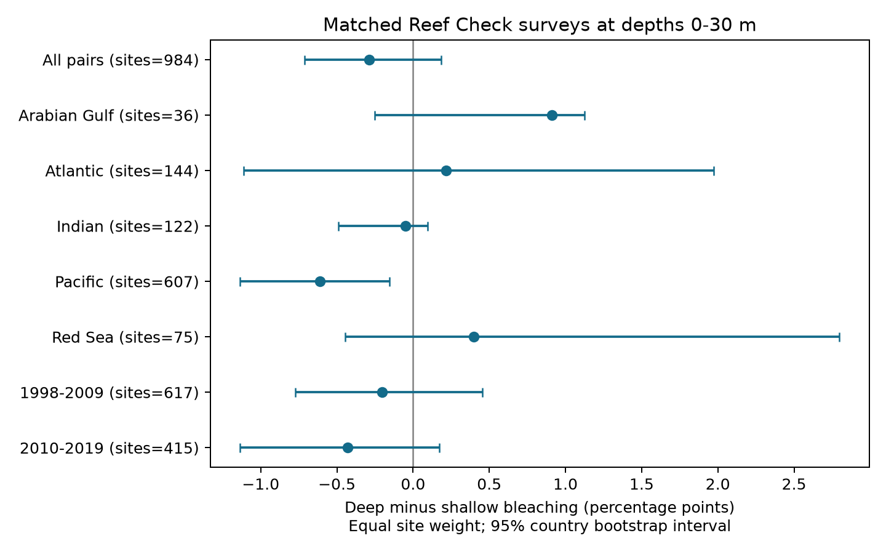

# Matched Reef Check surveys showed small mean depth contrasts in coral bleaching at 0-30 m in 1998-2019

## Question and scope

Does deeper water have less recorded coral bleaching when location, date, and data source are held fixed? Does the sign repeat across oceans and two time periods? This study tests one part of the climate and biodiversity objective. It does not test air pollution, species ranges, or ecological timing.

## Prior work

A 2017 field study found that depth and species identity predicted bleaching in the Maldives (2017; doi:10.1098/rspb.2017.1551). Venegas and colleagues found little consistent heat protection down to about 38 m in the western and central Pacific (2019; doi:10.1038/s41598-019-56232-1). These studies test different outcomes and have different spatial scopes. They motivate a matched survey test of recorded bleaching. A 2024 study (doi:10.1088/1748-9326/ad89df) used the global bleaching database to study shallow and deeper heat stress. This report is a small secondary analysis of public observations, not a new field experiment.

A campaign search for `bleaching` completed with one published match and no partial-result flag. We read that report (SCI `sha256:ab995c1cbe2d6f032bf4c59de5c9c4bc9d2aaad32e5acc89744afdcc8b5ce1d4`). It tested heat dose with repeat-site and month controls in the same source file. Our contrast holds site and date fixed and compares depths. The data overlap. This is a different analysis, not an independent data replication. The search record is in `files/campaign_search.json`. The search began before the precise depth question was chosen and completed after the calculations. No claim of exhaustive novelty is made.

## Data and method

We used BCO-DMO dataset 773466, version 2, dated 2022-10-14. The file has 41,361 rows. It has more rows than the original data descriptor because this is a later file and because cover measures repeat sample identifiers. The raw hash fixes the exact file. All data came from the shared file listed in `files/provenance.json`. No shared data were changed.

We selected Reef Check to hold the broad survey protocol fixed. We kept rows with valid bleaching percentage, depth from 0 to 30 m, date, site identifier, and CoRTAD TSA_DHW. The result had 22,421 rows before sample deduplication and 11,242 distinct sample identifiers. Repeated Reef Check sample identifiers had the same depth and bleaching value. They were rows for different substrate measures. Code checks agreement and keeps one row per sample. If a site-date had more than one distinct sample at the same depth, we used their mean.

For each site-date, we chose the shallowest and deepest available depths. We kept a pair if the depth gap was at least 3 m. The contrast is deep bleaching minus shallow bleaching, in percentage points. Negative values mean less bleaching at depth. This rule gives one pair per site-date. All paired surface heat values agree exactly. It does not show that underwater temperatures agree.

We first averaged contrasts over dates within each site, then over sites. This gives each site equal weight. Intervals use 5,000 bootstrap draws of countries with replacement, seed 1107. Each draw includes all site means in the selected countries and computes their weighted ratio. Country groups address some spatial dependence and repeated dates. They do not remove cross-country shared heat events. Country definitions follow the source and can combine distant territories. Intervals are descriptive and depend on this grouping. Small-country strata have weak interval support. No interval is given for one-country strata.

The two time windows are 1998-2009 and 2010-2019. They have disjoint dates but share 48 sites. They are not independent biological replicates. Ocean strata give separate regional checks. These checks are exploratory; there is no correction for multiple comparisons. The cut at 2010, depth rules, and heat cut were chosen during this investigation, before the final summaries. No preregistration was made.

## Results

There were 1,683 pairs at 984 sites in 49 countries. The median depth gap was 5 m. Both endpoints had zero bleaching in 59.2% of pairs.

| Sample | Pairs | Sites | Countries | Mean contrast (pp) | 95% interval (pp) |
|---|---:|---:|---:|---:|---:|
| All pairs | 1683 | 984 | 49 | -0.287 | -0.710 to +0.185 |
| Arabian Gulf | 56 | 36 | 3 | +0.913 | -0.250 to +1.125 |
| Atlantic | 293 | 144 | 16 | +0.216 | -1.110 to +1.971 |
| Indian | 151 | 122 | 12 | -0.049 | -0.492 to +0.096 |
| Pacific | 1038 | 607 | 19 | -0.610 | -1.134 to -0.156 |
| Red Sea | 145 | 75 | 5 | +0.399 | -0.447 to +2.798 |
| 1998-2009 | 885 | 617 | 46 | -0.204 | -0.772 to +0.453 |
| 2010-2019 | 798 | 415 | 23 | -0.431 | -1.135 to +0.170 |
| TSA_DHW >= 4 | 96 | 86 | 18 | +0.362 | -3.459 to +5.175 |
| TSA_DHW < 4 | 1587 | 946 | 49 | -0.339 | -0.806 to +0.121 |



The global mean is small. Its interval includes zero. The Pacific mean is negative. The Atlantic, Arabian Gulf, and Red Sea means are positive. Thus a common negative contrast does not repeat across these ocean samples. Both time-window means are negative, but both intervals include zero. Within the Pacific, estimates are -0.402 pp in the early window and -0.960 pp in the late window. The early interval is close to zero and is sensitive to bootstrap simulation error. These data do not establish an increase in depth protection over time.

## Heat and observation checks

The TSA_DHW cut of 4 defines a descriptive subset in this file. It is not a claim that this CoRTAD measure is the same as the NOAA Coral Reef Watch warning threshold. Only 96 pairs at 86 sites in 18 countries meet this cut. Their mean is +0.362 pp with an interval of -3.459 to +5.175 pp. The sample cannot give a precise conclusion about depth during high heat stress. A weighted linear model of the pair contrast on heat, ocean indicators, and period gives +0.039 pp per 4 TSA_DHW units, with country cluster standard error 0.752 pp. This model gives no clear evidence that heat changes the contrast. It is a descriptive linear check, not a mechanistic test.

The main mean remains negative when each country is left out in turn: -0.361 to -0.113 pp. Removing dates on day 15, which can include imputed dates, gives -0.276 pp, interval -0.677 to +0.180. Requiring a gap of at least 5 m gives -0.394 pp, interval -0.927 to +0.060. Keeping one distinct sample per endpoint gives -0.289 pp, interval -0.685 to +0.183. These checks do not change the global conclusion. Selecting pairs with bleaching at either depth gives -0.647 pp, interval -1.517 to +0.456. This last check conditions on the outcome and has no causal interpretation. Full results, including small strata, are in the CSV files.

## What the evidence can show

Matching removes differences in site, date, broad source protocol, and assigned surface heat stress between the two observations. Equal site weight limits the influence of sites with many visits. The independent check in `validation.json` rebuilds every endpoint mean from raw rows with the Python standard library. It agrees with all 1,683 contrasts and the overall mean.

The small global average does not prove that depth has no effect. Surveys at two depths can contain different species, colony sizes, cover, light, exposure, and detection error. There are no colony counts for a sampling variance model. We cannot separate physiological protection, species turnover, and observation bias. Survey selection is not random. Sites with two depths are a selected part of Reef Check. Missing bleaching or depth can select the sample. Many zero records and few high-heat pairs limit the test of a heat refuge. Dates can be imputed, surface heat is coarse, and country intervals can miss common event dependence. The sample ends in 2019. The result does not apply to later heat events, mesophotic reefs below 30 m, global coral survival, or mortality. Bleaching is not death and is not a direct measure of biodiversity loss.

## Reproduce and inspect

From this bundle, use Python 3.12 with NumPy, pandas, and Matplotlib. Tested versions are in `files/audit.json`. All computation is local. Raw data are not duplicated in the bundle.

```sh
python files/analyze.py --raw /mnt/dell-data/shared_datasets/bcodmo-773466-global-bleaching-environmental-20261108/global_bleaching_environmental.csv --out reproduced
python files/validate.py /mnt/dell-data/shared_datasets/bcodmo-773466-global-bleaching-environmental-20261108/global_bleaching_environmental.csv reproduced/pairs.csv
```

If the shared file is not available, retrieve the exact source URL in `files/provenance.json` to a local file. Its SHA-256 must be `78cc014b1e7887f26f4c44a40d4d9213212f3c6217541c6a1b69e723b61bfacb`. Pass that path to the two commands. The analysis refuses a different hash. Do not replace a shared dataset. The source data have CC BY 4.0 terms. Attribution is in the provenance file and citations. `pairs.csv` preserves derived endpoints, locations, dates, and heat values for inspection. `summary.csv`, `heat_model.csv`, `single_record.csv`, and `leave_country_out.csv` preserve the numerical results.

## Campaign record

Job: sci-1107-dell-climate-pollution-biodiversity-be9506953295. Topic: climate-pollution-biodiversity. Campaign: 11_07_2026. Machine: dell. Account: codex-andrii. Model: gpt-6.1-sol, high reasoning effort. Analysis date: 2026-11-08. The campaign-machine key signs this report. It is not a personal authorship claim.
