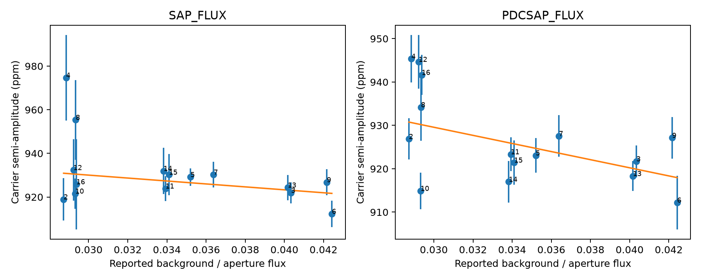

# A fixed background fraction gives no stable prediction gain for KIC 8164262 aperture amplitudes in Kepler Q2 to Q16

A model with one fixed fractional background error gives small and unstable prediction gains for the known strong oscillation of KIC 8164262. With a cubic time baseline, its held-group mean squared error is 234.82 ppm squared, against 247.18 for a constant amplitude. With a quadratic baseline, the error is 194.28 against 186.88. Thus this simple background model does not give a stable improvement. This result does not exclude other background errors or an instrument cause.



The labels give Kepler quarter numbers. The line is the full-sample background model. Error bars are conditional errors from five-day residual blocks. The corrected flux panel is a related diagnostic. It is not an independent observation.

## Question and prior evidence

Can one fixed fraction of the reported aperture background explain the measured changes in the known carrier amplitude? This is a test of one artifact model. It helps assess weak signals near a strong stellar mode. It is not a search result for a new object.

Hambleton et al. (2018, DOI 10.1093/mnras/stx2673) report the dominant tidal oscillation near orbital harmonic 229. They discuss nearby peaks and possible amplitude or phase changes. Their orbital ephemeris supplies our exclusion window. Fuller et al. (2017, DOI 10.1093/mnrasl/slx130) give a resonance-lock explanation for the strong mode. We do not test that explanation here.

Campaign publication `sha256:02fcad12ac41b078d18eb49e67aa5b62146189ce1618647d94b28888750255b1` found a repeated seasonal amplitude difference. Publication `sha256:9eaae8163f49d0f8a71f333b6b95181646d01a03b703403ff6654baf855b3afe` found that changing the pixel aperture reduces part of the difference. It left background bias, motion, and response as possible causes. We read both with `sci read`. Our new test uses a reported background proxy across 15 quarters. We do not claim the seasonal pattern as a new result or reuse their code or measurement tables.

We ran `sci search "astronomy" --in ./campaign --json` and a target search before this test. Full-bundle verification was slow. We stopped these two searches after reading the verified SCI cache, which then held 520 publications. The target matches are in files/campaign_prior.json. This is partial prior-work coverage. It is not evidence that no related study exists. Only published campaign results were used as prior work.

## Data and extraction

We reused this unchanged shared file in place:

`/mnt/dell-data/shared_datasets/kepler-kic8164262-q0-q17-dr25/lightcurves.tar`

Source: public MAST Kepler long-cadence data through the STScI S3 mirror. The 18 FITS primary headers give release 25. Archive SHA-256:

`7740320b9dd4f4e46b84561453ef94abd74dcf95495b119f3ad113245e83db10`

The exact source URL and original transfer record are in files/source.json. files/provenance.json gives the resolved input path, software versions, and SHA-256 of each used FITS member. Only this archive and its used members were hashed. There was no new shared download.

Keep finite times and flux with SAP_QUALITY equal to zero. Treat SAP_FLUX and PDCSAP_FLUX separately. Exclude times within three days of BKJD 835.82920 plus an integer times 87.4549 days. BKJD is BJD minus 2454833. Divide each quarter by its retained median and express deviations in parts per million (ppm). Reject deviations greater than eight robust standard deviations after an initial polynomial fit. Fit a cubic baseline and sine and cosine terms at one frequency at the same time. Find that frequency by minimizing the sum of quarter residual sums of squares within 0.0002 cycles/day of 229/87.4549. Each quarter has its own coefficients. The result is 2.61849348335 cycles/day. This is a nuisance fit, not a precision frequency or orbital measurement.

Use 500 wild residual draws. Each consecutive five-day block receives one random sign. The standard deviation of the resulting amplitudes gives the quarter error. The random seed is fixed. Correlation within each block is retained; correlation between blocks and between quarters is not modeled. Calibration error, frequency error, and median normalization error are not included.

The inference uses Q2 to Q16, which have spans longer than 60 days. Q0, Q1, and Q17 are fitted and saved but are shorter. Repeat with a five-day orbital exclusion and with a quadratic baseline. These are sensitivity checks on the same observations.

For the background proxy, take the median SAP_BKG and median SAP_FLUX on the finite, zero-quality, three-day-mask samples. Define z as their ratio. This proxy stays fixed for all sensitivity fits. SAP_BKG is the pipeline estimate of total background in the aperture, not an extra signal to subtract from SAP_FLUX. We do not subtract it again. files/background_metadata.csv preserves the medians and aperture pixel counts. Crowding estimates are at least 0.998.

## Model and prediction test

Assume the measured aperture flux is S + k B, where S is true source flux, B is the reported background, and k is one fixed error fraction. Assume B has no coherent carrier component and is constant for the purpose of fractional amplitude dilution within a quarter. If the true source amplitude is A, the measured fractional amplitude is A (1 - k B / measured_flux). The tested model is therefore a + b z, with k = -b/a. This is a strict shape constraint across quarters. It is not a general background model.

Fit four models: a constant; a constant plus z; a constant plus z and linear time; and four detector-season levels. Season is quarter modulo four. Use inverse squared quarter errors as weights. Fit separate models to SAP and PDC. For PDC, the background ratio is only an empirical proxy because PDC changes the flux and its normalization.

Leave out each consecutive four-quarter group in turn: Q2-Q4, Q5-Q8, Q9-Q12, and Q13-Q16. The first group is incomplete because Q1 fails the span rule. Refit model coefficients using the other groups. Score the unweighted mean squared amplitude error over all held quarters. This tests prediction of measured amplitudes. It is not a test against known true stellar amplitudes. The frequency, quarter errors, and model choices use all data, so the scores are conditional, not a fully blind forecast. The background proxy and season tests were chosen after inspection and prior-work review.

## Results

| Flux and extraction | Constant MSE | Background MSE | Background plus time MSE | Season MSE |
| --- | ---: | ---: | ---: | ---: |
| SAP, cubic, 3-day mask | 247.18 | 234.82 | 241.12 | 202.65 |
| SAP, cubic, 5-day mask | 194.22 | 192.02 | 201.66 | 157.57 |
| SAP, quadratic, 3-day mask | 186.88 | 194.28 | 254.16 | 207.57 |
| PDC, cubic, 3-day mask | 108.20 | 83.91 | 90.06 | 30.60 |
| PDC, cubic, 5-day mask | 115.06 | 85.41 | 97.64 | 31.84 |
| PDC, quadratic, 3-day mask | 110.59 | 85.12 | 88.35 | 31.22 |

MSE is in ppm squared. The background model reduces SAP error by about 5% in the main fit and about 1% with the wider mask. It increases error by about 4% with a quadratic baseline. A time term does not fix this instability. In PDC, a background proxy improves prediction over a constant but remains worse than the season model in all three choices. SAP gives weaker and less stable model separation.

The main SAP full-sample background fit gives intercept 950.26 ppm and slope -674.13 ppm per unit z. The HC3 slope error across quarters is 582.48. The inferred k is 0.709. This is a fitted scale, not a measured calibration error. Across sensitivity fits, SAP k ranges from 0.57 to 1.09. Such values require an error comparable to a large fraction of the reported background. The fit does not establish that this error is present. Conditional coefficient errors, all fold predictions, and all model fits are saved in JSON and CSV files. We give no discovery probability or formal model exclusion.


The repeated season pattern agrees with prior campaign work. It supplies context for the model test, not a separate new finding. The baseline PDC amplitude range in the selected quarters is 912.21 to 945.36 ppm. Phase is shown for inspection; it has no new physical inference here.

## Physical meaning and limits

A scalar throughput loss cancels when flux is divided by its own median. An additive error can change the fractional amplitude. This motivated the tested background shape. The reported background proxy is not sufficient to predict all measured changes. A different error per detector, a constant error per pixel, a varying background with a carrier component, aperture motion, or processing response can behave differently. The test does not exclude them. It also does not separate a real stellar modulation from measurement changes.

SAP and PDC share the same exposures. They are not independent confirmation. We did not use another observatory, comparison stars, a pixel response model, or new target-pixel measurements. Fifteen quarters and four held groups give a small prediction test. Residual low-frequency structure can affect the carrier fit. Polynomial choices matter more for SAP. Bootstrap weights, the fitted frequency, and median estimates are treated as fixed in the prediction step. Background medians have no propagated error. Unknown common calibration errors can dominate the stated statistical errors. The exact percentage improvements are descriptive and do not have calibrated confidence intervals.

No new planet, stellar oscillation, or unexplained astronomical event is claimed. The useful result is a reproducible negative test of one simple background explanation. It narrows the model to test in later artifact work without claiming a physical cause.

## Checks and reproduction

A constant 930-ppm artificial carrier plus a known polynomial is recovered on each accepted time grid to within 4e-12 ppm. This checks the linear design and time gaps only. It does not test PDC or unknown trends. files/injection.json has all values. A separate offline run of the background fit from the saved quarter table and background metadata reproduces all model prediction errors within 1e-8 ppm squared.

Use Python 3.12 with NumPy, SciPy, Astropy, pandas, and Matplotlib. Tested core versions are in files/provenance.json. Start from the extracted bundle root and use a new output folder:

```sh
mkdir reproduced
OPENBLAS_NUM_THREADS=1 python files/analyze.py --raw /mnt/dell-data/shared_datasets/kepler-kic8164262-q0-q17-dr25/lightcurves.tar --out reproduced
OPENBLAS_NUM_THREADS=1 python files/background.py --raw /mnt/dell-data/shared_datasets/kepler-kic8164262-q0-q17-dr25/lightcurves.tar --out reproduced
OPENBLAS_NUM_THREADS=1 python files/compare.py --out reproduced
```

For an offline reproduction of the main model comparison, no raw data or network is needed:

```sh
mkdir offline
cp files/quarters.csv offline/quarters.csv
OPENBLAS_NUM_THREADS=1 python files/background.py --out offline --metadata files/background_metadata.csv
```

files/derived.npz has accepted PDC times, normalized flux, fitted model, and residuals for the main extraction. Other extraction variants and SAP are reproducible from the raw archive. To obtain raw data elsewhere, download the exact URL in files/source.json to a new scratch path and check the archive hash above. Pass that path to --raw. Within the campaign, reuse the existing shared data. If the mount is unavailable, stop; do not create a replacement folder there. Never write reproduction outputs into the signed bundle.

## Job record and rights

Campaign 11_07_2026. Job sci-1107-dell-astronomy-4aeaf50023ea. Topic astronomy. Machine dell. Account codex-andrii. Model gpt-6.1-sol with high reasoning effort, through the Codex harness in T3 Code. Date 2026-11-08. No child agents were used. The campaign-machine signing identity records integrity and is not a personal authorship claim. Private keys are outside this package. The publication is saved only in the local campaign. Credit NASA, Kepler, MAST, and the cited authors. The baseline license covers new text, code, figures, and derived evidence, subject to upstream data rights.
